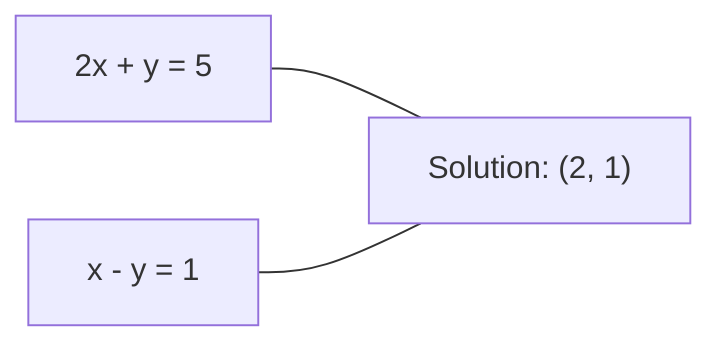
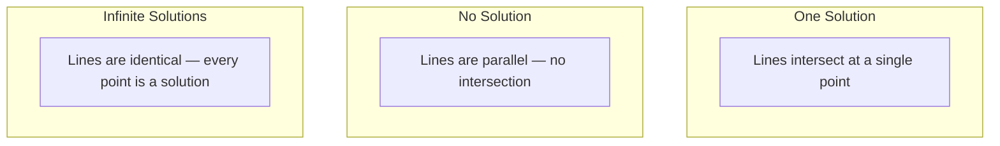

# الأنظمة الخطية

> الحل$Ax = b$هي أقدم مشكلة في الرياضيات التي لا تزال تشغيل شبكة عصبية.

**Type:** Build
**Language:**بايثون
**Prerequisites:** Phase 1, Lessons 01 (Linear Algebra Intuition), 02 (Vectors & Matrices), 03 (Matrix Transformations)
**Time:** ~120 minutes

## أهداف التعلم

- حل$Ax = b$باستخدام القضاء على غوسيان مع تحويل جزئي واستبدال الخلف
- المصفوفات العوامل مع LU، QR، وتفكيكات تشولسكي وتشرح متى كل مناسب
- استنباط المعادلات الطبيعية لأقل مربعات وربطها إلى التراجع الخطوي والخريج
- تشخيص الأنظمة السيئة باستخدام رقم الحالة وتطبيق التنظيم لتحقيق استقرارها

## المشكلة

كل مرة تدرب فيها رجعة خطية، تحل نظام خطي. كل مرة تقوم فيها بحساب أقل مربعات، تحل نظام خطي. كل مرة تقوم فيها طبقة شبكة عصبية بحسابات`y = Wx + b`عندما تضيفون التنظيم، تقومون بتعديل النظام. عندما تستخدمون عمليات غوسيان، تقومون بتعديل ماتريكس. عندما تقومون بتعديل ماتريكس التغيرات على مسافة مهالانوبي، تحلون نظام خطي.

المعادلة$Ax = b$يظهر في كل مكان$A$هي ماتريكس من المعاملات المعروفة. $b$هو متجه للمخرجات المعروفة. $x$هو متجه المجهول الذي تريد العثور عليه.$A$هو ماتريسك البيانات$b$هو متجه الهدف الخاص بك، و $x$هو متجه الوزن. النموذج بأكمله يقلل إلى: العثور $x$مثل هذا$Ax$هو أقرب إلى$b$-أقدر الإمكان

هذه الدروس تبني كل طريقة رئيسية لحل هذه المعادلة من الصفر. ستفهم لماذا بعض الطرق سريعة والبعض الثابتة، لماذا تعمل بعضها فقط لنظم مربعة والبعض الآخر يتعامل مع أكثر من حد، ولماذا عدد الحالة في المصفوفة تحدد ما إذا كان إجابتك تعني أي شيء على الإطلاق.

## المفهوم

### ما يعني Ax = b جغرافيا

نظام المعادلات الخطية له تفسير هندسي. كل معادلة تعريف خطة خارقة. الحل هو النقطة (أو مجموعة من النقاط) حيث تتقاطع جميع خطات خارقة.

```
2x + y = 5          Two lines in 2D.
x - y  = 1          They intersect at x=2, y=1.
```



ثلاثة أشياء يمكن أن تحدث:



في شكل ماتريك، "حل واحد" يعني $A$"لا حل" يعني أن النظام غير متسق. "الحلول المتناهية" تعني$A$معظم مشاكل ML تقع في فئة "لا حلاً دقيقاً" لأن لديك معادلات (نقاط بيانات) أكثر من المعروفات (فعايير). هذا هو المكان الذي يأتي فيه أقل مربعات.

### صورة العمود مقابل صورة الصف

هناك طريقتان للقراءة$Ax = b$. . .

**Row picture.**كل صف من$A$تعريف معادلة واحدة. كل معادلة هي طائرة خارقة. الحل هو حيث تقاطع كل منها.

**Column picture.**كل عمود من$A$السؤال يصبح: ما هو الجمع الخطى من أعمدة $A$تنتج$b$- ماذا ؟

```
A = | 2  1 |    b = | 5 |
    | 1 -1 |        | 1 |

Row picture: solve 2x + y = 5 and x - y = 1 simultaneously.

Column picture: find x1, x2 such that:
  x1 * [2, 1] + x2 * [1, -1] = [5, 1]
  2 * [2, 1] + 1 * [1, -1] = [4+1, 2-1] = [5, 1]   check.
```

صورة العمود أكثر أساسية.$b$يقع في مساحة العمود$A$إذا كان هناك حل$b$لا، تجد أقرب نقطة في مساحة العمود.

### القضاء على غوسيان

تحويلات القضاء على غوسيان $Ax = b$إلى نظام مثلث أعلى$Ux = c$و التي تحل بها عن طريق استبدال الظهر. انها الطريقة الأكثر مباشرة.

الخوارزمية:

```
1. For each column k (the pivot column):
   a. Find the largest entry in column k at or below row k (partial pivoting).
   b. Swap that row with row k.
   c. For each row i below k:
      - Compute multiplier m = A[i][k] / A[k][k]
      - Subtract m times row k from row i.
2. Back substitute: solve from the last equation upward.
```

مثال:

```
Original:
| 2  1  1 | 8 |       R2 = R2 - (2)R1     | 2  1   1 |  8 |
| 4  3  3 |20 |  -->  R3 = R3 - (1)R1 --> | 0  1   1 |  4 |
| 2  3  1 |12 |                            | 0  2   0 |  4 |

                       R3 = R3 - (2)R2     | 2  1   1 |  8 |
                                       --> | 0  1   1 |  4 |
                                           | 0  0  -2 | -4 |

Back substitute:
  -2 * x3 = -4    -->  x3 = 2
  x2 + 2  = 4     -->  x2 = 2
  2*x1 + 2 + 2 = 8 --> x1 = 2
```

تكاليف القضاء على غوسيان $O(n^3)$العمليات.$1000 \times 1000$نظام، وهذا حوالي مليار عملية نقطة عائمة. سريعة، ولكن يمكنك أن تفعل أفضل إذا كنت بحاجة لحل أنظمة متعددة مع نفس $A$. . .

### التحول الجزئي: لماذا يهم

بدون محور، يمكن أن تفشل القضاء على غوسيان أو ينتج قمامة. إذا كان عنصر محور هو صفر، تقوم بتقسيمها عن طريق صفر. إذا كان صغيرًا، تقوم بتعزيز أخطاء التدريب.

```
Bad pivot:                       With partial pivoting:
| 0.001  1 | 1.001 |            Swap rows first:
| 1      1 | 2     |            | 1      1 | 2     |
                                 | 0.001  1 | 1.001 |
m = 1/0.001 = 1000              m = 0.001/1 = 0.001
R2 = R2 - 1000*R1               R2 = R2 - 0.001*R1
| 0.001  1     | 1.001   |      | 1      1     | 2     |
| 0     -999   | -999.0  |      | 0      0.999 | 0.999 |

x2 = 1.000 (correct)            x2 = 1.000 (correct)
x1 = (1.001 - 1)/0.001          x1 = (2 - 1)/1 = 1.000 (correct)
   = 0.001/0.001 = 1.000        Stable because the multiplier is small.
```

في حسابات النقاط العائمة بدقة محدودة، يمكن أن تفقد النسخة غير المتحركة أرقام كبيرة. يختار المحور الجزئي دائمًا أكبر محور متاح لتقليل تضخيم الخطأ.

### تدهور LU

عوامل التفكك الوطني $A$إلى المصفوفة الثلاثية السفلى$L$و المصفوفة الثلاثية العليا$U$: $A = LU$- المُؤمنون$L$المصفوفة تخزين المضاعفات من القضاء على غوسيان.$U$المصفوفة هي نتيجة القضاء

```
A = L @ U

| 2  1  1 |   | 1  0  0 |   | 2  1   1 |
| 4  3  3 | = | 2  1  0 | @ | 0  1   1 |
| 2  3  1 |   | 1  2  1 |   | 0  0  -2 |
```

لماذا العامل بدلاً من مجرد القضاء عليه؟$L$و$U$، حل$Ax = b$لأي شيء جديد$b$تكاليف فقط $O(n^2)$:

```math
\begin{aligned}
Ax &= b \\
LUx &= b \\
&\text{Let } y = Ux\text{:} \\
Ly &= b \quad \text{(forward substitution, } O(n^2)\text{)} \\
Ux &= y \quad \text{(back substitution, } O(n^2)\text{)}
\end{aligned}
```

- نعم$O(n^3)$يتم دفع التكلفة مرة واحدة خلال التصوير.$O(n^2)$إذا كنت بحاجة لحل 1000 نظام بنفس$A$ولكن مختلفة$b$ويكترات، LU يحتفظ عامل 1000/3 في إجمالي العمل.

مع التحويل الجزئي، تحصل على$PA = LU$أين$P$هي ماتريكيس محول تسجل تبادل الصف.

### تدمير QR

عوامل تدمير القوة القصرية $A$إلى المصفوفة المُستقيلة$Q$و المصفوفة الثلاثية العليا$R$: $A = QR$. . .

المصفوفة المُتَمَرَّكَة لديها خصائص$Q^T Q = I$عموداتها متجهات طبيعية أوثنية$Q$يحافظ على الطول والزوايا.

```
A = Q @ R

Q has orthonormal columns: Q^T Q = I
R is upper triangular

To solve Ax = b:
  QRx = b
  Rx = Q^T b    (just multiply by Q^T, no inversion needed)
  Back substitute to get x.
```

إن QR أكثر استقرارًا عدديًا من LU لحل مشاكل أقل مربعات.$Q$عمود بعد عمود:

```
Given columns a1, a2, ... of A:

q1 = a1 / ||a1||

q2 = a2 - (a2 . q1) * q1        (subtract projection onto q1)
q2 = q2 / ||q2||                (normalize)

q3 = a3 - (a3 . q1) * q1 - (a3 . q2) * q2
q3 = q3 / ||q3||

R[i][j] = qi . aj    for i <= j
```

كل خطوة تُزيل المكون على طول كل الخطوة السابقة$q$المتجهات، والتي تترك فقط الاتجاه المُستقيم الجديد.

### تدمير تشوليسكي

متى$A$هو متماثل ($A = A^T$) والإيجابية المحددة (كل القيم الخاصة إيجابية) ، يمكنك أن تفاعلها ك $A = L L^T$أين$L$هذا هو تدمير تشوليسكي

```
A = L @ L^T

| 4  2 |   | 2  0 |   | 2  1 |
| 2  5 | = | 1  2 | @ | 0  2 |

L[i][i] = sqrt(A[i][i] - sum(L[i][k]^2 for k < i))
L[i][j] = (A[i][j] - sum(L[i][k]*L[j][k] for k < j)) / L[j][j]    for i > j
```

تشوليسكي أسرع مرتين من LU ويتطلب نصف التخزين.

- المصفوفات المتغيرة هي شبه محددة إيجابية متماثلة (محددة إيجابية مع التنظيم).
- ماتريكس النواة في عمليات غوس هو متماثل إيجابي محدد.
- الحد الأدنى من المكونات الملتوية هي الحد الأدنى من المكونات الملتوية المحددة.
- $A^T A$هو دائماً متماثل الإيجابي شبه محدد.

في عمليات غوسيان، تقوم بتحليل ماتريكس النواة$K$مع تشولسكي، ثم حل$K \alpha = y$العامل تشوليسكي يعطيك أيضاً مقياس الحساب للوفرة الحدوديّة:$\log \det(K) = 2 \sum \log(\mathop{\mathrm{diag}}(L))$. . .

### أقل مربعات: عندما لا يكون لدى Ax = b حل دقيق

إذا$A$هو$m \times n$مع$m > n$(مزيد من المعادلات من غير المعروفة) ، النظام هو أكثر تحديدًا. لا يوجد حل دقيق. بدلاً من ذلك، تقليل الخطأ التربيعي:

```
minimize ||Ax - b||^2

This is the sum of squared residuals:
  sum((A[i,:] @ x - b[i])^2 for i in range(m))
```

الحد الأدنى يرضى المعادلات الطبيعية:

```math
A^T A x = A^T b
```

المشتق: توسع$\lVert Ax - b \rVert^2 = (Ax - b)^T (Ax - b) = x^T A^T A x - 2 x^T A^T b + b^T b$خذ التراجع فيما يتعلق بـ$x$، أضعها إلى الصفر:$2 A^T A x - 2 A^T b = 0$. . .

```
Original system (overdetermined, 4 equations, 2 unknowns):
| 1  1 |         | 3 |
| 1  2 | x     = | 5 |       No exact x satisfies all 4 equations.
| 1  3 |         | 6 |
| 1  4 |         | 8 |

Normal equations:
A^T A = | 4  10 |    A^T b = | 22 |
        | 10 30 |            | 63 |

Solve: x = [1.5, 1.7]

This is linear regression. x[0] is the intercept, x[1] is the slope.
```

### المعادلات الطبيعية = التراجع الخطى

الاتصال دقيق. في التراجع الخطى، ماتريك بياناتك$X$لديه صف واحد لكل عينة وعمدة واحدة لكل ميزة. متجه الهدف الخاص بك $y$يحتوي على مدخل واحد لكل عينة.$w$يرضى:

```math
\begin{aligned}
X^T X w &= X^T y \\
w &= (X^T X)^{-1} X^T y
\end{aligned}
```

هذا هو الحل المكتوب للعودة الخطية. كل مكالمة إلى`sklearn.linear_model.LinearRegression.fit()`يحسب هذا (أو ما يعادله عبر QR أو SVD).

إضافة مصطلح التنظيم $\lambda I$إلى المصفوفة وتحصل على رجعة التخفيف:

```math
\begin{aligned}
(X^T X + \lambda I) w &= X^T y \\
w &= (X^T X + \lambda I)^{-1} X^T y
\end{aligned}
```

يجعلها المصفوفة أكثر تحفيزاً (من السهل أن تُعكس بدقة) ويمنع الإفراط من خلال تقليص الوزن نحو الصفر.$X^T X + \lambda I$هو دائماً متماثل إيجابي محدد عندما$\lambda > 0$، حتى تتمكن من استخدام تشولسكي لحلها.

### الاختلاف السوداني (مور-بينروز)

الـ " زيفو إنفيرس "$A^+$يُعمّل عكس المصفوفة إلى المصفوفات غير المربعية والفردية.$A$:

```math
\begin{aligned}
x &= A^+ b \\[4pt]
\text{where } A^+ &= V \Sigma^+ U^T \quad \text{(computed via SVD)}
\end{aligned}
```

$\Sigma^+$يتم تشكيله عن طريق أخذ المتبادل لكل قيمة فردية غير صفر ونقل النتيجة.$A = U \Sigma V^T$، ثم$A^+ = V \Sigma^+ U^T$. . .

```
A = U Sigma V^T        (SVD)

Sigma = | 5  0 |       Sigma+ = | 1/5  0  0 |
        | 0  2 |                | 0  1/2  0 |
        | 0  0 |

A+ = V Sigma+ U^T
```

يقدم النظام الاختلافية الحل الحد الأدنى للقاعدة الأدنى من المربعات إذا كان النظام:
- حل واحد:$A^+ b$يعطيه
- لا يوجد حل:$A^+ b$يعطي الحل بأقل مربعات
- حلول لا نهاية لها:$A^+ b$يعطي من لديه أصغر$\lVert x \rVert$. . .

(نومبي)`np.linalg.lstsq`و`np.linalg.pinv`كلاهما يستخدم جهاز SVD داخلياً

### رقم الحالة

يُقيّد رقم الحالة مدى حساسية الحل للتغيرات الصغيرة في المدخل.$A$، رقم الحالة هو:

```math
\kappa(A) = \lVert A \rVert \cdot \lVert A^{-1} \rVert = \frac{\sigma_{\max}}{\sigma_{\min}}
```

أين$\sigma_{\max}$و$\sigma_{\min}$هي أكبر وأصغر قيم فردية.

```
Well-conditioned (kappa ~ 1):        Ill-conditioned (kappa ~ 10^15):
Small change in b -->                Small change in b -->
small change in x                    huge change in x

| 2  0 |   kappa = 2/1 = 2          | 1   1          |   kappa ~ 10^15
| 0  1 |   safe to solve            | 1   1+10^(-15) |   solution is garbage
```

قواعد الإبهام:
- $\kappa < 100$: آمن، الحل دقيق.
- $\kappa \approx 10^k$: تخسر حوالي $k$أرقام الدقة من حسابك المتحرك
- $\kappa \approx 10^{16}$(لـ float64): الحل لا معنى له. المصفوفة هي بشكل فعال فردية.

في ML، يحدث سوء التكييف عندما تكون الميزات شبه متقاطعة.$\lambda I$) تحسن عدد الحالات من $\sigma_{\max} / \sigma_{\min}$إلى$(\sigma_{\max} + \lambda) / (\sigma_{\min} + \lambda)$. . .

### الأساليب المتكررة: تراجع المتكامل

بالنسبة للأنظمة النادرة الكبيرة جداً (ملايين من المجهولات) ، فإن الطرق المباشرة مثل LU أو Cholesky مكلفة جداً. تقترب الطرق المتكررة من الحل من خلال تحسين التخمين على العديد من التكرارات.

تحل التراجع المشترك (CG) $Ax = b$متى$A$هو التوافق الإيجابي المحدد. فإنه يجد الحل الدقيق في كحد أقصى$n$التكرار (في الحساب الدقيق) ، ولكن عادة ما يتقارب أسرع بكثير إذا كانت القيم الخاصة من $A$يتم تجميعها

```
Algorithm sketch:
  x0 = initial guess (often zero)
  r0 = b - A x0           (residual)
  p0 = r0                 (search direction)

  For k = 0, 1, 2, ...:
    alpha = (rk . rk) / (pk . A pk)
    x_{k+1} = xk + alpha * pk
    r_{k+1} = rk - alpha * A pk
    beta = (r_{k+1} . r_{k+1}) / (rk . rk)
    p_{k+1} = r_{k+1} + beta * pk
    if ||r_{k+1}|| < tolerance: stop
```

تستخدم CG في:
- التحسين على نطاق واسع (طريقة نيوتون-سي جي)
- حل التخفيفات في PDE
- أساليب النواة حيث تكون ماتريكس النواة كبيرة جداً للاستفادة من العامل
- التشريط المسبق لحلولات التكرار الأخرى

معدل التقارب يعتمد على عدد الحالات. الأنظمة المعتمدة بشكل أفضل تتقارب بشكل أسرع، وهذا سبب آخر يساعد على التنظيم.

### الصورة الكاملة: أي طريقة عندما

| Method | Requirements | Cost | Use case |
|--------|-------------|------|----------|
| Gaussian elimination | Square, nonsingular $A$ | $O(n^3)$ | One-off solve of a square system |
| LU decomposition | Square, nonsingular $A$ | $O(n^3)$ factor + $O(n^2)$ solve | Multiple solves with the same $A$ |
| QR decomposition | Any $A$ ($m \ge n$) | $O(mn^2)$ | Least squares, numerically stable |
| Cholesky | Symmetric positive definite $A$ | $O(n^3/3)$ | Covariance matrices, Gaussian processes, ridge regression |
| Normal equations | Overdetermined ($m > n$) | $O(mn^2 + n^3)$ | Linear regression (small $n$) |
| SVD / pseudoinverse | Any $A$ | $O(mn^2)$ | Rank-deficient systems, minimum-norm solutions |
| Conjugate gradient | Symmetric positive definite, sparse $A$ | $O(n \cdot k \cdot \text{nnz})$ | Large sparse systems, $k$ = iterations |

### اتصال مع ML

كل طريقة في هذا الدروس تظهر في الإنتاج ML:

**Linear regression.**الحل المغلق يحل المعادلات الطبيعية$X^T X w = X^T y$هذا يتم عبر تشولسكي (إذا$n$هو صغير) أو QR (إذا كان الاستقرار الرقمي مهم) أو SVD (إذا كانت المصفوفة قد تكون ناقصة الصف).

**Ridge regression.**إضافة$\lambda I$إلى$X^T X$النظام المنظم$(X^T X + \lambda I) w = X^T y$يمكن حل هذا الأمر دائماً من خلال (تشولسكي) لأن$X^T X + \lambda I$هو مثالي مثالي محدد ل$\lambda > 0$. . .

**Gaussian processes.**المتوسط التنبؤي يتطلب حل$K \alpha = y$أين$K$هو المصفوفة النواة.$K$هو النهج القياسي.$\log \det(K) = 2 \sum \log(\mathop{\mathrm{diag}}(L))$. . .

**Neural network initialization.**يستخدم التشغيل الأورتوغونال تدمير QR لإنشاء ماتريصات الوزن التي تكون عموداتها أورتوغونرمالية. هذا يمنع انهيار الإشارة في الشبكات العميقة.

**Preconditioning.**تستخدم المحفزات الكبيرة الكبيرة تشولسكي غير كاملة أو LU غير كاملة كشرطات مسبقة لحلات التراجع المتكاملة.

**Feature engineering.**رقم الحالة$X^T X$يخبرك إن كانت صفاتك متقاطعة$\kappa$هو كبير، انقطاع الميزات أو إضافة التنظيم.

```figure
linear-system-conditioning
```

## بناءها

### الخطوة الأولى: القضاء على غوسيان مع التحويل الجزئي

```python
import numpy as np

def gaussian_elimination(A, b):
    n = len(b)
    Ab = np.hstack([A.astype(float), b.reshape(-1, 1).astype(float)])

    for k in range(n):
        max_row = k + np.argmax(np.abs(Ab[k:, k]))
        Ab[[k, max_row]] = Ab[[max_row, k]]

        if abs(Ab[k, k]) < 1e-12:
            raise ValueError(f"Matrix is singular or nearly singular at pivot {k}")

        for i in range(k + 1, n):
            m = Ab[i, k] / Ab[k, k]
            Ab[i, k:] -= m * Ab[k, k:]

    x = np.zeros(n)
    for i in range(n - 1, -1, -1):
        x[i] = (Ab[i, -1] - Ab[i, i+1:n] @ x[i+1:n]) / Ab[i, i]

    return x
```

### الخطوة الثانية: تدهور LU

```python
def lu_decompose(A):
    n = A.shape[0]
    L = np.eye(n)
    U = A.astype(float).copy()
    P = np.eye(n)

    for k in range(n):
        max_row = k + np.argmax(np.abs(U[k:, k]))
        if max_row != k:
            U[[k, max_row]] = U[[max_row, k]]
            P[[k, max_row]] = P[[max_row, k]]
            if k > 0:
                L[[k, max_row], :k] = L[[max_row, k], :k]

        for i in range(k + 1, n):
            L[i, k] = U[i, k] / U[k, k]
            U[i, k:] -= L[i, k] * U[k, k:]

    return P, L, U

def lu_solve(P, L, U, b):
    n = len(b)
    Pb = P @ b.astype(float)

    y = np.zeros(n)
    for i in range(n):
        y[i] = Pb[i] - L[i, :i] @ y[:i]

    x = np.zeros(n)
    for i in range(n - 1, -1, -1):
        x[i] = (y[i] - U[i, i+1:] @ x[i+1:]) / U[i, i]

    return x
```

### الخطوة الثالثة: تدمير تشوليسكي

```python
def cholesky(A):
    n = A.shape[0]
    L = np.zeros_like(A, dtype=float)

    for i in range(n):
        for j in range(i + 1):
            s = A[i, j] - L[i, :j] @ L[j, :j]
            if i == j:
                if s <= 0:
                    raise ValueError("Matrix is not positive definite")
                L[i, j] = np.sqrt(s)
            else:
                L[i, j] = s / L[j, j]

    return L
```

### الخطوة الرابعة: أقل مربعات من خلال المعادلات الطبيعية

```python
def least_squares_normal(A, b):
    AtA = A.T @ A
    Atb = A.T @ b
    return gaussian_elimination(AtA, Atb)

def ridge_regression(A, b, lam):
    n = A.shape[1]
    AtA = A.T @ A + lam * np.eye(n)
    Atb = A.T @ b
    L = cholesky(AtA)
    y = np.zeros(n)
    for i in range(n):
        y[i] = (Atb[i] - L[i, :i] @ y[:i]) / L[i, i]
    x = np.zeros(n)
    for i in range(n - 1, -1, -1):
        x[i] = (y[i] - L.T[i, i+1:] @ x[i+1:]) / L.T[i, i]
    return x
```

### الخطوة 5: رقم الحالة

```python
def condition_number(A):
    U, S, Vt = np.linalg.svd(A)
    return S[0] / S[-1]
```

## استخدمها

وضع الأجزاء معاً للعودة الخطية والعودة للجزر على البيانات الحقيقية:

```python
np.random.seed(42)
X_raw = np.random.randn(100, 3)
w_true = np.array([2.0, -1.0, 0.5])
y = X_raw @ w_true + np.random.randn(100) * 0.1

X = np.column_stack([np.ones(100), X_raw])

w_ols = least_squares_normal(X, y)
print(f"OLS weights (ours):    {w_ols}")

w_np = np.linalg.lstsq(X, y, rcond=None)[0]
print(f"OLS weights (numpy):   {w_np}")
print(f"Max difference: {np.max(np.abs(w_ols - w_np)):.2e}")

w_ridge = ridge_regression(X, y, lam=1.0)
print(f"Ridge weights (ours):  {w_ridge}")

from sklearn.linear_model import Ridge
ridge_sk = Ridge(alpha=1.0, fit_intercept=False)
ridge_sk.fit(X, y)
print(f"Ridge weights (sklearn): {ridge_sk.coef_}")
```

## أرسله

هذا الدرس ينتج عن:
- `code/linear_systems.py`تحتوي على تنفيذات من الصفر من القضاء على غوس، وتفكيك LU، وتفكيك Cholesky، أقل مربعات، وانخفاض التسلسل
- إثبات عمل بأن المعادلات الطبيعية والإرجاع السلكي للكلارن ينتج نفس الوزن

## التمارين

1. حل النظام`[[1,2,3],[4,5,6],[7,8,10]] x = [6, 15, 27]`باستخدام القضاء على غوسيان، محلل LU الخاص بك، و`np.linalg.solve`تأكد من أن كل ثلاثة يقدمون نفس الإجابة ضمن التسامح مع نقطة العائمة

2. قم بتوليد 50x5 المصفوفة عشوائية X والهدف y = X @ w_true + ضجيج. حل ل w باستخدام المعادلات العادية، QR (via `np.linalg.qr`) ، SVD (بـ)`np.linalg.svd`() و`np.linalg.lstsq`. مقارنة جميع الحلول الأربعة . قياس عدد الحالة من$X^T X$و أوضح لك كيف تؤثر على الطريقة التي تثق بها

3. قم بإنشاء ماتريكيس شبه فردية عن طريق جعل عمودين متطابقين تقريبًا (على سبيل المثال، عمود 2 = عمود 1 + 1e-10 * ضجيج). احسب رقم حالةها. حل $Ax = b$مع و بدون تنظيم (اضافة$0.01 I$) مقارنة الحلول والبقايا و اشرح لماذا تساعد التنظيم.

4. تنفيذ خوارزمية التراجع المشترك لمصفوفة محددة إيجابية عشوائية 100 × 100. احتساب عدد التكرارات التي يتطلبها التقارب إلى التسامح 1e-8. مقارنة مع أقصى نظري من $n$التكرار

5. وقت حلولك Cholesky مقابل حلولك LU مقابل`np.linalg.solve`على المصفوفات المحددة الإيجابية التوافقية من الحجم 10، 50، 200، 500، رسم النتائج. التحقق من تشوليسكي هو أسرع حوالي 2x من LU.

### إشارات

**Exercise 1.**اتصل`gaussian_elimination(A, b)`، ثم`lu_decompose(A)`يليها `lu_solve(P, L, U, b)`، ثم`np.linalg.solve(A, b)`تحقق من كل إجابة مع`np.allclose(A @ x, b)`و مقارنة الإجابات الثلاثة مع`np.allclose`. . .

**Exercise 2.**استخدام`least_squares_normal`بالنسبة للمعادلات الطبيعية والثلاثة وظائف NumPy للطرق الأخرى. يجب أن تكون جميع الإجابات الأربعة قريبة من `w_true`. مقارنة`condition_number(X.T @ X)`مع`condition_number(X)`: الأول هو مربع الثاني، لذلك المعادلات الطبيعية تفقد الدقة الأكبر.

**Exercise 3.**توقع رقم شرط فوق$10^{9}$- حل مع`np.linalg.solve`و مع`ridge_regression(A, b, 0.01)`، ثم مقارنة`np.linalg.norm(x)`وطبيعة النسبة المتبقية لكل منها. يمكن أن تكون كل من النسبة المتبقية صغيرة، ولكن الحل دون التنظيم عادة ما يكون له إدخالات كبيرة جدا.

**Exercise 4.**قم بإعداد ماتريكيس محدد إيجابي متماثل مع `B @ B.T + n * np.eye(n)`، بحيث كل قيمة ذاتية إيجابية. أضف عداد للحلقة في نسخة من `conjugate_gradient`ثم تحقق من أن القاعدة النهائية المتبقية أقل من 1e-8 وأن العدد هو على أقصى حد 100.

**Exercise 5.**استخدم نفسها`B @ B.T + n * np.eye(n)`المصفوفات لكل من الحلّات الثلاثة والوقت كلّ حلّ مع `time.perf_counter`تشولسكي يحتاج إلى حوالي نصف حسابات LU، لذلك النسبة هي أكثر وضوحا في الأحجام الكبيرة.

## الشروط الرئيسية

| Term | What people say | What it actually means |
|------|----------------|----------------------|
| Linear system | "Solve for x" | A set of linear equations $Ax = b$. Finding $x$ means finding the input that produces output $b$ under transformation $A$. |
| Gaussian elimination | "Row reduce" | Systematically zero out entries below the diagonal using row operations, producing an upper triangular system solvable by back substitution. $O(n^3)$. |
| Partial pivoting | "Swap rows for stability" | Before eliminating in column $k$, swap the row with the largest absolute value in that column to the pivot position. Prevents division by small numbers. |
| LU decomposition | "Factor into triangles" | Write $A = LU$ where $L$ is lower triangular (stores multipliers) and $U$ is upper triangular (the eliminated matrix). Amortizes the $O(n^3)$ cost over multiple solves. |
| QR decomposition | "Orthogonal factorization" | Write $A = QR$ where $Q$ has orthonormal columns and $R$ is upper triangular. More stable than LU for least squares. |
| Cholesky decomposition | "Square root of a matrix" | For symmetric positive definite $A$, write $A = LL^T$. Half the cost of LU. Used for covariance matrices, kernel matrices, and ridge regression. |
| Least squares | "Best fit when exact is impossible" | Minimize the sum of squared residuals $\lVert Ax - b \rVert^2$ when the system is overdetermined (more equations than unknowns). |
| Normal equations | "The calculus shortcut" | $A^T A x = A^T b$. Setting the gradient of $\lVert Ax - b \rVert^2$ to zero. This IS the closed-form solution to linear regression. |
| Pseudoinverse | "Inversion for non-square matrices" | $A^+ = V \Sigma^+ U^T$ via SVD. Gives the minimum-norm least-squares solution for any matrix, square or rectangular, singular or not. |
| Condition number | "How trustworthy is this answer" | $\kappa = \sigma_{\max} / \sigma_{\min}$. Measures sensitivity to input perturbations. Lose about $\log_{10}(\kappa)$ digits of precision. |
| Ridge regression | "Regularized least squares" | Solve $(X^T X + \lambda I) w = X^T y$. Adding $\lambda I$ improves conditioning and shrinks weights toward zero. Prevents overfitting. |
| Conjugate gradient | "Iterative Ax=b for big matrices" | An iterative solver for symmetric positive definite systems. Converges in at most $n$ steps. Practical for large sparse systems where factorization is too expensive. |
| Overdetermined system | "More data than parameters" | $m > n$ in an $m\text{-by-}n$ system. No exact solution exists. Least squares finds the best approximation. This is every regression problem. |
| Back substitution | "Solve from the bottom up" | Given an upper triangular system, solve the last equation first, then substitute backward. $O(n^2)$. |
| Forward substitution | "Solve from the top down" | Given a lower triangular system, solve the first equation first, then substitute forward. $O(n^2)$. Used in the L step of LU solves. |

## المزيد من القراءة

- [MIT 18.06: Linear Algebra](https://ocw.mit.edu/courses/18-06-linear-algebra-spring-2010/)(غيلبرت سترانغ) -- الدورة النهائية على الأنظمة الخطية وتعاملات المصفوفة
- [Numerical Linear Algebra](https://people.maths.ox.ac.uk/trefethen/text.html)(تريفثن و باو) -- المرجع القياسي لفهم الاستقرار الرقمي، والتشريط، ولماذا الفشل الخوارزميات
- [Matrix Computations](https://www.press.jhu.edu/books/title/10678/matrix-computations)(جولب و فان لون) -- المرجع المعارفية لكل خوارزمية المصفوفة
- [3Blue1Brown: Inverse Matrices](https://www.3blue1brown.com/lessons/inverse-matrices)-- البصرية للحل$Ax = b$يعني هندسيًا
