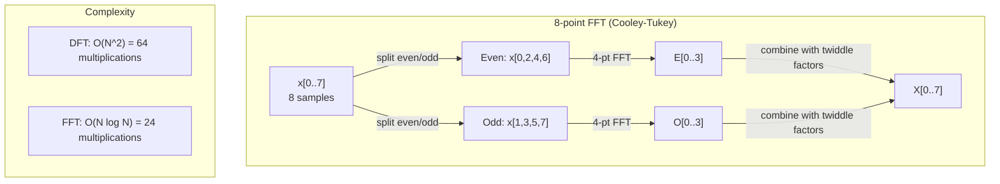
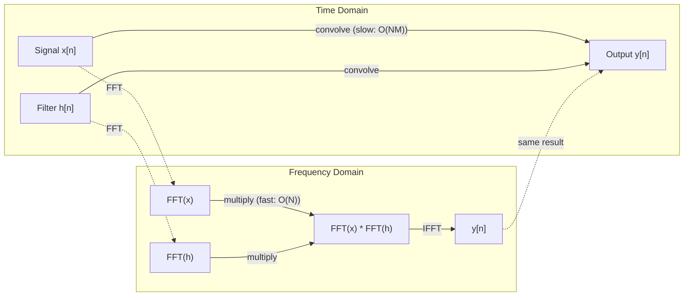

# تحويل فوريه

> كل إشارة هي مجموع موجات الصين، تحويل فوريير يخبرك عن أي موجات

**Type:** Build
**Language:**بايثون
**Prerequisites:** Phase 1, Lessons 01-04, 19 (complex numbers)
**Time:** ~90 minutes

## أهداف التعلم

- تنفيذ DFT من الصفر وتحقق منه ضد $O(N \log N)$كولي-توكي FFT
- تفسير معايير التردد: استخراج الطول والمرحلة ومتعدد الطاقة من الإشارة
- تطبيق نظرية التخزين لتنفيذ التخزين عبر مضاعفة FFT
- ربط تدمير تردد فوريير إلى ترنسفورمات التشفير الموضعي وطبقات التخزين CNN

## المشكلة

تسجيل الصوت هو سلسلة من قياسات الضغط على مر الزمن. سعر الأسهم هو سلسلة من القيم على مدى أيام. صورة هي شبكة من كثافة البيكسل على الفضاء. كل هذه هي بيانات في مجال الزمن (أو مجال الفضاء). ترى القيم تتغير على بعض المؤشر.

ولكن العديد من الأنماط غير مرئية في مجال الزمن. هل هذه الإشارة الصوتية هي نغمة نقية أو صفات؟ هل سعر الأسهم هذا له دورة أسبوعية؟ هل هذه الصورة لديها نسيج متكرر؟ هذه الأسئلة تتعلق بمحتويات التردد، ويمتلك مجال الزمن ذلك.

تحويل فوريه تحويل البيانات من مجال الوقت إلى مجال الترددات. يأخذ إشارة ويفسدها في موجات السينوس من ترددات مختلفة. كل موجة السينوس لديها amplitude (كم قوية هي) ومرحلة (من حيث تبدأ). تحويل فوريه يخبرك كليهما.

هذا مهم بالنسبة لـ ML لأن التفكير في مجال التردد يظهر في كل مكان. تقوم الشبكات العصبية المتحركة بإجراء التحويل، وهو مضاعفة في مجال التردد. تُستخدم مُشفّرات المُحوّل المُوضّع التفكّر المتردد لتمثيل المُوضّع. نماذج الصوت (تعرف الكلام، توليد الموسيقى) تعمل على الطيفيات -- تمثيلات تردد للصوت. نماذج سلسلة الزمن تبحث عن أنماط دورية. فهم تحويل فوريير يعطيك المفردات للعمل مع كل هذه.

## المفهوم

### تعريف DFT

- نعم$N$العينات$x[0], x[1], \ldots, x[N-1]$، تحويل فوريه المفصّل ينتج$N$معايير التردد $X[0], X[1], \ldots, X[N-1]$:

```math
X[k] = \sum_{n=0}^{N-1} x[n] \, e^{-2\pi i k n/N} \qquad \text{for } k = 0, 1, \ldots, N-1
```

كل واحد$X[k]$هو رقم معقد.$\lvert X[k] \rvert$يخبرك حجم التردد$k$. مرحلته$\angle X[k]$يخبرك التخفيضات المرحلية لهذا التردد.

المعلومات الرئيسية:$e^{-2\pi i k n/N}$هو الفازور المتداول في التردد$k$. يقوم DFT بحساب التواصل بين الإشارة و كل من$N$إذا كانت الإشارة تحتوي على طاقة في التردد$k$إذا لم يكن، فإنه قريب من الصفر.

### ما تعنيه كل معدل

**$X[0]$: the DC component.**هذا هو مجموع جميع العينات -- متناسبة مع المتوسط. وهو يمثل استمرار (الصفر التردد) التداخل من الإشارة.

```math
X[0] = \sum_{n=0}^{N-1} x[n] \, e^0 = \text{sum of all samples}
```

**$X[k]$ for $1 \le k \le N/2$: positive frequencies.** $X[k]$يمثل التردد$k$الدورات الدورية$N$العينات. أعلى $k$تعني تردد أعلى (تذبذب أسرع).

**$X[N/2]$: the Nyquist frequency.**أعلى تردد يمكنك أن تمثله$N$فوق هذا، تحصل على الاسم التلقائي -- ترددات عالية تتظاهر بأنها منخفضة.

**$X[k]$ for $N/2 < k < N$: negative frequencies.**بالنسبة للإشارات ذات القيمة الحقيقية$X[N-k] = \overline{X[k]}$. الترددات السلبية هي صور مرآة للتي إيجابية . لهذا السبب المعلومات المفيدة هي في الأول$N/2 + 1$معايير

### الـ DFT العكس

يقوم DFT العكسي بإعادة تشكيل الإشارة الأصلية من معايير ترددها:

```math
x[n] = \frac{1}{N} \sum_{k=0}^{N-1} X[k] \, e^{2\pi i k n/N} \qquad \text{for } n = 0, 1, \ldots, N-1
```

الاختلافات الوحيدة عن DFT الأمامي: علامة في المُعربة إيجابية (ليس سلبية) ، وهناك $1/N$عامل التطبيع

DFT العكسية هي إعادة بناء مثالية. لا تفقد أي معلومات. يمكنك الذهاب من نطاق الوقت إلى نطاق التردد والعودة دون أي خطأ. DFT هو تغيير الأساس -- يعيد التعبير عن نفس المعلومات في نظام إحداثيات مختلفة.

### الـ (ف.إف.تي): جعل الأمر سريعاً

المبلغ المحدد أعلاه هو$O(N^2)$: لكل من $N$معايير الناتج، يمكنك جمع $N$عينات المدخلات$N$= مليون، وهذا هو $10^{12}$العمليات

تحسب تحويل فوريه السريع نفس النتيجة في $O(N \log N)$- لأجل$N$= 1 مليون، وهذا حوالي 20 مليون عملية بدلا من تريليون. وهذا ما يجعل تحليل التردد عملي.

يعمل خوارزمية كولي-توكي (أكثر FFT شيوعًا) عن طريق القسم والغزو:

1. تقسيم الإشارة إلى عينات متصفحة مساوية وممتصفحة غير مساوية.
2. احسب DFT لكل نصف بشكل متكرر.
3. قم بتجميع اثنين من DFTs نصف حجم باستخدام "عاملات المزدوج" $e^{-2\pi i k/N}$. . .

```math
\begin{aligned}
X[k] &= E[k] + e^{-2\pi i k/N} \, O[k] && \text{for } k = 0, \ldots, N/2 - 1 \\
X[k + N/2] &= E[k] - e^{-2\pi i k/N} \, O[k] && \text{for } k = 0, \ldots, N/2 - 1 \\[6pt]
\text{where } E &= \text{DFT of even-indexed samples} \\
O &= \text{DFT of odd-indexed samples}
\end{aligned}
```

التناظر يعني أن كل مستوى من التكرار$O(N)$العمل، وهناك$\log_2(N)$المستويات. إجمالي: $O(N \log N)$. . .



يتطلب FFT أن يكون طول الإشارة قوة 2. في الممارسة العملية ، يتم إضافة الإشارات إلى الصفر إلى قوة 2.

### تحليل الطيف

- نعم**power spectrum**هو$\lvert X[k] \rvert^2$-- الحجم التربيعي لكل معدل تردد. يظهر كم من الطاقة في كل تردد.

- نعم**phase spectrum**هو$\angle X[k]$معظم مهام التحليل، تهتمين بمتابعة الطاقة وتجاهلون المرحلة.

```math
\begin{aligned}
\text{Power at frequency } k: \quad P[k] &= |X[k]|^2 = \mathop{\mathrm{Re}}(X[k])^2 + \mathop{\mathrm{Im}}(X[k])^2 \\
\text{Phase at frequency } k: \quad \phi[k] &= \mathop{\mathrm{atan2}}(\mathop{\mathrm{Im}}(X[k]), \mathop{\mathrm{Re}}(X[k]))
\end{aligned}
```

### تحديد التردد

إنّ قرار تردد DFT يعتمد على عدد العينات $N$ومعدل أخذ العينات $f_s$. . .

```math
\begin{aligned}
\text{Frequency of bin } k: \quad & f_k = k \cdot f_s / N \\
\text{Frequency resolution:} \quad & \Delta f = f_s / N \\
\text{Maximum frequency:} \quad & f_{\max} = f_s / 2 \quad \text{(Nyquist)}
\end{aligned}
```

لتحديد ترددات قريبة من بعضها البعض، تحتاج إلى المزيد من العينات. لالتقاط ترددات عالية، تحتاج إلى معدل أعلى من أخذ العينات.

### نظرية التخزين

هذه واحدة من أهم النتائج في معالجة الإشارات و ذات صلة مباشرة مع قنوات سي إن إن

**Convolution in the time domain equals pointwise multiplication in the frequency domain.**

```math
\begin{aligned}
& x * h = \text{IFFT}(\text{FFT}(x) \cdot \text{FFT}(h)) \\[4pt]
& \text{where } * \text{ is convolution and } \cdot \text{ is element-wise multiplication}
\end{aligned}
```

لماذا هذا مهم:

- التخفيف المباشر لـ إشارات طول$N$و$M$يأخذ$O(NM)$العمليات
- التخزين القائم على FFT يأخذ $O(N \log N)$تغير كل منهما، وتضاعف، وتحول مرة أخرى.
- بالنسبة للجوهرات الكبيرة، فإن تحويل FFT أسرع بشكل كبير.
- هذا بالضبط ما يحدث في الطبقات الملتوية مع مجالات استقبلية كبيرة.

ملاحظة: يقوم DFT بحساب التخدير الدائري (تتغلف الإشارة حولها). بالنسبة للتخدير الخطى (لا يوجد تغلف) ، قم بتحديد كل من الإشارات إلى طولها .$N + M - 1$قبل الحوسبة



### النوافذ

يفترض DFT أن الإشارة دورية - يعالج$N$إذا لم تبدأ الإشارة وتنتهي بنفس القيمة، فإنه يخلق عدم استمرارية في الحدود، والتي تظهر كمحتوى عالية التردد وهمية. وهذا ما يسمى التسرب الطيفي.

يقلل التسرب من النافذة عن طريق تقليل الإشارة إلى الصفر في كلا الطرفين قبل حساب DFT.

النوافذ المشتركة:

| Window | Shape | Main lobe width | Side lobe level | Use case |
|--------|-------|----------------|-----------------|----------|
| Rectangular | Flat (no window) | Narrowest | Highest (-13 dB) | When signal is exactly periodic in N samples |
| Hann | Raised cosine | Moderate | Low (-31 dB) | General purpose spectral analysis |
| Hamming | Modified cosine | Moderate | Lower (-42 dB) | Audio processing, speech analysis |
| Blackman | Triple cosine | Wide | Very low (-58 dB) | When side lobe suppression is critical |

```math
\begin{aligned}
\text{Hann window:} \quad & w[n] = 0.5 \left(1 - \cos\frac{2\pi n}{N-1}\right) \\
\text{Hamming window:} \quad & w[n] = 0.54 - 0.46 \cos\frac{2\pi n}{N-1}
\end{aligned}
```

تطبيق النافذة عن طريق مضاعفةها حسب العناصر مع الإشارة التي تسبق DFT: `X = DFT(x * w)`. . .

### خصائص DFT

| Property | Time Domain | Frequency Domain |
|----------|-------------|-----------------|
| Linearity | $ax + by$ | $aX + bY$ |
| Time shift | $x[n - k]$ | $X[f] e^{-2\pi i f k/N}$ |
| Frequency shift | $x[n] e^{2\pi i f_0 n/N}$ | $X[f - f_0]$ |
| Convolution | $x * h$ | $X \cdot H$ (pointwise) |
| Multiplication | $x \cdot h$ (pointwise) | $X * H$ (circular convolution, scaled by $1/N$) |
| Parseval's theorem | $\sum \lvert x[n] \rvert^2$ | $\frac{1}{N} \sum \lvert X[k] \rvert^2$ |
| Conjugate symmetry (real input) | $x[n]$ real | $X[k] = \overline{X[N-k]}$ |

نظرية بارسيفال تقول أن الطاقة الكلية هي نفسها في كلا المجالين

### اتصال بتشفيرات المواقع

المصدر الأصلي يستخدم تشفيرات موقف سينوسيدال:

```math
\begin{aligned}
PE(pos, 2i) &= \sin\left(pos / 10000^{2i/d_{\text{model}}}\right) \\
PE(pos, 2i+1) &= \cos\left(pos / 10000^{2i/d_{\text{model}}}\right)
\end{aligned}
```

كل زوج من الأبعاد$(2i, 2i+1)$تتذبذب في تردد مختلف. يتم توزيع تردداتها على بعد هندسي من مرتفع (أبعاد 0.1) إلى منخفض (أبعاد أخيرة). هذا يعطي كل موقع نمطًا فريدًا عبر جميع فروع التردد -- مما يشبه كيفية تحديد معايير فوريري بشكل فريد للإشارة.

الخصائص الرئيسية التي يقدمها:

- **Uniqueness:**لا توجد موقفين لديهم نفس التشفير
- **Bounded values:**الخطيئة والعقوبة دائماً ما تكون في$[-1, 1]$. . .
- **Relative position:**تشفير الموقع$p+k$يمكن أن يعبر عن عمل خطي من التشفير في الموقف $p$يمكن أن يتعلم النموذج الالتزام بالمواقف النسبية

### اتصال مع قنوات سي إن إن

طبقة التخزين تطبق مرشحًا تعلمًا (كور) على المدخل عن طريق نقله عبر الإشارة أو الصورة.

من خلال نظرية التخزين، هذا يعادل:
1. FFT المدخل
2. FFT النجم
3. مضاعفة في مجال التردد
4. إذا كان النتيجة

تستخدم تنفيذات CNN القياسية التناغم المباشر (أسرع بالنسبة للنواة الصغيرة 3x3). ولكن بالنسبة للنواة الكبيرة أو التناغم العالمي، فإن النهج القائم على FFT أسرع بكثير. بعض الهندسة المعمارية (مثل FNet) تحل محل الاهتمام بالكامل مع FFT، مما يصل إلى دقة تنافسية مع $O(N \log N)$بدلاً من$O(N^2)$التعقيد

### البرامج المتطرفة و تحويل فوريه القصير

يقدم لك FFT واحد محتوى تردد الإشارة بأكملها ، ولكن لا يخبرك بأي شيء عن متى تحدث هذه الترددات. يمكن أن يكون لدى إشارة (إشارة تزداد ترددها مع مرور الوقت) وخط (جميع الترددات الموجودة في نفس الوقت) نفس الطيف الكبير.

تحل تحويل فوريه القصير من الوقت (STFT) هذا الأمر عن طريق حساب FFTs على نوافذ تتداخل من الإشارة. النتيجة هي طيفية: تمثيل ثنائي الأبعاد مع الوقت على محور واحد والتياتر على الآخر. يظهر كثافة كل نقطة الطاقة في تلك التردد في ذلك الوقت.

```
STFT procedure:
1. Choose a window size (e.g., 1024 samples)
2. Choose a hop size (e.g., 256 samples -- 75% overlap)
3. For each window position:
   a. Extract the windowed segment
   b. Apply a Hann/Hamming window
   c. Compute FFT
   d. Store the magnitude spectrum as one column of the spectrogram
```

تعد التصويرات الطيفية هي التمثيل القياسي للمدخلات للنموذجات الصوتية ML. تعمل نماذج التعرف على الكلام (Whisper، DeepSpeech) على التصويرات الطيفية - التصويرات الطيفية ذات الترددات المخطوطة إلى مقياس الميل، والتي تطابق بشكل أفضل تصور الصوت البشري.

### التعبير

إذا كانت الإشارة تحتوي على ترددات أعلى $f_s/2$(تكرار نيكوست) ، أخذ العينات عند سرعة$f_s$سيخلق نسخ مستعار. إشارة 90 هرتز التي يتم أخذها في 100 هرتز تبدو متطابقة مع إشارة 10 هرتز. لا توجد طريقة للتمييز بينها من العينات وحدها.

```
Example:
  True signal: 90 Hz sine wave
  Sampling rate: 100 Hz
  Apparent frequency: 100 - 90 = 10 Hz

  The samples from the 90 Hz signal at 100 Hz sampling rate
  are identical to the samples from a 10 Hz signal.
  No amount of math can recover the original 90 Hz.
```

هذا هو السبب في أن محولات التناظر إلى الرقميات تشمل مرشحات مكافحة التناظر التي تزيل ترددات فوق Nyquist قبل أخذ العينات. في ML، يظهر التناظر عند أخذ العينات إلى أسفل خرائط ميزات دون تصفية المنخفضة المناسبة - بعض الهندسة المعمارية تعالج هذا مع طبقات تجمع مكافحة التناظر.

### عدم زيادة الحلّة من خلال إصلاح الصفر

تصور خاطئ شائع: إعادة إعادة إعادة إعادة إعادة إعادة إعادة إعادة إعادة إعادة إعادة إعادة إعادة إعادة إعادة إعادة إعادة إعادة إعادة إعادة إعادة إعادة إعادة إعادة إعادة إعادة إعادة إعادة إعادة إعادة إعادة إعادة إعادة إعادة إعادة إعادة إعادة إعادة إعادة إعادة إعادة إعادة إعادة إعادة إعادة إعادة إعادة إعادة إعادة إعادة إعادة إعادة إعادة إعادة إعادة إعادة إعادة إعادة إعادة إعادة إعادة إعادة إعادة إعادة إعادة إعادة إعادة إعادة إعادة إعادة إعادة إعادة إعادة إعادة إعادة إعادة إعادة إعادة إعادة إعادة إعادة إعادة إعادة إعادة إعادة إعادة إعادة إعادة إعادة إعادة إعادة إعادة إعادة إعادة إعادة إعادة إعادة إعادة إعادة إعادة إعادة إعادة إعادة إعادة إعادة إعادة إعادة إعادة إعادة إعادة إعادة إعادة إعادة إعادة إعادة إعادة إعادة إعادة إعادة إعادة إعادة إعادة إعادة إعادة إعادة إعادة إعادة إعادة إعادة إعادة إعادة إعادة إعادة إعادة إعادة إعادة إعادة إعادة إعادة إعادة إعادة إعادة إعادة إعادة إعادة إعادة إعادة إعادة إعادة إعادة إعادة إعادة إعادة إعادة إعادة إعادة إعادة إعادة إعادة إعادة إعادة إعادة إعادة إعادة إعادة إعادة إعادة إعادة إعادة إعادة إعادة إعادة إعادة إعادة إعادة إعادة إعادة إعادة إعادة إعادة إعادة إعادة إعادة إعادة إعادة إعادة إعادة إعادة إعادة إعادة إعادة إعادة إعادة إعادة إعادة إعادة إعادة إعادة إعادة إعادة إعادة إعادة إعادة إعادة إعادة إعادة إعادة إعادة إعادة إعادة إعادة إعادة إعادة إعادة إعادة إعادة إعادة إعادة إعادة إعادة إعادة إعادة إعادة إعادة إ إ إ إ إعادة إ إ إ إعادة إعادة إ إ إ إ إعادة إعادة إ إ إ إ إعادة إعادة إ إ إعادة إعادة إ إ إ إ إ إ إ إ إ إ إ إعادة إعادة إ إ إ إ إ إ

إنّ الحلّ الحقيقي للتردّد يعتمد فقط على وقت المراقبة$T = N / f_s$. لحل ترددات منفصلة عن$\Delta f$، تحتاجين على الأقل$T = 1 / \Delta f$لا يوجد كمية من الصفر المضغطة تغير هذا الحد الأساسي.

```figure
fourier-synthesis
```

## بناءها

### الخطوة الأولى: DFT من الصفر

- نعم$O(N^2)$ويتبع DFT مباشرة من التعريف.

```python
import math

class Complex:
    ...

def dft(x):
    N = len(x)
    result = []
    for k in range(N):
        total = Complex(0, 0)
        for n in range(N):
            angle = -2 * math.pi * k * n / N
            w = Complex(math.cos(angle), math.sin(angle))
            xn = x[n] if isinstance(x[n], Complex) else Complex(x[n])
            total = total + xn * w
        result.append(total)
    return result
```

### الخطوة الثانية: DFT العكسية

نفس الهيكل، المعبر الإيجابي، تقسيم ب $N$. . .

```python
def idft(X):
    N = len(X)
    result = []
    for n in range(N):
        total = Complex(0, 0)
        for k in range(N):
            angle = 2 * math.pi * k * n / N
            w = Complex(math.cos(angle), math.sin(angle))
            total = total + X[k] * w
        result.append(Complex(total.real / N, total.imag / N))
    return result
```

### الخطوة الثالثة: FFT (كولي-توكي)

المعدل السريع يتطلب قوة من 2 طول. تقسيم إلى متكافئة ومتكافئة، الجمع مع عوامل التويدل.

```python
def fft(x):
    N = len(x)
    if N <= 1:
        return [x[0] if isinstance(x[0], Complex) else Complex(x[0])]
    if N % 2 != 0:
        return dft(x)

    even = fft([x[i] for i in range(0, N, 2)])
    odd = fft([x[i] for i in range(1, N, 2)])

    result = [Complex(0)] * N
    for k in range(N // 2):
        angle = -2 * math.pi * k / N
        twiddle = Complex(math.cos(angle), math.sin(angle))
        t = twiddle * odd[k]
        result[k] = even[k] + t
        result[k + N // 2] = even[k] - t
    return result
```

### الخطوة الرابعة: مساعدي تحليل الطيف

```python
def power_spectrum(X):
    return [xk.real ** 2 + xk.imag ** 2 for xk in X]

def convolve_fft(x, h):
    N = len(x) + len(h) - 1
    padded_N = 1
    while padded_N < N:
        padded_N *= 2

    x_padded = x + [0.0] * (padded_N - len(x))
    h_padded = h + [0.0] * (padded_N - len(h))

    X = fft(x_padded)
    H = fft(h_padded)

    Y = [xk * hk for xk, hk in zip(X, H)]

    y = idft(Y)
    return [y[n].real for n in range(N)]
```

## استخدمها

للعمل الحقيقي، استخدم Numpy's FFT الذي يدعم من قبل المكتبات C المثلى للغاية.

```python
import numpy as np

signal = np.sin(2 * np.pi * 5 * np.arange(256) / 256)
spectrum = np.fft.fft(signal)
freqs = np.fft.fftfreq(256, d=1/256)

power = np.abs(spectrum) ** 2

positive_freqs = freqs[:len(freqs)//2]
positive_power = power[:len(power)//2]
```

لتحليل النوافذ والتحليلات الطيفية الأكثر تقدما:

```python
from scipy.signal import windows, stft

window = windows.hann(256)
windowed = signal * window
spectrum = np.fft.fft(windowed)
```

للفصل:

```python
from scipy.signal import fftconvolve

result = fftconvolve(signal, kernel, mode='full')
```

للطيفيات:

```python
from scipy.signal import stft

frequencies, times, Zxx = stft(signal, fs=sample_rate, nperseg=256)
spectrogram = np.abs(Zxx) ** 2
```

المصفوفة المعدنية لها شكل (n_frequencies, n_time_frames). كل عمود هو الطيف الطاقة في نافذة زمنية واحدة. هذا ما تستخدمها نماذج ML الصوتية كمدخول.

## أرسله

أركض`code/fourier.py`لإنتاج`outputs/prompt-spectral-analyzer.md`. . .

## التمارين

1. **Pure tone identification.**قم بإنشاء إشارة بموجة سينوسية واحدة في تردد مجهول (بين 1 و 50 هرتز) ، وخذ عينات عند 128 هرتز لمدة ثانية واحدة. استخدم DFT الخاص بك لتحديد التردد. تحقق من مطابقة الإجابة. الآن أضف ضجيج غوسيان مع انحراف معيار 0.5 واكرر. كيف يؤثر الضجيج على الطيف؟

2. **FFT vs DFT verification.**إنشاء إشارة عشوائية بطول 64. حساب كل من DFT ($O(N^2){}$) و FFT. التحقق من أن جميع المعاملات تتطابق مع داخل 1e-10. يعمل الوقت على الإشارات بطول 256 ، 512 ، 1024 ، و 2048. رسم النسبة من وقت DFT إلى وقت FFT.

3. **Convolution theorem proof by example.**قم بإنشاء إشارة x = [1, 2, 3, 4, 0, 0, 0, 0] والتحذير h = [1, 1, 1, 0, 0, 0, 0, 0]. احسب تحوُّلها الدائري مباشرةً (حلقة حلقة). ثم احسبها عن طريق FFT (تحول، مضاعفة، تحويل عكسية). تحقق من مطابقة النتائج. الآن قم بتحوُّل خطيّة عن طريق إضافة الصفر بشكل مناسب.

4. **Windowing effects.**قم بإنشاء إشارة هي مجموع موجات الصناعية الثنائية عند 10 هرتز و 12 هرتز (قريبة جداً). قم بعمل عينات عند 128 هرتز لمدة ثانية واحدة. احسب طيف الطاقة دون نافذة، نافذة هان، ونفذة هامينغ. أي نافذة تجعل من الأسهل تمييز النقبتين؟ لماذا؟

5. **Positional encoding analysis.**توليد التشفيرات الموضعية السينوسوايدالية d_model = 128 و max_pos = 512.$(p_1, p_2)$،حساب نسبة النقاط من ترميزاتهم.$\lvert p_1 - p_2 \rvert$ماذا يحدث لمعدل النقاط مع زيادة المسافة؟

### إشارات

**Exercise 1.**مع 128 عينة على مدى ثانية واحدة،$k$هو$k$Hz، لذلك بالنسبة لمتردد عددي كامل، فإن مؤشر أكبر قيمة في حاويات 1 إلى 63 هو التردد. اختر عدد كامل من هيرتز. تتنتشر التردد بين حاويتين إلى جيرانها، ويمنح الذروة أقرب حاوية فقط. استخدام `generate_signal`و`magnitude_spectrum`بعد إضافة الضجيج، تحقق من أن القمة لا تزال في نفس القمامة بينما القمامة الأخرى ترتفع.

**Exercise 2.**استخدم قوة بطولين، لأن `fft`يفرق الإشارة إلى نصفين.`max(abs(a - b))`على جميع المعاملات. يجب أن ينمو النسبة الزمنية تقريباً$N / \log_2 N$. . .

**Exercise 3.**لتحويل دائري، الحساب $y[n] = \sum_k h[k] x[(n-k) \bmod 8]$باليد$n$= 0، 1، و 2، و مقارنة القيم الثلاثة الأولى من `convolve_direct`و`convolve_fft`. التخيل الخطى له طول 4 + 3 - 1 = 6, لذلك تحقق أولاً إذا كان طول 8 طويل بما فيه الكفاية.

**Exercise 4.**استخدام`hann_window`،`hamming_window`،`apply_window`و`power_spectrum`ويعدّ النقاط القصوى المختلفة بين 9 و 13 هرتز. كل من 10 هرتز و 12 هرتز يكتملان دورات كاملة في ثانية واحدة، لذلك لا يمكن أن تبدو أي نافذة أفضل. كرر مع 10.5 هرتز و 12.5 هرتز لمعرفة التسرب الذي تقلل من النافذة.

**Exercise 5.**احسب كل رمز مع `positional_encoding(pos, 128)`. مقارنة نسبة نقطة للمواقع (0, 10) مع نسبة نقطة لل (100, 110): يجب أن تتطابق القيمتان مع حوالي 1e-10. ثم رسم نسبة نقطة مقابل $\lvert p_1 - p_2 \rvert$لـ واحد ثابت$p_1$. . .

## الشروط الرئيسية

| Term | What it means |
|------|---------------|
| DFT (Discrete Fourier Transform) | Converts $N$ time-domain samples into $N$ frequency-domain coefficients. Each coefficient is the correlation with a complex sinusoid at that frequency |
| FFT (Fast Fourier Transform) | An $O(N \log N)$ algorithm to compute the DFT. The Cooley-Tukey algorithm splits even/odd indices recursively |
| Inverse DFT | Reconstructs the time-domain signal from frequency coefficients. Same formula as DFT with flipped exponent sign and $1/N$ scaling |
| Frequency bin | Each index $k$ in the DFT output represents frequency $k f_s/N$ Hz. The "bin" is the discrete frequency slot |
| DC component | $X[0]$, the zero-frequency coefficient. Proportional to the signal mean |
| Nyquist frequency | $f_s/2$, the maximum frequency representable at sampling rate $f_s$. Frequencies above this alias |
| Power spectrum | $\lvert X[k] \rvert^2$, the squared magnitude of each frequency coefficient. Shows energy distribution across frequencies |
| Phase spectrum | $\angle X[k]$, the phase offset of each frequency component. Often ignored in analysis |
| Spectral leakage | Spurious frequency content caused by treating a non-periodic signal as periodic. Reduced by windowing |
| Window function | A tapering function (Hann, Hamming, Blackman) applied before DFT to reduce spectral leakage |
| Twiddle factor | The complex exponential $e^{-2\pi i k/N}$ used to combine sub-DFTs in the FFT butterfly computation |
| Convolution theorem | Convolution in time domain equals pointwise multiplication in frequency domain. Fundamental to signal processing and CNNs |
| Circular convolution | Convolution where the signal wraps around. This is what the DFT naturally computes |
| Linear convolution | Standard convolution without wraparound. Achieved by zero-padding before DFT |
| Parseval's theorem | Total energy is preserved through the Fourier transform. $\sum \lvert x[n] \rvert^2 = \frac{1}{N} \sum \lvert X[k] \rvert^2$ |
| Aliasing | When frequencies above Nyquist appear as lower frequencies due to insufficient sampling rate |

## المزيد من القراءة

- [Cooley & Tukey: An Algorithm for the Machine Calculation of Complex Fourier Series (1965)](https://www.ams.org/journals/mcom/1965-19-090/S0025-5718-1965-0178586-1/)- ورقة FFT الأصلية التي غيرت الحوسبة
- [3Blue1Brown: But what is the Fourier Transform?](https://www.youtube.com/watch?v=spUNpyF58BY)- أفضل تعريف بصري لتحولات فوريير
- [Lee-Thorp et al.: FNet: Mixing Tokens with Fourier Transforms (2021)](https://arxiv.org/abs/2105.03824)- يبدل الاهتمام الذاتي بـ FFT في المحولات
- [Smith: The Scientist and Engineer's Guide to Digital Signal Processing](http://www.dspguide.com/)- كتاب دراسي مجاني على الإنترنت يغطى التحليل المعمق للفوتوغرافية والنوافذ والطيفيات
- [Vaswani et al.: Attention Is All You Need (2017)](https://arxiv.org/abs/1706.03762)- تشفيرات المواقع السينوسيدالية المستمدة من تدهور تردد فوريير
- [Radford et al.: Whisper (2022)](https://arxiv.org/abs/2212.04356)- التعرف على الكلام باستخدام طيفيات الميل كتمثيل مدخل
