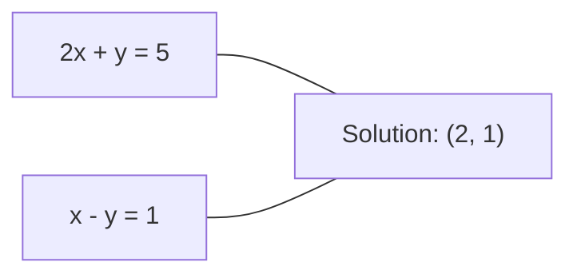
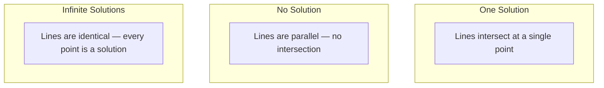

# Sistemas lineales

> Resolución $Ax = b$es el problema más antiguo en matemáticas que aún maneja tu red neuronal.

**Type:** Build
**Language:**Python
**Prerequisites:** Phase 1, Lessons 01 (Linear Algebra Intuition), 02 (Vectors & Matrices), 03 (Matrix Transformations)
**Time:** ~120 minutes

## Objetivos de aprendizaje

- Resolver$Ax = b$utilizando la eliminación de Gaussian con giro parcial y sustitución de la espalda
- Matrices de factores con descomposiciones LU, QR y Cholesky y explicar cuándo cada una es apropiada
- Derivar las ecuaciones normales para los cuadrados mínimos y conectarlos a regresión lineal y de cresta
- Diagnóstico de sistemas mal condicionados utilizando el número de condición y aplicar regularización para estabilizarlos

## El problema

Cada vez que entrenas una regresión lineal, resuelves un sistema lineal. Cada vez que computes un ajuste de mínimos cuadrados, resuelves un sistema lineal. Cada vez que una capa de red neuronal computa.`y = Wx + b`Cuando se añade regularización, se modifica el sistema. Cuando se utiliza procesos de Gaussian, se hace una matriz. Cuando se invierte una matriz de covarianza para la distancia de Mahalanobis, se resuelve un sistema lineal.

La ecuación $Ax = b$aparece en todas partes.$A$es una matriz de coeficientes conocidos. $b$es un vector de las salidas conocidas. $x$es el vector de lo desconocido que quieres encontrar.$A$es su matriz de datos,$b$es su vector objetivo, y $x$El modelo completo se reduce a: encontrar $x$Es así .$Ax$es lo más cerca de $b$lo más posible.

Esta lección construye todos los métodos principales para resolver esa ecuación desde cero. Comprenderá por qué algunos métodos son rápidos y otros estables, por qué algunos funcionan solo para sistemas cuadrados y otros manejan los excesivamente determinados, y por qué el número de condición de su matriz determina si su respuesta significa algo en absoluto.

## El concepto

### Lo que Ax = b significa geométricamente

Un sistema de ecuaciones lineales tiene una interpretación geométrica. Cada ecuación define un hiperplano. La solución es el punto (o conjunto de puntos) donde todos los hiperplanos se cruzan.

```
2x + y = 5          Two lines in 2D.
x - y  = 1          They intersect at x=2, y=1.
```



Tres cosas pueden suceder:



En forma de matriz, "solución única" significa $A$"No hay solución" significa que el sistema es inconsistente.$A$La mayoría de los problemas de ML caen en la categoría "no solución exacta" porque tienes más ecuaciones (puntos de datos) que desconocidos (parámetros).

### Imagen de columna vs imagen de fila

Hay dos maneras de leer .$Ax = b$¿ Qué ?

**Row picture.**Cada fila de $A$Cada ecuación es un hiperplano. La solución es donde se cruzan todas.

**Column picture.**Cada columna de $A$La pregunta es: ¿qué combinación lineal de las columnas de $A$produce $b$¿ Qué ?

```
A = | 2  1 |    b = | 5 |
    | 1 -1 |        | 1 |

Row picture: solve 2x + y = 5 and x - y = 1 simultaneously.

Column picture: find x1, x2 such that:
  x1 * [2, 1] + x2 * [1, -1] = [5, 1]
  2 * [2, 1] + 1 * [1, -1] = [4+1, 2-1] = [5, 1]   check.
```

La imagen de columna es más fundamental.$b$se encuentra en el espacio de columna de $A$, el sistema tiene una solución.$b$Si no, encontrar el punto más cercano en el espacio columna. Ese punto más cercano es la solución de cuadrados menores.

### Eliminación gaussiana

La eliminación gaussiana se transforma.$Ax = b$en un sistema triangular superior $Ux = c$que se resuelve por la sustitución de la espalda. Es el método más directo.

El algoritmo:

```
1. For each column k (the pivot column):
   a. Find the largest entry in column k at or below row k (partial pivoting).
   b. Swap that row with row k.
   c. For each row i below k:
      - Compute multiplier m = A[i][k] / A[k][k]
      - Subtract m times row k from row i.
2. Back substitute: solve from the last equation upward.
```

Ejemplo:

```
Original:
| 2  1  1 | 8 |       R2 = R2 - (2)R1     | 2  1   1 |  8 |
| 4  3  3 |20 |  -->  R3 = R3 - (1)R1 --> | 0  1   1 |  4 |
| 2  3  1 |12 |                            | 0  2   0 |  4 |

                       R3 = R3 - (2)R2     | 2  1   1 |  8 |
                                       --> | 0  1   1 |  4 |
                                           | 0  0  -2 | -4 |

Back substitute:
  -2 * x3 = -4    -->  x3 = 2
  x2 + 2  = 4     -->  x2 = 2
  2*x1 + 2 + 2 = 8 --> x1 = 2
```

Los costes de eliminación de Gaussian $O(n^3)$Las operaciones de$1000 \times 1000$sistema, eso es aproximadamente un billón de operaciones de puntos flotantes. Rápido, pero se puede hacer mejor si se necesita resolver varios sistemas con el mismo$A$¿ Qué ?

### La rotación parcial: por qué importa

Sin pivotar, la eliminación gaussiana puede fallar o producir basura. Si un elemento pivot es cero, se divide por cero. Si es pequeño, se amplifican los errores de redondeo.

```
Bad pivot:                       With partial pivoting:
| 0.001  1 | 1.001 |            Swap rows first:
| 1      1 | 2     |            | 1      1 | 2     |
                                 | 0.001  1 | 1.001 |
m = 1/0.001 = 1000              m = 0.001/1 = 0.001
R2 = R2 - 1000*R1               R2 = R2 - 0.001*R1
| 0.001  1     | 1.001   |      | 1      1     | 2     |
| 0     -999   | -999.0  |      | 0      0.999 | 0.999 |

x2 = 1.000 (correct)            x2 = 1.000 (correct)
x1 = (1.001 - 1)/0.001          x1 = (2 - 1)/1 = 1.000 (correct)
   = 0.001/0.001 = 1.000        Stable because the multiplier is small.
```

En la aritmética de puntos flotantes con precisión limitada, la versión sin pivot puede perder cifras significativas.

### Descomposición de las LU

Los factores de descomposición de la LU $A$en una matriz triangular inferior $L$y una matriz triangular superior $U$¿ Qué es esto ?$A = LU$- El .$L$La matriz almacena los multiplicadores de la eliminación de Gaussian.$U$Matrix es el resultado de la eliminación.

```
A = L @ U

| 2  1  1 |   | 1  0  0 |   | 2  1   1 |
| 4  3  3 | = | 2  1  0 | @ | 0  1   1 |
| 2  3  1 |   | 1  2  1 |   | 0  0  -2 |
```

¿Por qué factor en lugar de eliminar?$L$y $U$, resolver$Ax = b$para cualquier nuevo $b$sólo los costes $O(n^2)$¿Qué es esto ?

```math
\begin{aligned}
Ax &= b \\
LUx &= b \\
&\text{Let } y = Ux\text{:} \\
Ly &= b \quad \text{(forward substitution, } O(n^2)\text{)} \\
Ux &= y \quad \text{(back substitution, } O(n^2)\text{)}
\end{aligned}
```

El $O(n^3)$El costo se paga una vez durante la factorization.$O(n^2)$Si necesitas resolver 1000 sistemas con el mismo$A$Pero diferente.$b$Los vectores de LU ahorran un factor de 1000/3 en el trabajo total.

Con la rotación parcial, se obtiene$PA = LU$donde$P$es una matriz de permutación que registra los intercambios de filas.

### Descomposición de las QR

Fáculos de descomposición de QR $A$en una matriz ortogonal $Q$y una matriz triangular superior $R$¿ Qué es esto ?$A = QR$¿ Qué ?

Una matriz ortogonal tiene la propiedad $Q^T Q = I$Sus columnas son vectores ortónormales.$Q$conserva las longitudes y los ángulos.

```
A = Q @ R

Q has orthonormal columns: Q^T Q = I
R is upper triangular

To solve Ax = b:
  QRx = b
  Rx = Q^T b    (just multiply by Q^T, no inversion needed)
  Back substitute to get x.
```

QR es numéricamente más estable que LU para resolver problemas de mínimos cuadrados.$Q$Columna por columna:

```
Given columns a1, a2, ... of A:

q1 = a1 / ||a1||

q2 = a2 - (a2 . q1) * q1        (subtract projection onto q1)
q2 = q2 / ||q2||                (normalize)

q3 = a3 - (a3 . q1) * q1 - (a3 . q2) * q2
q3 = q3 / ||q3||

R[i][j] = qi . aj    for i <= j
```

Cada paso elimina el componente a lo largo de todos los anteriores $q$vectores, dejando sólo la nueva dirección ortogonal.

### Descomposición de Cholesky

¿ Cuándo ?$A$es simétrico ($A = A^T$) y positivo definido (todos los valores propios positivos), se puede factorizar como $A = L L^T$donde$L$Es la descomposición de Cholesky.

```
A = L @ L^T

| 4  2 |   | 2  0 |   | 2  1 |
| 2  5 | = | 1  2 | @ | 0  2 |

L[i][i] = sqrt(A[i][i] - sum(L[i][k]^2 for k < i))
L[i][j] = (A[i][j] - sum(L[i][k]*L[j][k] for k < j)) / L[j][j]    for i > j
```

Cholesky es dos veces más rápido que LU y requiere la mitad del almacenamiento.

- Las matrices de covarianza son semidefinidas positivas simétricas (definidas positivas con regularización).
- La matriz del núcleo en los procesos de Gaussian es simétrica positiva definida.
- El Hessiano de una función convexa en un mínimo es simétrico positivo definido.
- $A^T A$es siempre semi-definido positivo simétrico.

En los procesos de Gaussian, se factorizan la matriz del núcleo $K$Con Cholesky, luego resuelva.$K \alpha = y$El factor Cholesky también le da el determinante de registro para la probabilidad marginal:$\log \det(K) = 2 \sum \log(\mathop{\mathrm{diag}}(L))$¿ Qué ?

### Cuadrados mínimos: cuando Ax = b no tiene solución exacta

Si ...$A$¿ Es verdad ?$m \times n$con$m > n$No hay una solución exacta. en cambio, minimizamos el error cuadrado:

```
minimize ||Ax - b||^2

This is the sum of squared residuals:
  sum((A[i,:] @ x - b[i])^2 for i in range(m))
```

El minimizador satisface las ecuaciones normales:

```math
A^T A x = A^T b
```

Derivación: expandir $\lVert Ax - b \rVert^2 = (Ax - b)^T (Ax - b) = x^T A^T A x - 2 x^T A^T b + b^T b$. Tome el gradiente con respecto a $x$, ajustar a cero: $2 A^T A x - 2 A^T b = 0$¿ Qué ?

```
Original system (overdetermined, 4 equations, 2 unknowns):
| 1  1 |         | 3 |
| 1  2 | x     = | 5 |       No exact x satisfies all 4 equations.
| 1  3 |         | 6 |
| 1  4 |         | 8 |

Normal equations:
A^T A = | 4  10 |    A^T b = | 22 |
        | 10 30 |            | 63 |

Solve: x = [1.5, 1.7]

This is linear regression. x[0] is the intercept, x[1] is the slope.
```

### Equaciones normales = regresión lineal

La conexión es exacta. En regresión lineal, su matriz de datos$X$Tiene una fila por muestra y una columna por característica.$y$El vector de peso $w$satisface:

```math
\begin{aligned}
X^T X w &= X^T y \\
w &= (X^T X)^{-1} X^T y
\end{aligned}
```

Esta es la solución de forma cerrada a la regresión lineal.`sklearn.linear_model.LinearRegression.fit()`calcula esto (o un equivalente a través de QR o SVD).

Añadir un término de regularización $\lambda I$a la matriz y obtienes regresión de cresta:

```math
\begin{aligned}
(X^T X + \lambda I) w &= X^T y \\
w &= (X^T X + \lambda I)^{-1} X^T y
\end{aligned}
```

La regularización hace que la matriz esté mejor condicionada (más fácil de invertir con precisión) y evita el sobreajuste reduciendo los pesos hacia cero.$X^T X + \lambda I$es siempre simétrico positivo definido cuando $\lambda > 0$, para que puedas usar Cholesky para resolverlo.

### Pseudoinverso (Moore-Penrose)

El pseudoinverso .$A^+$generaliza la inversión de matriz a matrices no cuadradas y singulares.$A$¿Qué es esto ?

```math
\begin{aligned}
x &= A^+ b \\[4pt]
\text{where } A^+ &= V \Sigma^+ U^T \quad \text{(computed via SVD)}
\end{aligned}
```

$\Sigma^+$Se forma tomando la reciprocidad de cada valor singular no cero y transponendo el resultado.$A = U \Sigma V^T$, entonces$A^+ = V \Sigma^+ U^T$¿ Qué ?

```
A = U Sigma V^T        (SVD)

Sigma = | 5  0 |       Sigma+ = | 1/5  0  0 |
        | 0  2 |                | 0  1/2  0 |
        | 0  0 |

A+ = V Sigma+ U^T
```

El pseudoinverso da la solución de mínimos mínimos cuadrados normales.
- Una solución: $A^+ b$lo da.
- No hay solución: $A^+ b$da la solución de cuadrados mínimos.
- Soluciones infinitas: $A^+ b$le da a quien tiene el más pequeño .$\lVert x \rVert$¿ Qué ?

NumPy's `np.linalg.lstsq`y `np.linalg.pinv`ambos utilizan el SVD internamente.

### Número de condición

El número de condición mide la sensibilidad de la solución a pequeños cambios en la entrada.$A$, el número de condición es:

```math
\kappa(A) = \lVert A \rVert \cdot \lVert A^{-1} \rVert = \frac{\sigma_{\max}}{\sigma_{\min}}
```

donde$\sigma_{\max}$y $\sigma_{\min}$son los valores singulares más grandes y más pequeños.

```
Well-conditioned (kappa ~ 1):        Ill-conditioned (kappa ~ 10^15):
Small change in b -->                Small change in b -->
small change in x                    huge change in x

| 2  0 |   kappa = 2/1 = 2          | 1   1          |   kappa ~ 10^15
| 0  1 |   safe to solve            | 1   1+10^(-15) |   solution is garbage
```

Reglas de los pulgares:
- $\kappa < 100$: seguro, la solución es precisa.
- $\kappa \approx 10^k$: pierdes alrededor de $k$cifras de precisión de su aritmética de puntos flotantes.
- $\kappa \approx 10^{16}$(para float64): la solución no tiene sentido. La matriz es efectivamente singular.

En el ML, la mala acondicionamiento ocurre cuando las características son casi colinearias.$\lambda I$) mejora el número de condiciones desde $\sigma_{\max} / \sigma_{\min}$¿ Qué ?$(\sigma_{\max} + \lambda) / (\sigma_{\min} + \lambda)$¿ Qué ?

### Métodos iterativos: gradiente conjugado

Para sistemas muy grandes y escasos (millones de desconocidos), los métodos directos como LU o Cholesky son demasiado caros. Los métodos iterativos se acercan a la solución mejorando una suposición en muchas iteraciones.

Gradiente conjugado (CG) se resuelve $Ax = b$¿ Cuándo ?$A$es simétrico positivo definido. encuentra la solución exacta en como máximo$n$las iteraciones (en aritmética exacta), pero por lo general converge mucho más rápido si los valores propios de $A$están agrupados.

```
Algorithm sketch:
  x0 = initial guess (often zero)
  r0 = b - A x0           (residual)
  p0 = r0                 (search direction)

  For k = 0, 1, 2, ...:
    alpha = (rk . rk) / (pk . A pk)
    x_{k+1} = xk + alpha * pk
    r_{k+1} = rk - alpha * A pk
    beta = (r_{k+1} . r_{k+1}) / (rk . rk)
    p_{k+1} = r_{k+1} + beta * pk
    if ||r_{k+1}|| < tolerance: stop
```

CG se utiliza en:
- Optimización a gran escala (método Newton-CG)
- Resolución de las discretizas de la EIP
- Métodos del núcleo donde la matriz del núcleo es demasiado grande para factorizar
- Precondicionamiento para otros solventes iterativos

La tasa de convergencia depende del número de condiciones. Los sistemas mejor condicionados convergen más rápido, lo que es otra razón por la que la regularización ayuda.

### El cuadro completo: qué método cuando

| Method | Requirements | Cost | Use case |
|--------|-------------|------|----------|
| Gaussian elimination | Square, nonsingular $A$ | $O(n^3)$ | One-off solve of a square system |
| LU decomposition | Square, nonsingular $A$ | $O(n^3)$ factor + $O(n^2)$ solve | Multiple solves with the same $A$ |
| QR decomposition | Any $A$ ($m \ge n$) | $O(mn^2)$ | Least squares, numerically stable |
| Cholesky | Symmetric positive definite $A$ | $O(n^3/3)$ | Covariance matrices, Gaussian processes, ridge regression |
| Normal equations | Overdetermined ($m > n$) | $O(mn^2 + n^3)$ | Linear regression (small $n$) |
| SVD / pseudoinverse | Any $A$ | $O(mn^2)$ | Rank-deficient systems, minimum-norm solutions |
| Conjugate gradient | Symmetric positive definite, sparse $A$ | $O(n \cdot k \cdot \text{nnz})$ | Large sparse systems, $k$ = iterations |

### Conexión a ML

Cada método de esta lección aparece en ML de producción:

**Linear regression.**La solución de forma cerrada resuelve las ecuaciones normales $X^T X w = X^T y$Esto se hace a través de Cholesky (si$n$es pequeño) o QR (si es importante la estabilidad numérica) o SVD (si la matriz puede ser deficiente en rango).

**Ridge regression.**Añade$\lambda I$¿ Qué ?$X^T X$El sistema regularizado$(X^T X + \lambda I) w = X^T y$siempre es solucionable a través de Cholesky porque $X^T X + \lambda I$es simétrico positivo definido para $\lambda > 0$¿ Qué ?

**Gaussian processes.**La media predictiva requiere una solución $K \alpha = y$donde$K$Es la matriz del núcleo.$K$El log de probabilidad marginal utiliza$\log \det(K) = 2 \sum \log(\mathop{\mathrm{diag}}(L))$¿ Qué ?

**Neural network initialization.**La inicialización ortogonal utiliza la descomposición QR para crear matrices de peso cuyas columnas son ortónormales. Esto evita el colapso de la señal en redes profundas.

**Preconditioning.**Los optimizadores a gran escala utilizan Cholesky incompleto o LU incompleto como precondiciones para los solventes de gradientes conjugados.

**Feature engineering.**El número de condición de $X^T X$te dice si tus rasgos son colineares.$\kappa$es grande, baja las características o añade regularización.

```figure
linear-system-conditioning
```

## Construye el mismo

### Paso 1: Eliminación gaussiana con giro parcial

```python
import numpy as np

def gaussian_elimination(A, b):
    n = len(b)
    Ab = np.hstack([A.astype(float), b.reshape(-1, 1).astype(float)])

    for k in range(n):
        max_row = k + np.argmax(np.abs(Ab[k:, k]))
        Ab[[k, max_row]] = Ab[[max_row, k]]

        if abs(Ab[k, k]) < 1e-12:
            raise ValueError(f"Matrix is singular or nearly singular at pivot {k}")

        for i in range(k + 1, n):
            m = Ab[i, k] / Ab[k, k]
            Ab[i, k:] -= m * Ab[k, k:]

    x = np.zeros(n)
    for i in range(n - 1, -1, -1):
        x[i] = (Ab[i, -1] - Ab[i, i+1:n] @ x[i+1:n]) / Ab[i, i]

    return x
```

### Paso 2: Descomposición de la LU

```python
def lu_decompose(A):
    n = A.shape[0]
    L = np.eye(n)
    U = A.astype(float).copy()
    P = np.eye(n)

    for k in range(n):
        max_row = k + np.argmax(np.abs(U[k:, k]))
        if max_row != k:
            U[[k, max_row]] = U[[max_row, k]]
            P[[k, max_row]] = P[[max_row, k]]
            if k > 0:
                L[[k, max_row], :k] = L[[max_row, k], :k]

        for i in range(k + 1, n):
            L[i, k] = U[i, k] / U[k, k]
            U[i, k:] -= L[i, k] * U[k, k:]

    return P, L, U

def lu_solve(P, L, U, b):
    n = len(b)
    Pb = P @ b.astype(float)

    y = np.zeros(n)
    for i in range(n):
        y[i] = Pb[i] - L[i, :i] @ y[:i]

    x = np.zeros(n)
    for i in range(n - 1, -1, -1):
        x[i] = (y[i] - U[i, i+1:] @ x[i+1:]) / U[i, i]

    return x
```

### Paso 3: Descomposición de Cholesky

```python
def cholesky(A):
    n = A.shape[0]
    L = np.zeros_like(A, dtype=float)

    for i in range(n):
        for j in range(i + 1):
            s = A[i, j] - L[i, :j] @ L[j, :j]
            if i == j:
                if s <= 0:
                    raise ValueError("Matrix is not positive definite")
                L[i, j] = np.sqrt(s)
            else:
                L[i, j] = s / L[j, j]

    return L
```

### Paso 4: Cuadrados mínimos a través de ecuaciones normales

```python
def least_squares_normal(A, b):
    AtA = A.T @ A
    Atb = A.T @ b
    return gaussian_elimination(AtA, Atb)

def ridge_regression(A, b, lam):
    n = A.shape[1]
    AtA = A.T @ A + lam * np.eye(n)
    Atb = A.T @ b
    L = cholesky(AtA)
    y = np.zeros(n)
    for i in range(n):
        y[i] = (Atb[i] - L[i, :i] @ y[:i]) / L[i, i]
    x = np.zeros(n)
    for i in range(n - 1, -1, -1):
        x[i] = (y[i] - L.T[i, i+1:] @ x[i+1:]) / L.T[i, i]
    return x
```

### Paso 5: Número de condición

```python
def condition_number(A):
    U, S, Vt = np.linalg.svd(A)
    return S[0] / S[-1]
```

## Usalo

Colocando las piezas juntas para la regresión lineal y la regresión de la cresta en datos reales:

```python
np.random.seed(42)
X_raw = np.random.randn(100, 3)
w_true = np.array([2.0, -1.0, 0.5])
y = X_raw @ w_true + np.random.randn(100) * 0.1

X = np.column_stack([np.ones(100), X_raw])

w_ols = least_squares_normal(X, y)
print(f"OLS weights (ours):    {w_ols}")

w_np = np.linalg.lstsq(X, y, rcond=None)[0]
print(f"OLS weights (numpy):   {w_np}")
print(f"Max difference: {np.max(np.abs(w_ols - w_np)):.2e}")

w_ridge = ridge_regression(X, y, lam=1.0)
print(f"Ridge weights (ours):  {w_ridge}")

from sklearn.linear_model import Ridge
ridge_sk = Ridge(alpha=1.0, fit_intercept=False)
ridge_sk.fit(X, y)
print(f"Ridge weights (sklearn): {ridge_sk.coef_}")
```

## Envío

Esta lección produce:
- `code/linear_systems.py`que contiene implementaciones desde cero de la eliminación de Gaussian, la descomposición de LU, la descomposición de Cholesky, los mínimos cuadrados y la regresión de la cresta
- Una demostración de trabajo de que las ecuaciones normales y la Regressión Lineal de sklearn producen los mismos pesos

## Los ejercicios

1. Resolver el sistema `[[1,2,3],[4,5,6],[7,8,10]] x = [6, 15, 27]`usando su eliminación Gaussian, su solvente de LU, y `np.linalg.solve`Verifique que los tres dan la misma respuesta dentro de la tolerancia de puntos flotantes.

2. Generar una matriz aleatoria 50x5 X y objetivo y = X @ w_true + ruido. Resolver para w utilizando ecuaciones normales, QR (via `np.linalg.qr`), SVD (a través de `np.linalg.svd`), y `np.linalg.lstsq`Comparar las cuatro soluciones.$X^T X$y explicar cómo afecta a qué método confías.

3. Crear una matriz casi singular haciendo que dos columnas sean casi idénticas (por ejemplo, columna 2 = columna 1 + 1e-10 * ruido).$Ax = b$con y sin regularización (adjunto $0.01 I$Comparar las soluciones y los residuos y explicar por qué ayuda la regularización.

4. Implemente el algoritmo de gradiente conjugado para una matriz definida positiva simétrica aleatoria de 100x100. Cuente cuántas iteraciones se necesitan para converger a la tolerancia 1e-8.$n$las iteraciones.

5. Tiempo de su solvente Cholesky vs su solvente LU vs `np.linalg.solve`En las matrices definidas positivas simétricas de tamaño 10, 50, 200, 500.

### Indicios

**Exercise 1.**Llamé`gaussian_elimination(A, b)`, entonces`lu_decompose(A)`seguido por `lu_solve(P, L, U, b)`, entonces`np.linalg.solve(A, b)`- Compruebe cada respuesta con`np.allclose(A @ x, b)`y comparar las tres respuestas con `np.allclose`¿ Qué ?

**Exercise 2.**Usar`least_squares_normal`Las respuestas deben ser cercanas a `w_true`- Comparar .`condition_number(X.T @ X)`con`condition_number(X)`: el primero es el cuadrado del segundo, por lo que las ecuaciones normales pierden la mayor precisión.

**Exercise 3.**Espera un número de condición arriba $10^{9}$- Resolver con`np.linalg.solve`y con `ridge_regression(A, b, 0.01)`, luego comparar`np.linalg.norm(x)`Los residuos pueden ser pequeños, pero la solución sin regularización suele tener entradas muy grandes.

**Exercise 4.**Haga una matriz positiva y definida simétrica con `B @ B.T + n * np.eye(n)`, para que cada valor propio sea positivo. Añadir un contador al bucle en su copia de `conjugate_gradient`, luego comprobar que la norma residual final es inferior a 1e-8 y que el recuento es como máximo 100.

**Exercise 5.**Usar lo mismo `B @ B.T + n * np.eye(n)`matrices para los tres solventes y tiempo cada resolver con `time.perf_counter`Cholesky necesita aproximadamente la mitad de la aritmética de LU, por lo que la relación es más clara en los tamaños más grandes.

## Términos clave

| Term | What people say | What it actually means |
|------|----------------|----------------------|
| Linear system | "Solve for x" | A set of linear equations $Ax = b$. Finding $x$ means finding the input that produces output $b$ under transformation $A$. |
| Gaussian elimination | "Row reduce" | Systematically zero out entries below the diagonal using row operations, producing an upper triangular system solvable by back substitution. $O(n^3)$. |
| Partial pivoting | "Swap rows for stability" | Before eliminating in column $k$, swap the row with the largest absolute value in that column to the pivot position. Prevents division by small numbers. |
| LU decomposition | "Factor into triangles" | Write $A = LU$ where $L$ is lower triangular (stores multipliers) and $U$ is upper triangular (the eliminated matrix). Amortizes the $O(n^3)$ cost over multiple solves. |
| QR decomposition | "Orthogonal factorization" | Write $A = QR$ where $Q$ has orthonormal columns and $R$ is upper triangular. More stable than LU for least squares. |
| Cholesky decomposition | "Square root of a matrix" | For symmetric positive definite $A$, write $A = LL^T$. Half the cost of LU. Used for covariance matrices, kernel matrices, and ridge regression. |
| Least squares | "Best fit when exact is impossible" | Minimize the sum of squared residuals $\lVert Ax - b \rVert^2$ when the system is overdetermined (more equations than unknowns). |
| Normal equations | "The calculus shortcut" | $A^T A x = A^T b$. Setting the gradient of $\lVert Ax - b \rVert^2$ to zero. This IS the closed-form solution to linear regression. |
| Pseudoinverse | "Inversion for non-square matrices" | $A^+ = V \Sigma^+ U^T$ via SVD. Gives the minimum-norm least-squares solution for any matrix, square or rectangular, singular or not. |
| Condition number | "How trustworthy is this answer" | $\kappa = \sigma_{\max} / \sigma_{\min}$. Measures sensitivity to input perturbations. Lose about $\log_{10}(\kappa)$ digits of precision. |
| Ridge regression | "Regularized least squares" | Solve $(X^T X + \lambda I) w = X^T y$. Adding $\lambda I$ improves conditioning and shrinks weights toward zero. Prevents overfitting. |
| Conjugate gradient | "Iterative Ax=b for big matrices" | An iterative solver for symmetric positive definite systems. Converges in at most $n$ steps. Practical for large sparse systems where factorization is too expensive. |
| Overdetermined system | "More data than parameters" | $m > n$ in an $m\text{-by-}n$ system. No exact solution exists. Least squares finds the best approximation. This is every regression problem. |
| Back substitution | "Solve from the bottom up" | Given an upper triangular system, solve the last equation first, then substitute backward. $O(n^2)$. |
| Forward substitution | "Solve from the top down" | Given a lower triangular system, solve the first equation first, then substitute forward. $O(n^2)$. Used in the L step of LU solves. |

## Leer más

- [MIT 18.06: Linear Algebra](https://ocw.mit.edu/courses/18-06-linear-algebra-spring-2010/)(Gilbert Strang) -- el curso definitivo sobre sistemas lineales y factorizations de matriz
- [Numerical Linear Algebra](https://people.maths.ox.ac.uk/trefethen/text.html)(Trefethen & Bau) -- la referencia estándar para entender la estabilidad numérica, el condicionamiento, y por qué los algoritmos fallan
- [Matrix Computations](https://www.press.jhu.edu/books/title/10678/matrix-computations)(Golub & Van Loan) -- la referencia enciclopédica para cada algoritmo de matriz
- [3Blue1Brown: Inverse Matrices](https://www.3blue1brown.com/lessons/inverse-matrices)-- Intuición visual para resolver lo que .$Ax = b$significa geométricamente
