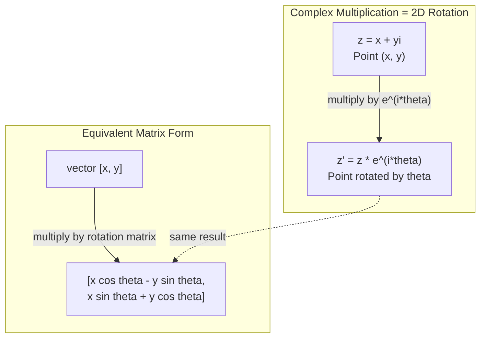
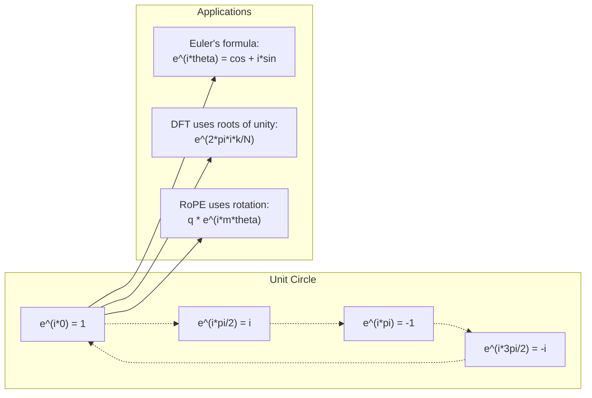

# Números complejos para IA

> La raíz cuadrada de -1 no es imaginaria, es la clave de las rotaciones, las frecuencias y la mitad del procesamiento de señales.

**Type:** Learn
**Language:**Python
**Prerequisites:** Phase 1, Lessons 01-04 (linear algebra, calculus)
**Time:** ~60 minutes

## Objetivos de aprendizaje

- Realizar aritmética compleja (agrega, multiplica, divide, conjugue) en forma rectangular y polar
- Aplicar la fórmula de Euler para convertir entre exponenciales complejos y funciones trigonómétricas
- Implemente la Transforma de Fourier discreta utilizando raíces complejas de unidad
- Explicar cómo se basan las rotaciones complejas en las codificaciones de posición de RoPE y sinusoidal en transformadores

## El problema

Abres un artículo sobre las transformaciones de Fourier y hay`i`Mira los codificadores de posición del transformador y ves`sin`y `cos`En diferentes frecuencias, las partes reales e imaginarias de exponenciales complejos.

Los números complejos parecen abstractos. Un sistema de números construido en la raíz cuadrada de -1 se siente como un truco matemático. Pero no es un truco. Es el lenguaje natural de las rotaciones y oscilaciones. Cada vez que algo gira, vibra o oscila, los números complejos son la herramienta correcta.

Sin entender los números complejos, no puede entender la Transforma de Fourier Discreta. No puede entender FFT. No puede entender cómo funciona RoPE (Rotary Position Embedding) en modelos de lenguaje modernos. No puede entender por qué los codificadores posicionales sinusoidales en el papel original del Transformer usan las frecuencias que hacen.

Esta lección construye la aritmética compleja desde cero, la conecta con la geometría y te muestra exactamente dónde aparecen los números complejos en el aprendizaje automático.

## El concepto

### ¿Qué es un número complejo?

Un número complejo tiene dos partes: una parte real y una parte imaginaria.

```
z = a + bi

where:
  a is the real part
  b is the imaginary part
  i is the imaginary unit, defined by i^2 = -1
```

Así es. se extiende la línea numérica en un plano. los números reales se sientan en un eje. los números imaginarios se sientan en el otro. cada número complejo es un punto en este plano.

### Aritmética compleja

**Addition.**Añade las partes reales, añade las partes imaginarias.

```math
\begin{aligned}
(a + bi) + (c + di) &= (a + c) + (b + d)i \\[4pt]
\text{Example: } (3 + 2i) + (1 + 4i) &= 4 + 6i
\end{aligned}
```

**Multiplication.**Utilice la ley de distribución y recuerda que$i^2 = -1$¿ Qué ?

```math
\begin{aligned}
(a + bi)(c + di) &= ac + adi + bci + bdi^2 \\
&= ac + adi + bci - bd \\
&= (ac - bd) + (ad + bc)i \\[8pt]
\text{Example: } (3 + 2i)(1 + 4i) &= 3 + 12i + 2i + 8i^2 \\
&= 3 + 14i - 8 \\
&= -5 + 14i
\end{aligned}
```

**Conjugate.**Vuelve la señal de la parte imaginaria.

```math
\text{conjugate of } (a + bi) = a - bi
```

El producto de un número complejo y su conjugado es siempre real:

```math
(a + bi)(a - bi) = a^2 + b^2
```

**Division.**Multiplicar el numerador y el denominador por el conjugado del denominador.

```math
\frac{a + bi}{c + di} = \frac{(a + bi)(c - di)}{c^2 + d^2}
```

Esto elimina la parte imaginaria del denominador, dándole un número complejo limpio.

### El plano complejo

El plano complejo mapea cada número complejo a un punto 2D. El eje horizontal es el eje real, el eje vertical es el eje imaginario.

```
z = 3 + 2i  corresponds to the point (3, 2)
z = -1 + 0i corresponds to the point (-1, 0) on the real axis
z = 0 + 4i  corresponds to the point (0, 4) on the imaginary axis
```

Un número complejo es simultáneamente un punto y un vector desde el origen. Esta interpretación dual es lo que hace que los números complejos sean útiles para la geometría.

### Forma polar

Cualquier punto del plano puede describirse por su distancia del origen y su ángulo del eje real positivo.

```math
\begin{aligned}
z &= r (\cos\theta + i \sin\theta) \\[4pt]
\text{where: } r &= |z| = \sqrt{a^2 + b^2} \quad \text{(magnitude, or modulus)} \\
\theta &= \mathop{\mathrm{atan2}}(b, a) \quad \text{(phase, or argument)}
\end{aligned}
```

Forma rectangular $(a + bi)$Es bueno para la adición.$(r, \theta)$es bueno para la multiplicación.

**Multiplication in polar form.**Multiplica las magnitudes, añade los ángulos.

```math
\begin{aligned}
z_1 &= r_1 e^{i\theta_1} \\
z_2 &= r_2 e^{i\theta_2} \\[4pt]
z_1 z_2 &= (r_1 r_2) \, e^{i(\theta_1 + \theta_2)}
\end{aligned}
```

Por eso los números complejos son perfectos para las rotaciones. Multiplicar por un número complejo con magnitud 1 es una rotación pura.

### La fórmula de Euler

El puente entre exponenciales complejos y trigonometría:

```math
e^{i\theta} = \cos\theta + i \sin\theta
```

Esta es la fórmula más importante de esta lección.$\theta = \pi$¿Qué es esto ?

```math
\begin{aligned}
e^{i\pi} &= \cos\pi + i \sin\pi = -1 + 0i = -1 \\[4pt]
\text{Therefore: } e^{i\pi} + 1 &= 0
\end{aligned}
```

Las constantes fundamentales ($e$¿ Qué ?$i$¿ Qué ?$\pi$, 1, 0) vinculados en una ecuación.

### Por qué la fórmula de Euler es importante para ML

La fórmula de Euler dice que$e^{i\theta}$traza el círculo unitario como $\theta$Las condiciones de la vida de los niños varían.$\theta = 0$, estás en$(1, 0)$- En el$\theta = \pi/2$, estás en$(0, 1)$- En el$\theta = \pi$, estás en$(-1, 0)$- En el$\theta = 3\pi/2$, estás en$(0, -1)$Una rotación completa es$\theta = 2\pi$¿ Qué ?

Esto significa que los exponenciales complejos son rotaciones. Y las rotaciones están en todas partes en procesamiento de señales y ML.

### Conexión a las rotaciones 2D

Multiplicando el número complejo $(x + yi)$por $e^{i\theta}$gira el punto $(x, y)$por ángulo $\theta$alrededor del origen.

```math
\begin{aligned}
&\text{Rotation via complex multiplication:} \\
&\quad (x + yi)(\cos\theta + i \sin\theta) = (x \cos\theta - y \sin\theta) + (x \sin\theta + y \cos\theta)i \\[8pt]
&\text{Rotation via matrix multiplication:} \\
&\quad \begin{bmatrix} \cos\theta & -\sin\theta \\ \sin\theta & \cos\theta \end{bmatrix} \begin{bmatrix} x \\ y \end{bmatrix} = \begin{bmatrix} x \cos\theta - y \sin\theta \\ x \sin\theta + y \cos\theta \end{bmatrix}
\end{aligned}
```

La matriz de rotación es simplemente una multiplicación compleja escrita en notación de matriz.



### Fámeros y señales giratorias

Un exponencial complejo $e^{i\omega t}$es un punto que gira alrededor del círculo unitario a frecuencia angular $\omega$- Como ...$t$aumenta, el punto sigue el círculo.

La parte real de este punto de rotación es$\cos(\omega t)$La parte imaginaria es$\sin(\omega t)$Una señal sinusoidal es la sombra de un número complejo rotativo.

```math
\begin{aligned}
e^{i\omega t} &= \cos(\omega t) + i \sin(\omega t) \\[4pt]
\text{Real part: } & \cos(\omega t) \quad \text{-- a cosine wave} \\
\text{Imaginary part: } & \sin(\omega t) \quad \text{-- a sine wave}
\end{aligned}
```

Esta es la representación de las fases. En lugar de rastrear una onda sinusal moviéndose, rastreas una flecha que gira suavemente. Los cambios de fase se convierten en compensaciones de ángulo. Los cambios de amplitud se convierten en cambios de magnitud. La adición de señales se convierten en adición vectorial.

### Raíces de la unidad

El $N$- las raíces de la unidad son $N$puntos equitativamente espaciados en el círculo unitario:

```math
w_k = e^{2\pi i k/N} \quad \text{for } k = 0, 1, 2, \ldots, N-1
```

Para$N = 4$, las raíces son: $1, i, -1, -i$(los cuatro puntos de la brújula).
Para$N = 8$, obtienes los cuatro puntos de la brújula más las cuatro diagonales.

Las raíces de la unidad son la base de la Transforma de Fourier Discreta.$N$frecuencias de igual espacio.

### Conexión a la DFT

La Transformación de Fourier discreta de una señal $x[0], x[1], \ldots, x[N-1]$es:

```math
X[k] = \sum_{n=0}^{N-1} x[n] \, e^{-2\pi i k n/N}
```

Cada uno .$X[k]$mide la correlación entre la señal y la$k$- la raíz de la unidad... un sinusoide complejo en frecuencia.$k$El DFT rompe una señal en$N$rotando los phase y le dice la amplitud y fase de cada uno.

### ¿Por qué no soy imaginario?

La palabra "imaginaria" es un accidente histórico.$i$¿No es más imaginario que los números negativos cuando la gente los rechazó por primera vez? los números negativos responden a "¿qué se resta 5 de 3 para obtener?"

Más útil: $i$Es un operador de rotación de 90 grados. Multiplica un número real por $i$Una vez, giras 90 grados hacia el eje imaginario.$i$de nuevo ($i^2$), giras otros 90 grados - ahora estás apuntando en la dirección real negativa.$i^2 = -1$No es misterioso, es un medio giro construido a partir de dos cuartos de giro.

Por eso los números complejos están en todas partes en la ingeniería. Cualquier cosa que gira - ondas electromagnéticas, estados cuánticos, oscilaciones de señal, codificación posicional - se describe naturalmente por números complejos.

### Las funciones de exponenciales complejas frente a las trigonométricas

Antes de la fórmula de Euler, los ingenieros escribían señales como $A \cos(\omega t + \phi)$-- amplitud $A$, frecuencia $\omega$, fase $\phi$Esto funciona pero hace que la aritmética sea dolorosa.

Con exponenciales complejos, la misma señal es $A e^{i(\omega t + \phi)}$. Añadir dos señales es simplemente añadir dos números complejos. Multiplicar (modular) es simplemente multiplicar magnitudes y añadir ángulos.

El campo entero de procesamiento de señales cambió a la notación exponencial compleja porque la matemática es más limpia. La "señal real" es siempre solo la parte real de la representación compleja. La parte imaginaria se lleva junto como contabilidad, haciendo que todo el álgebra funcione de manera natural.

### Conexión a transformadores

**Sinusoidal positional encodings**(papel original de transformador):

```math
\begin{aligned}
PE(pos, 2i) &= \sin\left(pos / 10000^{2i/d}\right) \\
PE(pos, 2i+1) &= \cos\left(pos / 10000^{2i/d}\right)
\end{aligned}
```

Los pares de pecado y cos son las partes reales e imaginarias de exponenciales complejos a diferentes frecuencias. Cada frecuencia proporciona una "resolución" diferente para la posición de codificación. Las frecuencias bajas cambian lentamente (posición gruesa). Las frecuencias altas cambian rápidamente (posición fina). Juntas dan a cada posición una huella digital de frecuencia única.

**RoPE (Rotary Position Embedding)**El modelo de la información se calcula utilizando estos vectores rotados, haciendo que el modelo sea sensible a la posición relativa a través de la multiplicación compleja.

| Operation | Algebraic Form | Geometric Meaning |
|-----------|---------------|-------------------|
| Addition | $(a+c) + (b+d)i$ | Vector addition in the plane |
| Multiplication | $(ac-bd) + (ad+bc)i$ | Rotate and scale |
| Conjugate | $a - bi$ | Reflect over real axis |
| Magnitude | $\sqrt{a^2 + b^2}$ | Distance from origin |
| Phase | $\mathop{\mathrm{atan2}}(b, a)$ | Angle from positive real axis |
| Division | multiply by conjugate | Reverse rotation and rescale |
| Power | $r^n e^{in\theta}$ | Rotate $n$ times, scale by $r^n$ |



```figure
roots-of-unity
```

## Construye el mismo

### Paso 1: clase compleja

Construye una clase de números complejos que admita la aritmética, la magnitud, la fase y la conversión entre formas rectangulares y polares.

```python
import math

class Complex:
    def __init__(self, real, imag=0.0):
        self.real = real
        self.imag = imag

    def __add__(self, other):
        return Complex(self.real + other.real, self.imag + other.imag)

    def __mul__(self, other):
        r = self.real * other.real - self.imag * other.imag
        i = self.real * other.imag + self.imag * other.real
        return Complex(r, i)

    def __truediv__(self, other):
        denom = other.real ** 2 + other.imag ** 2
        r = (self.real * other.real + self.imag * other.imag) / denom
        i = (self.imag * other.real - self.real * other.imag) / denom
        return Complex(r, i)

    def magnitude(self):
        return math.sqrt(self.real ** 2 + self.imag ** 2)

    def phase(self):
        return math.atan2(self.imag, self.real)

    def conjugate(self):
        return Complex(self.real, -self.imag)
```

### Paso 2: Conversión polar y fórmula de Euler

```python
def to_polar(z):
    return z.magnitude(), z.phase()

def from_polar(r, theta):
    return Complex(r * math.cos(theta), r * math.sin(theta))

def euler(theta):
    return Complex(math.cos(theta), math.sin(theta))
```

Verifique:`euler(theta).magnitude()`siempre debe ser 1.0. `euler(0)`debe dar (1, 0). `euler(pi)`debe dar (-1, 0).

### Paso 3: Rotación

Rotando un punto$(x, y)$por ángulo $\theta$es una multiplicación compleja:

```python
point = Complex(3, 4)
rotated = point * euler(math.pi / 4)
```

La magnitud se mantiene igual, sólo cambia el ángulo.

### Paso 4: DFT de la aritmética compleja

```python
def dft(signal):
    N = len(signal)
    result = []
    for k in range(N):
        total = Complex(0, 0)
        for n in range(N):
            angle = -2 * math.pi * k * n / N
            total = total + Complex(signal[n], 0) * euler(angle)
        result.append(total)
    return result
```

Esto es el$O(N^2)$DFT. Cada salida $X[k]$es la suma de las muestras de señal multiplicadas por raíces de unidad.

### Paso 5: DFT inverso

El DFT inverso reconstruye la señal original de su espectro. Los únicos cambios desde el DFT hacia adelante: voltear la señal en el exponente y dividir por $N$¿ Qué ?

```python
def idft(spectrum):
    N = len(spectrum)
    result = []
    for n in range(N):
        total = Complex(0, 0)
        for k in range(N):
            angle = 2 * math.pi * k * n / N
            total = total + spectrum[k] * euler(angle)
        result.append(Complex(total.real / N, total.imag / N))
    return result
```

Esto le da una reconstrucción perfecta. Aplique DFT, luego IDFT, y usted vuelve la señal original a la precisión de la máquina. No se pierde información.

### Paso 6: Raíces de la unidad

```python
def roots_of_unity(N):
    return [euler(2 * math.pi * k / N) for k in range(N)]
```

Verifique dos propiedades:
- Cada raíz tiene magnitud exactamente 1.
- La suma de todos$N$las raíces son cero (anulan por simetría).

Estas propiedades son lo que hace invertible el DFT. Las raíces de la unidad forman una base ortogonal para el dominio de frecuencia.

## Usalo

Python tiene soporte integrado de números complejos.`j`representa la unidad imaginaria.

```python
z = 3 + 2j
w = 1 + 4j

print(z + w)
print(z * w)
print(abs(z))

import cmath
print(cmath.phase(z))
print(cmath.exp(1j * cmath.pi))
```

Para matrices, numpy maneja números complejos de forma nativa:

```python
import numpy as np

z = np.array([1+2j, 3+4j, 5+6j])
print(np.abs(z))
print(np.angle(z))
print(np.conj(z))
print(np.real(z))
print(np.imag(z))

signal = np.sin(2 * np.pi * 5 * np.linspace(0, 1, 128))
spectrum = np.fft.fft(signal)
freqs = np.fft.fftfreq(128, d=1/128)
```

## Envío

- ¿ Qué ?`code/complex_numbers.py`para generar `outputs/skill-complex-arithmetic.md`¿ Qué ?

## Los ejercicios

1. **Complex arithmetic by hand.**Computación$(2 + 3i)(4 - i)$y verificar con el código. Luego calcular.$(5 + 2i) / (1 - 3i)$Dibujar ambos resultados en el plano complejo y comprobar que la multiplicación giró y escalaron el primer número.

2. **Rotation sequence.**Comience con el punto.$(1, 0)$Multiplicar por$e^{i\pi/6}$Ve a ver si regresas a la casa.$(1, 0)$Imprimir las coordenadas en cada paso y confirmar que rastrean un 12-gon regular.

3. **DFT of a known signal.**Crear una señal que es la suma de $\sin(2\pi \cdot 3t)$y $0.5 \sin(2\pi \cdot 7t)$Se muestra en 32 puntos. ejecuta su DFT. Verifique si el espectro de magnitud tiene picos en las frecuencias 3 y 7, con el pico en 7 siendo la mitad de la altura del pico en 3.

4. **Roots of unity visualization.**Compute las octavas raíces de la unidad. Verifique si suman a cero. Verifique que multiplicando cualquier raíz por la raíz primitiva$e^{2\pi i/8}$da la siguiente raíz.

5. **Rotation matrix equivalence.**Para 10 ángulos aleatorios y 10 puntos aleatorios, verifique que la multiplicación compleja da el mismo resultado que la multiplicación de matrices-vectores con la matriz de rotación 2x2. Imprima la diferencia numérica máxima.

### Indicios

**Exercise 1.**Expande el producto con $i^2 = -1$, luego dividir multiplicando la parte superior y la parte inferior por el conjugado $1 + 3i$- Compruebe el producto con`Complex(2, 3) * Complex(4, -1)`: su `magnitude()`debe ser igual al producto de las dos magnitudes, y su`phase()`debe ser igual a la suma de las dos fases.

**Exercise 2.**Haz el paso con `euler(math.pi / 6)`y multiplicar 12 veces. En cada paso, compruebe que la magnitud permanece 1 y que el ángulo crece en 30 grados. El punto final debe estar dentro de aproximadamente 1e-12 de (1, 0).

**Exercise 3.**Haga los puntos de tiempo con $t = n/32$y llamar`dft`Sólo mira en los contenedores 0 a 15, porque la mitad superior es una imagen especular.$k$para un seno de amplitud $A$¿ Es verdad ?$AN/2$, así que espere alrededor de 16 en el cuadro 3 y alrededor de 8 en el cuadro 7.

**Exercise 4.**Llamé`roots_of_unity(8)`y agregar las raíces: la magnitud de la suma debe ser cerca de 0. Dividir cada raíz por la raíz anterior y comprobar que cada resultado es igual `euler(2 * math.pi / 8)`¿ Qué ?

**Exercise 5.**La matriz de rotación es [[cos t, -sin t], [sin t, cos t]]. Para cada ángulo y punto, calcular `euler(t) * Complex(x, y)`y el producto de la matriz, luego registran la mayor diferencia absoluta.$10^{-15}$¿ Qué ?

## Términos clave

| Term | What it means |
|------|---------------|
| Complex number | A number $a + bi$ where $a$ is the real part, $b$ is the imaginary part, and $i^2 = -1$ |
| Imaginary unit | The number $i$, defined by $i^2 = -1$. Not imaginary in the philosophical sense -- it is a rotation operator |
| Complex plane | The 2D plane where the x-axis is real and the y-axis is imaginary. Also called the Argand plane |
| Magnitude (modulus) | The distance from the origin: $\sqrt{a^2 + b^2}$. Written as $\lvert z \rvert$ |
| Phase (argument) | The angle from the positive real axis: $\mathop{\mathrm{atan2}}(b, a)$. Written as $\arg(z)$ |
| Conjugate | The mirror image across the real axis: conjugate of $a + bi$ is $a - bi$ |
| Polar form | Expressing $z$ as $r e^{i\theta}$ instead of $a + bi$. Makes multiplication easy |
| Euler's formula | $e^{i\theta} = \cos\theta + i \sin\theta$. Connects exponentials to trigonometry |
| Phasor | A rotating complex number $e^{i\omega t}$ representing a sinusoidal signal |
| Roots of unity | The $N$ complex numbers $e^{2\pi i k/N}$ for $k = 0$ to $N-1$. $N$ equally spaced points on the unit circle |
| DFT | Discrete Fourier Transform. Decomposes a signal into complex sinusoidal components using roots of unity |
| RoPE | Rotary Position Embedding. Uses complex multiplication to encode relative position in transformer attention |

## Leer más

- [Visual Introduction to Euler's Formula](https://betterexplained.com/articles/intuitive-understanding-of-eulers-formula/)- construye intuición geométrica sin notación pesada
- [Su et al.: RoFormer (2021)](https://arxiv.org/abs/2104.09864)- el documento que introduce el emplazamiento rotativo de posición mediante rotación compleja
- [Vaswani et al.: Attention Is All You Need (2017)](https://arxiv.org/abs/1706.03762)- el papel original de transformador con codificación posicional sinusoidal
- [3Blue1Brown: Euler's formula with introductory group theory](https://www.youtube.com/watch?v=mvmuCPvRoWQ)- explicación visual del porqué $e^{i\pi} = -1$
- [Needham: Visual Complex Analysis](https://global.oup.com/academic/product/visual-complex-analysis-9780198534464)- el mejor tratamiento visual de números complejos, lleno de conocimientos geométricos
- [Strang: Introduction to Linear Algebra, Ch. 10](https://math.mit.edu/~gs/linearalgebra/)- números complejos en el contexto del álgebra lineal y los valores propios
