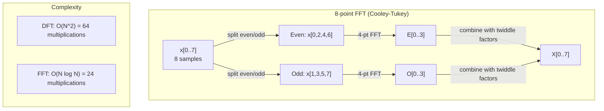
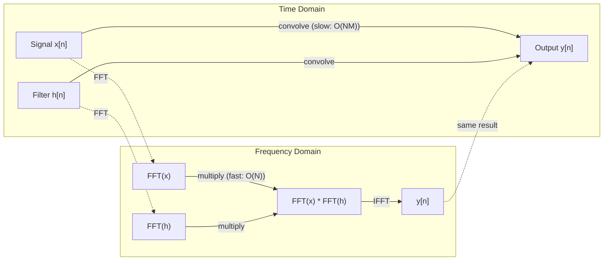

# فرقلای فوری

> هر سیگنال مجموعه امواج سینوس است. تحول فوریه به شما می گوید کدامین هستند.

**Type:** Build
**Language:**پیتون
**Prerequisites:** Phase 1, Lessons 01-04, 19 (complex numbers)
**Time:** ~90 minutes

## اهداف یادگیری

- از ابتدا DFT را اجرا کنید و آن را در برابر $O(N \log N)$کولی-تکی FFT
- تعبیر معادلات فرکانس: آمپلتد، فاز و طیف قدرت را از یک سیگنال استخراج کنید
- استفاده از نظریه کنولوشن برای انجام کنولوشن از طریق ضرب FFT
- اتصال تجزیه فرکانس فوری به کدگذاری موقعیت تبدیل کننده و لایه های کنوولسیون CNN

## مشکل

ضبط صوتی یک ردیف اندازه گیری فشار در طول زمان است. قیمت سهام یک ردیف ارزش ها در طول روز است. یک تصویر یک شبکه از شدت پیکسل ها در فضا است. همه اینها داده های حوزه زمان (یا دامنه فضا) هستند. شما می بینید که ارزش ها در طول برخی شاخص ها تغییر می کنند.

اما بسیاری از الگوها در حوزه زمان نامرئی هستند. آیا این سیگنال صوتی یک صدا خالص یا یک سند است؟ آیا این قیمت سهام چرخه هفتگی دارد؟ آیا این تصویر بافت تکراری دارد؟ این سوالات مربوط به محتوای فرکانس است و دامنه زمان آن را پنهان می کند.

فرور ترانسفورم اطلاعات را از دامنه زمان به دامنه فرکانس تبدیل می کند. این یک سیگنال را می گیرد و آن را به امواج سینوس فرکانس های مختلف تجزیه می کند. هر امواج سینوس دارای یک امپلمیتود (چه مقدار قوی است) و یک مرحله (که از کجا شروع می شود) است. فرور ترانسفورم به شما هر دو را می گوید.

این برای ML مهم است زیرا تفکر دامنه فرکانس در همه جا ظاهر می شود. شبکه های عصبی کنولوشن کنولوشن را انجام می دهند که ضرب در دامنه فرکانس است. کدگذاری موقعیت ترانسفورماتور از تجزیه فرکانس برای نشان دادن موقعیت استفاده می کند. مدل های صوتی (تعرفی سخنران، تولید موسیقی) بر روی طیف ها عمل می کنند - نمایش های فرکانسی صدا. مدل های سری زمان به دنبال الگوهای دوره ای هستند. درک تحول فوریه به شما فرهنگ لغاتی می دهد تا با همه اینها کار کنید.

## مفهوم

### تعریف DFT

داده شده$N$نمونه ها$x[0], x[1], \ldots, x[N-1]$، " ترانسفورم فوري" ديسکريت تولید ميکنه$N$تعادل های فرکانس $X[0], X[1], \ldots, X[N-1]$:

```math
X[k] = \sum_{n=0}^{N-1} x[n] \, e^{-2\pi i k n/N} \qquad \text{for } k = 0, 1, \ldots, N-1
```

هرکدوم$X[k]$این یک عدد پیچیده است.$\lvert X[k] \rvert$به شما عرض فرکانس میگه$k$. مرحله اش$\angle X[k]$به شما می گوید که مرحله تعویض این فرکانس است.

نکته کلیدی:$e^{-2\pi i k n/N}$یک فازور در فرکانس چرخش است$k$. DFT ارتباط بین سیگنال و هر یک از$N$فرکانس های مساوی. اگر سیگنال حاوی انرژی در فرکانس باشد$k$اگر این اتفاق بیفتد، نزدیک به صفر می شود.

### معنی هر یک از این معادلات

**$X[0]$: the DC component.**این مجموع تمام نمونه ها است -- متناسب با متوسط. این ثابت (فرکانس صفر) تعویض سیگنال را نشان می دهد.

```math
X[0] = \sum_{n=0}^{N-1} x[n] \, e^0 = \text{sum of all samples}
```

**$X[k]$ for $1 \le k \le N/2$: positive frequencies.** $X[k]$تعدد را نشان می دهد$k$چرخه های هر$N$نمونه ها. بالاتر$k$فرکانس بالاتر (تذبذب سریعتر) را معنی می دهد.

**$X[N/2]$: the Nyquist frequency.**بالاترين فرکانس که ميتوني با آن نشان بدي$N$نمونه ها. در بالای این، شما نام مستعار می گیرید-- فرکانس های بالا به عنوان فرکانس های پایین پنهان می شوند.

**$X[k]$ for $N/2 < k < N$: negative frequencies.**برای سیگنال های واقعی،$X[N-k] = \overline{X[k]}$فرکانس های منفی عکس های آینه ای از فرکانس های مثبت هستند. به همین دلیل اطلاعات مفید در اولین$N/2 + 1$معادلات

### DFT معکوس

DFT معکوس سیگنال اصلی را از معادل های فرکانس خود بازسازی می کند:

```math
x[n] = \frac{1}{N} \sum_{k=0}^{N-1} X[k] \, e^{2\pi i k n/N} \qquad \text{for } n = 0, 1, \ldots, N-1
```

تنها تفاوت های DFT پیش رو: علامت در نماد مثبت (نه منفی) است و یک $1/N$عامل عادی سازی

DFT معکوس بازسازی کامل است. هیچ اطلاعاتی از دست نمی رود. شما می توانید از دامنه زمان به دامنه فرکانس و بدون هیچ خطا برگردید. DFT تغییر پایه است - این دوباره همان اطلاعات را در یک سیستم هماهنگی متفاوت بیان می کند.

### FFT: سرعتش رو بالا ميبرم

DFT که در بالا تعریف شده است $O(N^2)$: برای هر یک از$N$معادلات خروجی، شما جمع آوری می کنید $N$نمونه های ورودی. برای $N$= 1 میلیون، یعنی$10^{12}$عملیات

فرجام فوریه سریع (FFT) نتیجه مشابه را در $O(N \log N)$. برای$N$یک میلیون، یعنی حدود 20 میلیون عملیات به جای یک تریلیون. این چیزی است که باعث می شود تجزیه و تحلیل فرکانس عملی باشد.

الگوریتم Cooley-Tukey (شترکی FFT) با تقسیم و فتح کار می کند:

1. سیگنال را به نمونه های حتی و نامتعادل تقسیم کنید.
2. DFT هر نیمه را به صورت تکراری محاسبه کنید.
3. دو DFT نیمه اندازه را با استفاده از "فاکتورهای دوگانه" ترکیب کنید $e^{-2\pi i k/N}$. .

```math
\begin{aligned}
X[k] &= E[k] + e^{-2\pi i k/N} \, O[k] && \text{for } k = 0, \ldots, N/2 - 1 \\
X[k + N/2] &= E[k] - e^{-2\pi i k/N} \, O[k] && \text{for } k = 0, \ldots, N/2 - 1 \\[6pt]
\text{where } E &= \text{DFT of even-indexed samples} \\
O &= \text{DFT of odd-indexed samples}
\end{aligned}
```

همترايش به اين معناست که هر سطح بازپسين$O(N)$کار کردن و وجود داره$\log_2(N)$سطحها.$O(N \log N)$. .



FFT نیاز به طول سیگنال را به یک قدرت 2 است. در عمل، سیگنال ها به صفر به قدرت بعدی 2 بسته می شوند.

### تجزیه و تحلیل طیف

.**power spectrum**.$\lvert X[k] \rvert^2$-- مقادیر مربع هر معادل فرکانس. این نشان می دهد که چقدر انرژی در هر فرکانس است.

.**phase spectrum**.$\angle X[k]$برای اکثر وظایف تجزیه و تحلیل، شما به طیف قدرت اهمیت می دهید و مرحله را نادیده می گیرید.

```math
\begin{aligned}
\text{Power at frequency } k: \quad P[k] &= |X[k]|^2 = \mathop{\mathrm{Re}}(X[k])^2 + \mathop{\mathrm{Im}}(X[k])^2 \\
\text{Phase at frequency } k: \quad \phi[k] &= \mathop{\mathrm{atan2}}(\mathop{\mathrm{Im}}(X[k]), \mathop{\mathrm{Re}}(X[k]))
\end{aligned}
```

### قطع فریکوئنسی

قطعنامه فرکانس DFT بستگی به تعداد نمونه ها دارد $N$و نرخ نمونه گیری$f_s$. .

```math
\begin{aligned}
\text{Frequency of bin } k: \quad & f_k = k \cdot f_s / N \\
\text{Frequency resolution:} \quad & \Delta f = f_s / N \\
\text{Maximum frequency:} \quad & f_{\max} = f_s / 2 \quad \text{(Nyquist)}
\end{aligned}
```

برای حل دو فرکانس که نزدیک به هم هستند، شما نیاز به نمونه های بیشتری دارید. برای گرفتن فرکانس های بالا، شما نیاز به نرخ نمونه گیری بالاتر دارید.

### نظریه پیچیدگی

این یکی از مهم ترین نتایج پردازش سیگنال ها و مستقیماً مربوط به سی ان ان است.

**Convolution in the time domain equals pointwise multiplication in the frequency domain.**

```math
\begin{aligned}
& x * h = \text{IFFT}(\text{FFT}(x) \cdot \text{FFT}(h)) \\[4pt]
& \text{where } * \text{ is convolution and } \cdot \text{ is element-wise multiplication}
\end{aligned}
```

چرا این مهمه:

- پیچ مستقیم دو سیگنال طول$N$و$M$میره$O(NM)$عملیات
- کنولوشن مبتنی بر FFT می گیرد $O(N \log N)$: هر دو را تغییر دهید، چندان کنید، برگردید
- برای هسته های بزرگ، کنولوشن FFT بسیار سریع تر است.
- این دقیقاً اتفاقی است که در لایه های پیچ و خم با میدان های پذیرنده بزرگ رخ می دهد.

توجه: DFT پیچ گرد را محاسبه می کند (سیگنال به اطراف می چرخد). برای پیچ خطی (بدون پیچ) ، صفر-پاد هر دو سیگنال به طول $N + M - 1$قبل از محاسبه



### پنجره

DFT فرض می کنه که سیگنال دوره ای باشه -$N$نمونه ها به عنوان یک دوره از یک سیگنال تکرار بی نهایت. اگر سیگنال در همان مقدار شروع و پایان نشود، این یک عدم تداوم در مرز ایجاد می کند که به عنوان محتوای فرضی فرکانس بالا ظاهر می شود. این به عنوان نشت طیف نامیده می شود.

پنجره سازی باعث کاهش خروجی می شود با کاهش سیگنال به صفر در هر دو پای قبل از محاسبه DFT.

پنجره های مشترک:

| Window | Shape | Main lobe width | Side lobe level | Use case |
|--------|-------|----------------|-----------------|----------|
| Rectangular | Flat (no window) | Narrowest | Highest (-13 dB) | When signal is exactly periodic in N samples |
| Hann | Raised cosine | Moderate | Low (-31 dB) | General purpose spectral analysis |
| Hamming | Modified cosine | Moderate | Lower (-42 dB) | Audio processing, speech analysis |
| Blackman | Triple cosine | Wide | Very low (-58 dB) | When side lobe suppression is critical |

```math
\begin{aligned}
\text{Hann window:} \quad & w[n] = 0.5 \left(1 - \cos\frac{2\pi n}{N-1}\right) \\
\text{Hamming window:} \quad & w[n] = 0.54 - 0.46 \cos\frac{2\pi n}{N-1}
\end{aligned}
```

پنجره را با ضرب آن به لحاظ عنصر با سیگنال قبل از DFT اعمال کنید: `X = DFT(x * w)`. .

### خواص DFT

| Property | Time Domain | Frequency Domain |
|----------|-------------|-----------------|
| Linearity | $ax + by$ | $aX + bY$ |
| Time shift | $x[n - k]$ | $X[f] e^{-2\pi i f k/N}$ |
| Frequency shift | $x[n] e^{2\pi i f_0 n/N}$ | $X[f - f_0]$ |
| Convolution | $x * h$ | $X \cdot H$ (pointwise) |
| Multiplication | $x \cdot h$ (pointwise) | $X * H$ (circular convolution, scaled by $1/N$) |
| Parseval's theorem | $\sum \lvert x[n] \rvert^2$ | $\frac{1}{N} \sum \lvert X[k] \rvert^2$ |
| Conjugate symmetry (real input) | $x[n]$ real | $X[k] = \overline{X[N-k]}$ |

نظريه پارسوال ميگه که کل انرژي در هر دو حوزه ي اين است که انرژي از طريق تحول حفظ ميشه

### اتصال به کد بندی موقعیت

ترانسفورمور اصلی از کد بندی موقعیت سینوسایدی استفاده می کند:

```math
\begin{aligned}
PE(pos, 2i) &= \sin\left(pos / 10000^{2i/d_{\text{model}}}\right) \\
PE(pos, 2i+1) &= \cos\left(pos / 10000^{2i/d_{\text{model}}}\right)
\end{aligned}
```

هر جفت ابعاد$(2i, 2i+1)$فرکانس ها از درجه بالا (متعدد 0.1) تا درجه پایین (متعدد آخر) فاصله هندسی دارند. این به هر موقعیت یک الگوی منحصر به فرد در تمام باند های فرکانس می دهد - شبیه به نحوه شناسایی یک سیگنال توسط معادل فوری.

ویژگی های کلیدی این ماده:

- **Uniqueness:**هیچ دو موقعیت دارای کد مشابه نیستند.
- **Bounded values:**گناه و گناه هميشه در ميانم هستن$[-1, 1]$. .
- **Relative position:**کدگذاری موقعیت$p+k$می تواند به عنوان یک تابع خطی کدگذاری در موقعیت بیان شود $p$مدل می تونه یاد بگیره که به موقعیت های نسبی توجه کنه

### ارتباط با سی ان ان

یک لایه کنولوشن یک فیلتر آموخته (کرنل) را با حرکت آن در سیگنال یا تصویر به ورودی می دهد.

با نظریه کنولوشن، این معادل:
1. FFT ورودی
2. FFT هسته
3. چندان در دامنه فرکانس
4. اگر نتیجه

پیاده سازی های استاندارد CNN از کنولوشن مستقیم (سرعت تر برای هسته های کوچک 3x3) استفاده می کنند. اما برای هسته های بزرگ یا کنولوشن جهانی، رویکردهای مبتنی بر FFT به طور قابل توجهی سریع تر هستند. برخی از معماری ها (مانند FNet) توجه را به طور کامل با FFT جایگزین می کنند و به دقت رقابتی با FFT می رسند.$O(N \log N)$به جای$O(N^2)$پیچیدگی

### طیف ها و فرسوفورمی کوتاه مدت

یک FFT واحد محتوای فرکانس کل سیگنال را به شما می دهد، اما چیزی در مورد اینکه این فرکانس ها چه زمانی رخ می دهد به شما نمی گوید. یک چرپ (سیگنال که فرکانس آن در طول زمان افزایش می یابد) و یک سند (همه فرکانس ها همزمان وجود دارد) می توانند طیف بزرگی یکسان داشته باشند.

فرجام فوریه کوتاه مدت (STFT) با محاسبه FFT ها در پنجره های متداخل سیگنال این مسئله را حل می کند. نتیجه یک طیف نامه است: یک نمایش 2D با زمان در یک محور و فرکانس در سمت دیگر. شدت در هر نقطه نشان دهنده انرژی در آن فرکانس در آن زمان است.

```
STFT procedure:
1. Choose a window size (e.g., 1024 samples)
2. Choose a hop size (e.g., 256 samples -- 75% overlap)
3. For each window position:
   a. Extract the windowed segment
   b. Apply a Hann/Hamming window
   c. Compute FFT
   d. Store the magnitude spectrum as one column of the spectrogram
```

طیف ها نمایش ورودی استاندارد برای مدل های صوتی ML هستند. مدل های تشخیص سخن (Whisper، DeepSpeech) بر روی طیف های mel عمل می کنند - طیف ها با فرکانس هایی که به مقیاس mel نقشه برداری شده است، که بهتر با درک صدای انسان مطابقت دارد.

### نامگذاری

اگر سیگنال فریکوئنسی های بالاتر را داشته باشد$f_s/2$(فرکانس نیکویست) ، نمونه گیری در سرعت$f_s$یک سیگنال 90 هرتز که در 100 هرتز نمونه گرفته شده به یک سیگنال 10 هرتز شبیه به آن است. هیچ راهی برای تشخیص آنها از نمونه ها نیست.

```
Example:
  True signal: 90 Hz sine wave
  Sampling rate: 100 Hz
  Apparent frequency: 100 - 90 = 10 Hz

  The samples from the 90 Hz signal at 100 Hz sampling rate
  are identical to the samples from a 10 Hz signal.
  No amount of math can recover the original 90 Hz.
```

به همین دلیل است که تبدیل کننده های آنالوگ به دیجیتال شامل فیلترهای ضد الایزینگ هستند که فرکانس های بالای نیکیست را قبل از نمونه گیری حذف می کنند. در ML، الایزینگ هنگام نمونه گیری نقشه های ویژگی بدون فیلتر مناسب کم گذری ظاهر می شود - برخی معماری ها با لایه های جمع آوری ضد الایزنگ این موضوع را حل می کنند.

### صفر کردن باعث افزایش وضوح نمی شود

یک تصور نادرست رایج: صفر کردن یک سیگنال قبل از FFT باعث بهبود رزولوشن فرکانس می شود. این کار را نمی کند. صفر کردن بین سطل های فرکانس موجود، به شما طیف ای را به نظر می دهد. اما نمی تواند جزئیات فرکانس را که در نمونه های اصلی وجود نداشت، نشان دهد.

وضوح فرکانس واقعی فقط به زمان مشاهده بستگی داره$T = N / f_s$. براي حل دو فرکانس جدا شده توسط$\Delta f$، حداقل به شما نياز داره$T = 1 / \Delta f$هیچ مقدار صفر-پادینگ این حد اساسی را تغییر نمی دهد.

```figure
fourier-synthesis
```

## آن را بسازید

### مرحله ی اول: DFT از ابتدا

.$O(N^2)$DFT مستقیما از تعریف این امر پیروی می کند.

```python
import math

class Complex:
    ...

def dft(x):
    N = len(x)
    result = []
    for k in range(N):
        total = Complex(0, 0)
        for n in range(N):
            angle = -2 * math.pi * k * n / N
            w = Complex(math.cos(angle), math.sin(angle))
            xn = x[n] if isinstance(x[n], Complex) else Complex(x[n])
            total = total + xn * w
        result.append(total)
    return result
```

### مرحله دوم: DFT معکوس

ساختار مشابه، معادل مثبت، تقسیم به $N$. .

```python
def idft(X):
    N = len(X)
    result = []
    for n in range(N):
        total = Complex(0, 0)
        for k in range(N):
            angle = 2 * math.pi * k * n / N
            w = Complex(math.cos(angle), math.sin(angle))
            total = total + X[k] * w
        result.append(Complex(total.real / N, total.imag / N))
    return result
```

### مرحله سوم: FFT (کولی-تکی)

FFT تکراری نیاز به قدرت دو طول دارد. به دو برابر و عجیب تقسیم شود، تکراری، با عوامل تندیل ترکیب شود.

```python
def fft(x):
    N = len(x)
    if N <= 1:
        return [x[0] if isinstance(x[0], Complex) else Complex(x[0])]
    if N % 2 != 0:
        return dft(x)

    even = fft([x[i] for i in range(0, N, 2)])
    odd = fft([x[i] for i in range(1, N, 2)])

    result = [Complex(0)] * N
    for k in range(N // 2):
        angle = -2 * math.pi * k / N
        twiddle = Complex(math.cos(angle), math.sin(angle))
        t = twiddle * odd[k]
        result[k] = even[k] + t
        result[k + N // 2] = even[k] - t
    return result
```

### مرحله 4: کمک کننده های تجزیه و تحلیل طیف

```python
def power_spectrum(X):
    return [xk.real ** 2 + xk.imag ** 2 for xk in X]

def convolve_fft(x, h):
    N = len(x) + len(h) - 1
    padded_N = 1
    while padded_N < N:
        padded_N *= 2

    x_padded = x + [0.0] * (padded_N - len(x))
    h_padded = h + [0.0] * (padded_N - len(h))

    X = fft(x_padded)
    H = fft(h_padded)

    Y = [xk * hk for xk, hk in zip(X, H)]

    y = idft(Y)
    return [y[n].real for n in range(N)]
```

## ازش استفاده کن

برای کار واقعی، از FFT numpy استفاده کنید که توسط کتابخانه های C بسیار بهینه شده پشتیبانی می شود.

```python
import numpy as np

signal = np.sin(2 * np.pi * 5 * np.arange(256) / 256)
spectrum = np.fft.fft(signal)
freqs = np.fft.fftfreq(256, d=1/256)

power = np.abs(spectrum) ** 2

positive_freqs = freqs[:len(freqs)//2]
positive_power = power[:len(power)//2]
```

برای پنجره سازی و تجزیه و تحلیل طیف پیشرفته تر:

```python
from scipy.signal import windows, stft

window = windows.hann(256)
windowed = signal * window
spectrum = np.fft.fft(windowed)
```

برای پیچ:

```python
from scipy.signal import fftconvolve

result = fftconvolve(signal, kernel, mode='full')
```

برای طیف ها:

```python
from scipy.signal import stft

frequencies, times, Zxx = stft(signal, fs=sample_rate, nperseg=256)
spectrogram = np.abs(Zxx) ** 2
```

ماتریکس طیف نامه شکل دارد (n_frequencies, n_time_frames). هر ستون طیف قدرت در یک پنجره زمان است. این چیزی است که مدل های صوتی ML به عنوان ورودی مصرف می کنند.

## -باده

فرار کن`code/fourier.py`تولید کردن`outputs/prompt-spectral-analyzer.md`. .

## تمرینات

1. **Pure tone identification.**یک سیگنال با یک موج سینوس واحد را با فرکانس ناشناخته (از 1 تا 50 هرتز) ایجاد کنید، که در 128 هرتز برای 1 ثانیه نمونه گیری شود. از DFT خود برای شناسایی فرکانس استفاده کنید. مطابقت پاسخ را بررسی کنید. حالا صداهای گاوسی را با انحراف استاندارد 0.5 اضافه کنید و تکرار کنید. صدا چگونه بر طیف تاثیر می گذارد؟

2. **FFT vs DFT verification.**یک سیگنال تصادفی طول 64 تولید کنید.$O(N^2){}$) و FFT. بررسی کنید که تمام معادل ها با 1e-10 مطابقت دارند. زمان هر دو عملکرد را در سیگنال های طول 256, 512, 1024, و 2048 نشان می دهد. نسبت زمان DFT به زمان FFT را نشان دهید.

3. **Convolution theorem proof by example.**ایجاد سیگنال x = [1, 2, 3, 4, 0, 0, 0, 0] و فیلتر h = [1, 1, 1, 0, 0, 0, 0, 0]. کنولسیون دایره ای آنها را مستقیماً محاسبه کنید (لپول سرپوش). سپس آن را از طریق FFT (تغییر، ضرب، تبدیل معکوس) محاسبه کنید. نتیجه را بررسی کنید. اکنون کنولسیون خطی را با صفر-پاد مناسب انجام دهید.

4. **Windowing effects.**یک سیگنال ایجاد کنید که مجموع دو موج سینوس در 10 هرتز و 12 هرتز (خیلی نزدیک) باشد. یک ثانیه با 128 هرتز نمونه بگیرید. طیف قدرت را بدون پنجره، پنجره هانی و پنجره هامینگ محاسبه کنید. کدام پنجره آسان ترین تشخیص دو اوج را می کند؟ چرا؟

5. **Positional encoding analysis.**کد بندی موقعیت سینوسایدی برای d_model = 128 و max_pos = 512 تولید کنید. برای هر جفت موقعیت $(p_1, p_2)$، محصول نقطه ای از کدگذاری های خود را محاسبه کنید. نشان دهید که محصول نقطه تنها به$\lvert p_1 - p_2 \rvert$با افزایش فاصله، چه اتفاقی برای عدد نقطه ای می افتد؟

### اشاره ها

**Exercise 1.**با 128 نمونه در طول 1 ثانیه،$k$.$k$Hz، بنابراین برای فرکانس یک عدد کامل شاخص بزرگترین مقدار در سطل 1 تا 63 فرکانس است. یک عدد کامل هرتز را انتخاب کنید. فرکانس بین دو سطل بین همسایه های خود گسترش می یابد و اوج تنها نزدیک ترین سطل را می دهد. استفاده کنید `generate_signal`و`magnitude_spectrum`بعد از اضافه کردن صدا، چک کنید که اوج هنوز در همان سطل است در حالی که سایر سطل ها بالا می روند.

**Exercise 2.**از قدرت دو طول استفاده کن چون`fft`. سیگنال رو به نصف تقسیم میکنه`max(abs(a - b))`نسبت زمان باید تقریبا به طور$N / \log_2 N$. .

**Exercise 3.**برای پیچ گرد، محاسبه کنید$y[n] = \sum_k h[k] x[(n-k) \bmod 8]$دست به دست$n$= 0، 1 و 2 و مقایسه سه مقدار اول از `convolve_direct`و`convolve_fft`. پیچ خطی دارای طول 4 + 3 - 1 = 6 است، بنابراین ابتدا بررسی کنید که آیا طول 8 به اندازه کافی طولانی است.

**Exercise 4.**استفاده کنید`hann_window`،`hamming_window`،`apply_window`و`power_spectrum`، و اوج های جداگانه بین 9 تا 13 هرتز را بشمارید. هر دو 10 هرتز و 12 هرتز چرخه های کامل را در 1 ثانیه کامل می کنند، بنابراین هیچ پنجره ای ممکن است به نظر بهتر برسد. با 10.5 هرتز و 12.5 هرتز تکرار کنید تا از نفوذ که پنجره ها کاهش می دهند دیدن کنید.

**Exercise 5.**هر کد را با  محاسبه کنید`positional_encoding(pos, 128)`. مقايسه محصول نقطه ای برای موقعیت ها (0, 10) با محصول نقطه ای برای (100, 110): دو مقدار باید با حدود 1e-10 مطابقت داشته باشد. سپس محصول نقطه ای را در برابر $\lvert p_1 - p_2 \rvert$برای یک ثابت$p_1$. .

## اصطلاحات کلیدی

| Term | What it means |
|------|---------------|
| DFT (Discrete Fourier Transform) | Converts $N$ time-domain samples into $N$ frequency-domain coefficients. Each coefficient is the correlation with a complex sinusoid at that frequency |
| FFT (Fast Fourier Transform) | An $O(N \log N)$ algorithm to compute the DFT. The Cooley-Tukey algorithm splits even/odd indices recursively |
| Inverse DFT | Reconstructs the time-domain signal from frequency coefficients. Same formula as DFT with flipped exponent sign and $1/N$ scaling |
| Frequency bin | Each index $k$ in the DFT output represents frequency $k f_s/N$ Hz. The "bin" is the discrete frequency slot |
| DC component | $X[0]$, the zero-frequency coefficient. Proportional to the signal mean |
| Nyquist frequency | $f_s/2$, the maximum frequency representable at sampling rate $f_s$. Frequencies above this alias |
| Power spectrum | $\lvert X[k] \rvert^2$, the squared magnitude of each frequency coefficient. Shows energy distribution across frequencies |
| Phase spectrum | $\angle X[k]$, the phase offset of each frequency component. Often ignored in analysis |
| Spectral leakage | Spurious frequency content caused by treating a non-periodic signal as periodic. Reduced by windowing |
| Window function | A tapering function (Hann, Hamming, Blackman) applied before DFT to reduce spectral leakage |
| Twiddle factor | The complex exponential $e^{-2\pi i k/N}$ used to combine sub-DFTs in the FFT butterfly computation |
| Convolution theorem | Convolution in time domain equals pointwise multiplication in frequency domain. Fundamental to signal processing and CNNs |
| Circular convolution | Convolution where the signal wraps around. This is what the DFT naturally computes |
| Linear convolution | Standard convolution without wraparound. Achieved by zero-padding before DFT |
| Parseval's theorem | Total energy is preserved through the Fourier transform. $\sum \lvert x[n] \rvert^2 = \frac{1}{N} \sum \lvert X[k] \rvert^2$ |
| Aliasing | When frequencies above Nyquist appear as lower frequencies due to insufficient sampling rate |

## خواندن بیشتر

- [Cooley & Tukey: An Algorithm for the Machine Calculation of Complex Fourier Series (1965)](https://www.ams.org/journals/mcom/1965-19-090/S0025-5718-1965-0178586-1/)- مقاله اصلی FFT که تغییر داده های کامپیوتری را ایجاد کرد
- [3Blue1Brown: But what is the Fourier Transform?](https://www.youtube.com/watch?v=spUNpyF58BY)- بهترین معرفی بصری به فرسودهای فوری
- [Lee-Thorp et al.: FNet: Mixing Tokens with Fourier Transforms (2021)](https://arxiv.org/abs/2105.03824)- خود توجه را با FFT در ترانسفورماتورها جایگزین می کند
- [Smith: The Scientist and Engineer's Guide to Digital Signal Processing](http://www.dspguide.com/)- کتاب درسی آنلاین رایگان که FFT، پنجره سازی و تحلیل طیف را به طور عمیق پوشش می دهد
- [Vaswani et al.: Attention Is All You Need (2017)](https://arxiv.org/abs/1706.03762)- کد بندی موقعیت سینوسایدی حاصل از تجزیه فرکانس فوری
- [Radford et al.: Whisper (2022)](https://arxiv.org/abs/2212.04356)- تشخیص صدا با استفاده از طیف های میل به عنوان نمایش ورودی
