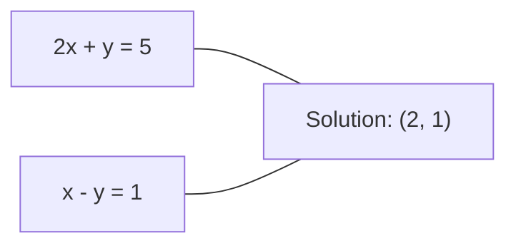
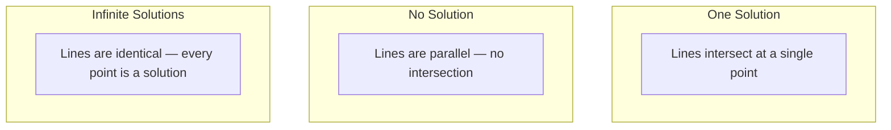

# Systèmes linéaires

> Résout$Ax = b$C'est le plus ancien problème en mathématiques qui dirige encore votre réseau neuronal.

**Type:** Build
**Language:**Python
**Prerequisites:** Phase 1, Lessons 01 (Linear Algebra Intuition), 02 (Vectors & Matrices), 03 (Matrix Transformations)
**Time:** ~120 minutes

## Objectifs d'apprentissage

- Résous $Ax = b$en utilisant l'élimination gaussienne avec pivoter partiel et substitution arrière
- Matrices facteurs avec les décompositions LU, QR et Cholesky et expliquer quand chacune est appropriée
- Dériver les équations normales pour les carrés les plus faibles et les connecter à la régression linéaire et de la crête
- Diagnosticer les systèmes mal conçus en utilisant le numéro de condition et appliquer la régularisation pour les stabiliser

## Le problème

Chaque fois que vous entraînez une régression linéaire, vous résolvez un système linéaire. Chaque fois que vous comptez un ajustement des carrés les plus faibles, vous résolvez un système linéaire. Chaque fois qu'une couche de réseau neural compute.`y = Wx + b`En effet, si vous ajoutez une régularisation, vous modifiez le système. Lorsque vous utilisez des processus gaussiens, vous faites un facteur d'une matrice.

L' équation $Ax = b$Il apparaît partout.$A$est une matrice de coefficients connus. $b$est un vecteur de sorties connues. $x$est le vecteur des inconnus que vous voulez trouver.$A$est votre matrice de données, $b$est votre vecteur cible, et $x$Le modèle entier se réduit à: trouver $x$comme ça .$Ax$est aussi proche que $b$- Je le ferai.

Cette leçon explique toutes les méthodes principales pour résoudre cette équation à partir de zéro. Vous comprendrez pourquoi certaines méthodes sont rapides et d'autres stables, pourquoi certaines fonctionnent uniquement pour les systèmes carrés et d'autres traitent des systèmes surdéterminés, et pourquoi le nombre de conditions de votre matrice détermine si votre réponse signifie quelque chose.

## Le concept

### Ce que Ax = b signifie géométriquement

Un système d'équations linéaires a une interprétation géométrique. Chaque équation définit un hyperplane. La solution est le point (ou ensemble de points) où tous les hyperplanes se croisent.

```
2x + y = 5          Two lines in 2D.
x - y  = 1          They intersect at x=2, y=1.
```



Trois choses peuvent arriver:



En forme de matrice, "une solution" signifie $A$est inversible. "Aucune solution" signifie que le système est incohérent. "Solutions infinies" signifie$A$La plupart des problèmes ML appartiennent à la catégorie " pas de solution exacte " parce que vous avez plus d'équations (points de données) que d'inconnus (paramètres).

### Image de colonne contre image de rangée

Il y a deux façons de lire .$Ax = b$- Je suis désolé .

**Row picture.**Chaque rangée de $A$Chaque équation est un hyperplane. La solution est où ils se croisent tous.

**Column picture.**Chaque colonne de $A$La question se pose: quelle combinaison linéaire des colonnes de $A$produit $b$- Je suis désolé .

```
A = | 2  1 |    b = | 5 |
    | 1 -1 |        | 1 |

Row picture: solve 2x + y = 5 and x - y = 1 simultaneously.

Column picture: find x1, x2 such that:
  x1 * [2, 1] + x2 * [1, -1] = [5, 1]
  2 * [2, 1] + 1 * [1, -1] = [4+1, 2-1] = [5, 1]   check.
```

La colonne est plus fondamentale.$b$se trouve dans l' espace de colonne de $A$Si vous avez une solution,$b$Si vous ne le faites pas, vous trouverez le point le plus proche dans l'espace de colonnes.

### Élimination gaussienne

L' élimination gaussienne se transforme $Ax = b$dans un système triangulaire supérieur $Ux = c$C'est la méthode la plus directe.

L' algorithme:

```
1. For each column k (the pivot column):
   a. Find the largest entry in column k at or below row k (partial pivoting).
   b. Swap that row with row k.
   c. For each row i below k:
      - Compute multiplier m = A[i][k] / A[k][k]
      - Subtract m times row k from row i.
2. Back substitute: solve from the last equation upward.
```

Exemple:

```
Original:
| 2  1  1 | 8 |       R2 = R2 - (2)R1     | 2  1   1 |  8 |
| 4  3  3 |20 |  -->  R3 = R3 - (1)R1 --> | 0  1   1 |  4 |
| 2  3  1 |12 |                            | 0  2   0 |  4 |

                       R3 = R3 - (2)R2     | 2  1   1 |  8 |
                                       --> | 0  1   1 |  4 |
                                           | 0  0  -2 | -4 |

Back substitute:
  -2 * x3 = -4    -->  x3 = 2
  x2 + 2  = 4     -->  x2 = 2
  2*x1 + 2 + 2 = 8 --> x1 = 2
```

Coûts d' élimination Gaussian $O(n^3)$Les opérations de l'entreprise$1000 \times 1000$Rapide, mais vous pouvez faire mieux si vous devez résoudre plusieurs systèmes avec le même$A$- Je suis désolé .

### Le pivot partiel: pourquoi cela importe

Sans pivoter, l'élimination gaussienne peut échouer ou produire des déchets. Si un élément pivot est zéro, vous divisez par zéro. Si c'est petit, vous amplifiez les erreurs d'arrondissement.

```
Bad pivot:                       With partial pivoting:
| 0.001  1 | 1.001 |            Swap rows first:
| 1      1 | 2     |            | 1      1 | 2     |
                                 | 0.001  1 | 1.001 |
m = 1/0.001 = 1000              m = 0.001/1 = 0.001
R2 = R2 - 1000*R1               R2 = R2 - 0.001*R1
| 0.001  1     | 1.001   |      | 1      1     | 2     |
| 0     -999   | -999.0  |      | 0      0.999 | 0.999 |

x2 = 1.000 (correct)            x2 = 1.000 (correct)
x1 = (1.001 - 1)/0.001          x1 = (2 - 1)/1 = 1.000 (correct)
   = 0.001/0.001 = 1.000        Stable because the multiplier is small.
```

En arithmétique à point flottant avec une précision limitée, la version non pivotée peut perdre des chiffres significatifs.

### Décomposition de l' LU

Facteurs de décomposition de l' LU $A$dans une matrice triangulaire inférieure $L$et une matrice triangulaire supérieure $U$Le numéro de la liste:$A = LU$- Le .$L$La matrice stocke les multiplicateurs de l'élimination gaussienne.$U$La matrice est le résultat de l'élimination.

```
A = L @ U

| 2  1  1 |   | 1  0  0 |   | 2  1   1 |
| 4  3  3 | = | 2  1  0 | @ | 0  1   1 |
| 2  3  1 |   | 1  2  1 |   | 0  0  -2 |
```

Pourquoi faire des facteurs au lieu de simplement éliminer ?$L$et $U$, résoudre$Ax = b$pour tout nouveau$b$coûts uniquement $O(n^2)$- Le numéro de la liste:

```math
\begin{aligned}
Ax &= b \\
LUx &= b \\
&\text{Let } y = Ux\text{:} \\
Ly &= b \quad \text{(forward substitution, } O(n^2)\text{)} \\
Ux &= y \quad \text{(back substitution, } O(n^2)\text{)}
\end{aligned}
```

Le $O(n^3)$Le coût est payé une fois lors de la facteurisation.$O(n^2)$Si vous devez résoudre 1000 systèmes avec le même$A$mais différent .$b$Les vecteurs, LU économisent un facteur de 1000/3 dans le travail total.

Avec le pivot partiel, vous obtenez $PA = LU$où $P$est une matrice de permutation enregistrant les échanges de rangées.

### Décomposition de la QR

Facteurs de décomposition QR $A$dans une matrice orthogonale $Q$et une matrice triangulaire supérieure $R$Le numéro de la liste:$A = QR$- Je suis désolé .

Une matrice orthogonale a la propriété $Q^T Q = I$Ses colonnes sont des vecteurs orthonormaux.$Q$préserve les longues et les angles.

```
A = Q @ R

Q has orthonormal columns: Q^T Q = I
R is upper triangular

To solve Ax = b:
  QRx = b
  Rx = Q^T b    (just multiply by Q^T, no inversion needed)
  Back substitute to get x.
```

Le QR est numériquement plus stable que LU pour résoudre les problèmes de minuscules carrés.$Q$Colonne par colonne:

```
Given columns a1, a2, ... of A:

q1 = a1 / ||a1||

q2 = a2 - (a2 . q1) * q1        (subtract projection onto q1)
q2 = q2 / ||q2||                (normalize)

q3 = a3 - (a3 . q1) * q1 - (a3 . q2) * q2
q3 = q3 / ||q3||

R[i][j] = qi . aj    for i <= j
```

Chaque étape supprime la composante tout au long de la précédente $q$Les vecteurs ne laissent que la nouvelle direction orthogonale.

### Décomposition de Cholesky

Quand ?$A$est symétrique ($A = A^T$) et définitive positive (toutes les valeurs propres positives), vous pouvez la faire figurer comme $A = L L^T$où $L$C'est la décomposition de Cholesky.

```
A = L @ L^T

| 4  2 |   | 2  0 |   | 2  1 |
| 2  5 | = | 1  2 | @ | 0  2 |

L[i][i] = sqrt(A[i][i] - sum(L[i][k]^2 for k < i))
L[i][j] = (A[i][j] - sum(L[i][k]*L[j][k] for k < j)) / L[j][j]    for i > j
```

Cholesky est deux fois plus rapide que LU et nécessite la moitié du stockage.

- Les matrices de covariance sont symétriques positives semi-définites (positives définites avec régularisation).
- La matrice du noyau dans les processus gaussiens est symétrique positive définie.
- Le Hessian d'une fonction convexe au minimum est symétrique positive définie.
- $A^T A$est toujours symétrique positive semi-définie.

Dans les processus gaussiens, vous faites le facteur de la matrice du noyau $K$Avec Cholesky, puis résoudre.$K \alpha = y$Le facteur Cholesky vous donne aussi le log-déterminant de la probabilité marginale:$\log \det(K) = 2 \sum \log(\mathop{\mathrm{diag}}(L))$- Je suis désolé .

### Les carrés minimaux: lorsque Ax = b n'a pas de solution exacte

Si vous$A$est $m \times n$avec $m > n$Il n'y a pas de solution exacte, mais vous réduisez l'erreur carré:

```
minimize ||Ax - b||^2

This is the sum of squared residuals:
  sum((A[i,:] @ x - b[i])^2 for i in range(m))
```

Le minimiseur satisfait aux équations normales:

```math
A^T A x = A^T b
```

Dérivé: élargir $\lVert Ax - b \rVert^2 = (Ax - b)^T (Ax - b) = x^T A^T A x - 2 x^T A^T b + b^T b$Prenez le gradient par rapport à$x$, le réglez à zéro: $2 A^T A x - 2 A^T b = 0$- Je suis désolé .

```
Original system (overdetermined, 4 equations, 2 unknowns):
| 1  1 |         | 3 |
| 1  2 | x     = | 5 |       No exact x satisfies all 4 equations.
| 1  3 |         | 6 |
| 1  4 |         | 8 |

Normal equations:
A^T A = | 4  10 |    A^T b = | 22 |
        | 10 30 |            | 63 |

Solve: x = [1.5, 1.7]

This is linear regression. x[0] is the intercept, x[1] is the slope.
```

### Equations normales = régression linéaire

La connexion est exacte.$X$Il a une ligne par échantillon et une colonne par fonction.$y$Il y a une entrée par échantillon.$w$satisfait à:

```math
\begin{aligned}
X^T X w &= X^T y \\
w &= (X^T X)^{-1} X^T y
\end{aligned}
```

C'est la solution de forme fermée à la régression linéaire.`sklearn.linear_model.LinearRegression.fit()`calculer ce calcul (ou un équivalent via QR ou SVD).

Ajouter un terme de régularisation $\lambda I$à la matrice et vous obtenez la régression de la crête:

```math
\begin{aligned}
(X^T X + \lambda I) w &= X^T y \\
w &= (X^T X + \lambda I)^{-1} X^T y
\end{aligned}
```

La régulation rend la matrice mieux conditionnée (plus facile à inverser avec précision) et empêche le surpassage en réduisant les poids vers zéro.$X^T X + \lambda I$est toujours symétrique positive définitive quand $\lambda > 0$, pour que vous puissiez utiliser Cholesky pour le résoudre.

### Pseudoinverse (Moore-Penrose)

Le pseudo-inverse $A^+$Généralise l'inversion de la matrice à des matrices non carrées et singulières.$A$- Le numéro de la liste:

```math
\begin{aligned}
x &= A^+ b \\[4pt]
\text{where } A^+ &= V \Sigma^+ U^T \quad \text{(computed via SVD)}
\end{aligned}
```

$\Sigma^+$est formé en prenant la réciproque de chaque valeur singulière non zéro et en transposant le résultat.$A = U \Sigma V^T$Alors ...$A^+ = V \Sigma^+ U^T$- Je suis désolé .

```
A = U Sigma V^T        (SVD)

Sigma = | 5  0 |       Sigma+ = | 1/5  0  0 |
        | 0  2 |                | 0  1/2  0 |
        | 0  0 |

A+ = V Sigma+ U^T
```

Le pseudo-inverse donne la solution minimum-norme des plus petits carrés.
- Une solution: $A^+ b$Il le donne.
- Aucune solution: $A^+ b$donne la solution des plus petits carrés.
- Des solutions infinies: $A^+ b$Il donne à celui qui a le plus petit .$\lVert x \rVert$- Je suis désolé .

NumPy's `np.linalg.lstsq`et `np.linalg.pinv`Les deux utilisent le SVD en interne.

### Numéro de condition

Le nombre de condition mesure la sensibilité de la solution aux petits changements de l'entrée.$A$, le numéro de condition est:

```math
\kappa(A) = \lVert A \rVert \cdot \lVert A^{-1} \rVert = \frac{\sigma_{\max}}{\sigma_{\min}}
```

où $\sigma_{\max}$et $\sigma_{\min}$sont les plus grandes et les plus petites valeurs singulières.

```
Well-conditioned (kappa ~ 1):        Ill-conditioned (kappa ~ 10^15):
Small change in b -->                Small change in b -->
small change in x                    huge change in x

| 2  0 |   kappa = 2/1 = 2          | 1   1          |   kappa ~ 10^15
| 0  1 |   safe to solve            | 1   1+10^(-15) |   solution is garbage
```

Règles générales:
- $\kappa < 100$: sûre, la solution est précise.
- $\kappa \approx 10^k$Tu perds à peu près .$k$Des chiffres de précision de votre arithmétique de point flottant.
- $\kappa \approx 10^{16}$(pour float64): la solution est sans sens.

Dans le domaine de la mécanique, les conditions de malformation se produisent lorsque les caractéristiques sont presque collineuses.$\lambda I$) améliore le nombre de conditions à partir de $\sigma_{\max} / \sigma_{\min}$à $(\sigma_{\max} + \lambda) / (\sigma_{\min} + \lambda)$- Je suis désolé .

### Métodes itératives: gradient conjugué

Pour les systèmes très grands et rares (des millions d'inconnus), les méthodes directes comme LU ou Cholesky sont trop coûteuses.

Le gradient conjugué (CG) résulte $Ax = b$quand ?$A$est symétrique positive définitive.$n$les itérations (en arithmétique exacte), mais converge généralement beaucoup plus rapidement si les valeurs propres de $A$sont regroupés.

```
Algorithm sketch:
  x0 = initial guess (often zero)
  r0 = b - A x0           (residual)
  p0 = r0                 (search direction)

  For k = 0, 1, 2, ...:
    alpha = (rk . rk) / (pk . A pk)
    x_{k+1} = xk + alpha * pk
    r_{k+1} = rk - alpha * A pk
    beta = (r_{k+1} . r_{k+1}) / (rk . rk)
    p_{k+1} = r_{k+1} + beta * pk
    if ||r_{k+1}|| < tolerance: stop
```

CG est utilisé dans:
- Optimisation à grande échelle (méthode Newton-CG)
- Résout des discrétions de la PDE
- Méthodes du noyau où la matrice du noyau est trop grande pour être prise en compte
- Préconditions pour les autres solvants itératifs

Le taux de convergence dépend du nombre de conditions. Les systèmes mieux conditionnés convergent plus rapidement, ce qui est une autre raison pour laquelle la régularisation aide.

### Le tableau complet: quelle méthode

| Method | Requirements | Cost | Use case |
|--------|-------------|------|----------|
| Gaussian elimination | Square, nonsingular $A$ | $O(n^3)$ | One-off solve of a square system |
| LU decomposition | Square, nonsingular $A$ | $O(n^3)$ factor + $O(n^2)$ solve | Multiple solves with the same $A$ |
| QR decomposition | Any $A$ ($m \ge n$) | $O(mn^2)$ | Least squares, numerically stable |
| Cholesky | Symmetric positive definite $A$ | $O(n^3/3)$ | Covariance matrices, Gaussian processes, ridge regression |
| Normal equations | Overdetermined ($m > n$) | $O(mn^2 + n^3)$ | Linear regression (small $n$) |
| SVD / pseudoinverse | Any $A$ | $O(mn^2)$ | Rank-deficient systems, minimum-norm solutions |
| Conjugate gradient | Symmetric positive definite, sparse $A$ | $O(n \cdot k \cdot \text{nnz})$ | Large sparse systems, $k$ = iterations |

### Connexion à ML

Chaque méthode de cette leçon est présentée dans la production ML:

**Linear regression.**La solution en forme fermée résout les équations normales $X^T X w = X^T y$Ceci est fait par Cholesky (si$n$est faible) ou QR (si la stabilité numérique est importante) ou SVD (si la matrice pourrait être déficient en grade).

**Ridge regression.**Ajout $\lambda I$à $X^T X$- Le système réglementé$(X^T X + \lambda I) w = X^T y$est toujours résolvable via Cholesky parce que $X^T X + \lambda I$est symétrique positive définie pour $\lambda > 0$- Je suis désolé .

**Gaussian processes.**La moyenne prédictive nécessite une résolution $K \alpha = y$où $K$est la matrice du noyau.$K$L'analyse de la probabilité marginale utilise$\log \det(K) = 2 \sum \log(\mathop{\mathrm{diag}}(L))$- Je suis désolé .

**Neural network initialization.**L'initialisation orthogonale utilise la décomposition QR pour créer des matrices de poids dont les colonnes sont orthonormales.

**Preconditioning.**Les optimisateurs à grande échelle utilisent Cholesky incomplet ou LU incomplet comme préconditions pour les solvants de gradients conjugués.

**Feature engineering.**Le numéro de condition de $X^T X$Il vous indique si vos traits sont collineux.$\kappa$est grand, laissez tomber les caractéristiques ou ajoutez la régularisation.

```figure
linear-system-conditioning
```

## Faites-le

### Étape 1: Élimination gaussienne avec pivots partiels

```python
import numpy as np

def gaussian_elimination(A, b):
    n = len(b)
    Ab = np.hstack([A.astype(float), b.reshape(-1, 1).astype(float)])

    for k in range(n):
        max_row = k + np.argmax(np.abs(Ab[k:, k]))
        Ab[[k, max_row]] = Ab[[max_row, k]]

        if abs(Ab[k, k]) < 1e-12:
            raise ValueError(f"Matrix is singular or nearly singular at pivot {k}")

        for i in range(k + 1, n):
            m = Ab[i, k] / Ab[k, k]
            Ab[i, k:] -= m * Ab[k, k:]

    x = np.zeros(n)
    for i in range(n - 1, -1, -1):
        x[i] = (Ab[i, -1] - Ab[i, i+1:n] @ x[i+1:n]) / Ab[i, i]

    return x
```

### Étape 2: décomposition de l' LU

```python
def lu_decompose(A):
    n = A.shape[0]
    L = np.eye(n)
    U = A.astype(float).copy()
    P = np.eye(n)

    for k in range(n):
        max_row = k + np.argmax(np.abs(U[k:, k]))
        if max_row != k:
            U[[k, max_row]] = U[[max_row, k]]
            P[[k, max_row]] = P[[max_row, k]]
            if k > 0:
                L[[k, max_row], :k] = L[[max_row, k], :k]

        for i in range(k + 1, n):
            L[i, k] = U[i, k] / U[k, k]
            U[i, k:] -= L[i, k] * U[k, k:]

    return P, L, U

def lu_solve(P, L, U, b):
    n = len(b)
    Pb = P @ b.astype(float)

    y = np.zeros(n)
    for i in range(n):
        y[i] = Pb[i] - L[i, :i] @ y[:i]

    x = np.zeros(n)
    for i in range(n - 1, -1, -1):
        x[i] = (y[i] - U[i, i+1:] @ x[i+1:]) / U[i, i]

    return x
```

### Étape 3: Décomposition de Cholesky

```python
def cholesky(A):
    n = A.shape[0]
    L = np.zeros_like(A, dtype=float)

    for i in range(n):
        for j in range(i + 1):
            s = A[i, j] - L[i, :j] @ L[j, :j]
            if i == j:
                if s <= 0:
                    raise ValueError("Matrix is not positive definite")
                L[i, j] = np.sqrt(s)
            else:
                L[i, j] = s / L[j, j]

    return L
```

### Étape 4: Les carrés minimaux par équations normales

```python
def least_squares_normal(A, b):
    AtA = A.T @ A
    Atb = A.T @ b
    return gaussian_elimination(AtA, Atb)

def ridge_regression(A, b, lam):
    n = A.shape[1]
    AtA = A.T @ A + lam * np.eye(n)
    Atb = A.T @ b
    L = cholesky(AtA)
    y = np.zeros(n)
    for i in range(n):
        y[i] = (Atb[i] - L[i, :i] @ y[:i]) / L[i, i]
    x = np.zeros(n)
    for i in range(n - 1, -1, -1):
        x[i] = (y[i] - L.T[i, i+1:] @ x[i+1:]) / L.T[i, i]
    return x
```

### Étape 5: Numéro de condition

```python
def condition_number(A):
    U, S, Vt = np.linalg.svd(A)
    return S[0] / S[-1]
```

## Utilisez-le

Rassembler les pièces pour la régression linéaire et la régression de la crête sur des données réelles:

```python
np.random.seed(42)
X_raw = np.random.randn(100, 3)
w_true = np.array([2.0, -1.0, 0.5])
y = X_raw @ w_true + np.random.randn(100) * 0.1

X = np.column_stack([np.ones(100), X_raw])

w_ols = least_squares_normal(X, y)
print(f"OLS weights (ours):    {w_ols}")

w_np = np.linalg.lstsq(X, y, rcond=None)[0]
print(f"OLS weights (numpy):   {w_np}")
print(f"Max difference: {np.max(np.abs(w_ols - w_np)):.2e}")

w_ridge = ridge_regression(X, y, lam=1.0)
print(f"Ridge weights (ours):  {w_ridge}")

from sklearn.linear_model import Ridge
ridge_sk = Ridge(alpha=1.0, fit_intercept=False)
ridge_sk.fit(X, y)
print(f"Ridge weights (sklearn): {ridge_sk.coef_}")
```

## La faire partir

Cette leçon donne:
- `code/linear_systems.py`contenant des implementations à partir de zéro de l'élimination gaussienne, de la décomposition de LU, de la décomposition Cholesky, des carrés les moins élevés et de la régression de la crête
- Une démonstration de travail selon laquelle les équations normales et la régression linéaire de sklearn produisent les mêmes poids

## Exercices

1. Résolvez le système `[[1,2,3],[4,5,6],[7,8,10]] x = [6, 15, 27]`en utilisant votre élimination Gaussian, votre solvant LU, et `np.linalg.solve`Vérifiez que les trois répondent de la même façon dans la tolérance des points flottants.

2. Générer une matrice aléatoire X de 50x5 et cible y = X @ w_true + bruit.`np.linalg.qr`), SVD (via `np.linalg.svd`), et `np.linalg.lstsq`Comparer les quatre solutions. Mesurer le nombre de conditions de$X^T X$et expliquer comment cela affecte la méthode en laquelle vous avez confiance.

3. Créer une matrice quasi singulière en faisant deux colonnes presque identiques (par exemple, colonne 2 = colonne 1 + 1e-10 * bruit).$Ax = b$avec et sans régularisation (add $0.01 I$) Comparer les solutions et les résidus.

4. Appliquer l'algorithme de gradient conjugué pour une matrice définie positive symétrique aléatoire 100x100. Comptez combien d'itérations il faut pour converger à la tolérance 1e-8.$n$les itérations.

5. Temps de votre solveur Cholesky vs votre solveur LU vs `np.linalg.solve`Sur des matrices positives symétriques de taille 10, 50, 200, 500, tracez les résultats.

### Des indices

**Exercise 1.**Appel`gaussian_elimination(A, b)`Alors ...`lu_decompose(A)`suivie de `lu_solve(P, L, U, b)`Alors ...`np.linalg.solve(A, b)`Vérifiez chaque réponse avec `np.allclose(A @ x, b)`et comparer les trois réponses avec `np.allclose`- Je suis désolé .

**Exercise 2.**Utilisation `least_squares_normal`Pour les équations normales et les trois fonctions NumPy pour les autres méthodes, les quatre réponses doivent être proches de `w_true`- Comparer`condition_number(X.T @ X)`avec `condition_number(X)`: le premier est le carré du second, donc les équations normales perdent la plus grande précision.

**Exercise 3.**Attendez-vous à un numéro de condition ci-dessus $10^{9}$- Résolvez avec `np.linalg.solve`et avec `ridge_regression(A, b, 0.01)`, puis comparer `np.linalg.norm(x)`Les deux résidus peuvent être petits, mais la solution sans régularisation a généralement de très grandes entrées.

**Exercise 4.**Faites une matrice définie positive symétrique avec `B @ B.T + n * np.eye(n)`, de sorte que chaque valeur propre est positive. Ajoutez un compteur à la boucle dans votre copie de `conjugate_gradient`, puis vérifiez que la norme résiduelle finale est inférieure à 1e-8 et que le nombre est au maximum de 100.

**Exercise 5.**Utilisez la même .`B @ B.T + n * np.eye(n)`matrices pour les trois résolveurs et le temps chaque résoudre avec `time.perf_counter`Cholesky a besoin d'environ la moitié de l'arithmétique de LU, donc le rapport est le plus clair sur les tailles plus grandes.

## Les termes clés

| Term | What people say | What it actually means |
|------|----------------|----------------------|
| Linear system | "Solve for x" | A set of linear equations $Ax = b$. Finding $x$ means finding the input that produces output $b$ under transformation $A$. |
| Gaussian elimination | "Row reduce" | Systematically zero out entries below the diagonal using row operations, producing an upper triangular system solvable by back substitution. $O(n^3)$. |
| Partial pivoting | "Swap rows for stability" | Before eliminating in column $k$, swap the row with the largest absolute value in that column to the pivot position. Prevents division by small numbers. |
| LU decomposition | "Factor into triangles" | Write $A = LU$ where $L$ is lower triangular (stores multipliers) and $U$ is upper triangular (the eliminated matrix). Amortizes the $O(n^3)$ cost over multiple solves. |
| QR decomposition | "Orthogonal factorization" | Write $A = QR$ where $Q$ has orthonormal columns and $R$ is upper triangular. More stable than LU for least squares. |
| Cholesky decomposition | "Square root of a matrix" | For symmetric positive definite $A$, write $A = LL^T$. Half the cost of LU. Used for covariance matrices, kernel matrices, and ridge regression. |
| Least squares | "Best fit when exact is impossible" | Minimize the sum of squared residuals $\lVert Ax - b \rVert^2$ when the system is overdetermined (more equations than unknowns). |
| Normal equations | "The calculus shortcut" | $A^T A x = A^T b$. Setting the gradient of $\lVert Ax - b \rVert^2$ to zero. This IS the closed-form solution to linear regression. |
| Pseudoinverse | "Inversion for non-square matrices" | $A^+ = V \Sigma^+ U^T$ via SVD. Gives the minimum-norm least-squares solution for any matrix, square or rectangular, singular or not. |
| Condition number | "How trustworthy is this answer" | $\kappa = \sigma_{\max} / \sigma_{\min}$. Measures sensitivity to input perturbations. Lose about $\log_{10}(\kappa)$ digits of precision. |
| Ridge regression | "Regularized least squares" | Solve $(X^T X + \lambda I) w = X^T y$. Adding $\lambda I$ improves conditioning and shrinks weights toward zero. Prevents overfitting. |
| Conjugate gradient | "Iterative Ax=b for big matrices" | An iterative solver for symmetric positive definite systems. Converges in at most $n$ steps. Practical for large sparse systems where factorization is too expensive. |
| Overdetermined system | "More data than parameters" | $m > n$ in an $m\text{-by-}n$ system. No exact solution exists. Least squares finds the best approximation. This is every regression problem. |
| Back substitution | "Solve from the bottom up" | Given an upper triangular system, solve the last equation first, then substitute backward. $O(n^2)$. |
| Forward substitution | "Solve from the top down" | Given a lower triangular system, solve the first equation first, then substitute forward. $O(n^2)$. Used in the L step of LU solves. |

## Pour en savoir plus

- [MIT 18.06: Linear Algebra](https://ocw.mit.edu/courses/18-06-linear-algebra-spring-2010/)(Gilbert Strang) -- le cours définitif sur les systèmes linéaires et les facteurisations de matrice
- [Numerical Linear Algebra](https://people.maths.ox.ac.uk/trefethen/text.html)(Trefethen & Bau) -- la référence standard pour comprendre la stabilité numérique, la conditionnement, et pourquoi les algorithmes échouent
- [Matrix Computations](https://www.press.jhu.edu/books/title/10678/matrix-computations)(Golub & Van Loan) -- la référence encyclopédique pour chaque algorithme de matrice
- [3Blue1Brown: Inverse Matrices](https://www.3blue1brown.com/lessons/inverse-matrices)-- l' intuition visuelle pour résoudre ce qui$Ax = b$signifie géométriquement
