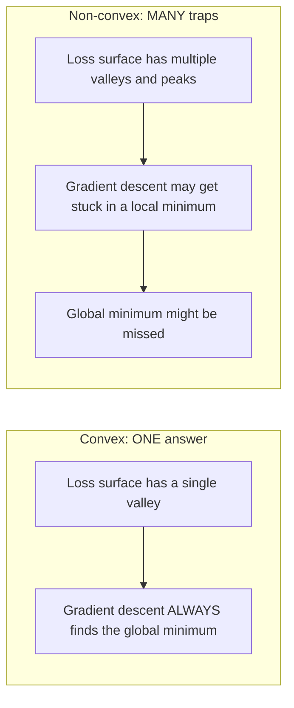
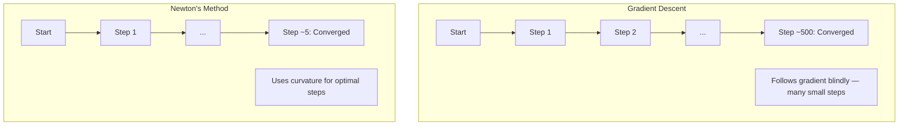
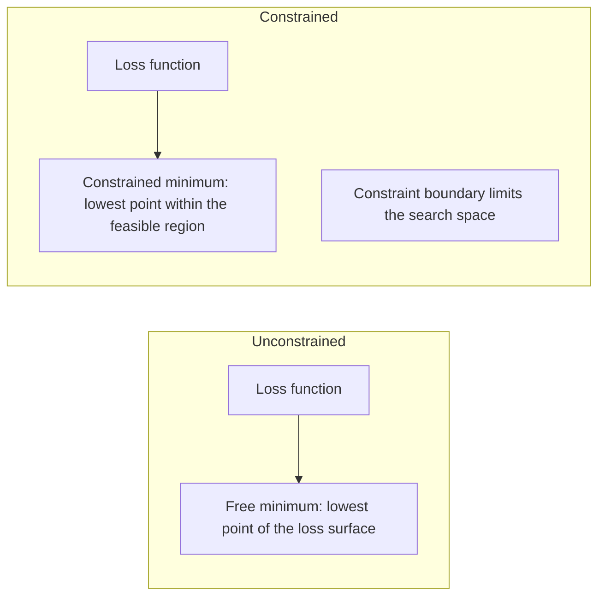
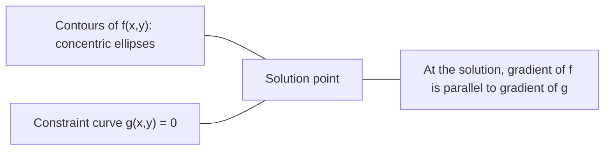

# Optimisation convexe

> Les problèmes convexes ont une vallée, les réseaux neuronaux ont des millions.

**Type:** Build
**Language:**Python
**Prerequisites:** Phase 1, Lessons 04 (Calculus for ML), 08 (Optimization)
**Time:** ~90 minutes

## Objectifs d'apprentissage

- Testez si une fonction est convexe en utilisant la définition, la deuxième dérivée et les critères hessiens
- Appliquer la méthode de Newton et comparer sa convergence quadratique contre la baisse du gradient
- Résoudre les problèmes d'optimisation restreints à l'aide de multiplicateurs de Lagrange et interpréter les conditions KKT
- Expliquez pourquoi les paysages de perte de réseau neural ne sont pas convexes mais SGD trouve toujours de bonnes solutions

## Le problème

La leçon 08 vous a appris la descente de gradient, l'élan et Adam. Ces optimistes marchent en descente sur n'importe quelle surface. Mais ils ne sont pas garanties. La descente de gradient sur un paysage non convexe peut arriver à un mauvais minimum local, rester coincé sur un point de selle, ou osciller pour toujours. Vous l'avez utilisé quand même parce que les réseaux neuraux ne sont pas convexes et qu'il n'y a pas d'alternative.

Mais de nombreux problèmes de machine learning sont convexes. Régrésion linéaire, régression logistique, SVM, LASSO, régression de crête. Pour ceux-ci, quelque chose de plus fort existe: optimisation avec des garanties mathématiques. Un problème convexe a exactement une vallée. Tout algorithme qui descend atteindra le minimum mondial. Pas besoin de redémarrage. Pas de calendriers de taux d'apprentissage. Pas de prière.

La compréhension de la convexité fait trois choses. Premièrement, elle vous indique quand votre problème est facile (convexe) contre difficile (non convexe). Deuxièmement, elle vous donne des outils plus rapides comme la méthode de Newton pour les problèmes convexes. Troisièmement, elle explique les concepts qui apparaissent dans tout ML: la régularisation comme une contrainte, la dualité dans les SVM, et pourquoi l'apprentissage profond fonctionne malgré la violation de toutes les bonnes propriétés que vous donne la convexité.

## Le concept

### Ensembles convexes

Un ensemble .$S$est convexe si pour deux points dans $S$, le segment de ligne entre eux se trouve également entièrement dans $S$- Je suis désolé .

| Convex sets | Not convex |
|---|---|
| **Rectangle**: any two points inside can be connected by a line segment that stays inside | **Star/crescent shape**: a line between two interior points can pass outside the set |
| **Triangle**: same property holds for all interior points | **Donut/annulus**: the hole means some line segments leave the set |
| The line segment between any two points stays within the set | The line segment between some pairs of points exits the set |

Test formel: pour tous les points $x, y$dans $S$et tout autre .$t \in [0, 1]$, le point $tx + (1-t)y$est également dans $S$- Je suis désolé .

Exemples d'ensembles convexes:
- Une ligne, un avion, tout ça.$\mathbb{R}^n$
- Une boule (cercle, sphère, hypersphère)
- Une demi-espace:$\lbrace x : a^T x \le b \rbrace$
- L'intersection de tout nombre d'ensembles convexes

Exemples d'ensembles non convexes:
- Un donut (annulus)
- L'union de deux cercles disjoints
- Tout ensemble avec un "dent" ou un "trou"

### Fonctions convexes

Une fonction $f$est convexe si son domaine est un ensemble convexe et pour deux points $x, y$dans son domaine et dans tous les$t \in [0, 1]$- Le numéro de la liste:

```math
f(tx + (1-t)y) \le t f(x) + (1-t) f(y)
```

Géométriquement: le segment de ligne entre deux points sur le graphique se trouve au-dessus ou sur le graphique.

| Property | Convex function | Non-convex function |
|---|---|---|
| **Line segment test** | The line between any two points on the graph lies **above or on** the curve | The line between some points on the graph dips **below** the curve |
| **Shape** | Single bowl/valley curving upward | Multiple peaks and valleys with mixed curvature |
| **Local minima** | Every local minimum is the global minimum | Multiple local minima may exist at different heights |

Fonctions convexes communes:
- $f(x) = x^2$Je suis désolé .
- $f(x) = \lvert x \rvert$(valeur absolue)
- $f(x) = e^x$(exponentiel)
- $f(x) = \max(0, x)$(Rélu, bien que linéaire par morceaux)
- $f(x) = -\log(x)$pour $x > 0$(registreur négatif)
- Toute fonction linéaire $f(x) = a^T x + b$(à la fois convexe et concave)

### Test de convexité

Trois tests pratiques, du plus facile au plus rigoureux.

**Test 1: Second derivative test (1D).**Si vous$f''(x) \ge 0$Pour tous$x$Alors ...$f$est convexe.

- $f(x) = x^2$Le numéro de la liste:$f''(x) = 2 \ge 0$- Elle est convexe.
- $f(x) = x^3$Le numéro de la liste:$f''(x) = 6x$- négatif pour$x < 0$- Pas convexe.
- $f(x) = e^x$Le numéro de la liste:$f''(x) = e^x > 0$- Elle est convexe.

**Test 2: Hessian test (multivariate).**Si la matrice hessienne $H(x)$est semi-définie pour tous $x$Alors ...$f$Le Hessian est la matrice des dérivés partiels de seconde.

**Test 3: Definition test.**Vérifiez l' inégalité $f(tx + (1-t)y) \le t f(x) + (1-t) f(y)$Il est utile pour les fonctions où les dérivés sont difficiles à calculer.

### Pourquoi la convexité est importante

Le théorème central de l'optimisation convexe:

**For a convex function, every local minimum is a global minimum.**

Cela signifie que la descente du gradient ne peut pas être piégée. Tout chemin en descente conduit à la même réponse. L'algorithme est garanti de converger à la solution optimale.



Les conséquences:
- Pas besoin de redémarrer au hasard
- Aucun besoin de calendriers sophistiqués de taux d'apprentissage
- Des preuves de convergence sont possibles (taux dépend des propriétés de la fonction)
- La solution est unique (jusqu'à des régions plates)

### Convexe contre non convexe dans le ML

| Problem | Convex? | Why |
|---------|---------|-----|
| Linear regression (MSE) | Yes | Loss is quadratic in weights |
| Logistic regression | Yes | Log-loss is convex in weights |
| SVM (hinge loss) | Yes | Maximum of linear functions |
| LASSO (L1 regression) | Yes | Sum of convex functions is convex |
| Ridge regression (L2) | Yes | Quadratic + quadratic = convex |
| Neural network (any loss) | No | Nonlinear activations create non-convex landscape |
| k-means clustering | No | Discrete assignment step |
| Matrix factorization | No | Product of unknowns |

Les modèles linéaires avec des pertes convexes sont convexes.

### La matrice hessienne

Le Hessien $H$d'une fonction $f: \mathbb{R}^n \to \mathbb{R}$est le $n \times n$matrice de dérivés partiels de seconde nature.

```math
H_{ij} = \frac{\partial^2 f}{\partial x_i \, \partial x_j}
```

Pour $f(x, y) = x^2 + 3xy + y^2$- Le numéro de la liste:

```math
\begin{gathered}
\begin{aligned}
\frac{\partial f}{\partial x} &= 2x + 3y & \frac{\partial^2 f}{\partial x^2} &= 2 & \frac{\partial^2 f}{\partial x \, \partial y} &= 3 \\
\frac{\partial f}{\partial y} &= 3x + 2y & \frac{\partial^2 f}{\partial y \, \partial x} &= 3 & \frac{\partial^2 f}{\partial y^2} &= 2
\end{aligned} \\[8pt]
H = \begin{bmatrix} 2 & 3 \\ 3 & 2 \end{bmatrix}
\end{gathered}
```

Le Hessien vous parle de la courbure:
- Les valeurs propres sont toutes positives: la fonction se déplace vers le haut dans toutes les directions (convexe à ce point)
- Value propre toutes négatives: courbes vers le bas dans toutes les directions (concave, max local)
- Signes mixtes: point de selle (curves vers le haut dans certaines directions, vers le bas dans d'autres)
- Value propre zéro: plane dans cette direction (dégenerée)

Pour la convexité, le hessien doit être semi-définit positif (toutes les valeurs propres $\ge 0$) partout, pas seulement à un moment donné.

### La méthode de Newton

La descente gradiente utilise des informations de premier ordre (le gradient). La méthode de Newton utilise des informations de deuxième ordre (le Hessian). Elle correspond à une approximation quadratique au point courant et saute directement au minimum de ce quadratique.

```math
\begin{aligned}
\text{Update rule:} \quad & x_{\text{new}} = x - H^{-1} \cdot \text{gradient} \\
\text{Compare to gradient descent:} \quad & x_{\text{new}} = x - \text{lr} \cdot \text{gradient}
\end{aligned}
```

La méthode de Newton remplace le taux d'apprentissage scalaire par le Hessian inverse.



Les avantages:
- Convergence quadratique proche du minimum (carrés d'erreur à chaque étape)
- Aucun taux d'apprentissage à régler
- Invariante d'échelle (fonctionne indépendamment de la façon dont vous paramétrerez le problème)

Les inconvénients:
- Compte tenu des coûts hessiens $O(n^2)$mémoire et $O(n^3)$à inverser
- Pour un réseau neural avec 1 million de poids, c'est $10^{12}$les entrées et $10^{18}$opérations
- Pas pratique pour l'apprentissage profond

### Optimisation restreinte

Optimisation sans contraintes: minimiser $f(x)$Tout le monde .$x$- Je suis désolé .
Optimisation restreinte: minimiser $f(x)$sous réserve de contraintes.

Les vrais problèmes ont des contraintes. Vous voulez minimiser les coûts mais votre budget est limité. Vous voulez minimiser les erreurs mais votre complexité de modèle est limitée.



### Multiplicateurs de lagrange

La méthode des multiplicateurs de Lagrange convertit un problème restreint en un problème non restreint.

Le problème: réduire au minimum $f(x)$sous réserve de $g(x) = 0$- Je suis désolé .

Solution: introduire une nouvelle variable (le multiplicateur de Lagrange $\lambda$) et résoudre le problème sans contrainte:

```math
L(x, \lambda) = f(x) + \lambda g(x)
```

À la solution, le gradient de $L$est de zéro:

```math
\begin{aligned}
\frac{\partial L}{\partial x} &= \frac{\partial f}{\partial x} + \lambda \frac{\partial g}{\partial x} = 0 \\
\frac{\partial L}{\partial \lambda} &= g(x) = 0
\end{aligned}
```

Intuition géométrique: au minimum limité, le gradient de $f$doit être parallèle au gradient de la contrainte $g$Si elles n'étaient pas parallèles, vous pourriez vous déplacer le long de la surface de contrainte et réduire$f$- Plus loin.



Exemple: réduire au minimum $f(x,y) = x^2 + y^2$sous réserve de $x + y = 1$- Je suis désolé .

```math
\begin{aligned}
L &= x^2 + y^2 + \lambda(x + y - 1) \\[4pt]
\frac{\partial L}{\partial x} &= 2x + \lambda = 0 \implies x = -\lambda/2 \\
\frac{\partial L}{\partial y} &= 2y + \lambda = 0 \implies y = -\lambda/2 \\
\frac{\partial L}{\partial \lambda} &= x + y - 1 = 0 \\[4pt]
&\text{From first two: } x = y \\
&\text{Substituting: } 2x = 1, \text{ so } x = y = 0.5, \ \lambda = -1
\end{aligned}
```

Le point le plus proche de la ligne .$x + y = 1$à l'origine est $(0.5, 0.5)$- Je suis désolé .

### Conditions de la TCC

Les conditions de Karush-Kuhn-Tucker étendent les multiplicateurs de Lagrange aux contraintes d'inégalité.

Le problème: réduire au minimum $f(x)$sous réserve de $g_i(x) \le 0$pour $i = 1, \ldots, m$- Je suis désolé .

Les conditions de KKT (nécessaires pour une optimisation):

```math
\begin{aligned}
&\text{1. Stationarity:} && \frac{\partial f}{\partial x} + \sum_i \lambda_i \frac{\partial g_i}{\partial x} = 0 \\
&\text{2. Primal feasibility:} && g_i(x) \le 0 \quad \text{for all } i \\
&\text{3. Dual feasibility:} && \lambda_i \ge 0 \quad \text{for all } i \\
&\text{4. Complementary slackness:} && \lambda_i \, g_i(x) = 0 \quad \text{for all } i
\end{aligned}
```

La lenteur complémentaire est la principale idée: soit la contrainte est active ($g_i = 0$, la solution est située sur la limite) ou le multiplicateur est zéro (la contrainte n'a pas d'importance).$\lambda = 0$- Je suis désolé .

Les conditions KKT sont au cœur des SVM. Les vecteurs de support sont les points de données où la contrainte est active ($\lambda > 0$Tous les autres points de données ont$\lambda = 0$et ne touchent pas la limite de décision.

### Régularisation en tant qu'optimisation limitée

La régularisation de L1 et L2 ne sont pas des tours arbitraires, mais des problèmes d'optimisation contraintes déguisés.

**L2 regularization (Ridge):**

```math
\begin{aligned}
&\text{minimize } \text{Loss}(w) \text{ subject to } \lVert w \rVert^2 \le t \\[4pt]
&\text{Equivalent unconstrained form:} \\
&\text{minimize } \text{Loss}(w) + \lambda \lVert w \rVert^2
\end{aligned}
```

La contrainte$\lVert w \rVert^2 \le t$La solution est celle où les contours de perte touchent d'abord cette boule.

**L1 regularization (LASSO):**

```math
\begin{aligned}
&\text{minimize } \text{Loss}(w) \text{ subject to } \lVert w \rVert_1 \le t \\[4pt]
&\text{Equivalent unconstrained form:} \\
&\text{minimize } \text{Loss}(w) + \lambda \lVert w \rVert_1
\end{aligned}
```

La contrainte$\lVert w \rVert_1 \le t$définit un diamant (carré rotatif en 2D).

| Property | L2 constraint (circle) | L1 constraint (diamond) |
|---|---|---|
| **Constraint shape** | Circle (sphere in higher dims) | Diamond (rotated square in 2D) |
| **Where loss contour touches** | Smooth boundary — any point on the circle | Corner — aligned with an axis |
| **Solution behavior** | Weights are small but nonzero | Some weights are exactly zero (sparse) |
| **Result** | Weight shrinkage | Feature selection |

Cela explique pourquoi L1 produit des modèles rares (sélection de fonctionnalités) tandis que L2 ne réduit que les poids. Le diamant a des coins alignés avec les axes. Les contours de perte sont plus susceptibles de toucher un coin, en fixant un ou plusieurs poids exactement à zéro.

### La dualité

Chaque problème d'optimisation restreinte (le primaire) a un problème de compagnon (le dual). Pour les problèmes convexes, le primaire et le dual ont la même valeur optimale.

La fonction dual Lagrangienne:

```math
\begin{aligned}
&\text{Primal:} && \text{minimize } f(x) \text{ subject to } g(x) \le 0 \\
&\text{Lagrangian:} && L(x, \lambda) = f(x) + \lambda g(x) \\
&\text{Dual function:} && d(\lambda) = \min_x L(x, \lambda) \\
&\text{Dual problem:} && \text{maximize } d(\lambda) \text{ subject to } \lambda \ge 0
\end{aligned}
```

Pourquoi la dualité est importante:
- Le problème du double est parfois plus facile à résoudre que le problème primordial.
- Les SVM sont résolus sous leur forme double, où le problème dépend des produits de point entre les points de données (activer le truc du noyau)
- Le double fournit une limite inférieure à l'optimal primaire, utile pour vérifier la qualité de la solution

Pour les SVM spécifiquement:

```
Primal: find w, b that maximize the margin 2/||w|| subject to
        y_i(w^T x_i + b) >= 1 for all i

Dual:   maximize sum(alpha_i) - 0.5 * sum_ij(alpha_i * alpha_j * y_i * y_j * x_i^T x_j)
        subject to alpha_i >= 0 and sum(alpha_i * y_i) = 0

The dual only involves dot products x_i^T x_j.
Replace x_i^T x_j with K(x_i, x_j) to get the kernel trick.
```

### Pourquoi l'apprentissage en profondeur fonctionne malgré la non-convexité

Les fonctions de perte de réseau neural sont extrêmement non convexes. Par chaque mesure classique, leur optimisation devrait échouer. Cependant, la baisse du gradient stochastique trouve de bonnes solutions de manière fiable.

**Most local minima are good enough.**Dans les espaces haute dimension, les points critiques aléatoires (où le gradient est zéro) sont en grande majorité des points de selle, et non des minima locaux. Les quelques minima locaux qui existent ont tendance à avoir des valeurs de perte proches du minimum mondial.

**Saddle points, not local minima, are the real obstacle.**Dans une fonction avec $n$Les points de courbure de la selle sont des points de courbure positifs et négatifs.$n$Les valeurs propres étant positives (minimum local) est approximativement $2^{-n}$La plupart des points critiques sont des points de selle.

**Overparameterization smooths the landscape.**Les réseaux avec plus de paramètres que les exemples de formation ont des surfaces de perte plus fluides et plus connectées. Les réseaux plus larges ont moins de mauvais minima locaux.

**Loss landscape structure:**

| Property | Low-dimensional space | High-dimensional space |
|---|---|---|
| **Landscape** | Many isolated peaks and valleys | Smoothly connected valleys |
| **Minima** | Many isolated local minima | Few bad local minima; most are near-optimal |
| **Navigation** | Hard to find global minimum | Many paths lead to good solutions |
| **Critical points** | Mix of local minima and saddle points | Overwhelmingly saddle points, not local minima |

**Stochastic noise acts as implicit regularization.**Les SGD mini-batches ajoutent du bruit qui empêche de s'installer dans des minima nets.

### Méthodes de deuxième ordre en pratique

La méthode de Newton pure est peu pratique pour les grands modèles.

**L-BFGS (Limited-memory BFGS):**Approximation de l' inverse Hessian en utilisant le dernier $m$Les différences de gradients.$O(mn)$mémoire au lieu de $O(n^2)$Il fonctionne bien pour les problèmes jusqu'à ~ 10 000 paramètres. Utilisé dans le ML classique (régrésion logistique, CRFs) mais pas dans l'apprentissage en profondeur.

**Natural gradient:**Utilise la matrice d'information Fisher (Hessian attendu de la probabilité de log) au lieu de la Hessian standard. Cela explique la géométrie des distributions de probabilité.

**Hessian-free optimization:**Utilise le gradient conjugué pour résoudre $Hx = g$sans jamais se former $H$. Ne nécessite que des produits vectoriels hessiens, qui peuvent être calculés en $O(n)$temps par différenciation automatique.

**Diagonal approximations:**Le deuxième moment d'Adam est une approximation diagonale de la diagonale de l'Hessian. AdaHessian l'étend en utilisant des éléments diagonales hessiens réels via l'estimatrice de Hutchinson.

| Method | Memory | Per-step cost | When to use |
|--------|--------|--------------|-------------|
| Gradient descent | $O(n)$ | $O(n)$ | Baseline, large models |
| Newton's method | $O(n^2)$ | $O(n^3)$ | Small convex problems |
| L-BFGS | $O(mn)$ | $O(mn)$ | Medium convex problems |
| Adam | $O(n)$ | $O(n)$ | Deep learning default |
| K-FAC | $O(n)$ | $O(n)$ per layer | Research, large-batch training |

```figure
convex-vs-nonconvex
```

## Faites-le

### Étape 1: vérificateur de convexité

Construire une fonction qui teste empiriquement la convexité en prélèvant des points d'échantillonnage et en vérifiant la définition.

```python
import random
import math

def check_convexity(f, dim, bounds=(-5, 5), samples=1000):
    violations = 0
    for _ in range(samples):
        x = [random.uniform(*bounds) for _ in range(dim)]
        y = [random.uniform(*bounds) for _ in range(dim)]
        t = random.uniform(0, 1)
        mid = [t * xi + (1 - t) * yi for xi, yi in zip(x, y)]
        lhs = f(mid)
        rhs = t * f(x) + (1 - t) * f(y)
        if lhs > rhs + 1e-10:
            violations += 1
    return violations == 0, violations
```

### Étape 2: La méthode de Newton pour la 2D

Appliquez la méthode de Newton en utilisant un Hessian explicite.

```python
def newtons_method(f, grad_f, hessian_f, x0, steps=50, tol=1e-12):
    x = list(x0)
    history = [x[:]]
    for _ in range(steps):
        g = grad_f(x)
        H = hessian_f(x)
        det = H[0][0] * H[1][1] - H[0][1] * H[1][0]
        if abs(det) < 1e-15:
            break
        H_inv = [
            [H[1][1] / det, -H[0][1] / det],
            [-H[1][0] / det, H[0][0] / det],
        ]
        dx = [
            H_inv[0][0] * g[0] + H_inv[0][1] * g[1],
            H_inv[1][0] * g[0] + H_inv[1][1] * g[1],
        ]
        x = [x[0] - dx[0], x[1] - dx[1]]
        history.append(x[:])
        if sum(gi ** 2 for gi in g) < tol:
            break
    return history
```

### Étape 3: Solveur de multiplicateur de lagrange

Résoudre l'optimisation restreinte en utilisant la descente de gradient sur le Lagrangian.

```python
def lagrange_solve(f_grad, g_val, g_grad, x0, lr=0.01,
                   lr_lambda=0.01, steps=5000):
    x = list(x0)
    lam = 0.0
    history = []
    for _ in range(steps):
        fg = f_grad(x)
        gv = g_val(x)
        gg = g_grad(x)
        x = [
            xi - lr * (fgi + lam * ggi)
            for xi, fgi, ggi in zip(x, fg, gg)
        ]
        lam = lam + lr_lambda * gv
        history.append((x[:], lam, gv))
    return history
```

### Étape 4: Comparer le premier ordre avec le second

Exécutez la descente du gradient et la méthode de Newton sur la même fonction quadratique.

```python
def quadratic(x):
    return 5 * x[0] ** 2 + x[1] ** 2

def quadratic_grad(x):
    return [10 * x[0], 2 * x[1]]

def quadratic_hessian(x):
    return [[10, 0], [0, 2]]
```

La méthode de Newton converge en 1 étape (c'est exactement pour la quadratique). La descente gradiente prendra des centaines de étapes parce que les valeurs propres de l'hessien diffèrent par un facteur 5, créant une vallée allongée.

## Utilisez-le

L'analyse de convexité s'applique directement au choix des modèles et des solvants ML.

Pour les problèmes convexes (régrésion logistique, SVM, LASSO):
- Utiliser des résolveurs dédiés (liblinear, CVXPY, scipy.optimize.minimize avec method='L-BFGS-B')
- Attendez-vous à une solution unique à l'échelle mondiale
- Les méthodes de deuxième ordre sont pratiques et rapides

Pour les problèmes non convexes (réseaux neuronaux):
- Utiliser des méthodes de premier ordre (SGD, Adam)
- Acceptez que la solution dépend de l'initialisation et de la randomisation
- Utiliser des horaires de surparamétrisation, de bruit et de taux d'apprentissage comme régularisation implicite
- Ne perdez pas de temps à chercher le minimum mondial.

```python
from scipy.optimize import minimize

result = minimize(
    fun=lambda w: sum((y - X @ w) ** 2) + 0.1 * sum(w ** 2),
    x0=np.zeros(d),
    method='L-BFGS-B',
    jac=lambda w: -2 * X.T @ (y - X @ w) + 0.2 * w,
)
```

Pour les SVM, la formule double vous permet d'utiliser le truc du noyau:

```python
from sklearn.svm import SVC

svm = SVC(kernel='rbf', C=1.0)
svm.fit(X_train, y_train)
print(f"Support vectors: {svm.n_support_}")
```

## Exercices

1. **Convexity gallery.**Testez ces fonctions pour la convexité en utilisant le vérificateur: $f(x) = x^4$- Je suis là .$f(x) = \sin(x)$- Je suis là .$f(x,y) = x^2 + y^2$- Je suis là .$f(x,y) = xy$- Je suis là .$f(x) = \max(x, 0)$Expliquez pourquoi chaque résultat a du sens.

2. **Newton vs gradient descent race.**Appliquez les deux méthodes $f(x,y) = 50x^2 + y^2$du point de départ $(10, 10)$. Combien d'étapes chaque doit atteindre pour atteindre la perte < 1e-10?

3. **Lagrange multiplier geometry.**Réduire au minimum$f(x,y) = (x-3)^2 + (y-3)^2$sous réserve de $x + 2y = 4$- Vérifiez la solution en vérifiant que le gradient de $f$est parallèle au gradient de $g$à la solution.

4. **Regularization constraint.**Implémentation de l' optimisation limitée L1: minimiser $(x-3)^2 + (y-2)^2$sous réserve de $\lvert x \rvert + \lvert y \rvert \le 1$. Montrez que la solution a une coordonnée égale à zéro (sparsité de la contrainte diamant).

5. **Hessian eigenvalue analysis.**Computez le Hessian de la fonction Rosenbrock à (1,1) et à (-1,1). Computez les valeurs propres à ces deux points.

### Des indices

**Exercise 1.**Prédire chaque résultat avant de courir .`check_convexity`: dans une dimension, regardez le signe de $f''(x)$; dans deux dimensions, regardez les valeurs propres de l'hessien.$f(x,y) = xy$, le Hessian a des valeurs propres 1 et -1, donc le vérificateur doit signaler qu'il n'est pas convexe.

**Exercise 2.**Appel`optimize_gd`et `newtons_method`avec le gradient et le Hessian de $f$La méthode de Newton résout un quadratique en une seule étape.$2/100$à cause de la$50x^2$le terme, donc le $y$La direction se déplace lentement.$100x^2$et compte les pas encore.

**Exercise 3.**Utilisation `lagrange_solve`avec $g(x,y) = x + 2y - 4$- À la réponse, vérifiez ça.$x + 2y = 4$et que$\nabla f = (2(x-3), 2(y-3))$est un multiple de $\nabla g = (1, 2)$- Je suis désolé .

**Exercise 4.**Le minimum non restreint (3, 2) est en dehors du diamant, donc la réponse est à sa limite.$\lvert x \rvert + \lvert y \rvert \le 1$. Vérifiez que le résultat satisfait à la contrainte par égalité et comparez-le avec `demo_regularization_geometry`- Je suis désolé .

**Exercise 5.**Appel`rosenbrock_hessian`à chaque point et transmettre le résultat à `hessian_eigenvalues_2d`. À (1, 1), les deux valeurs propres sont positives et leur rapport est très grand, de sorte que la vallée est étroite dans une direction et plate dans l'autre.

## Les termes clés

| Term | What it means |
|------|---------------|
| Convex set | A set where the line segment between any two points in the set stays inside the set |
| Convex function | A function where the line between any two points on its graph lies above or on the graph. Equivalently, Hessian is positive semidefinite everywhere |
| Local minimum | A point lower than all nearby points. For convex functions, every local minimum is the global minimum |
| Global minimum | The lowest point of a function over its entire domain |
| Hessian matrix | The matrix of all second partial derivatives. Encodes curvature information |
| Positive semidefinite | A matrix whose eigenvalues are all non-negative. The multidimensional analogue of "second derivative >= 0" |
| Condition number | Ratio of largest to smallest eigenvalue of the Hessian. High condition number means elongated valleys and slow gradient descent |
| Newton's method | Second-order optimizer that uses the inverse Hessian to determine step direction and size. Quadratic convergence near the minimum |
| Lagrange multiplier | A variable introduced to convert a constrained optimization problem into an unconstrained one |
| KKT conditions | Necessary conditions for optimality with inequality constraints. Generalize Lagrange multipliers |
| Complementary slackness | At the solution, either a constraint is active or its multiplier is zero. Never both nonzero |
| Duality | Every constrained problem has a companion dual problem. For convex problems, both have the same optimal value |
| Strong duality | Primal and dual optimal values are equal. Holds for convex problems satisfying Slater's condition |
| L-BFGS | Approximate second-order method that stores the last $m$ gradient differences instead of the full Hessian |
| Saddle point | A point where the gradient is zero but it is a minimum in some directions and a maximum in others |
| Overparameterization | Using more parameters than training examples. Smooths the loss landscape and reduces bad local minima |

## Pour en savoir plus

- [Boyd & Vandenberghe: Convex Optimization](https://web.stanford.edu/~boyd/cvxbook/)- le manuel standard, disponible en ligne
- [Bottou, Curtis, Nocedal: Optimization Methods for Large-Scale Machine Learning (2018)](https://arxiv.org/abs/1606.04838)- des ponts de théorie de l'optimisation convexe et de pratique de l'apprentissage profond
- [Choromanska et al.: The Loss Surfaces of Multilayer Networks (2015)](https://arxiv.org/abs/1412.0233)- pourquoi les paysages de réseaux neuraux non convexes ne sont pas aussi mauvais qu'ils semblent
- [Nocedal & Wright: Numerical Optimization](https://link.springer.com/book/10.1007/978-0-387-40065-5)- référence complète de la méthode de Newton, L-BFGS, et optimisation restreinte
