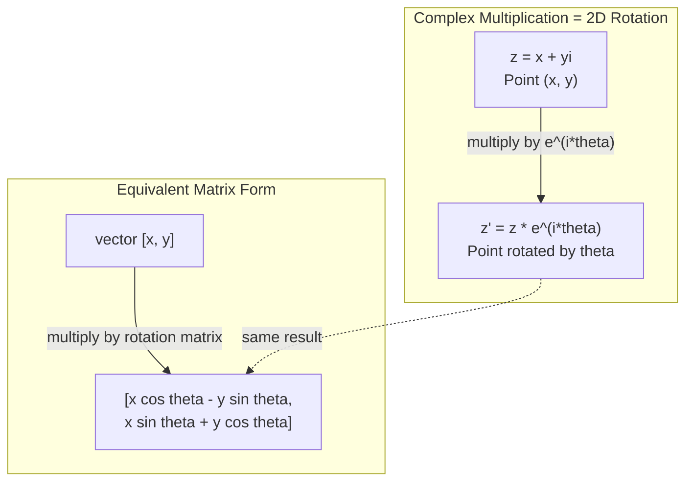
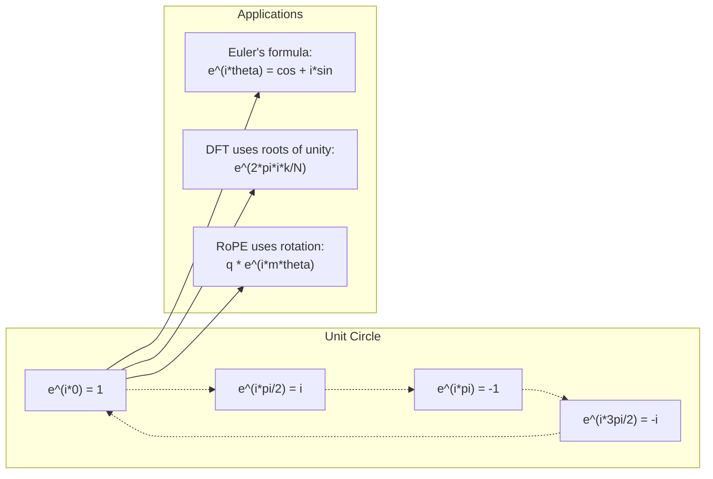

# Numéros complexes pour l'IA

> La racine carrée de -1 n'est pas imaginaire, elle est la clé des rotations, des fréquences et de la moitié du traitement du signal.

**Type:** Learn
**Language:**Python
**Prerequisites:** Phase 1, Lessons 01-04 (linear algebra, calculus)
**Time:** ~60 minutes

## Objectifs d'apprentissage

- Exécuter l'arithmétique complexe (ajouter, multiplier, diviser, conjuguer) sous forme rectangulaire et polaire
- Appliquer la formule d'Euler pour convertir entre les exponentiels complexes et les fonctions trigonométriques
- Implémenter la Transformation Fourier discrète en utilisant des racines complexes d'unité
- Expliquer comment les rotations complexes sous-tendent les encodements positionnels RoPE et sinusoïdale dans les transformateurs

## Le problème

Vous ouvrez un article sur les transformations de Fourier et il y a`i`Vous regardez les encodements de position des transformateurs et vous voyez`sin`et `cos`Vous lisez sur l'informatique quantique et trouvez tout exprimé dans des espaces vectoriels complexes.

Les nombres complexes semblent abstraits. Un système de nombres construit sur la racine carrée de -1 semble être une astuce mathématique. Mais ce n'est pas une astuce. C'est le langage naturel des rotations et des oscillations. Chaque fois que quelque chose tourne, vibrera ou oscillera, les nombres complexes sont l'outil idéal.

Sans comprendre les nombres complexes, vous ne pouvez pas comprendre la Transformation Fourier discrète. Vous ne pouvez pas comprendre FFT. Vous ne pouvez pas comprendre comment RoPE (Rotary Position Embedding) fonctionne dans les modèles de langage modernes. Vous ne pouvez pas comprendre pourquoi les encodements positionnels sinusoïdes dans le papier Transformer original utilisent les fréquences qu'ils font.

Cette leçon construit l'arithmétique complexe à partir de zéro, la connecte à la géométrie, et vous montre exactement où apparaissent les nombres complexes dans l'apprentissage automatique.

## Le concept

### Qu'est-ce qu'un nombre complexe ?

Un nombre complexe a deux parties: une partie réelle et une partie imaginaire.

```
z = a + bi

where:
  a is the real part
  b is the imaginary part
  i is the imaginary unit, defined by i^2 = -1
```

C'est tout. Vous étendrez la ligne numérique dans un plan. Les nombres réels sont assis sur un axe. Les nombres imaginaires sont assis sur l'autre. Chaque nombre complexe est un point dans ce plan.

### L'arithmétique complexe

**Addition.**Ajoutez les parties réelles, ajoutez les parties imaginaires.

```math
\begin{aligned}
(a + bi) + (c + di) &= (a + c) + (b + d)i \\[4pt]
\text{Example: } (3 + 2i) + (1 + 4i) &= 4 + 6i
\end{aligned}
```

**Multiplication.**Utilisez la loi de la distribution et rappelez-vous que$i^2 = -1$- Je suis désolé .

```math
\begin{aligned}
(a + bi)(c + di) &= ac + adi + bci + bdi^2 \\
&= ac + adi + bci - bd \\
&= (ac - bd) + (ad + bc)i \\[8pt]
\text{Example: } (3 + 2i)(1 + 4i) &= 3 + 12i + 2i + 8i^2 \\
&= 3 + 14i - 8 \\
&= -5 + 14i
\end{aligned}
```

**Conjugate.**Faites tourner le signe de la partie imaginaire.

```math
\text{conjugate of } (a + bi) = a - bi
```

Le produit d'un nombre complexe et de son conjugué est toujours réel:

```math
(a + bi)(a - bi) = a^2 + b^2
```

**Division.**Multipliez le numérateur et le dénominateur par le conjugué du dénominateur.

```math
\frac{a + bi}{c + di} = \frac{(a + bi)(c - di)}{c^2 + d^2}
```

Cela élimine la partie imaginaire du dénominateur, vous donnant un nombre complexe propre.

### Le plan complexe

Le plan complexe trace chaque nombre complexe à un point 2D. L'axe horizontal est l'axe réel, l'axe vertical est l'axe imaginaire.

```
z = 3 + 2i  corresponds to the point (3, 2)
z = -1 + 0i corresponds to the point (-1, 0) on the real axis
z = 0 + 4i  corresponds to the point (0, 4) on the imaginary axis
```

Un nombre complexe est simultanément un point et un vecteur de l'origine. Cette interprétation double est ce qui rend les nombres complexes utiles pour la géométrie.

### Forme polaire

Tout point du plan peut être décrit par sa distance de l'origine et son angle de l'axe réel positif.

```math
\begin{aligned}
z &= r (\cos\theta + i \sin\theta) \\[4pt]
\text{where: } r &= |z| = \sqrt{a^2 + b^2} \quad \text{(magnitude, or modulus)} \\
\theta &= \mathop{\mathrm{atan2}}(b, a) \quad \text{(phase, or argument)}
\end{aligned}
```

Forme rectangulaire $(a + bi)$est bon pour l'addition.$(r, \theta)$est bon pour la multiplication.

**Multiplication in polar form.**Multipliez les magnitudes, ajoutez les angles.

```math
\begin{aligned}
z_1 &= r_1 e^{i\theta_1} \\
z_2 &= r_2 e^{i\theta_2} \\[4pt]
z_1 z_2 &= (r_1 r_2) \, e^{i(\theta_1 + \theta_2)}
\end{aligned}
```

C'est pourquoi les nombres complexes sont parfaits pour les rotations. Multiplier par un nombre complexe avec une magnitude 1 est une rotation pure.

### La formule d'Euler

Le pont entre les exponentiels complexes et la trigonométrie:

```math
e^{i\theta} = \cos\theta + i \sin\theta
```

C'est la formule la plus importante de cette leçon.$\theta = \pi$- Le numéro de la liste:

```math
\begin{aligned}
e^{i\pi} &= \cos\pi + i \sin\pi = -1 + 0i = -1 \\[4pt]
\text{Therefore: } e^{i\pi} + 1 &= 0
\end{aligned}
```

Cinq constantes fondamentales ($e$- Je suis là .$i$- Je suis là .$\pi$, 1, 0) liés dans une seule équation.

### Pourquoi la formule d'Euler est importante pour ML

La formule d'Euler dit que$e^{i\theta}$trace le cercle de l'unité comme $\theta$Les taux de change sont très élevés.$\theta = 0$Tu es à la$(1, 0)$À la .$\theta = \pi/2$Tu es à la$(0, 1)$À la .$\theta = \pi$Tu es à la$(-1, 0)$À la .$\theta = 3\pi/2$Tu es à la$(0, -1)$Une rotation complète est$\theta = 2\pi$- Je suis désolé .

Cela signifie que les exponentiels complexes sont des rotations.

### Connexion à des rotations 2D

Multiplication du nombre complexe $(x + yi)$par $e^{i\theta}$tourne le point $(x, y)$par angle $\theta$autour de l'origine.

```math
\begin{aligned}
&\text{Rotation via complex multiplication:} \\
&\quad (x + yi)(\cos\theta + i \sin\theta) = (x \cos\theta - y \sin\theta) + (x \sin\theta + y \cos\theta)i \\[8pt]
&\text{Rotation via matrix multiplication:} \\
&\quad \begin{bmatrix} \cos\theta & -\sin\theta \\ \sin\theta & \cos\theta \end{bmatrix} \begin{bmatrix} x \\ y \end{bmatrix} = \begin{bmatrix} x \cos\theta - y \sin\theta \\ x \sin\theta + y \cos\theta \end{bmatrix}
\end{aligned}
```

La matrice de rotation est simplement une multiplication complexe écrite en notation de matrice.



### Les phasors et les signaux rotatifs

Une exponentielle complexe $e^{i\omega t}$est un point tournant autour du cercle unitaire à fréquence angulaire $\omega$- Comme ...$t$augmenter, le point trace le cercle.

La vraie partie de ce point de rotation est $\cos(\omega t)$La partie imaginaire est$\sin(\omega t)$Un signal sinusoïdale est l'ombre d'un nombre complexe en rotation.

```math
\begin{aligned}
e^{i\omega t} &= \cos(\omega t) + i \sin(\omega t) \\[4pt]
\text{Real part: } & \cos(\omega t) \quad \text{-- a cosine wave} \\
\text{Imaginary part: } & \sin(\omega t) \quad \text{-- a sine wave}
\end{aligned}
```

C'est la représentation du phasor. Au lieu de suivre une onde sinusoïdale mouvementée, vous suivez une flèche qui tourne doucement. Les changements de phase deviennent des compensations d'angle. Les changements d'amplitude deviennent des changements de magnitude. L'ajout de signaux devient l'ajout vectoriel.

### Les racines de l'unité

Le $N$- les racines de l'unité sont $N$points égaux sur le cercle unitaire:

```math
w_k = e^{2\pi i k/N} \quad \text{for } k = 0, 1, 2, \ldots, N-1
```

Pour $N = 4$, les racines sont: $1, i, -1, -i$(les quatre points de la boussole).
Pour $N = 8$, vous obtenez les quatre points de la boussole plus les quatre diagonales.

Les racines de l'unité sont à la base de la transformation discrète de Fourier.$N$fréquences de même espace.

### Connexion au DFT

La transformation discrète de Fourier d' un signal $x[0], x[1], \ldots, x[N-1]$est:

```math
X[k] = \sum_{n=0}^{N-1} x[n] \, e^{-2\pi i k n/N}
```

Chacun d' eux .$X[k]$mesure la corrélation entre le signal et le signal $k$- la racine de l'unité - un sinus complexe à fréquence$k$Le DFT rompt un signal en$N$Il vous indique l'amplitude et la phase de chacun.

### Pourquoi je ne suis pas imaginaire

Le mot "imaginé" est un accident historique.$i$Les nombres négatifs répondent à "qu'est-ce que vous soustraisez 5 de 3 pour obtenir?"

Plus utile: $i$est un opérateur de rotation de 90 degrés.$i$Une fois, vous faites 90 degrés de rotation vers l'axe imaginaire.$i$encore une fois ($i^2$Vous faites encore 90 degrés de rotation, et vous pointez dans la direction négative.$i^2 = -1$Ce n'est pas mystérieux, c'est une demi-tournée construite à partir de deux quarts de tour.

C'est pourquoi les nombres complexes sont partout dans l'ingénierie. Tout ce qui tourne - ondes électromagnétiques, états quantiques, oscillations de signal, codes positionnels - est naturellement décrit par des nombres complexes.

### Exponentiels complexes par rapport aux fonctions trigonométriques

Avant la formule d'Euler, les ingénieurs écrivaient des signaux comme:$A \cos(\omega t + \phi)$-- l' amplitude$A$, fréquence $\omega$, phase $\phi$L'ajout de deux cosines avec différentes phases nécessite des identités trigonométriques.

Avec des exponentiels complexes, le même signal est $A e^{i(\omega t + \phi)}$. Ajouter deux signaux est juste ajouter deux nombres complexes. Multiplication (modulation) est juste multiplier les magnitudes et ajouter des angles. Les changements de phase deviennent des ajouts d'angle.

Le champ entier du traitement des signaux est passé à la notation exponentielle complexe parce que les mathématiques sont plus propres. Le "signal réel" est toujours juste la partie réelle de la représentation complexe.

### Connexion aux transformateurs

**Sinusoidal positional encodings**(papier transformateur original):

```math
\begin{aligned}
PE(pos, 2i) &= \sin\left(pos / 10000^{2i/d}\right) \\
PE(pos, 2i+1) &= \cos\left(pos / 10000^{2i/d}\right)
\end{aligned}
```

Les paires de péché et de cos sont les parties réelles et imaginaires d'exponentiels complexes à différentes fréquences. Chaque fréquence fournit une "résolution" différente pour la position de codage.

**RoPE (Rotary Position Embedding)**Il multiplie explicitement les vecteurs de requête et de clé par des matrices de rotation complexes. La position relative entre deux jetons devient un angle de rotation.

| Operation | Algebraic Form | Geometric Meaning |
|-----------|---------------|-------------------|
| Addition | $(a+c) + (b+d)i$ | Vector addition in the plane |
| Multiplication | $(ac-bd) + (ad+bc)i$ | Rotate and scale |
| Conjugate | $a - bi$ | Reflect over real axis |
| Magnitude | $\sqrt{a^2 + b^2}$ | Distance from origin |
| Phase | $\mathop{\mathrm{atan2}}(b, a)$ | Angle from positive real axis |
| Division | multiply by conjugate | Reverse rotation and rescale |
| Power | $r^n e^{in\theta}$ | Rotate $n$ times, scale by $r^n$ |



```figure
roots-of-unity
```

## Faites-le

### Étape 1: classe complexe

Construisez une classe de nombres complexes qui prend en charge l'arithmétique, la magnitude, la phase et la conversion entre les formes rectangulaires et polaires.

```python
import math

class Complex:
    def __init__(self, real, imag=0.0):
        self.real = real
        self.imag = imag

    def __add__(self, other):
        return Complex(self.real + other.real, self.imag + other.imag)

    def __mul__(self, other):
        r = self.real * other.real - self.imag * other.imag
        i = self.real * other.imag + self.imag * other.real
        return Complex(r, i)

    def __truediv__(self, other):
        denom = other.real ** 2 + other.imag ** 2
        r = (self.real * other.real + self.imag * other.imag) / denom
        i = (self.imag * other.real - self.real * other.imag) / denom
        return Complex(r, i)

    def magnitude(self):
        return math.sqrt(self.real ** 2 + self.imag ** 2)

    def phase(self):
        return math.atan2(self.imag, self.real)

    def conjugate(self):
        return Complex(self.real, -self.imag)
```

### Étape 2: Conversion polaire et formule d'Euler

```python
def to_polar(z):
    return z.magnitude(), z.phase()

def from_polar(r, theta):
    return Complex(r * math.cos(theta), r * math.sin(theta))

def euler(theta):
    return Complex(math.cos(theta), math.sin(theta))
```

Vérifiez: `euler(theta).magnitude()`Il devrait toujours être de 1.0.`euler(0)`doit donner (1, 0). `euler(pi)`doit donner (-1, 0).

### Étape 3: Rotation

Retourner un point $(x, y)$par angle $\theta$est une multiplication complexe:

```python
point = Complex(3, 4)
rotated = point * euler(math.pi / 4)
```

La magnitude reste la même, mais l'angle change.

### Étape 4: DFT de l'arithmétique complexe

```python
def dft(signal):
    N = len(signal)
    result = []
    for k in range(N):
        total = Complex(0, 0)
        for n in range(N):
            angle = -2 * math.pi * k * n / N
            total = total + Complex(signal[n], 0) * euler(angle)
        result.append(total)
    return result
```

C' est le $O(N^2)$DFT. Chaque sortie $X[k]$est la somme des échantillons de signal multipliée par les racines d'unité.

### Étape 5: DFT inversé

Le DFT inverse reconstruit le signal d'origine à partir de son spectre.$N$- Je suis désolé .

```python
def idft(spectrum):
    N = len(spectrum)
    result = []
    for n in range(N):
        total = Complex(0, 0)
        for k in range(N):
            angle = 2 * math.pi * k * n / N
            total = total + spectrum[k] * euler(angle)
        result.append(Complex(total.real / N, total.imag / N))
    return result
```

Cela vous donne une reconstruction parfaite. Appliquez DFT, puis IDFT, et vous obtenez le signal original à la précision de la machine. Aucune information n'est perdue.

### Étape 6: Les racines de l'unité

```python
def roots_of_unity(N):
    return [euler(2 * math.pi * k / N) for k in range(N)]
```

Vérifiez deux propriétés:
- Chaque racine a une magnitude de 1 exactement.
- La somme de tous $N$les racines sont zéro (elles sont annulées par symétrie).

Ces propriétés sont ce qui rend le DFT inversible.

## Utilisez-le

Python a intégré le support de nombres complexes.`j`représente l'unité imaginaire.

```python
z = 3 + 2j
w = 1 + 4j

print(z + w)
print(z * w)
print(abs(z))

import cmath
print(cmath.phase(z))
print(cmath.exp(1j * cmath.pi))
```

Pour les matrices, numpy traite les nombres complexes de manière native:

```python
import numpy as np

z = np.array([1+2j, 3+4j, 5+6j])
print(np.abs(z))
print(np.angle(z))
print(np.conj(z))
print(np.real(z))
print(np.imag(z))

signal = np.sin(2 * np.pi * 5 * np.linspace(0, 1, 128))
spectrum = np.fft.fft(signal)
freqs = np.fft.fftfreq(128, d=1/128)
```

## La faire partir

On court .`code/complex_numbers.py`pour générer `outputs/skill-complex-arithmetic.md`- Je suis désolé .

## Exercices

1. **Complex arithmetic by hand.**Compte $(2 + 3i)(4 - i)$et vérifier avec le code.$(5 + 2i) / (1 - 3i)$. Dessinez les deux résultats sur le plan complexe et vérifiez que la multiplication a tourné et étalé le premier nombre.

2. **Rotation sequence.**Commencez par le point.$(1, 0)$Multipliez par$e^{i\pi/6}$Vérifiez que vous revenez à la$(1, 0)$Imprimez les coordonnées à chaque étape et confirmez qu'elles suivent un 12-gon régulier.

3. **DFT of a known signal.**Créer un signal qui est la somme de $\sin(2\pi \cdot 3t)$et $0.5 \sin(2\pi \cdot 7t)$Prenez votre DFT. Vérifiez que le spectre de magnitude a des pics à la fréquence 3 et 7, avec le pic à 7 étant la moitié de la hauteur du pic à 3.

4. **Roots of unity visualization.**Comptez les 8e racines de l'unité. Vérifiez qu'elles s'ajoutent à zéro. Vérifiez que la multiplication de n'importe quelle racine par la racine primitive$e^{2\pi i/8}$donne la racine suivante.

5. **Rotation matrix equivalence.**Pour 10 angles aléatoires et 10 points aléatoires, vérifiez que la multiplication complexe donne le même résultat que la multiplication par matrice-vecteur avec la matrice de rotation 2x2.

### Des indices

**Exercise 1.**Élargir le produit avec $i^2 = -1$, puis partager en multipliant le haut et le bas par le conjugué $1 + 3i$Vérifiez le produit avec `Complex(2, 3) * Complex(4, -1)`: son `magnitude()`doit être égal au produit des deux magnitudes, et son`phase()`doit être égale à la somme des deux phases.

**Exercise 2.**Faites le pas avec `euler(math.pi / 6)`et multiplier 12 fois. À chaque étape, vérifiez que la magnitude reste 1 et que l'angle augmente de 30 degrés.

**Exercise 3.**Faites les points horaires avec $t = n/32$et appeler`dft`Regardez seulement les poubelles de 0 à 15, car la moitié supérieure est une image miroir.$k$pour un sinus d'amplitude $A$est $AN/2$, alors attendez-vous à environ 16 au bac 3 et environ 8 au bac 7.

**Exercise 4.**Appel`roots_of_unity(8)`et ajouter les racines: la magnitude de la somme doit être proche de 0. Divisez chaque racine par la racine précédente et vérifiez que chaque résultat est égal `euler(2 * math.pi / 8)`- Je suis désolé .

**Exercise 5.**La matrice de rotation est [cos t, -sin t], [sin t, cos t]. Pour chaque angle et point, calculer `euler(t) * Complex(x, y)`et le produit de la matrice, puis enregistrer la plus grande différence absolue.$10^{-15}$- Je suis désolé .

## Les termes clés

| Term | What it means |
|------|---------------|
| Complex number | A number $a + bi$ where $a$ is the real part, $b$ is the imaginary part, and $i^2 = -1$ |
| Imaginary unit | The number $i$, defined by $i^2 = -1$. Not imaginary in the philosophical sense -- it is a rotation operator |
| Complex plane | The 2D plane where the x-axis is real and the y-axis is imaginary. Also called the Argand plane |
| Magnitude (modulus) | The distance from the origin: $\sqrt{a^2 + b^2}$. Written as $\lvert z \rvert$ |
| Phase (argument) | The angle from the positive real axis: $\mathop{\mathrm{atan2}}(b, a)$. Written as $\arg(z)$ |
| Conjugate | The mirror image across the real axis: conjugate of $a + bi$ is $a - bi$ |
| Polar form | Expressing $z$ as $r e^{i\theta}$ instead of $a + bi$. Makes multiplication easy |
| Euler's formula | $e^{i\theta} = \cos\theta + i \sin\theta$. Connects exponentials to trigonometry |
| Phasor | A rotating complex number $e^{i\omega t}$ representing a sinusoidal signal |
| Roots of unity | The $N$ complex numbers $e^{2\pi i k/N}$ for $k = 0$ to $N-1$. $N$ equally spaced points on the unit circle |
| DFT | Discrete Fourier Transform. Decomposes a signal into complex sinusoidal components using roots of unity |
| RoPE | Rotary Position Embedding. Uses complex multiplication to encode relative position in transformer attention |

## Pour en savoir plus

- [Visual Introduction to Euler's Formula](https://betterexplained.com/articles/intuitive-understanding-of-eulers-formula/)- construit une intuition géométrique sans notes lourdes
- [Su et al.: RoFormer (2021)](https://arxiv.org/abs/2104.09864)- le document introduisant l'implantation de position rotative à l'aide de rotations complexes
- [Vaswani et al.: Attention Is All You Need (2017)](https://arxiv.org/abs/1706.03762)- le papier transformateur original avec des encodements positionnels sinusoïdes
- [3Blue1Brown: Euler's formula with introductory group theory](https://www.youtube.com/watch?v=mvmuCPvRoWQ)- une explication visuelle du pourquoi $e^{i\pi} = -1$
- [Needham: Visual Complex Analysis](https://global.oup.com/academic/product/visual-complex-analysis-9780198534464)- le meilleur traitement visuel des nombres complexes, plein de compréhension géométrique
- [Strang: Introduction to Linear Algebra, Ch. 10](https://math.mit.edu/~gs/linearalgebra/)- les nombres complexes dans le contexte de l'algèbre linéaire et des valeurs propres
