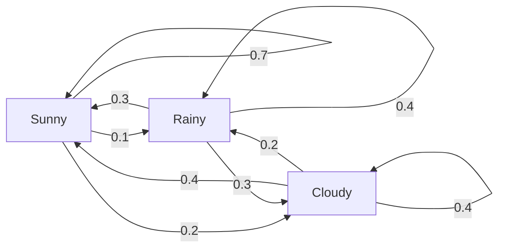
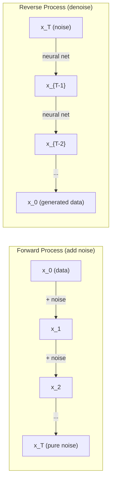

# Procédures stochastiques

> Le mathématicien derrière les promenades aléatoires, les chaînes de Markov et les modèles de diffusion.

**Type:** Learn
**Language:**Python
**Prerequisites:** Phase 1, Lessons 06-07 (probability, Bayes)
**Time:** ~75 minutes

## Objectifs d'apprentissage

- Simuler des promenades aléatoires en 1D et en 2D et vérifier les $\sqrt{n}$évolutions de la délocalisation
- Construire un simulateur de chaîne Markov et calculer sa distribution stationnaire via une propre composition
- Implementer la dynamique MCMC et Langevin de Metropolis-Hastings pour le prélèvement d'échantillons à partir de distributions cibles
- Connectez le processus de diffusion avant au mouvement Brownien et expliquez comment le processus inverse génère des données

## Le problème

Beaucoup de systèmes d'IA impliquent le hasard qui évolue au fil du temps, pas le hasard statique, le hasard structuré et séquentiel où chaque étape dépend de ce qui est arrivé avant.

Les modèles de langage génèrent des jetons un à la fois. Chaque jeton dépend du contexte précédent. Le modèle produit une distribution de probabilité, des échantillons à partir de lui, et passe à autre chose. C'est un processus stochastique.

Les modèles de diffusion ajoutent du bruit à une image étape par étape jusqu'à ce qu'elle devienne pure statique. Ils inversent ensuite le processus, dénonçant étape par étape jusqu'à ce qu'une nouvelle image émerge.

Les agents d'apprentissage de renforcement prennent des actions dans un environnement. Chaque action conduit à un nouvel état avec une certaine probabilité. L'agent suit une politique aléatoire dans un monde aléatoire.

L'échantillonnage MCMC - la colonne vertébrale de l'inférence bayésienne - construit une chaîne de Markov dont la distribution stationnaire est la partie postérieure dont vous voulez échantillonner.

Tout cela repose sur quatre idées fondamentales:
1. Les promenades aléatoires -- le processus stochastique le plus simple
2. Chaînes de Markov -- structurée au hasard avec une matrice de transition
3. Dynamique de Langevin - descente de gradient avec le bruit
4. Metropolis-Hastings - prélèvement d'échantillons à partir de toute distribution

## Le concept

### Des promenades aléatoires

Commencez à la position 0. À chaque étape, lancez une pièce équitable.

Après$n$Pas, votre position est la somme de $n$au hasard$\pm 1$Les valeurs de la position attendue est de 0 (la marche est impartiale).$\sqrt{n}$- Je suis désolé .

C'est contre-intuitif. La marche est juste - pas de dérive dans les deux sens. Mais avec le temps, il va de plus en plus loin de là où il a commencé.$n$les étapes sont $\sqrt{n}$- Je suis désolé .

```
Step 0:  Position = 0
Step 1:  Position = +1 or -1
Step 2:  Position = +2, 0, or -2
...
Step 100: Expected distance from origin ~ 10 (sqrt(100))
Step 10000: Expected distance from origin ~ 100 (sqrt(10000))
```

**In 2D**, la marche se déplace vers le haut, vers le bas, à gauche ou à droite avec la même probabilité.$\sqrt{n}$La mise à l'échelle s'applique à la distance de l'origine.

**Why $\sqrt{n}$?**Chaque étape est +1 ou -1 avec la même probabilité.$n$étapes, la position $S_n = X_1 + X_2 + \cdots + X_n$où chacun $X_i$est $\pm 1$. La variance de chaque étape est de 1, et les étapes sont indépendantes, donc $\mathop{\mathrm{Var}}(S_n) = n$. Déviation standard = $\sqrt{n}$- Par le théorème de la limite centrale,$S_n / \sqrt{n}$converge à une distribution normale standard.

Ça ?$\sqrt{n}$L'échelle de dimensionnement apparaît partout dans le ML. Les échelles de bruit SGD sont 1/sqrt(taille de lot).$\sqrt{d}$La racine carrée est la signature des additions aléatoires indépendantes.

**Connection to Brownian motion.**Faites une promenade aléatoire avec la taille des marches $1/\sqrt{n}$et $n$Les étapes par unité de temps.$n$va à l'infini, la marche converge au mouvement brownien$B(t)$-- un processus continu où $B(t)$est normalement réparti avec la moyenne 0 et la variance $t$- Je suis désolé .

Le mouvement brownien est la base mathématique de la diffusion. Il modélise le vibration aléatoire des particules dans un fluide, les fluctuations des prix des actions et - crucialement - le processus sonore dans les modèles de diffusion.

**Gambler's ruin.**Un marcheur au hasard qui commence à la position .$k$, avec des barrières d' absorption à 0 et $N$Quelle est la probabilité d' atteindre$N$Pour une promenade équitable:$P(\text{reach } N) = k/N$C'est étonnamment simple et élégant. Il se connecte à la théorie des martingales - la marche aléatoire juste est un martingale (valeur future attendue = valeur actuelle).

### Chaînes de Markov

Une chaîne de Markov est un système qui transite entre les états selon des probabilités fixes.

```math
P(X_{t+1} = j \mid X_t = i, X_{t-1} = \ldots) = P(X_{t+1} = j \mid X_t = i)
```

C'est la propriété de Markov, vous pouvez décrire toute la dynamique avec une matrice de transition.$P$- Le numéro de la liste:

```math
P[i][j] = \text{probability of going from state } i \text{ to state } j
```

Chaque rangée de $P$Les sommes sont à 1 (vous devez aller quelque part).

**Example -- Weather:**

```
States: Sunny (0), Rainy (1), Cloudy (2)

P = [[0.7, 0.1, 0.2],    (if sunny: 70% sunny, 10% rainy, 20% cloudy)
     [0.3, 0.4, 0.3],    (if rainy: 30% sunny, 40% rainy, 30% cloudy)
     [0.4, 0.2, 0.4]]    (if cloudy: 40% sunny, 20% rainy, 40% cloudy)
```

Après de nombreuses transitions, la répartition des états converge à la répartition stationnaire.$\pi$Où ?$\pi P = \pi$C' est le propre vecteur gauche de$P$avec la valeur propre 1.

Pour la chaîne météorologique, la répartition stationnaire est [0,55, 0,18, 0,27] -- à long terme, il est ensoleillé 55% du temps, quel que soit l'état de départ.



**Computing the stationary distribution.**Il existe deux approches:

1. **Power method**: multiplier toute répartition initiale par $P$Après suffisamment d'itérations, il converge.
2. **Eigenvalue method**: trouver le propre vecteur gauche de $P$avec la valeur propre 1. Ceci est le propre vecteur de $P^T$avec la valeur propre 1.

Les deux approches exigent que la chaîne remplisse les conditions de convergence.

**Convergence conditions.**Une chaîne Markov converge à une distribution stationnaire unique si elle est:
- **Irreducible**: chaque État est accessible depuis chaque autre État
- **Aperiodic**: la chaîne ne cycle pas avec une période fixe

La plupart des chaînes rencontrées dans ML satisfont aux deux conditions.

**Absorbing states.**Un état est absorbant si une fois que vous y entrez, vous ne sortez jamais ($P[i][i] = 1$L'absorption des processus de modélisation de chaînes de Markov avec des états terminaux - un jeu qui se termine, un client qui se révolte, une séquence de jetons qui frappe le jeton de fin de texte.

**Mixing time.**Combien d'étapes jusqu'à ce que la chaîne soit "close" à la distribution stationnaire?$P$(1 moins la deuxième plus grande valeur propre) contrôle le temps de mélange.

### Connexion avec les modèles linguistiques

La génération de jetons dans un modèle de langage est approximativement un processus de Markov.

```math
P(\text{token}_i) = \frac{\exp(\text{logit}_i / \text{temperature})}{\sum_j \exp(\text{logit}_j / \text{temperature})}
```

- Température = 1,0: répartition standard
- Température < 1,0: plus nette (plus déterministe)
- Température > 1,0: plus plate (plus aléatoire)
- Température $\to 0$: argmax (compulsif)

Le prélèvement d'échantillons de haut en bas à la$k$Les échantillons de pointe (nucleus) se réduisent à la plus petite série de jetons dont la probabilité cumulée dépasse $p$Les deux modifient les probabilités de transition de Markov.

### Motion brown

La limite de temps continue de la marche aléatoire.$B(t)$a trois propriétés:
1. $B(0) = 0$
2. $B(t) - B(s)$est normalement réparti avec la moyenne 0 et la variance $t - s$(pour $t > s$)
3. Les augmentations sur les intervalles non superposés sont indépendantes

Le mouvement brownien est continu mais nulle part différenciable - il se balance à chaque échelle.

Dans une simulation discrète, on approche le mouvement brownien par:

```math
B(t + dt) = B(t) + \sqrt{dt} \, z, \quad \text{where } z \sim \mathcal{N}(0, 1)
```

Le $\sqrt{dt}$L'échelle est importante. Elle vient du théorème limite centrale appliqué aux promenades aléatoires.

### Dynamique de Langevin

La dynamique de Langevin trouve la distribution de probabilité proportionnelle à $\exp(-U(x)/T)$Où ?$U$est une fonction énergétique et $T$est la température.

```math
x_{t+1} = x_t - dt \, \nabla U(x_t) + \sqrt{2 T \, dt} \, z_t
```

Deux forces agissent sur la particule:
1. **Gradient force**(le secteur de l'énergie)$-dt \cdot \nabla U$): pousse vers une faible énergie (comme la descente de la gradiente)
2. **Random force**(le secteur de l'énergie)$\sqrt{2T dt} \cdot z$): pousse dans des directions aléatoires (exploration)

À température$T = 0$À haute température, c'est presque une marche aléatoire. À la bonne température, la particule explore le paysage énergétique et passe plus de temps dans les régions à faible énergie.

**Connection to diffusion models.**Le processus avancé d'un modèle de diffusion est le suivant:

```math
x_t = \sqrt{\alpha_t} \, x_{t-1} + \sqrt{1 - \alpha_t} \cdot \text{noise}
```

C'est une chaîne de Markov qui mélange progressivement les données avec le bruit.$x_T$C'est un bruit gaussien pur.

Le processus inverse - passer du bruit à la data - est aussi une chaîne de Markov, mais ses probabilités de transition sont apprises par un réseau neuronal. Le réseau apprend à prédire le bruit qui a été ajouté à chaque étape, puis le soustrait.



### MCMC: Chaîne de Markov à Monte Carlo

Parfois, il faut prendre des échantillons d'une distribution.$p(x)$Les postérieurs bayésiens sont l'exemple classique -- vous connaissez la probabilité par la précédente, mais la constante de normalisation est difficile à résoudre.

**Metropolis-Hastings**construit une chaîne de Markov dont la distribution stationnaire est$p(x)$- Le numéro de la liste:

1. Commencez par une position .$x$
2. Proposez une nouvelle position $x'$de la distribution de propositions $Q(x' \mid x)$
3. Ratio d' acceptation de calcul: $a = p(x') Q(x \mid x') / (p(x) Q(x' \mid x))$
4. Je l' accepte .$x'$avec probabilité $\min(1, a)$- Sinon , restez à la .$x$- Je suis désolé .
5. Je répète.

Si vous$Q$est symétrique (p. ex., $Q(x' \mid x) = Q(x \mid x') = \mathcal{N}(x, \sigma^2){}$), le ratio est simplifié à $a = p(x') / p(x)$Il vous suffit de voir le ratio des probabilités, la constante de normalisation annulée.

La chaîne est garantie de converger à $p(x)$La convergence peut être lente si la proposition est trop petite (marche aléatoire) ou trop grande (rejetation élevée).

**Why it works.**Le ratio d' acceptation assure un équilibre détaillé: la probabilité d' être à $x$et de se déplacer à $x'$est égale à la probabilité d' être à $x'$et de se déplacer à $x$Un équilibre détaillé implique que$p(x)$Donc après suffisamment de pas, les échantillons proviennent de$p(x)$- Je suis désolé .

**Practical considerations:**
- **Burn-in**: jeter le premier $N$La chaîne a besoin de temps pour atteindre la distribution stationnaire à partir de son point de départ.
- **Thinning**Gardez tout .$k$- le 1er échantillon pour réduire l'autocorrélation.
- **Multiple chains**Si elles convergent vers la même distribution, vous avez des preuves de convergence.
- **Acceptance rate**: pour les propositions gaussiennes en$d$Les dimensions de la chaîne sont plus élevées que celles de la chaîne, le taux d'acceptation optimal est d'environ 23% (Roberts & Rosenthal, 2001).

### Processus stochastiques dans l'IA

| Process | AI Application |
|---------|---------------|
| Random walk | Exploration in RL, Node2Vec embeddings |
| Markov chain | Text generation, MCMC sampling |
| Brownian motion | Diffusion models (forward process) |
| Langevin dynamics | Score-based generative models, SGLD |
| Markov decision process | Reinforcement learning |
| Metropolis-Hastings | Bayesian inference, posterior sampling |

```figure
random-walk-diffusion
```

## Faites-le

### Étape 1: Simulateur de marche aléatoire

```python
import numpy as np

def random_walk_1d(n_steps, seed=None):
    rng = np.random.RandomState(seed)
    steps = rng.choice([-1, 1], size=n_steps)
    positions = np.concatenate([[0], np.cumsum(steps)])
    return positions


def random_walk_2d(n_steps, seed=None):
    rng = np.random.RandomState(seed)
    directions = rng.choice(4, size=n_steps)
    dx = np.zeros(n_steps)
    dy = np.zeros(n_steps)
    dx[directions == 0] = 1   # right
    dx[directions == 1] = -1  # left
    dy[directions == 2] = 1   # up
    dy[directions == 3] = -1  # down
    x = np.concatenate([[0], np.cumsum(dx)])
    y = np.concatenate([[0], np.cumsum(dy)])
    return x, y
```

La marche 1D stocke les sommes cumulées. chaque étape est +1 ou -1.$n$La variance augmente linéairement avec $n$, donc l' écart standard augmente à mesure que $\sqrt{n}$- Je suis désolé .

### Étape 2: Chaîne de Markov

```python
class MarkovChain:
    def __init__(self, transition_matrix, state_names=None):
        self.P = np.array(transition_matrix, dtype=float)
        self.n_states = len(self.P)
        self.state_names = state_names or [str(i) for i in range(self.n_states)]

    def step(self, current_state, rng=None):
        if rng is None:
            rng = np.random.RandomState()
        probs = self.P[current_state]
        return rng.choice(self.n_states, p=probs)

    def simulate(self, start_state, n_steps, seed=None):
        rng = np.random.RandomState(seed)
        states = [start_state]
        current = start_state
        for _ in range(n_steps):
            current = self.step(current, rng)
            states.append(current)
        return states

    def stationary_distribution(self):
        eigenvalues, eigenvectors = np.linalg.eig(self.P.T)
        idx = np.argmin(np.abs(eigenvalues - 1.0))
        stationary = np.real(eigenvectors[:, idx])
        stationary = stationary / stationary.sum()
        return np.abs(stationary)
```

La distribution stationnaire est le propre vecteur gauche de $P$On le trouve en calculant des vecteurs propres de $P^T$(transposant les vecteurs propres gauche en vecteurs propres droits).

### Étape 3: Dynamique de Langevin

```python
def langevin_dynamics(grad_U, x0, dt, temperature, n_steps, seed=None):
    rng = np.random.RandomState(seed)
    x = np.array(x0, dtype=float)
    trajectory = [x.copy()]
    for _ in range(n_steps):
        noise = rng.randn(*x.shape)
        x = x - dt * grad_U(x) + np.sqrt(2 * temperature * dt) * noise
        trajectory.append(x.copy())
    return np.array(trajectory)
```

Le gradient pousse $x$Le bruit empêche la prise de poids.$\exp(-U(x)/\text{temperature})$- Je suis désolé .

### Étape 4: Métropole-Hastings

```python
def metropolis_hastings(target_log_prob, proposal_std, x0, n_samples, seed=None):
    rng = np.random.RandomState(seed)
    x = np.array(x0, dtype=float)
    samples = [x.copy()]
    accepted = 0
    for _ in range(n_samples - 1):
        x_proposed = x + rng.randn(*x.shape) * proposal_std
        log_ratio = target_log_prob(x_proposed) - target_log_prob(x)
        if np.log(rng.rand()) < log_ratio:
            x = x_proposed
            accepted += 1
        samples.append(x.copy())
    acceptance_rate = accepted / (n_samples - 1)
    return np.array(samples), acceptance_rate
```

L'algorithme propose un nouveau point, vérifie s'il a une probabilité plus élevée (ou accepte avec probabilité proportionnelle au ratio) et répète.

## Utilisez-le

En pratique, vous utilisez des bibliothèques établies pour ces algorithmes, mais comprendre la mécanique est important pour débogage et réglage.

```python
import numpy as np

rng = np.random.RandomState(42)
walk = np.cumsum(rng.choice([-1, 1], size=10000))
print(f"Final position: {walk[-1]}")
print(f"Expected distance: {np.sqrt(10000):.1f}")
print(f"Actual distance: {abs(walk[-1])}")
```

### numpy pour les matrices de transition

```python
import numpy as np

P = np.array([[0.7, 0.1, 0.2],
              [0.3, 0.4, 0.3],
              [0.4, 0.2, 0.4]])

distribution = np.array([1.0, 0.0, 0.0])
for _ in range(100):
    distribution = distribution @ P

print(f"Stationary distribution: {np.round(distribution, 4)}")
```

Multipliez la répartition initiale par $P$Il est le système de puissance pour trouver le vecteur propre gauche dominant.

### Connexions avec des cadres réels

- **PyTorch diffusion:**Le `DDPMScheduler`Dans une tête enveloppée .`diffusers`met en œuvre les chaînes Markov avant et arrière
- **NumPyro / PyMC:**Utiliser MCMC (échantillonneur NUTS, qui améliore sur Metropolis-Hastings) pour l'inférence bayésienne
- **Gymnasium (RL):**La fonction étape environnement définit un processus de décision Markov

### Vérification de la convergence de la chaîne de Markov

```python
import numpy as np

P = np.array([[0.9, 0.1], [0.3, 0.7]])

eigenvalues = np.linalg.eigvals(P)
spectral_gap = 1 - sorted(np.abs(eigenvalues))[-2]
print(f"Eigenvalues: {eigenvalues}")
print(f"Spectral gap: {spectral_gap:.4f}")
print(f"Approximate mixing time: {1/spectral_gap:.1f} steps")
```

L'écart spectrale vous indique à quelle vitesse la chaîne oublie son état initial. Un écart de 0,2 signifie environ 5 étapes pour mélanger. Un écart de 0,01 signifie environ 100 étapes. Vérifiez toujours cela avant d'exécuter de longues simulations - un calcul de déchets de chaîne mélange lentement.

## La faire partir

Cette leçon donne:
- `outputs/prompt-stochastic-process-advisor.md`-- une requête qui aide à identifier quel cadre de processus stochastique s'applique à un problème donné

## Les liens

| Concept | Where it shows up |
|---------|------------------|
| Random walk | Node2Vec graph embeddings, exploration in RL |
| Markov chain | Token generation in LLMs, MCMC sampling |
| Brownian motion | Forward diffusion process in DDPM, SDE-based models |
| Langevin dynamics | Score-based generative models, stochastic gradient Langevin dynamics (SGLD) |
| Stationary distribution | MCMC convergence target, PageRank |
| Metropolis-Hastings | Bayesian posterior sampling, simulated annealing |
| Temperature | LLM sampling, Boltzmann exploration in RL, simulated annealing |
| Mixing time | Convergence speed of MCMC, spectral gap analysis |
| Absorbing state | End-of-sequence token, terminal states in RL |
| Detailed balance | Correctness guarantee for MCMC samplers |

Les modèles de diffusion méritent une attention particulière.

```math
q(x_t \mid x_{t-1}) = \mathcal{N}\left(x_t; \sqrt{1-\beta_t} \, x_{t-1}, \beta_t I\right)
```

où $\beta_t$C'est un calendrier de bruit.$T$étapes,$x_T$est approximativement $\mathcal{N}(0, I)$Le processus inverse est paramétrifié par un réseau neural qui prédit le bruit:

```math
p_\theta(x_{t-1} \mid x_t) = \mathcal{N}\left(x_{t-1}; \mu_\theta(x_t, t), \sigma_t^2 I\right)
```

Chaque étape de la génération est une étape dans une chaîne de Markov apprise.

Le SGLD (Stochastic Gradient Langevin Dynamics) combine la descente de gradient mini-batch avec le bruit de Langevin. Au lieu de calculer le gradient complet, vous utilisez une estimation stochastique et ajoutez un bruit calibré. Alors que le taux d'apprentissage diminue, le SGLD passe de l'optimisation à l'échantillonnage -- vous obtenez des échantillons Bayésiens approximatifs gratuits. C'est l'un des moyens les plus simples d'obtenir des estimations d'incertitude à partir d'un réseau neuronal.

L'idée clé de toutes ces connexions: les processus stochastiques ne sont pas seulement des outils théoriques. Ce sont les mécanismes informatiques à l'intérieur des systèmes d'IA modernes. Quand vous ajustez la température d'un LLM, vous ajustez une chaîne Markov. Quand vous entraînez un modèle de diffusion, vous apprenez à inverser un processus de mouvement Brownian. Quand vous exécutez l'inférence bayésienne, vous construisez une chaîne qui converge vers l'arrière.

## Exercices

1. **Simulate 1000 random walks of 10000 steps.**Décrire la répartition des positions finales. Vérifiez qu'il est approximativement gaussien avec la moyenne 0 et l'écart standard $\sqrt{10000} = 100$- Je suis désolé .

2. **Build a text generator using a Markov chain.**Formez un petit corpus: pour chaque mot, comptez les transitions vers le mot suivant. Construisez la matrice de transition. Générez de nouvelles phrases en prélèvant des échantillons de la chaîne.

3. **Implement simulated annealing**En utilisant Metropolis-Hastings, commencez à haute température (acceptez presque tout) et refroidissez progressivement (acceptez seulement des améliorations).

4. **Compare Langevin dynamics at different temperatures.**Pratique d' un potentiel de puits double $U(x) = (x^2 - 1)^2$À basse température, les échantillons se regroupent dans un puits. À haute température, ils se répandent sur les deux.

5. **Implement the forward diffusion process.**Commencez par un signal 1D (par exemple, une onde sinusoïde). Ajoutez progressivement le bruit sur 100 étapes avec un calendrier sonore linéaire. Montrez comment le signal se dégrade en bruit pur.

### Des indices

**Exercise 1.**Appel`random_walk_1d(10000, seed=i)`Pour 1000 graines, et conservez chaque position finale. Vérifiez que la moyenne est proche de 0, que l'écart standard est proche de 100, et que 68% des positions finales sont entre -100 et 100.

**Exercise 2.**Comptez chaque paire de mots, puis divisez chaque rangée par son total de sorte que chaque rangée s'ajoute à 1. Passez la matrice à `MarkovChain(transition_matrix, state_names)`et appeler`simulate`Vérifiez que chaque paire de mots dans votre sortie se trouve également dans le corpus.

**Exercise 3.**Acceptez un pire point avec la probabilité .$\exp(-\Delta / T)$et multiplier $T$Test sur une fonction dont vous connaissez le minimum, et vérifiez votre réponse contre une recherche fine grille.

**Exercise 4.**Le gradient est $4x(x^2 - 1)$, alors passez ça à `langevin_dynamics(grad_U, x0, dt, temperature, n_steps)`La barrière à$x = 0$a une hauteur de 1, alors comptez la fréquence de la marque de$x$les changements de température de 0,05 à 1 et recherchez la température où le nombre commence à augmenter rapidement.

**Exercise 5.**Appel`diffusion_forward(signal, 100)`et calculer $\bar{\alpha}$à la dernière étape comme produit de $(1 - \beta_t)$Si vous ...$\bar{\alpha}$est loin de 0, le signal n'est pas encore bruit pur, alors élève `beta_end`Testez votre dénoiseur d' abord avec le bruit réel:$(x_t - \sqrt{1 - \bar{\alpha}_t} \epsilon)/\sqrt{\bar{\alpha}_t}$doit rendre le signal original exactement.

## Les termes clés

| Term | What people say | What it actually means |
|------|----------------|----------------------|
| Random walk | "Coin-flip movement" | A process where position changes by random increments at each step |
| Markov property | "Memoryless" | The future depends only on the present state, not on the history |
| Transition matrix | "The probability table" | $P[i][j]$ = probability of moving from state $i$ to state $j$ |
| Stationary distribution | "The long-run average" | The distribution $\pi$ where $\pi P = \pi$ -- the chain's equilibrium |
| Brownian motion | "Random jiggling" | The continuous-time limit of a random walk, $B(t) \sim \mathcal{N}(0, t)$ |
| Langevin dynamics | "Gradient descent with noise" | Update rule that combines deterministic gradient and random perturbation |
| MCMC | "Walking toward the target" | Constructing a Markov chain whose stationary distribution is the one you want |
| Metropolis-Hastings | "Propose and accept/reject" | MCMC algorithm that uses acceptance ratios to ensure convergence |
| Temperature | "The randomness knob" | Parameter controlling the tradeoff between exploration and exploitation |
| Diffusion process | "Noise in, noise out" | Forward: gradually add noise. Reverse: gradually remove it. Generates data. |

## Pour en savoir plus

- **Ho, Jain, Abbeel (2020)**- "Dénoncer les modèles probabilistiques de diffusion". Le document du DDPM qui a lancé la révolution du modèle de diffusion.
- **Song & Ermon (2019)**-- "Modélisation générative en estimant les gradients de la distribution des données". Approche basée sur le score en utilisant la dynamique de Langevin pour l'échantillonnage.
- **Roberts & Rosenthal (2004)**"Les chaînes Markov et les algorithmes MCMC". La théorie derrière quand et pourquoi MCMC fonctionne.
- **Norris (1997)**- "Markov Chains". Le manuel standard couvre la convergence, les répartitions stationnaires et les temps de frappe.
- **Welling & Teh (2011)**-- "L'apprentissage bayésien via la dynamique de Langevin au degré stochastique". Combine SGD avec la dynamique de Langevin pour une inférence bayésienne évolutive.
