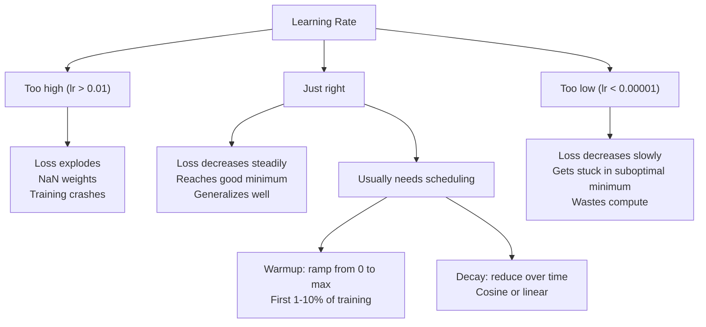
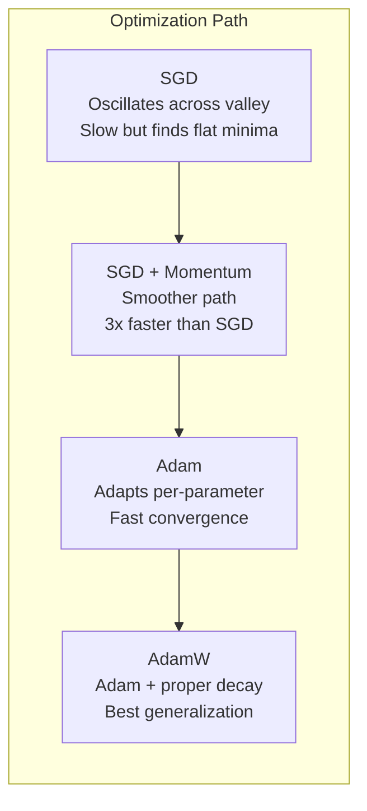
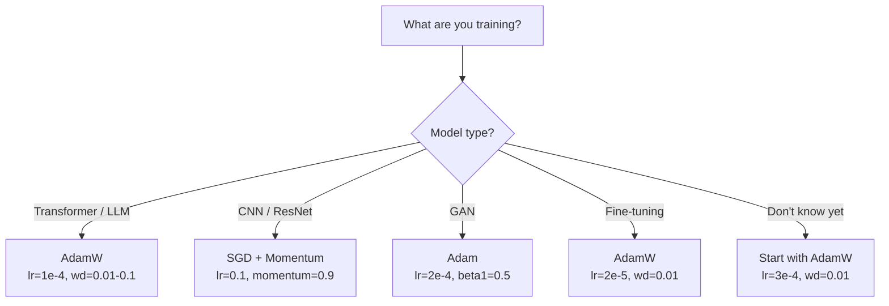

# Optimisateurs

> La descente gradiente vous indique dans quelle direction vous devez vous déplacer, mais elle ne dit rien sur la distance ou la vitesse.

**Type:** Build
**Languages:** Python
**Prerequisites:** Lesson 03.05 (Loss Functions)
**Time:** ~75 minutes

## Objectifs d'apprentissage

- Implémenter SGD, SGD avec dynamique, Adam et AdamW optimisateurs à partir de zéro dans Python
- Expliquez comment la correction du biais d'Adam compense les estimations de moment initiales zéro dans les premières étapes de formation
- Démontre pourquoi AdamW produit une meilleure généralisation que Adam avec une régulation L2 sur la même tâche
- Sélectionnez l'optimisateur et les hyperparametres par défaut appropriés pour les transformateurs, les CNN, les GAN et les réglages

## Le problème

Vous avez calculé les gradients. Vous savez que le poids n ° 4,721 devrait diminuer de 0,003 pour réduire la perte. Mais 0,003 dans quelles unités?

La baisse du gradient de la vanille applique le même taux d'apprentissage à chaque paramètre à chaque étape: $w = w - \text{lr} \cdot \text{gradient}$Cela crée trois problèmes qui rendent la formation des réseaux neuronaux pénible en pratique.

Tout d'abord, l'oscillation. Le paysage de la perte est rarement en forme de bol lisse. C'est plus comme une longue vallée étroite. Le gradient pointe à travers la vallée (direction raide), pas le long de celle-ci (direction peu profonde). La descente graduelle rebondit en avant et en arrière à travers la dimension étroite tout en faisant de petits progrès le long de la dimension utile. Vous avez vu ceci: la perte diminue rapidement que les plateaux, non pas parce que le modèle converge mais parce qu'il oscilla.

Deuxièmement, un taux d'apprentissage pour tous les paramètres est incorrect. Certains poids ont besoin de grandes mises à jour (ils sont dans la phase initiale, sous-ajustement).

Troisièmement, les points de selle. Dans les dimensions élevées, le paysage de perte a de vastes régions plates où le gradient est proche de zéro. SGD vanille rampant à travers ces à la vitesse du gradient, qui est effectivement zéro. Le modèle semble coincé. Il n'est pas coincé - il est dans une région plate avec une descente utile de l'autre côté. Mais SGD n'a aucun mécanisme pour pousser à travers.

Adam résout les trois. Il maintient deux moyennes courantes par paramètre - le gradient moyen (momentum, manipulation de l'oscillation) et le gradient moyen carré (taux d'adaptation, manipulation d'échelles différentes). Combiné à la correction des biais pour les premières étapes, il vous donne un seul optimisateur qui fonctionne sur 80% des problèmes avec des hyperparametres par défaut. Cette leçon le construit à partir de zéro pour que vous compreniez exactement quand et pourquoi il échoue sur les 20% restants.

## Le concept

### Déclin de gradient stochastique (DGS)

Le plus simple optimisateur, calculer le gradient sur un mini lot et faire un pas dans la direction opposée.

```math
w = w - \text{lr} \cdot \text{gradient}
```

Le "stochastique" signifie que vous utilisez un sous-ensemble aléatoire (mini-batch) de données pour estimer le gradient, plutôt que l'ensemble des données. Ce bruit est en fait utile - il aide à échapper aux minima locaux. Mais le bruit provoque aussi des oscillations.

Le taux d'apprentissage est le seul bouton. Trop élevé: la perte diverge. Trop bas: la formation prend toujours. La valeur optimale dépend de l'architecture, des données, de la taille du lot et de la phase actuelle de la formation. Pour les SGD de vanille sur les réseaux modernes, les valeurs typiques vont de 0,01 à 0,1.

### Le momentum

L'analogie de la descente de la balle est trop utilisée mais exacte. Au lieu de marcher par le gradient seul, vous maintenez une vitesse qui s'accumule par le passé.

```math
\begin{aligned}
m_t &= \beta \, m_{t-1} + \text{gradient} \\
w &= w - \text{lr} \cdot m_t
\end{aligned}
```

La bêta (généralement 0,9) contrôle la quantité d'historique à conserver.$\beta = 0.9$, l'élan est approximativement la moyenne des 10 derniers gradients ($1 / (1 - 0.9) = 10$)

Pourquoi cela corrige l'oscillation: les gradients qui pointent dans la même direction s'accumulent. Les gradients qui inversent la direction s'annulent. Dans cette vallée étroite, le composant "cross" fait le tour de chaque étape et est amorti. Le composant "along" reste cohérent et est amplifié. Le résultat est une accélération fluide dans la direction utile.

Les chiffres réels: le DSP seul dans un paysage de perte mal conçu pourrait prendre 10 000 pas.$\beta = 0.9$Il est généralement nécessaire de faire entre 3 000 et 5 000 pas sur le même problème.

### RMSProp

La première méthode de taux d'apprentissage adaptatif par paramètre qui a réellement fonctionné.

```math
\begin{aligned}
s_t &= \beta \, s_{t-1} + (1 - \beta) \cdot \text{gradient}^2 \\
w &= w - \text{lr} \cdot \frac{\text{gradient}}{\sqrt{s_t} + \epsilon}
\end{aligned}
```

$s_t$Les paramètres avec des gradients de grande taille sont divisés par un grand nombre (taux d'apprentissage efficace plus faible).

Cela résout le problème du " un taux d'apprentissage pour tous les paramètres ". Un poids qui a déjà reçu de grandes mises à jour est probablement proche de son objectif - ralentit. Un poids qui a reçu de petites mises à jour pourrait être sous-entraîné - accélérer.

L'Epsilon (généralement 1e-8) empêche la division par zéro lorsqu'un paramètre n'a pas été mis à jour.

### Adam: Momentum + RMSProp

Adam combine les deux idées. Il maintient deux moyennes mobiles exponentielles par paramètre:

```math
\begin{aligned}
m_t &= \beta_1 m_{t-1} + (1 - \beta_1) \cdot \text{gradient} && \text{(first moment: mean)} \\
v_t &= \beta_2 v_{t-1} + (1 - \beta_2) \cdot \text{gradient}^2 && \text{(second moment: variance)}
\end{aligned}
```

**Bias correction**La plupart des explications ne sont pas mentionnées.$m_1 = (1 - \beta_1) \cdot \text{gradient}$Avec $\beta_1 = 0.9$C'est tout.$0.1 \cdot \text{gradient}$La moyenne mobile n'est pas encore réchauffée.

```math
\begin{aligned}
\hat{m} &= \frac{m_t}{1 - \beta_1^t} \\
\hat{v} &= \frac{v_t}{1 - \beta_2^t}
\end{aligned}
```

À l' étape 1 avec $\beta_1 = 0.9$Le numéro de la liste:$\hat{m} = m_1 / (1 - 0.9) = m_1 / 0.1 =$Le gradient réel.$(1 - 0.9^{100})$La correction de partialité est importante pour les 10 premières étapes et est irrélevante après les 50 étapes.

La mise à jour:

```math
w = w - \text{lr} \cdot \frac{\hat{m}}{\sqrt{\hat{v}} + \epsilon}
```

Adam par défaut: $\text{lr} = 0.001$- Je suis là .$\beta_1 = 0.9$- Je suis là .$\beta_2 = 0.999$- Je suis là .$\epsilon = 10^{-8}$Ces paramètres fonctionnent pour 80% des problèmes.$\beta_2$- Il ne change presque jamais .$\beta_1$ou $\epsilon$- Je suis désolé .

### La perte de poids est bonne

L2 régularisation ajoute $\lambda w^2$En SGD de vanille, cela équivaut à une perte de poids (soustraction de$\lambda w$Dans Adam, cette équivalence est rompue.

Loshchilov & Hutter: quand on ajoute L2 à la perte et que Adam traite le gradient, le taux d'apprentissage adaptatif étalonne aussi le terme de régularisation. Les paramètres avec une grande variance de gradient obtiennent moins de régularisation. Les paramètres avec une petite variance obtiennent plus. Ce n'est pas ce que vous voulez - vous voulez une régularisation uniforme indépendamment des statistiques de gradient.

AdamW corrige ce problème en appliquant directement la dégradation du poids aux poids, après la mise à jour Adam:

```math
w = w - \text{lr} \cdot \frac{\hat{m}}{\sqrt{\hat{v}} + \epsilon} - \text{lr} \cdot \lambda w
```

La période de déclin du poids ($\text{lr} \cdot \lambda w$Il est possible de calculer la taille de chaque paramètre en fonction de la taille de l'échelle de l'échelle de l'échelle de l'échelle de l'échelle de l'échelle de l'échelle de l'échelle de l'échelle de l'échelle de l'échelle de l'échelle de l'échelle de l'échelle de l'échelle de l'échelle de l'échelle de l'échelle de l'échelle de l'échelle de l'échelle de l'échelle de l'échelle de l'échelle de l'échelle de l'échelle de l'échelle de l'échelle de l'échelle de l'échelle de l'échelle de l'échelle de l'échelle de l'échelle de l'échelle de l'échelle de l'échelle de l'échelle de l'échelle de l'échelle de l'échelle de l'échelle de l'échelle de l'échelle de l'échelle de l'échelle de l'échelle de l'échelle de l'échelle de l'échelle de l'échelle de l'échelle de l'échelle de l'échelle de l'échelle de l'échelle de l'échelle de l'échelle.

C'est le système d'optimisation par défaut de PyTorch pour la formation de transformateurs, de modèles de diffusion et de la plupart des architectures modernes. BERT, GPT, LLaMA, Stable Diffusion - tous formés avec AdamW.

### Le taux d'apprentissage: l'hyperparamètre le plus important



Si vous ajustez un hyperparamètre, ajustez le taux d'apprentissage.

- SGD: lr = 0,01 à 0,1
- Adam/AdamW: lr = 1e-4 à 3e-4
- Modèles pré-entraînés à réglage fin: lr = 1e-5 à 5e-5
- Réchauffement du rythme d'apprentissage: rampe linéaire sur les 1 à 10% des premières étapes

### Comparaison optimisée



### Quand chaque optimisateur gagne



```figure
optimizer-trajectory
```

## Faites-le

### Étape 1: SGD de vanille

```python
class SGD:
    def __init__(self, lr=0.01):
        self.lr = lr

    def step(self, params, grads):
        for i in range(len(params)):
            params[i] -= self.lr * grads[i]
```

### Étape 2: SGD avec Momentum

```python
class SGDMomentum:
    def __init__(self, lr=0.01, beta=0.9):
        self.lr = lr
        self.beta = beta
        self.velocities = None

    def step(self, params, grads):
        if self.velocities is None:
            self.velocities = [0.0] * len(params)
        for i in range(len(params)):
            self.velocities[i] = self.beta * self.velocities[i] + grads[i]
            params[i] -= self.lr * self.velocities[i]
```

### Étape 3: Adam

```python
import math

class Adam:
    def __init__(self, lr=0.001, beta1=0.9, beta2=0.999, epsilon=1e-8):
        self.lr = lr
        self.beta1 = beta1
        self.beta2 = beta2
        self.epsilon = epsilon
        self.m = None
        self.v = None
        self.t = 0

    def step(self, params, grads):
        if self.m is None:
            self.m = [0.0] * len(params)
            self.v = [0.0] * len(params)

        self.t += 1

        for i in range(len(params)):
            self.m[i] = self.beta1 * self.m[i] + (1 - self.beta1) * grads[i]
            self.v[i] = self.beta2 * self.v[i] + (1 - self.beta2) * grads[i] ** 2

            m_hat = self.m[i] / (1 - self.beta1 ** self.t)
            v_hat = self.v[i] / (1 - self.beta2 ** self.t)

            params[i] -= self.lr * m_hat / (math.sqrt(v_hat) + self.epsilon)
```

### Étape 4: AdamW

```python
class AdamW:
    def __init__(self, lr=0.001, beta1=0.9, beta2=0.999, epsilon=1e-8, weight_decay=0.01):
        self.lr = lr
        self.beta1 = beta1
        self.beta2 = beta2
        self.epsilon = epsilon
        self.weight_decay = weight_decay
        self.m = None
        self.v = None
        self.t = 0

    def step(self, params, grads):
        if self.m is None:
            self.m = [0.0] * len(params)
            self.v = [0.0] * len(params)

        self.t += 1

        for i in range(len(params)):
            self.m[i] = self.beta1 * self.m[i] + (1 - self.beta1) * grads[i]
            self.v[i] = self.beta2 * self.v[i] + (1 - self.beta2) * grads[i] ** 2

            m_hat = self.m[i] / (1 - self.beta1 ** self.t)
            v_hat = self.v[i] / (1 - self.beta2 ** self.t)

            params[i] -= self.lr * m_hat / (math.sqrt(v_hat) + self.epsilon)
            params[i] -= self.lr * self.weight_decay * params[i]
```

### Étape 5: Comparer les formations

Exercez le même réseau à deux couches sur le jeu de données du cercle à partir de la leçon 05 avec les quatre optimisateurs.

```python
import random

def sigmoid(x):
    x = max(-500, min(500, x))
    return 1.0 / (1.0 + math.exp(-x))

def make_circle_data(n=200, seed=42):
    random.seed(seed)
    data = []
    for _ in range(n):
        x = random.uniform(-2, 2)
        y = random.uniform(-2, 2)
        label = 1.0 if x * x + y * y < 1.5 else 0.0
        data.append(([x, y], label))
    return data


class OptimizerTestNetwork:
    def __init__(self, optimizer, hidden_size=8):
        random.seed(0)
        self.hidden_size = hidden_size
        self.optimizer = optimizer

        self.w1 = [[random.gauss(0, 0.5) for _ in range(2)] for _ in range(hidden_size)]
        self.b1 = [0.0] * hidden_size
        self.w2 = [random.gauss(0, 0.5) for _ in range(hidden_size)]
        self.b2 = 0.0

    def get_params(self):
        params = []
        for row in self.w1:
            params.extend(row)
        params.extend(self.b1)
        params.extend(self.w2)
        params.append(self.b2)
        return params

    def set_params(self, params):
        idx = 0
        for i in range(self.hidden_size):
            for j in range(2):
                self.w1[i][j] = params[idx]
                idx += 1
        for i in range(self.hidden_size):
            self.b1[i] = params[idx]
            idx += 1
        for i in range(self.hidden_size):
            self.w2[i] = params[idx]
            idx += 1
        self.b2 = params[idx]

    def forward(self, x):
        self.x = x
        self.z1 = []
        self.h = []
        for i in range(self.hidden_size):
            z = self.w1[i][0] * x[0] + self.w1[i][1] * x[1] + self.b1[i]
            self.z1.append(z)
            self.h.append(max(0.0, z))

        self.z2 = sum(self.w2[i] * self.h[i] for i in range(self.hidden_size)) + self.b2
        self.out = sigmoid(self.z2)
        return self.out

    def compute_grads(self, target):
        eps = 1e-15
        p = max(eps, min(1 - eps, self.out))
        d_loss = -(target / p) + (1 - target) / (1 - p)
        d_sigmoid = self.out * (1 - self.out)
        d_out = d_loss * d_sigmoid

        grads = [0.0] * (self.hidden_size * 2 + self.hidden_size + self.hidden_size + 1)
        idx = 0
        for i in range(self.hidden_size):
            d_relu = 1.0 if self.z1[i] > 0 else 0.0
            d_h = d_out * self.w2[i] * d_relu
            grads[idx] = d_h * self.x[0]
            grads[idx + 1] = d_h * self.x[1]
            idx += 2

        for i in range(self.hidden_size):
            d_relu = 1.0 if self.z1[i] > 0 else 0.0
            grads[idx] = d_out * self.w2[i] * d_relu
            idx += 1

        for i in range(self.hidden_size):
            grads[idx] = d_out * self.h[i]
            idx += 1

        grads[idx] = d_out
        return grads

    def train(self, data, epochs=300):
        losses = []
        for epoch in range(epochs):
            total_loss = 0.0
            correct = 0
            for x, y in data:
                pred = self.forward(x)
                grads = self.compute_grads(y)
                params = self.get_params()
                self.optimizer.step(params, grads)
                self.set_params(params)

                eps = 1e-15
                p = max(eps, min(1 - eps, pred))
                total_loss += -(y * math.log(p) + (1 - y) * math.log(1 - p))
                if (pred >= 0.5) == (y >= 0.5):
                    correct += 1
            avg_loss = total_loss / len(data)
            accuracy = correct / len(data) * 100
            losses.append((avg_loss, accuracy))
            if epoch % 75 == 0 or epoch == epochs - 1:
                print(f"    Epoch {epoch:3d}: loss={avg_loss:.4f}, accuracy={accuracy:.1f}%")
        return losses
```

## Utilisez-le

Les optimisateurs PyTorch gèrent les groupes de paramètres, le coupage des gradients et la planification du taux d'apprentissage:

```python
import torch
import torch.optim as optim

model = torch.nn.Sequential(
    torch.nn.Linear(784, 256),
    torch.nn.ReLU(),
    torch.nn.Linear(256, 10),
)

optimizer = optim.AdamW(model.parameters(), lr=3e-4, weight_decay=0.01)

scheduler = optim.lr_scheduler.CosineAnnealingLR(optimizer, T_max=100)

for epoch in range(100):
    optimizer.zero_grad()
    output = model(torch.randn(32, 784))
    loss = torch.nn.functional.cross_entropy(output, torch.randint(0, 10, (32,)))
    loss.backward()
    torch.nn.utils.clip_grad_norm_(model.parameters(), max_norm=1.0)
    optimizer.step()
    scheduler.step()
```

Le schéma est toujours: zero_grad, forward, loss, backward, (clip), step, (schedule). mémorisez cet ordre. Faire erreur (par exemple, appeler scheduler.step() avant optimiser.step()) est une source commune de bugs subtils.

Pour les CNN, de nombreux praticiens préfèrent toujours SGD + momentum (lr=0,1, momentum=0,9, weight_decay=1e-4) avec un calendrier étape ou cosine. SGD trouve des minima plus plats, qui généralisent souvent mieux. Pour les transformateurs et les LLM, AdamW avec chauffage + cosine décomposition est la norme par défaut.

## La faire partir

Cette leçon donne:
- `outputs/prompt-optimizer-selector.md`-- une décision rapide pour choisir le bon optimisateur et le taux d'apprentissage pour toute architecture

## Exercices

1. Implémenter l'élan de Nesterov, où vous comptez le gradient à la position "lookhead" ($w - \text{lr} \cdot \beta v$Comparer la convergence à la dynamique standard sur l'ensemble de données de cercle.

2. Mettre en œuvre un calendrier de réchauffement de la fréquence d'apprentissage: rampe linéaire de 0 à max_lr au cours des 10% des premières étapes d'entraînement, puis déclin cosine à 0.

3. Suivre le taux d'apprentissage effectif pour chaque paramètre pendant la formation Adam.$\text{lr} \cdot \hat{m} / (\sqrt{\hat{v}} + \epsilon)$- Le tableau de la répartition des taux effectifs après les étapes 10, 50 et 200.

4. Mettre en œuvre le coupage de gradient (clip par norme globale). Définir la norme maximale de gradient à 1.0. Exercer avec et sans coupage en utilisant un taux d'apprentissage élevé (lr=0,01 pour Adam). Comptez combien de courses divergent (perte va à NaN) avec et sans coupage de plus de 10 graines aléatoires.

5. Comparer Adam vs AdamW sur un réseau avec de grands poids. Initializer tous les poids à des valeurs aléatoires en [-5, 5] (bien plus grandes que la normale).

## Les termes clés

| Term | What people say | What it actually means |
|------|----------------|----------------------|
| Learning rate | "Step size" | The scalar multiplier on the gradient update; the single most impactful hyperparameter in training |
| SGD | "Basic gradient descent" | Stochastic gradient descent: update weights by subtracting $\text{lr} \cdot \text{gradient}$, computed on a mini-batch |
| Momentum | "Rolling ball analogy" | Exponential moving average of past gradients; dampens oscillation and accelerates consistent directions |
| RMSProp | "Adaptive learning rate" | Divides each parameter's gradient by the running RMS of its recent gradients; equalizes learning rates |
| Adam | "The default optimizer" | Combines momentum (first moment) and RMSProp (second moment) with bias correction for the initial steps |
| AdamW | "Adam done right" | Adam with decoupled weight decay; applies regularization directly to weights rather than through the gradient |
| Bias correction | "Warmup for running averages" | Dividing by $(1 - \beta^t)$ to compensate for the zero-initialization of Adam's moment estimates |
| Weight decay | "Shrink the weights" | Subtracting a fraction of the weight value at each step; a regularizer that penalizes large weights |
| Learning rate schedule | "Changing lr over time" | A function that adjusts the learning rate during training; warmup + cosine decay is the modern default |
| Gradient clipping | "Capping the gradient norm" | Scaling down the gradient vector when its norm exceeds a threshold; prevents exploding gradient updates |

## Pour en savoir plus

- Kingma & Ba, "Adam: une méthode d'optimisation stochastique" (2014) -- le document original Adam avec analyse de convergence et dérivation de la correction de biais
- Loshchilov et Hutter, "Regularization découplée de la perte de poids" (2017) -- prouvé que la régulation de L2 et la perte de poids ne sont pas équivalentes chez Adam, et proposé AdamW
- Smith, "Taux d'apprentissage cycliques pour les réseaux neuronaux de formation" (2017) -- introduit le test LR et les horaires cycliques qui éliminent la nécessité de régler un taux d'apprentissage fixe
- Ruder, "Un aperçu des algorithmes d'optimisation de la descente de la gradience" (2016) -- le meilleur sondage unique de toutes les variantes d'optimisateur, avec des comparaisons et des intuitions claires
