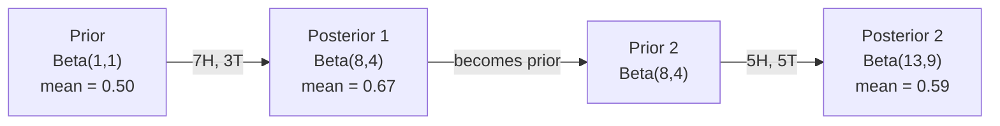

# बेयज़ का प्रमेय

> संभावना के बारे में आप क्या उम्मीद है. बेयज़ का प्रमेय के बारे में आप क्या सीखते हैं.

**Type:** Build
**Language:**पायथन
**Prerequisites:** Phase 1, Lesson 06 (Probability Fundamentals)
**Time:** ~75 minutes

## सीखने के लक्ष्य

- पूर्व, संभावनाओं और साक्ष्य से पिछली संभावनाओं की गणना करने के लिए बेयज़ के प्रमेय का उपयोग करें
- लैपलेस चिकनाई और लॉग-स्पेस गणना के साथ खरोंच से एक भोले बेयस पाठ वर्गीकरण बनाएं
- MLE और MAP अनुमान की तुलना करें और समझाएं कि MAP L2 नियमितता से कैसे मेल खाता है
- ए/बी परीक्षण के लिए बीटा-बाइनोमीअल संयुग्मित पूर्ववर्ती का उपयोग करके अनुक्रमिक बेयसियन अद्यतन लागू करें

## समस्या

एक मेडिकल टेस्ट 99% सटीक है. आप सकारात्मक परीक्षण करते हैं. आपके पास वास्तव में बीमारी होने की संभावना क्या है?

अधिकांश लोग कहते हैं कि 99%। वास्तविक उत्तर इस बात पर निर्भर करता है कि बीमारी कितनी दुर्लभ है। यदि हर 10,000 में से 1 व्यक्ति में यह है, तो सकारात्मक परिणाम आपको बीमार होने की संभावना केवल 1% देता है। शेष 99% सकारात्मक परिणाम स्वस्थ लोगों से झूठी अलार्म हैं।

यह एक चालाक सवाल नहीं है. यह बेयज़ का सिद्धांत है. हर स्पैम फ़िल्टर, हर चिकित्सा निदान, हर मशीन लर्निंग मॉडल जो अनिश्चितता को मात्राबद्ध करता है इस सटीक तर्क का उपयोग करता है. आप एक विश्वास से शुरू करते हैं. आप सबूत देखते हैं. आप अद्यतन करते हैं.

यदि आप इसे समझते हुए ML सिस्टम बनाते हैं, तो आप मॉडल आउटपुट को गलत तरीके से समझेंगे, खराब सीमाएं निर्धारित करेंगे, और अत्यधिक आत्मविश्वास वाली भविष्यवाणियां भेजेंगे।

## अवधारणा

### संयुक्त संभावना से बेयज़ तक

आप पहले से ही पाठ 06 से जानते हैं कि सशर्त संभावना हैः

```math
P(A \mid B) = \frac{P(A \text{ and } B)}{P(B)}
```

और सममित रूप सेः

```math
P(B \mid A) = \frac{P(A \text{ and } B)}{P(A)}
```

दोनों अभिव्यक्ति एक ही संख्याकार साझा करते हैंः $P(A \text{ and } B)$. उन्हें बराबर करें और पुनर्गठनः

```math
\begin{aligned}
P(A \text{ and } B) &= P(A \mid B) \cdot P(B) = P(B \mid A) \cdot P(A) \\[4pt]
&\text{Therefore:} \\[4pt]
P(A \mid B) &= \frac{P(B \mid A) \cdot P(A)}{P(B)}
\end{aligned}
```

यह बेयज़ का प्रमेय है चार मात्राओं, एक समीकरण।

### चार भागों

| Part | Name | What it means |
|------|------|---------------|
| $P(A \mid B)$ | Posterior | Your updated belief about $A$ after seeing evidence $B$ |
| $P(B \mid A)$ | Likelihood | How probable the evidence $B$ is if $A$ is true |
| $P(A)$ | Prior | Your belief about $A$ before seeing any evidence |
| $P(B)$ | Evidence | Total probability of seeing $B$ under all possibilities |

साक्ष्य अवधि $P(B)$आप कुल संभावना के कानून का उपयोग करके इसे बढ़ा सकते हैंः

```math
P(B) = P(B \mid A) \cdot P(A) + P(B \mid \text{not } A) \cdot P(\text{not } A)
```

### चिकित्सा परीक्षण का उदाहरण

एक बीमारी 10,000 में से 1 व्यक्ति को प्रभावित करती है। परीक्षण 99% सटीक है (बीमार लोगों का 99% पकड़ता है, समय के 1% में झूठे सकारात्मकता देता है) ।

```math
\begin{aligned}
P(\text{sick}) &= 0.0001 \quad \text{(prior: disease is rare)} \\
P(\text{positive} \mid \text{sick}) &= 0.99 \quad \text{(likelihood: test catches it)} \\
P(\text{positive} \mid \text{healthy}) &= 0.01 \quad \text{(false positive rate)} \\[6pt]
P(\text{positive}) &= P(\text{positive} \mid \text{sick}) \cdot P(\text{sick}) + P(\text{positive} \mid \text{healthy}) \cdot P(\text{healthy}) \\
&= 0.99 \cdot 0.0001 + 0.01 \cdot 0.9999 \\
&= 0.000099 + 0.009999 \\
&= 0.010098 \\[6pt]
P(\text{sick} \mid \text{positive}) &= P(\text{positive} \mid \text{sick}) \cdot P(\text{sick}) / P(\text{positive}) \\
&= 0.99 \cdot 0.0001 / 0.010098 \\
&= 0.0098 \\
&= 0.98\%
\end{aligned}
```

एक बार जब कोई बीमारी होती है तो सटीक परीक्षण भी अक्सर झूठे सकारात्मक परिणाम देते हैं यही कारण है कि डॉक्टर पुष्टि परीक्षणों का आदेश देते हैं।

### स्पैम फ़िल्टर उदाहरण

आपको एक ईमेल मिलता है जिसमें "लॉटरी" शब्द होता है। क्या यह स्पैम है?

```math
\begin{aligned}
P(\text{spam}) &= 0.3 \quad \text{(30\% of email is spam)} \\
P(\text{"lottery"} \mid \text{spam}) &= 0.05 \quad \text{(5\% of spam emails contain "lottery")} \\
P(\text{"lottery"} \mid \text{not spam}) &= 0.001 \quad \text{(0.1\% of legitimate emails contain "lottery")} \\[6pt]
P(\text{"lottery"}) &= 0.05 \cdot 0.3 + 0.001 \cdot 0.7 \\
&= 0.015 + 0.0007 \\
&= 0.0157 \\[6pt]
P(\text{spam} \mid \text{"lottery"}) &= 0.05 \cdot 0.3 / 0.0157 \\
&= 0.955 \\
&= 95.5\%
\end{aligned}
```

एक शब्द 30% से 95.5% तक संभावना को स्थानांतरित करता है। एक वास्तविक स्पैम फ़िल्टर एक साथ सैकड़ों शब्दों पर बेयज़ लागू करता है।

### साफ़ बेयसः स्वतंत्रता की धारणा

Naive Bayes यह वर्ग को देखते हुए सभी सुविधाओं को सशर्त रूप से स्वतंत्र मानते हुए कई विशेषताओं तक विस्तारित करता हैः

```math
P(\text{class} \mid \text{feature}_1, \text{feature}_2, \ldots, \text{feature}_n) = \frac{P(\text{class}) \cdot P(\text{feature}_1 \mid \text{class}) \cdot P(\text{feature}_2 \mid \text{class}) \cdots P(\text{feature}_n \mid \text{class})}{P(\text{feature}_1, \text{feature}_2, \ldots, \text{feature}_n)}
```

"नाईव" हिस्सा स्वतंत्रता परिकल्पना है। पाठ में, शब्द घटनाएं स्वतंत्र नहीं हैं ("नई" और "यॉर्क" संबद्ध हैं) लेकिन यह परिकल्पना अभ्यास में आश्चर्यजनक रूप से अच्छी तरह से काम करती है क्योंकि वर्गीकरणकर्ता को केवल वर्गों को रैंक करने की आवश्यकता है, न कि कैलिब्रेटेड संभावनाओं का उत्पादन करना है।

चूंकि सभी वर्गों के लिए नामक एक ही है, आप इसे छोड़ सकते हैं और बस संख्याओं की तुलना कर सकते हैंः

```math
\text{score}(\text{class}) = P(\text{class}) \cdot \prod_i P(\text{feature}_i \mid \text{class})
```

उच्चतम स्कोर वाला वर्ग चुनें।

### अधिकतम संभावना अनुमान (MLE)

आप कैसे प्राप्त करते हैं$P(\text{feature} \mid \text{class})$प्रशिक्षण डेटा से?

```math
P(\text{"free"} \mid \text{spam}) = \frac{\text{number of spam emails containing "free"}}{\text{total spam emails}}
```

यह MLE है: उन पैरामीटर मानों का चयन करें जो अवलोकन किए गए डेटा को सबसे अधिक संभावना बनाते हैं। आप संभावना फ़ंक्शन को अधिकतम कर रहे हैं, जो डिस्क्रिट गिनती के लिए सापेक्ष आवृत्ति में कम हो जाता है।

समस्याः यदि एक शब्द प्रशिक्षण के दौरान स्पैम में कभी नहीं दिखाई देता है, तो MLE उसे शून्य संभावना देता है। एक अदृश्य शब्द पूरे उत्पाद को मार देता है। इसे लैपलेस चिकनाई के साथ ठीक करेंः

```math
P(\text{word} \mid \text{class}) = \frac{\text{count}(\text{word}, \text{class}) + 1}{\text{total\_words\_in\_class} + \text{vocabulary\_size}}
```

प्रत्येक गणना में 1 जोड़ने से कोई संभावना कभी शून्य नहीं होती है।

### अधिकतम एक बाद में (MAP)

एमएलई पूछता हैः कौन से पैरामीटर अधिकतम $P(\text{data} \mid \text{parameters})$?

मैप पूछता हैः कौन से पैरामीटर अधिकतम $P(\text{parameters} \mid \text{data})$?

बेयज़ के प्रमेय द्वाराः

```math
P(\text{parameters} \mid \text{data}) \propto P(\text{data} \mid \text{parameters}) \cdot P(\text{parameters})
```

MAP स्वयं मापदंडों पर एक पूर्ववर्ती जोड़ता है। यदि आपको लगता है कि मापदंड छोटे होने चाहिए, तो आप इसे एक पूर्ववर्ती के रूप में एन्कोड करते हैं जो बड़े मानों को दंडित करता है। यह एमएल में एल 2 नियमितकरण के समान है। रिग रेग्रिशन में "रिज" दंड सचमुच भार पर गौशियन पूर्ववर्ती है।

| Estimation | Optimizes | ML equivalent |
|------------|-----------|---------------|
| MLE | $P(\text{data} \mid \text{params})$ | Unregularized training |
| MAP | $P(\text{data} \mid \text{params}) \cdot P(\text{params})$ | L2 / L1 regularization |

### बेयिसियन बनाम फ्रिक्वेन्टिस्टः व्यावहारिक अंतर

अक्सरता के वैज्ञानिक पैरामीटर को अपरिचित के रूप में देखते हैं। वे पूछते हैं, "अगर मैं इस प्रयोग को कई बार दोहराता तो क्या होता?"

बेयिसियन पैरामीटर को वितरण के रूप में देखते हैं। वे पूछते हैं, "मैंने जो देखा है, उसके आधार पर मैं पैरामीटर के बारे में क्या मानता हूं?"

एमएल प्रणालियों के निर्माण के लिए, व्यावहारिक अंतरः

| Aspect | Frequentist | Bayesian |
|--------|-------------|----------|
| Output | Point estimate | Distribution over values |
| Uncertainty | Confidence intervals (about procedure) | Credible intervals (about parameter) |
| Small data | Can overfit | Prior acts as regularization |
| Computation | Usually faster | Often requires sampling (MCMC) |

अधिकांश उत्पादन एमएल आवृत्तिवादी है (एसजीडी, बिंदु अनुमान) बेयिसियन तरीकों चमक जब आप एक माप अनिश्चितता (चिकित्सा निर्णय, सुरक्षा-महत्वपूर्ण प्रणालियों) की जरूरत है या जब डेटा दुर्लभ है (कुछ शॉट सीखने, ठंड शुरू) ।

### एमएल के लिए बेयसियन सोच महत्वपूर्ण क्यों है

यह संबंध समानता से भी गहरा हैः

**Priors are regularization.**भार पर गौसीयन पूर्वक्रम L2 नियमितता है। लैपलेस पूर्वक्रम L1 है। जब भी आप एक नियमितता शब्द जोड़ते हैं, तो आप एक बेयसीयन कथन बना रहे हैं कि आप किन पैरामीटर मानों की उम्मीद करते हैं।

**Posteriors are uncertainty.**एक ही भविष्यवाणी की संभावना आपको बताती है कि मॉडल उस अनुमान में कितना आश्वस्त है के बारे में कुछ नहीं है. बेयिसियन तरीकों आप एक वितरण देते हैंः "मुझे लगता है कि$P(\text{spam})$0.8 से 0.95 के बीच है।"

**Bayes updates are online learning.**आज का पीछे का हिस्सा कल का पूर्व बन जाता है जब आपका मॉडल नए डेटा देखता है, तो यह स्क्रैच से पुनः प्रशिक्षण के बजाय अपने विश्वासों को क्रमिक रूप से अपडेट करता है।

**Model comparison is Bayesian.**बेयिस सूचना मानदंड (बीआईसी), मार्जिनल प्रॉबलिटी और बेयिस कारक सभी बेयिस तर्क का उपयोग बिना ओवरफिटिंग के मॉडल के बीच चयन करने के लिए करते हैं।

```figure
bayes-update
```

## इसे बनाओ

### चरण 1: बेयज़ प्रमेय फ़ंक्शन

```python
def bayes(prior, likelihood, false_positive_rate):
    evidence = likelihood * prior + false_positive_rate * (1 - prior)
    posterior = likelihood * prior / evidence
    return posterior

result = bayes(prior=0.0001, likelihood=0.99, false_positive_rate=0.01)
print(f"P(sick|positive) = {result:.4f}")
```

### चरण 2: साफ़ बेयिस वर्गीकरण

```python
import math
from collections import defaultdict

class NaiveBayes:
    def __init__(self, smoothing=1.0):
        self.smoothing = smoothing
        self.class_counts = defaultdict(int)
        self.word_counts = defaultdict(lambda: defaultdict(int))
        self.class_word_totals = defaultdict(int)
        self.vocab = set()

    def train(self, documents, labels):
        for doc, label in zip(documents, labels):
            self.class_counts[label] += 1
            words = doc.lower().split()
            for word in words:
                self.word_counts[label][word] += 1
                self.class_word_totals[label] += 1
                self.vocab.add(word)

    def predict(self, document):
        words = document.lower().split()
        total_docs = sum(self.class_counts.values())
        vocab_size = len(self.vocab)
        best_class = None
        best_score = float("-inf")
        for cls in self.class_counts:
            score = math.log(self.class_counts[cls] / total_docs)
            for word in words:
                count = self.word_counts[cls].get(word, 0)
                total = self.class_word_totals[cls]
                score += math.log((count + self.smoothing) / (total + self.smoothing * vocab_size))
            if score > best_score:
                best_score = score
                best_class = cls
        return best_class
```

लॉग-प्रोबेबिलिटीज अंडरफ्लो को रोकती हैं। कई छोटी संभावनाओं को गुणा करने से फ्लोटिंग प्वाइंट के लिए संख्याएं बहुत छोटी होती हैं। लॉग-प्रोबेबिलिटीज को योग करना संख्यात्मक रूप से स्थिर और गणितीय रूप से समतुल्य है।

### चरण 3: स्पैम डेटा पर प्रशिक्षण

```python
train_docs = [
    "win free money now",
    "free lottery ticket winner",
    "claim your prize today free",
    "urgent offer free cash",
    "congratulations you won free",
    "meeting tomorrow at noon",
    "project update attached",
    "can we schedule a call",
    "quarterly report review",
    "lunch on thursday sounds good",
    "team standup notes attached",
    "please review the pull request",
]

train_labels = [
    "spam", "spam", "spam", "spam", "spam",
    "ham", "ham", "ham", "ham", "ham", "ham", "ham",
]

classifier = NaiveBayes()
classifier.train(train_docs, train_labels)

test_messages = [
    "free money waiting for you",
    "meeting rescheduled to friday",
    "you won a free prize",
    "please review the attached report",
]

for msg in test_messages:
    print(f"  '{msg}' -> {classifier.predict(msg)}")
```

### चरण 4: सीखी गई संभावनाओं की जांच करें

```python
def show_top_words(classifier, cls, n=5):
    vocab_size = len(classifier.vocab)
    total = classifier.class_word_totals[cls]
    probs = {}
    for word in classifier.vocab:
        count = classifier.word_counts[cls].get(word, 0)
        probs[word] = (count + classifier.smoothing) / (total + classifier.smoothing * vocab_size)
    sorted_words = sorted(probs.items(), key=lambda x: x[1], reverse=True)
    for word, prob in sorted_words[:n]:
        print(f"    {word}: {prob:.4f}")

print("\nTop spam words:")
show_top_words(classifier, "spam")
print("\nTop ham words:")
show_top_words(classifier, "ham")
```

## इसका प्रयोग करें

स्किट-लर्न जहाज उत्पादन के लिए तैयार भोले बेयज़ कार्यान्वयनः

```python
from sklearn.feature_extraction.text import CountVectorizer
from sklearn.naive_bayes import MultinomialNB
from sklearn.metrics import classification_report

vectorizer = CountVectorizer()
X_train = vectorizer.fit_transform(train_docs)
clf = MultinomialNB()
clf.fit(X_train, train_labels)

X_test = vectorizer.transform(test_messages)
predictions = clf.predict(X_test)
for msg, pred in zip(test_messages, predictions):
    print(f"  '{msg}' -> {pred}")
```

एक ही एल्गोरिथ्म. CountVectorizer टोकनाइजेशन और शब्दावली निर्माण को संभालता है. MultinomialNB आंतरिक रूप से चिकनाई और लॉग-संभाव्यता को संभालता है. आपके खरोंच संस्करण 40 पंक्तियों में एक ही बात करता है।

## इसे भेजें

यहाँ निर्मित NaiveBayes वर्ग पूरी पाइपलाइन का प्रदर्शन करता हैः टोकनकरण, लैपलेस चिकनाई के साथ संभावना अनुमान, लॉग-स्पेस भविष्यवाणी।`code/bayes.py`पायथन के मानक पुस्तकालय से परे कोई निर्भरता के साथ अंत-से-अंत चलाता है।

### पूर्ववर्ती विवाह

जब पूर्व और पश्च में वितरण के एक ही परिवार से संबंधित हैं, पूर्व को "संयुक्त" कहा जाता है. यह बेयिसियन अद्यतन बीजगणित साफ बनाता है - आप संख्यात्मक एकीकरण के बिना एक बंद-रूप के पश्च प्राप्त करते हैं.

| Likelihood | Conjugate Prior | Posterior | Example |
|-----------|----------------|-----------|---------|
| Bernoulli | $\text{Beta}(a, b)$ | $\text{Beta}(a + \text{successes}, b + \text{failures})$ | Coin flip bias estimation |
| Normal (known variance) | $\text{Normal}(\mu_0, \sigma_0)$ | Normal(weighted mean, smaller variance) | Sensor calibration |
| Poisson | $\text{Gamma}(a, b)$ | $\text{Gamma}(a + \text{sum of counts}, b + n)$ | Modeling arrival rates |
| Multinomial | $\text{Dirichlet}(\alpha)$ | $\text{Dirichlet}(\alpha + \text{counts})$ | Topic modeling, language models |

यह महत्वपूर्ण क्यों हैः बिना संयुग्मित पूर्व के, आप मोन्टे कार्लो नमूना या भिन्नता inference के पीछे के करीब करने की जरूरत है. संयुग्मित पूर्व के साथ, आप सिर्फ दो संख्याओं को अद्यतन.

बीटा वितरण व्यवहार में सबसे आम संयुग्गित पूर्व है। $\text{Beta}(a, b)$संभावना पैरामीटर के बारे में आपके विश्वास का प्रतिनिधित्व करता है। औसत है$a/(a+b)$. . . . . . . . . . . . . . . . . . . . . . . . . . . . . . . . . . . . . . . . . . . . . . . . . . . . . . . . . . . . . . . . . . . . . . . . . . . . . . . . . . . . . . . . . . . . . . . . . . . . . . . . . . . . . . . . . . . . . . . . . . . . . . . . . . . . . . . . . . . . . . . . . . . . . . . . . . . . . . . . . . . . . . . . . . . . . . . . . . . . . . . . . . . . . . . . . . . . . . . . . . . . . . . . . . . . . . . . . . . . . . . . . . . . . . . . . . . . . . . . . . . . . . . . . . . . . . . . . . . . . . . . . . . . . . . . . . . . . . . . . . . . . . . . . . . . . . . . . . . . . . . . . . . . . . . . . . . . . . . . . . . . . . . . . . . . . . . . . . . . . . . . . . . . . . . . . . . . . . . . . . . . . . . . . . . . . . . . . . . . . . . . . . . . . . . . . . . . . . . . . . . . . . . . . . . . . . . . . . . . . . . . . . . . . . . . . . . . . . . . . . . . . . . . . . . . . . . . . . . . . . . . . . . . . . . . . . . . . . . . . . . . . . . . . . . . . . . . . . . . . . . . . . . . . .$a+b$, अधिक केंद्रित (आत्मविश्वास) वितरण।

बीटा पूर्व के विशेष मामलेः
- $\text{Beta}(1, 1)$आप पैरामीटर के बारे में कोई राय नहीं है.
- $\text{Beta}(10, 10)$आप दृढ़ता से मानता है कि पैरामीटर 0.5 के करीब है।
- $\text{Beta}(1, 10)$= 0 की ओर झुका हुआ है. आप मानते हैं कि पैरामीटर छोटा है.

अद्यतन नियम बहुत सरल हैः

```math
\begin{aligned}
\text{Prior:} \quad & \text{Beta}(a, b) \\
\text{Data:} \quad & s \text{ successes}, f \text{ failures} \\
\text{Posterior:} \quad & \text{Beta}(a + s, b + f)
\end{aligned}
```

कोई पूर्णांक नहीं, कोई नमूना नहीं, बस जोड़।

### क्रमशः बेयिसियन अद्यतन

बेयसियन निष्कर्ष स्वाभाविक रूप से अनुक्रमिक है। आज का पीछे का कल का पूर्व बन जाता है। यह वास्तविक प्रणालियों को सभी ऐतिहासिक डेटा को पुनः संसाधित किए बिना क्रमिक रूप से सीखता है।

एक ठोस उदाहरण: यह अनुमान लगाना कि क्या एक सिक्का निष्पक्ष है।

**Day 1: No data yet.**
 से शुरू करें$\text{Beta}(1, 1)$- एक वर्दी पूर्व. आपके पास कोई राय नहीं है.
- पूर्व औसतः 0.5
- पूर्व की चौड़ाई [0, 1]

**Day 2: Observe 7 heads, 3 tails.**
$\text{Posterior} = \text{Beta}(1 + 7, 1 + 3) = \text{Beta}(8, 4)$
- पश्चात् औसतः $8/12 = 0.667$
- सबूत बताते हैं कि सिक्का सिर की ओर झुका हुआ है

**Day 3: Observe 5 more heads, 5 more tails.**
कल के पीछे का उपयोग आज के पूर्व के रूप में करें।
$\text{Posterior} = \text{Beta}(8 + 5, 4 + 5) = \text{Beta}(13, 9)$
- पश्चात् औसतः $13/22 = 0.591$
- संतुलित नए आंकड़ों ने अनुमान को 0.5 की ओर वापस खींच लिया



टिप्पणियों का क्रम मायने नहीं रखता। $\text{Beta}(1,1)$सभी 12 सिर और 8 पूंछ के साथ एक ही समय में अद्यतन देता है $\text{Beta}(13, 9)$क्रमशः अद्यतन और बैच अद्यतन गणितीय रूप से बराबर हैं. लेकिन क्रमशः अद्यतन आप कच्चे डेटा संग्रहीत किए बिना प्रत्येक चरण में निर्णय लेने की अनुमति देता है.

यह उत्पादन एमएल सिस्टम में ऑनलाइन सीखने की नींव है। डाकू के लिए थॉम्पसन नमूनाकरण, वृद्धिशील सिफारिश प्रणाली और स्ट्रीमिंग विसंगति डिटेक्टर सभी इस पैटर्न का उपयोग करते हैं।

### ए/बी परीक्षण से संबंध

ए/बी परीक्षण बेयिसियन निष्कर्ष है।

सेटअपः आप दो बटन रंगों का परीक्षण कर रहे हैं। वेरिएंट ए (नीला) और वेरिएंट बी (हरे) । आप जानना चाहते हैं कि इनमें से किस पर अधिक क्लिक होते हैं।

बेयिसियन ए/बी परीक्षणः

1. **Prior.** से शुरू करें$\text{Beta}(1, 1)$दोनों संस्करणों के लिए कोई पूर्व प्राथमिकता नहीं है।
2. **Data.**वेरिएंट ए: 1000 विचारों में से 50 क्लिक। वेरिएंट बी: 1000 विचारों में से 65 क्लिक।
3. **Posteriors.**
   - ए: $\text{Beta}(1 + 50, 1 + 950) = \text{Beta}(51, 951)$. औसत = 0.051
   - बीः $\text{Beta}(1 + 65, 1 + 935) = \text{Beta}(66, 936)$. औसत = 0.066
4. **Decision.**गणना $P(B > A)$-- संभावना है कि बी की वास्तविक रूपांतरण दर A की तुलना में अधिक है।

कम्प्यूटिंग $P(B > A)$विश्लेषणात्मक रूप से कठिन है, लेकिन मोंटे कार्लो इसे तुच्छ बनाता हैः

```
1. Draw 100,000 samples from Beta(51, 951)  -> samples_A
2. Draw 100,000 samples from Beta(66, 936)  -> samples_B
3. P(B > A) = fraction of samples where B > A
```

यदि$P(B > A) > 0.95$यदि यह 0.05 से 0.95 के बीच है, तो आप डेटा एकत्र करना जारी रखते हैं।$P(B > A) < 0.05$, आप जहाज संस्करण ए.

आवृत्ति ए/बी परीक्षणों के मुकाबले लाभः
- आप एक प्रत्यक्ष संभावना कथन प्राप्त करते हैंः "एक 97% संभावना है कि बी बेहतर है"
- कोई p-मूल्य भ्रम नहीं, कोई "नल परिकल्पना को अस्वीकार करने में विफलता" हेजिंग नहीं।
- आप किसी भी समय झूठी सकारात्मक दरों को बढ़ाए बिना परिणामों की जांच कर सकते हैं (कोई "खोजने की समस्या" नहीं)
- आप पूर्व ज्ञान को शामिल कर सकते हैं (उदाहरण के लिए, पिछले परीक्षणों से पता चलता है कि रूपांतरण दरें आमतौर पर 3-8%)

| Aspect | Frequentist A/B | Bayesian A/B |
|--------|----------------|--------------|
| Output | p-value | $P(B > A)$ |
| Interpretation | "How surprising is this data if A=B?" | "How likely is B better than A?" |
| Early stopping | Inflates false positives | Safe at any point (given a well-chosen prior and correctly specified model) |
| Prior knowledge | Not used | Encoded as Beta prior |
| Decision rule | $p < 0.05$ | $P(B > A) > \text{threshold}$ |

## व्यायाम

1. **Multiple tests.**एक रोगी स्वतंत्र परीक्षणों पर दो बार सकारात्मक परीक्षण करता है (दोनों 99% सटीक, रोग प्रवृत्ति 10,000 में से 1 है) ।$P(\text{sick})$पहले परीक्षण के बाद दूसरे परीक्षण के लिए पूर्व के रूप में पिछली प्रयोग करें।

2. **Smoothing impact.**स्पाम वर्गीकरणकर्ता को 0.01, 0.1, 1.0 और 10.0 के स्लाइडिंग मानों के साथ चलाएं। शीर्ष शब्द संभावनाएं कैसे बदलती हैं? स्लाइडिंग=0 और एक शब्द के साथ क्या होता है जो केवल शिन में दिखाई देता है?

3. **Add features.**NaiveBayes वर्ग का विस्तार करें ताकि संदेश लंबाई (लघु/लंबे) को शब्द गणना के साथ एक विशेषता के रूप में भी उपयोग किया जा सके। अनुमान $P(\text{short} \mid \text{spam})$और $P(\text{short} \mid \text{ham})$प्रशिक्षण डेटा से और भविष्यवाणी स्कोर में इसे फोल्ड।

4. **MAP by hand.**अवलोकन किए गए आंकड़ों को देखते हुए (7 सिक्के में 10 सिर) एक $\text{Beta}(2,2)$इससे पहले की तुलना MLE अनुमान से करें ($7/10$) ।

### संकेत

**Exercise 1.**कॉल`bayes`एक बार परीक्षण 1 के बाद पिछली प्राप्त करने के लिए, फिर इसे पूर्व के रूप में पिछली के साथ फिर से कॉल। `sequential_bayes(prior, likelihood, false_positive_rate, 2)`0.5 के करीब एक ही मान देना चाहिए।

**Exercise 2.**एक बनाओ `NaiveBayes(smoothing=s)`प्रत्येक मान के लिए, इसे उसी डेटा पर प्रशिक्षित करें, और प्रिंट करें `top_words`प्रत्येक के लिए. 0 को समतल करने के साथ, एक शब्द जो कभी स्पैम में दिखाई नहीं देता है, संभावना 0 प्राप्त करता है, इसलिए इसका लॉग परिभाषित नहीं है।

**Exercise 3.**गणना कितनी स्पैम और हैम संदेशों को कम है, प्रत्येक वर्ग में संदेशों की संख्या द्वारा विभाजित, और उस अनुपात के लॉग को स्कोर में जोड़ें `predict`जाँच करें कि प्रत्येक वर्ग के लिए दो संभावनाओं 1 तक जोड़ने के लिए.

**Exercise 4.**एक के साथ $\text{Beta}(\alpha, \beta)$पहले, MAP अनुमान $\frac{h + \alpha - 1}{n + \alpha + \beta - 2}$. . डाल दिया .$h = 7$,$n = 10$; परिणाम MLE (0.7) और पूर्व मोड (0.5) के बीच होना चाहिए।

## प्रमुख शर्तें

| Term | What people say | What it actually means |
|------|----------------|----------------------|
| Prior | "My initial guess" | $P(\text{hypothesis})$ before observing evidence. In ML: the regularization term. |
| Likelihood | "How well the data fits" | $P(\text{evidence} \mid \text{hypothesis})$. How probable the observed data is under a specific hypothesis. |
| Posterior | "My updated belief" | $P(\text{hypothesis} \mid \text{evidence})$. The prior multiplied by the likelihood, then normalized. |
| Evidence | "The normalizing constant" | $P(\text{data})$ across all hypotheses. Ensures the posterior sums to 1. |
| Naive Bayes | "That simple text classifier" | A classifier that assumes features are independent given the class. Works well despite the false assumption. |
| Laplace smoothing | "Add-one smoothing" | Adding a small count to every feature to prevent zero probabilities from unseen data. |
| MLE | "Just use the frequencies" | Choose parameters that maximize $P(\text{data} \mid \text{parameters})$. No prior. Can overfit with small data. |
| MAP | "MLE with a prior" | Choose parameters that maximize $P(\text{data} \mid \text{parameters}) \cdot P(\text{parameters})$. Equivalent to regularized MLE. |
| Log-probability | "Work in log space" | Using $\log(P)$ instead of $P$ to avoid floating-point underflow when multiplying many small numbers. |
| False positive | "A wrong alarm" | The test says positive, but the true state is negative. Drives the base rate fallacy. |

## आगे पढ़ना

- [3Blue1Brown: Bayes' theorem](https://www.youtube.com/watch?v=HZGCoVF3YvM)- चिकित्सा परीक्षण के उदाहरण के साथ दृश्य स्पष्टीकरण
- [Stanford CS229: Generative Learning Algorithms](https://cs229.stanford.edu/main_notes.pdf)- बेयज़ की साफ़ता और भेदभावपूर्ण मॉडल से उसका संबंध
- [Think Bayes](https://greenteapress.com/wp/think-bayes/)- मुक्त पुस्तक, पायथन कोड के साथ बेयसियन सांख्यिकी
- [scikit-learn Naive Bayes](https://scikit-learn.org/stable/modules/naive_bayes.html)- उत्पादन के कार्यान्वयन और प्रत्येक संस्करण का उपयोग कब किया जाना चाहिए
