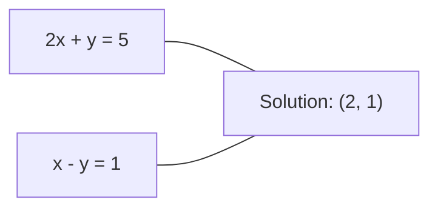
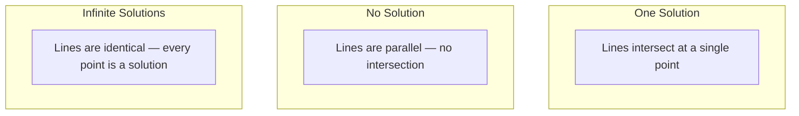

# रैखिक प्रणाली

> हल करना $Ax = b$गणित में सबसे पुरानी समस्या है जो अभी भी आपके तंत्रिका नेटवर्क को चलाती है।

**Type:** Build
**Language:**पायथन
**Prerequisites:** Phase 1, Lessons 01 (Linear Algebra Intuition), 02 (Vectors & Matrices), 03 (Matrix Transformations)
**Time:** ~120 minutes

## सीखने के लक्ष्य

- हल करें$Ax = b$आंशिक पिवटिंग और बैक रिप्लेसमेंट के साथ गौशियन उन्मूलन का उपयोग करना
- LU, QR और Cholesky विघटन के साथ कारक मैट्रिक्स और समझाएं कि प्रत्येक उपयुक्त कब है
- न्यूनतम वर्गों के लिए सामान्य समीकरणों को व्युत्पन्न करें और उन्हें रैखिक और रिज रिग्रेशन से जोड़ें
- स्थिति संख्या का उपयोग करके खराब स्थिति वाले प्रणालियों का निदान करें और उन्हें स्थिर करने के लिए नियमितता लागू करें

## समस्या

जब भी आप एक रैखिक regression को प्रशिक्षित करते हैं, आप एक रैखिक प्रणाली को हल करते हैं. जब भी आप एक न्यूनतम वर्ग फिट की गणना करते हैं, आप एक रैखिक प्रणाली को हल करते हैं. जब भी एक तंत्रिका नेटवर्क परत गणना करता है।`y = Wx + b`जब आप नियमितता जोड़ते हैं, तो आप प्रणाली को संशोधित करते हैं. जब आप गौशियन प्रक्रियाओं का उपयोग करते हैं, तो आप एक मैट्रिक्स को गुणा करते हैं. जब आप महालनोबी की दूरी के लिए एक सह-विवर्तन मैट्रिक्स को उलटते हैं, तो आप एक रैखिक प्रणाली को हल करते हैं।

समीकरण $Ax = b$हर जगह दिखाई देता है।$A$ज्ञात गुणांक का एक मैट्रिक्स है। $b$ज्ञात आउटपुट का वेक्टर है। $x$यह अज्ञात का वेक्टर है जिसे आप ढूंढना चाहते हैं।$A$आपका डेटा मैट्रिक्स है,$b$आपका लक्ष्य वेक्टर है, और $x$पूरे मॉडल में निम्न तक कम हो जाता हैः$x$इस तरह की$Ax$$b$जितना संभव हो सके।

इस पाठ में उस समीकरण को हल करने के लिए हर प्रमुख विधि को खरोंच से बनाया गया है। आप समझेंगे कि कुछ विधियां तेज क्यों हैं और अन्य स्थिर क्यों हैं, क्यों कुछ केवल वर्ग प्रणालियों के लिए काम करते हैं और अन्य ओवरडेटर्मिनेटेड सिस्टम को संभालते हैं, और क्यों आपके मैट्रिक्स की स्थिति संख्या निर्धारित करती है कि क्या आपका उत्तर कुछ भी मायने रखता है।

## अवधारणा

### ज्यामितीय रूप से एक्स = बी का क्या अर्थ है

रैखिक समीकरणों की एक प्रणाली में ज्यामितीय व्याख्या होती है। प्रत्येक समीकरण एक हाइपरप्लेन को परिभाषित करता है। समाधान वह बिंदु (या बिंदुओं का एक सेट) है जहां सभी हाइपरप्लेन पार करते हैं।

```
2x + y = 5          Two lines in 2D.
x - y  = 1          They intersect at x=2, y=1.
```



तीन चीजें हो सकती हैंः



मैट्रिक्स के रूप में, "एक समाधान" का अर्थ है $A$"कोई समाधान नहीं" का अर्थ है कि प्रणाली असंगत है। "असीम समाधान" का अर्थ है$A$इसमें शून्य स्थान है। अधिकांश एमएल समस्याएं "कोई सटीक समाधान नहीं" श्रेणी में आती हैं क्योंकि आपके पास अज्ञात (परिमाणकों) की तुलना में अधिक समीकरण (डेटा पॉइंट) हैं। यही वह जगह है जहां सबसे कम वर्ग आते हैं।

### स्तंभ चित्र बनाम पंक्ति चित्र

पढ़ने के दो तरीके हैं $Ax = b$. .

**Row picture.**$A$एक समीकरण को परिभाषित करता है. प्रत्येक समीकरण एक हाइपरप्लेन है. समाधान है जहां वे सभी पार करते हैं.

**Column picture.** के प्रत्येक स्तंभ$A$प्रश्न बन जाता हैः  के स्तंभों के रैखिक संयोजन क्या है$A$उत्पादन करता है $b$?

```
A = | 2  1 |    b = | 5 |
    | 1 -1 |        | 1 |

Row picture: solve 2x + y = 5 and x - y = 1 simultaneously.

Column picture: find x1, x2 such that:
  x1 * [2, 1] + x2 * [1, -1] = [5, 1]
  2 * [2, 1] + 1 * [1, -1] = [4+1, 2-1] = [5, 1]   check.
```

स्तंभ चित्र अधिक मौलिक है।$b$ के स्तंभ स्थान में स्थित है$A$, प्रणाली का एक समाधान है.$b$नहीं, आप कॉलम अंतरिक्ष में सबसे निकटतम बिंदु मिल जाएगा. सबसे निकटतम बिंदु सबसे कम वर्ग समाधान है.

### गौसीयन उन्मूलन

Gaussian उन्मूलन परिवर्तन $Ax = b$एक ऊपरी त्रिकोण प्रणाली में $Ux = c$यह सबसे सीधा तरीका है।

एल्गोरिथ्मः

```
1. For each column k (the pivot column):
   a. Find the largest entry in column k at or below row k (partial pivoting).
   b. Swap that row with row k.
   c. For each row i below k:
      - Compute multiplier m = A[i][k] / A[k][k]
      - Subtract m times row k from row i.
2. Back substitute: solve from the last equation upward.
```

उदाहरण:

```
Original:
| 2  1  1 | 8 |       R2 = R2 - (2)R1     | 2  1   1 |  8 |
| 4  3  3 |20 |  -->  R3 = R3 - (1)R1 --> | 0  1   1 |  4 |
| 2  3  1 |12 |                            | 0  2   0 |  4 |

                       R3 = R3 - (2)R2     | 2  1   1 |  8 |
                                       --> | 0  1   1 |  4 |
                                           | 0  0  -2 | -4 |

Back substitute:
  -2 * x3 = -4    -->  x3 = 2
  x2 + 2  = 4     -->  x2 = 2
  2*x1 + 2 + 2 = 8 --> x1 = 2
```

गौशियन उन्मूलन लागत $O(n^3)$एक के लिए$1000 \times 1000$प्रणाली, जो लगभग एक अरब फ्लोटिंग-पॉइंट संचालन है. तेजी से, लेकिन आप बेहतर कर सकते हैं अगर आप एक ही के साथ कई प्रणालियों को हल करने की जरूरत है$A$. .

### आंशिक पिवटिंगः यह क्यों मायने रखता है

बिना पिवोट किए, गौसियन उन्मूलन विफल हो सकता है या कचरा पैदा कर सकता है। यदि पिवोट तत्व शून्य है, तो आप शून्य से विभाजित करते हैं। यदि यह छोटा है, तो आप गोल त्रुटि को बढ़ाते हैं।

```
Bad pivot:                       With partial pivoting:
| 0.001  1 | 1.001 |            Swap rows first:
| 1      1 | 2     |            | 1      1 | 2     |
                                 | 0.001  1 | 1.001 |
m = 1/0.001 = 1000              m = 0.001/1 = 0.001
R2 = R2 - 1000*R1               R2 = R2 - 0.001*R1
| 0.001  1     | 1.001   |      | 1      1     | 2     |
| 0     -999   | -999.0  |      | 0      0.999 | 0.999 |

x2 = 1.000 (correct)            x2 = 1.000 (correct)
x1 = (1.001 - 1)/0.001          x1 = (2 - 1)/1 = 1.000 (correct)
   = 0.001/0.001 = 1.000        Stable because the multiplier is small.
```

सीमित सटीकता के साथ फ्लोटिंग-पॉइंट अंकगणित में, अनपॉइंट संस्करण महत्वपूर्ण अंकों को खो सकता है। आंशिक प्वाइंटिंग हमेशा त्रुटि प्रवर्धन को कम करने के लिए सबसे बड़ा उपलब्ध प्वाइंट चुनता है।

### एलयू विघटन

LU विघटन कारक $A$एक निचले त्रिकोण मैट्रिक्स में $L$और एक ऊपरी त्रिकोण मैट्रिक्स $U$$A = LU$. . .$L$मैट्रिक्स Gaussian उन्मूलन से गुणकों को संग्रहीत करता है।$U$मैट्रिक्स उन्मूलन का परिणाम है।

```
A = L @ U

| 2  1  1 |   | 1  0  0 |   | 2  1   1 |
| 4  3  3 | = | 2  1  0 | @ | 0  1   1 |
| 2  3  1 |   | 1  2  1 |   | 0  0  -2 |
```

क्यों कारक सिर्फ खत्म करने के बजाय? क्योंकि एक बार जब आप$L$और $U$, हल करना $Ax = b$किसी भी नए के लिए $b$केवल लागत $O(n^2)$:

```math
\begin{aligned}
Ax &= b \\
LUx &= b \\
&\text{Let } y = Ux\text{:} \\
Ly &= b \quad \text{(forward substitution, } O(n^2)\text{)} \\
Ux &= y \quad \text{(back substitution, } O(n^2)\text{)}
\end{aligned}
```

$O(n^3)$लागत का भुगतान एक बार कारककरण के दौरान किया जाता है।$O(n^2)$. अगर आप एक ही के साथ 1000 प्रणालियों को हल करने की जरूरत है $A$लेकिन अलग $b$वेक्टर, LU कुल काम में 1000/3 का कारक बचाता है।

आंशिक पिवटिंग के साथ, आप प्राप्त $PA = LU$कहाँ$P$पंक्ति स्वैप को रिकॉर्ड करने वाला एक परमुटੇਸ਼ਨ मैट्रिक्स है।

### क्यूआर विघटन

क्यूआर विघटन कारक $A$एक ऑर्थोगनल मैट्रिक्स में $Q$और एक ऊपरी त्रिकोण मैट्रिक्स $R$$A = QR$. .

एक orthogonal मैट्रिक्स गुण है $Q^T Q = I$. इसके स्तंभों orthonormal वेक्टर हैं.$Q$लम्बाई और कोण को संरक्षित करता है।

```
A = Q @ R

Q has orthonormal columns: Q^T Q = I
R is upper triangular

To solve Ax = b:
  QRx = b
  Rx = Q^T b    (just multiply by Q^T, no inversion needed)
  Back substitute to get x.
```

कम से कम वर्गों की समस्याओं को हल करने के लिए क्यूआर संख्यात्मक रूप से एलयू की तुलना में अधिक स्थिर है।$Q$स्तंभ से स्तंभः

```
Given columns a1, a2, ... of A:

q1 = a1 / ||a1||

q2 = a2 - (a2 . q1) * q1        (subtract projection onto q1)
q2 = q2 / ||q2||                (normalize)

q3 = a3 - (a3 . q1) * q1 - (a3 . q2) * q2
q3 = q3 / ||q3||

R[i][j] = qi . aj    for i <= j
```

प्रत्येक चरण सभी पिछले के साथ घटक को हटा देता है $q$वेक्टर, केवल नए orthogonal दिशा छोड़ने.

### चोलेस्की विघटन

कब$A$सममित है ($A = A^T$) और सकारात्मक निश्चित (सभी स्वमूल्य सकारात्मक), आप इसे कारक के रूप में कर सकते हैं $A = L L^T$कहाँ$L$यह चोलेस्की विघटन है।

```
A = L @ L^T

| 4  2 |   | 2  0 |   | 2  1 |
| 2  5 | = | 1  2 | @ | 0  2 |

L[i][i] = sqrt(A[i][i] - sum(L[i][k]^2 for k < i))
L[i][j] = (A[i][j] - sum(L[i][k]*L[j][k] for k < j)) / L[j][j]    for i > j
```

Cholesky LU से दोगुना तेज है और आधा भंडारण की आवश्यकता होती है। यह केवल सममित सकारात्मक निश्चित मैट्रिक्स के लिए काम करता है, लेकिन वे लगातार दिखाई देते हैंः

- कोवरिएंसी मैट्रिक्स सममित सकारात्मक अर्ध-परिभाषित (नियमन के साथ सकारात्मक निश्चित) हैं।
- गौसी प्रक्रियाओं में कर्नेल मैट्रिक्स सममित सकारात्मक निश्चित है।
- कम से कम एक संकुचित फ़ंक्शन का हेसियन सममित सकारात्मक निश्चित है।
- $A^T A$हमेशा सममित सकारात्मक अर्ध-परिभाषित है।

Gaussian प्रक्रियाओं में, आप कर्नेल मैट्रिक्स कारक $K$Cholesky के साथ, तो हल $K \alpha = y$Cholesky कारक आपको मार्जिनल संभावना के लिए लॉग-निर्धारक भी देता हैः$\log \det(K) = 2 \sum \log(\mathop{\mathrm{diag}}(L))$. .

### न्यूनतम वर्गः जब Ax = b का कोई सटीक समाधान नहीं होता है

यदि$A$है $m \times n$के साथ$m > n$(अज्ञात की तुलना में अधिक समीकरण), प्रणाली अधिक निर्धारित है. कोई सटीक समाधान नहीं है. इसके बजाय, आप वर्ग त्रुटि को कम से कम करते हैंः

```
minimize ||Ax - b||^2

This is the sum of squared residuals:
  sum((A[i,:] @ x - b[i])^2 for i in range(m))
```

न्यूनतमकरण सामान्य समीकरणों को संतुष्ट करता हैः

```math
A^T A x = A^T b
```

व्युत्पन्न: विस्तार $\lVert Ax - b \rVert^2 = (Ax - b)^T (Ax - b) = x^T A^T A x - 2 x^T A^T b + b^T b$.  के संबंध में ग्रेडिएंट लें$x$, इसे शून्य पर सेट करें: $2 A^T A x - 2 A^T b = 0$. .

```
Original system (overdetermined, 4 equations, 2 unknowns):
| 1  1 |         | 3 |
| 1  2 | x     = | 5 |       No exact x satisfies all 4 equations.
| 1  3 |         | 6 |
| 1  4 |         | 8 |

Normal equations:
A^T A = | 4  10 |    A^T b = | 22 |
        | 10 30 |            | 63 |

Solve: x = [1.5, 1.7]

This is linear regression. x[0] is the intercept, x[1] is the slope.
```

### सामान्य समीकरण = रैखिक प्रतिगमन

रैखिक प्रतिगमन में, आपके डेटा मैट्रिक्स$X$प्रति नमूना एक पंक्ति और प्रति विशेषता एक स्तंभ है.$y$प्रति नमूना एक प्रविष्टि है। वजन वेक्टर $w$संतुष्ट करता हैः

```math
\begin{aligned}
X^T X w &= X^T y \\
w &= (X^T X)^{-1} X^T y
\end{aligned}
```

यह रैखिक प्रतिगमन के लिए बंद-रूप समाधान है।`sklearn.linear_model.LinearRegression.fit()`यह गणना करता है (या QR या SVD के माध्यम से समकक्ष) ।

एक नियमितता शब्द जोड़ें $\lambda I$मैट्रिक्स और आप रिज रिग्रेशन मिलता हैः

```math
\begin{aligned}
(X^T X + \lambda I) w &= X^T y \\
w &= (X^T X + \lambda I)^{-1} X^T y
\end{aligned}
```

नियमितता मैट्रिक्स को बेहतर स्थिति में बनाती है (सटीक रूप से उलटा करना आसान है) और शून्य की ओर वजन को छोटा करके ओवरफिट को रोकती है।$X^T X + \lambda I$हमेशा समानुपातिक सकारात्मक निश्चित है जब $\lambda > 0$, तो आप इसे हल करने के लिए Cholesky का उपयोग कर सकते हैं.

### प्यूडियोइंवर्स (मूर-पेनरोज)

झूठी उलटी हुई दुनिया $A^+$मैट्रिक्स के लिए सामान्यीकरण की inversion गैर-वर्ग और एकल मैट्रिक्स.$A$:

```math
\begin{aligned}
x &= A^+ b \\[4pt]
\text{where } A^+ &= V \Sigma^+ U^T \quad \text{(computed via SVD)}
\end{aligned}
```

$\Sigma^+$प्रत्येक गैर-शून्य एकल मूल्य का प्रतिफल लेते हुए और परिणाम को पारस्परिक रूप से पार कर के गठन किया जाता है।$A = U \Sigma V^T$, तो $A^+ = V \Sigma^+ U^T$. .

```
A = U Sigma V^T        (SVD)

Sigma = | 5  0 |       Sigma+ = | 1/5  0  0 |
        | 0  2 |                | 0  1/2  0 |
        | 0  0 |

A+ = V Sigma+ U^T
```

प्यूडोकवरस न्यूनतम-नॉर्म न्यूनतम-क्वायर समाधान देता है। यदि प्रणाली में हैः
- एक समाधान: $A^+ b$यह देता है.
- कोई समाधान नहीं: $A^+ b$न्यूनतम वर्ग समाधान देता है।
- अनंत समाधान: $A^+ b$जो सबसे छोटा है उसे देता है $\lVert x \rVert$. .

NumPy की `np.linalg.lstsq`और `np.linalg.pinv`दोनों आंतरिक रूप से एसवीडी का उपयोग करते हैं।

### स्थिति संख्या

स्थिति संख्या मापता है कि समाधान इनपुट में छोटे परिवर्तनों के लिए कितना संवेदनशील है।$A$, स्थिति संख्या हैः

```math
\kappa(A) = \lVert A \rVert \cdot \lVert A^{-1} \rVert = \frac{\sigma_{\max}}{\sigma_{\min}}
```

कहाँ$\sigma_{\max}$और $\sigma_{\min}$सबसे बड़ा और सबसे छोटा एकल मान हैं।

```
Well-conditioned (kappa ~ 1):        Ill-conditioned (kappa ~ 10^15):
Small change in b -->                Small change in b -->
small change in x                    huge change in x

| 2  0 |   kappa = 2/1 = 2          | 1   1          |   kappa ~ 10^15
| 0  1 |   safe to solve            | 1   1+10^(-15) |   solution is garbage
```

अंगूठे के नियमः
- $\kappa < 100$: सुरक्षित, समाधान सटीक है।
- $\kappa \approx 10^k$: आप खो के बारे में $k$आपके फ्लोटिंग-पॉइंट अंकगणित से सटीकता के अंकों।
- $\kappa \approx 10^{16}$(फ्लोट64 के लिए): समाधान अर्थहीन है। मैट्रिक्स प्रभावी रूप से एकल है।

एमएल में, खराब स्थिति तब होती है जब विशेषताएं लगभग सहरी होती हैं।$\lambda I$) से स्थिति संख्या में सुधार करता है $\sigma_{\max} / \sigma_{\min}$$(\sigma_{\max} + \lambda) / (\sigma_{\min} + \lambda)$. .

### पुनरावर्ती विधिः संयुग्मित ग्रेडिएंट

बहुत बड़ी दुर्लभ प्रणालियों (मिलियंस अज्ञात) के लिए, एलयू या चोलेस्की जैसे प्रत्यक्ष तरीके बहुत महंगे हैं। पुनरावृत्तिक विधियां कई पुनरावृत्तियों पर अनुमान को बेहतर बनाकर समाधान के करीब आती हैं।

संयुग्मित ग्रेडिएंट (सीजी) हल करता है $Ax = b$कब$A$यह अधिकतम में सटीक समाधान पाता है$n$पुनरावृत्ति (सटीक अंकगणित में), लेकिन आम तौर पर बहुत तेजी से अभिसरण यदि स्वमान के $A$समूहबद्ध हैं।

```
Algorithm sketch:
  x0 = initial guess (often zero)
  r0 = b - A x0           (residual)
  p0 = r0                 (search direction)

  For k = 0, 1, 2, ...:
    alpha = (rk . rk) / (pk . A pk)
    x_{k+1} = xk + alpha * pk
    r_{k+1} = rk - alpha * A pk
    beta = (r_{k+1} . r_{k+1}) / (rk . rk)
    p_{k+1} = r_{k+1} + beta * pk
    if ||r_{k+1}|| < tolerance: stop
```

CG का उपयोग निम्नलिखित में किया जाता हैः
- बड़े पैमाने पर अनुकूलन (न्यूटन-सीजी विधि)
- पीडीई विघटनों का समाधान
- कर्नेल विधियाँ जहां कर्नेल मैट्रिक्स कारक करने के लिए बहुत बड़ा है
- अन्य पुनरावर्ती समाधानों के लिए पूर्व-संरचना

अभिसरण दर स्थिति संख्या पर निर्भर करती है। बेहतर स्थिति वाले सिस्टम तेजी से अभिसरण करते हैं, जो नियमितता का एक और कारण है।

### पूरी तस्वीरः किस विधि से

| Method | Requirements | Cost | Use case |
|--------|-------------|------|----------|
| Gaussian elimination | Square, nonsingular $A$ | $O(n^3)$ | One-off solve of a square system |
| LU decomposition | Square, nonsingular $A$ | $O(n^3)$ factor + $O(n^2)$ solve | Multiple solves with the same $A$ |
| QR decomposition | Any $A$ ($m \ge n$) | $O(mn^2)$ | Least squares, numerically stable |
| Cholesky | Symmetric positive definite $A$ | $O(n^3/3)$ | Covariance matrices, Gaussian processes, ridge regression |
| Normal equations | Overdetermined ($m > n$) | $O(mn^2 + n^3)$ | Linear regression (small $n$) |
| SVD / pseudoinverse | Any $A$ | $O(mn^2)$ | Rank-deficient systems, minimum-norm solutions |
| Conjugate gradient | Symmetric positive definite, sparse $A$ | $O(n \cdot k \cdot \text{nnz})$ | Large sparse systems, $k$ = iterations |

### एमएल से कनेक्शन

इस पाठ में प्रत्येक विधि उत्पादन एमएल में दिखाई देती हैः

**Linear regression.**बंद-रूप समाधान सामान्य समीकरणों को हल करता है $X^T X w = X^T y$यह चोलेस्की के माध्यम से किया जाता है (यदि$n$छोटा है) या क्यूआर (यदि संख्यात्मक स्थिरता मायने रखती है) या एसवीडी (यदि मैट्रिक्स रैंक-अभावी हो सकती है) ।

**Ridge regression.**जोड़ता है $\lambda I$$X^T X$. नियमित प्रणाली $(X^T X + \lambda I) w = X^T y$हमेशा Cholesky के माध्यम से हल किया जा सकता है क्योंकि $X^T X + \lambda I$ के लिए सममित सकारात्मक निश्चित है$\lambda > 0$. .

**Gaussian processes.**भविष्यवाणी औसत हल करने की आवश्यकता होती है $K \alpha = y$कहाँ$K$यह कोर मैट्रिक्स है.$K$यह मानक दृष्टिकोण है। लॉग मार्जिनल संभावना का उपयोग करता है $\log \det(K) = 2 \sum \log(\mathop{\mathrm{diag}}(L))$. .

**Neural network initialization.**ऑर्तोगनल आरंभिकरण क्यूआर विघटन का उपयोग वजन मैट्रिक्स बनाने के लिए करता है जिनके स्तंभों में ऑर्तोनॉर्मल हैं। यह गहरे नेटवर्क में संकेत को विफल करने से बचाता है।

**Preconditioning.**बड़े पैमाने पर अनुकूलक संयुग्मित ग्रेडिएंट सॉल्वर के लिए अपूर्ण चोलेस्की या अपूर्ण LU को पूर्व शर्तों के रूप में उपयोग करते हैं।

**Feature engineering.** की स्थिति संख्या$X^T X$आपको बताता है कि क्या आपके लक्षण संरेखित हैं।$\kappa$बड़ी है, सुविधाओं को छोड़ दें या नियमितता जोड़ें।

```figure
linear-system-conditioning
```

## इसे बनाओ

### चरण 1: आंशिक पिवटिंग के साथ गौशियन उन्मूलन

```python
import numpy as np

def gaussian_elimination(A, b):
    n = len(b)
    Ab = np.hstack([A.astype(float), b.reshape(-1, 1).astype(float)])

    for k in range(n):
        max_row = k + np.argmax(np.abs(Ab[k:, k]))
        Ab[[k, max_row]] = Ab[[max_row, k]]

        if abs(Ab[k, k]) < 1e-12:
            raise ValueError(f"Matrix is singular or nearly singular at pivot {k}")

        for i in range(k + 1, n):
            m = Ab[i, k] / Ab[k, k]
            Ab[i, k:] -= m * Ab[k, k:]

    x = np.zeros(n)
    for i in range(n - 1, -1, -1):
        x[i] = (Ab[i, -1] - Ab[i, i+1:n] @ x[i+1:n]) / Ab[i, i]

    return x
```

### चरण 2: LU विघटन

```python
def lu_decompose(A):
    n = A.shape[0]
    L = np.eye(n)
    U = A.astype(float).copy()
    P = np.eye(n)

    for k in range(n):
        max_row = k + np.argmax(np.abs(U[k:, k]))
        if max_row != k:
            U[[k, max_row]] = U[[max_row, k]]
            P[[k, max_row]] = P[[max_row, k]]
            if k > 0:
                L[[k, max_row], :k] = L[[max_row, k], :k]

        for i in range(k + 1, n):
            L[i, k] = U[i, k] / U[k, k]
            U[i, k:] -= L[i, k] * U[k, k:]

    return P, L, U

def lu_solve(P, L, U, b):
    n = len(b)
    Pb = P @ b.astype(float)

    y = np.zeros(n)
    for i in range(n):
        y[i] = Pb[i] - L[i, :i] @ y[:i]

    x = np.zeros(n)
    for i in range(n - 1, -1, -1):
        x[i] = (y[i] - U[i, i+1:] @ x[i+1:]) / U[i, i]

    return x
```

### चरण 3: चोलेस्की विघटन

```python
def cholesky(A):
    n = A.shape[0]
    L = np.zeros_like(A, dtype=float)

    for i in range(n):
        for j in range(i + 1):
            s = A[i, j] - L[i, :j] @ L[j, :j]
            if i == j:
                if s <= 0:
                    raise ValueError("Matrix is not positive definite")
                L[i, j] = np.sqrt(s)
            else:
                L[i, j] = s / L[j, j]

    return L
```

### चरण 4: सामान्य समीकरणों के माध्यम से न्यूनतम वर्ग

```python
def least_squares_normal(A, b):
    AtA = A.T @ A
    Atb = A.T @ b
    return gaussian_elimination(AtA, Atb)

def ridge_regression(A, b, lam):
    n = A.shape[1]
    AtA = A.T @ A + lam * np.eye(n)
    Atb = A.T @ b
    L = cholesky(AtA)
    y = np.zeros(n)
    for i in range(n):
        y[i] = (Atb[i] - L[i, :i] @ y[:i]) / L[i, i]
    x = np.zeros(n)
    for i in range(n - 1, -1, -1):
        x[i] = (y[i] - L.T[i, i+1:] @ x[i+1:]) / L.T[i, i]
    return x
```

### चरण 5: स्थिति संख्या

```python
def condition_number(A):
    U, S, Vt = np.linalg.svd(A)
    return S[0] / S[-1]
```

## इसका प्रयोग करें

वास्तविक डेटा पर रैखिक प्रतिगमन और रिज प्रतिगमन के लिए टुकड़ों को एक साथ रखनाः

```python
np.random.seed(42)
X_raw = np.random.randn(100, 3)
w_true = np.array([2.0, -1.0, 0.5])
y = X_raw @ w_true + np.random.randn(100) * 0.1

X = np.column_stack([np.ones(100), X_raw])

w_ols = least_squares_normal(X, y)
print(f"OLS weights (ours):    {w_ols}")

w_np = np.linalg.lstsq(X, y, rcond=None)[0]
print(f"OLS weights (numpy):   {w_np}")
print(f"Max difference: {np.max(np.abs(w_ols - w_np)):.2e}")

w_ridge = ridge_regression(X, y, lam=1.0)
print(f"Ridge weights (ours):  {w_ridge}")

from sklearn.linear_model import Ridge
ridge_sk = Ridge(alpha=1.0, fit_intercept=False)
ridge_sk.fit(X, y)
print(f"Ridge weights (sklearn): {ridge_sk.coef_}")
```

## इसे भेजें

इस पाठ से उत्पन्न होता हैः
- `code/linear_systems.py`जिसमें गॉसियन उन्मूलन, LU विघटन, चोलेस्की विघटन, न्यूनतम वर्ग और रिज रेग्रिशन के खरोंच से लागू होते हैं
- एक कामकाजी प्रदर्शन कि सामान्य समीकरण और sklearn के रैखिक regression समान वजन पैदा

## व्यायाम

1. प्रणाली को हल करें `[[1,2,3],[4,5,6],[7,8,10]] x = [6, 15, 27]`अपने गौशियन उन्मूलन, अपने LU हल करने वाला, और `np.linalg.solve`. तीनों एक ही उत्तर के लिए फ्लोटिंग-पॉइंट सहिष्णुता के भीतर जांचें.

2. 50x5 यादृच्छिक मैट्रिक्स X और लक्ष्य y = X @ w_true + शोर उत्पन्न करें. सामान्य समीकरणों का उपयोग करके w के लिए हल करें, QR (via `np.linalg.qr`), एसवीडी (मार्फत `np.linalg.svd`), तथा `np.linalg.lstsq`. सभी चार समाधानों की तुलना करें. स्थिति संख्या का मापें$X^T X$और समझाएं कि यह किस विधि को प्रभावित करता है जिस पर आप भरोसा करते हैं।

3. दो स्तंभों को लगभग समान बनाकर एक लगभग एकल मैट्रिक्स बनाएं (उदाहरण के लिए, स्तंभ 2 = स्तंभ 1 + 1e-10 * शोर) । इसकी स्थिति संख्या की गणना करें। हल $Ax = b$नियमितता के साथ और बिना (add $0.01 I$) समाधानों और अवशेषों की तुलना करें। नियमितता का लाभ क्यों होता है, समझाएं।

4. 100x100 यादृच्छिक सममित सकारात्मक निश्चित मैट्रिक्स के लिए संयुग्मित ग्रेडिएंट एल्गोरिथ्म को लागू करें। सहिष्णुता 1e-8 तक पहुंचने के लिए कितने पुनरावृत्ति की आवश्यकता होती है, इसकी गणना करें।$n$पुनरावृत्ति।

5. अपने Cholesky हल करने के लिए समय अपने LU हल करने के लिए बनाम`np.linalg.solve`आकार 10, 50, 200, 500 के सममित सकारात्मक निश्चित मैट्रिक्स पर। परिणामों का पता लगाएं। सत्यापित करें कि चोलेस्की लगभग 2 गुना तेजी से LU से है।

### संकेत

**Exercise 1.**कॉल`gaussian_elimination(A, b)`, तो `lu_decompose(A)`इसके बाद `lu_solve(P, L, U, b)`, तो `np.linalg.solve(A, b)`. प्रत्येक उत्तर की जांच करें `np.allclose(A @ x, b)`और तीनों उत्तरों की तुलना `np.allclose`. .

**Exercise 2.**उपयोग करें`least_squares_normal`सामान्य समीकरणों के लिए और अन्य विधियों के लिए तीन संख्यात्मक फ़ंक्शंस के लिए। सभी चार उत्तरों के करीब होना चाहिए `w_true`. तुलना करें`condition_number(X.T @ X)`के साथ`condition_number(X)`: पहला दूसरे का वर्ग है, इसलिए सामान्य समीकरण सबसे अधिक सटीकता खो देते हैं।

**Exercise 3.**ऊपर एक स्थिति संख्या की उम्मीद $10^{9}$. . के साथ हल करें`np.linalg.solve`और साथ में `ridge_regression(A, b, 0.01)`, फिर तुलना करें `np.linalg.norm(x)`दोनों अवशिष्ट छोटे हो सकते हैं, लेकिन नियमितता के बिना समाधान में आमतौर पर बहुत बड़े प्रविष्टियां होती हैं।

**Exercise 4.**एक सममित सकारात्मक निश्चित मैट्रिक्स बनाओ `B @ B.T + n * np.eye(n)`, ताकि प्रत्येक स्वयं मूल्य सकारात्मक है. अपने प्रति में लूप के लिए एक काउंटर जोड़ें`conjugate_gradient`, फिर जांचें कि अंतिम अवशिष्ट मान 1e-8 से नीचे है और कि गिनती अधिकतम 100 है।

**Exercise 5.**वही प्रयोग करें `B @ B.T + n * np.eye(n)`सभी तीनों हलकों के लिए मैट्रिक्स और समय प्रत्येक हल के साथ `time.perf_counter`Cholesky के लिए लगभग आधा अंकगणित की आवश्यकता है, तो अनुपात बड़े आकार पर सबसे स्पष्ट है।

## प्रमुख शर्तें

| Term | What people say | What it actually means |
|------|----------------|----------------------|
| Linear system | "Solve for x" | A set of linear equations $Ax = b$. Finding $x$ means finding the input that produces output $b$ under transformation $A$. |
| Gaussian elimination | "Row reduce" | Systematically zero out entries below the diagonal using row operations, producing an upper triangular system solvable by back substitution. $O(n^3)$. |
| Partial pivoting | "Swap rows for stability" | Before eliminating in column $k$, swap the row with the largest absolute value in that column to the pivot position. Prevents division by small numbers. |
| LU decomposition | "Factor into triangles" | Write $A = LU$ where $L$ is lower triangular (stores multipliers) and $U$ is upper triangular (the eliminated matrix). Amortizes the $O(n^3)$ cost over multiple solves. |
| QR decomposition | "Orthogonal factorization" | Write $A = QR$ where $Q$ has orthonormal columns and $R$ is upper triangular. More stable than LU for least squares. |
| Cholesky decomposition | "Square root of a matrix" | For symmetric positive definite $A$, write $A = LL^T$. Half the cost of LU. Used for covariance matrices, kernel matrices, and ridge regression. |
| Least squares | "Best fit when exact is impossible" | Minimize the sum of squared residuals $\lVert Ax - b \rVert^2$ when the system is overdetermined (more equations than unknowns). |
| Normal equations | "The calculus shortcut" | $A^T A x = A^T b$. Setting the gradient of $\lVert Ax - b \rVert^2$ to zero. This IS the closed-form solution to linear regression. |
| Pseudoinverse | "Inversion for non-square matrices" | $A^+ = V \Sigma^+ U^T$ via SVD. Gives the minimum-norm least-squares solution for any matrix, square or rectangular, singular or not. |
| Condition number | "How trustworthy is this answer" | $\kappa = \sigma_{\max} / \sigma_{\min}$. Measures sensitivity to input perturbations. Lose about $\log_{10}(\kappa)$ digits of precision. |
| Ridge regression | "Regularized least squares" | Solve $(X^T X + \lambda I) w = X^T y$. Adding $\lambda I$ improves conditioning and shrinks weights toward zero. Prevents overfitting. |
| Conjugate gradient | "Iterative Ax=b for big matrices" | An iterative solver for symmetric positive definite systems. Converges in at most $n$ steps. Practical for large sparse systems where factorization is too expensive. |
| Overdetermined system | "More data than parameters" | $m > n$ in an $m\text{-by-}n$ system. No exact solution exists. Least squares finds the best approximation. This is every regression problem. |
| Back substitution | "Solve from the bottom up" | Given an upper triangular system, solve the last equation first, then substitute backward. $O(n^2)$. |
| Forward substitution | "Solve from the top down" | Given a lower triangular system, solve the first equation first, then substitute forward. $O(n^2)$. Used in the L step of LU solves. |

## आगे पढ़ना

- [MIT 18.06: Linear Algebra](https://ocw.mit.edu/courses/18-06-linear-algebra-spring-2010/)(गिलबर्ट स्ट्रैंग) -- रैखिक प्रणालियों और मैट्रिक्स कारककरण पर अंतिम पाठ्यक्रम
- [Numerical Linear Algebra](https://people.maths.ox.ac.uk/trefethen/text.html)(ट्रेफेटन और बाउ) - संख्यात्मक स्थिरता, संस्थिता और एल्गोरिदम विफल क्यों समझने के लिए मानक संदर्भ
- [Matrix Computations](https://www.press.jhu.edu/books/title/10678/matrix-computations)(गोलब और वैन लोन) - प्रत्येक मैट्रिक्स एल्गोरिदम के लिए ज्ञानकोश संदर्भ
- [3Blue1Brown: Inverse Matrices](https://www.3blue1brown.com/lessons/inverse-matrices)-- दृश्य अंतर्ज्ञान के लिए क्या हल करने के लिए $Ax = b$ज्यामितीय रूप से अर्थ
