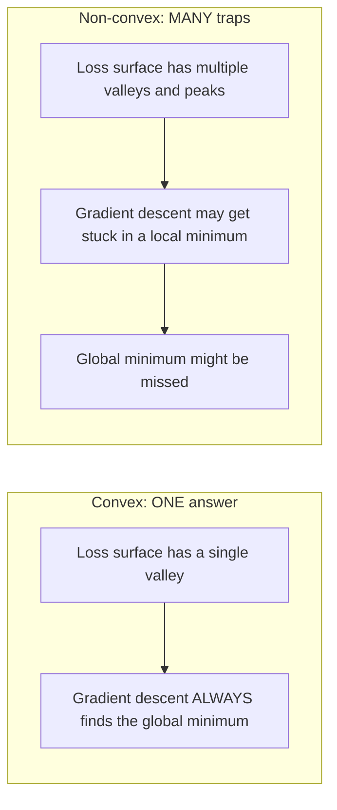
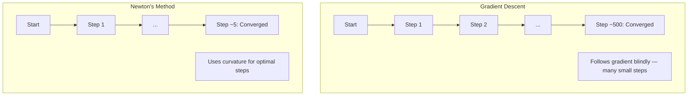
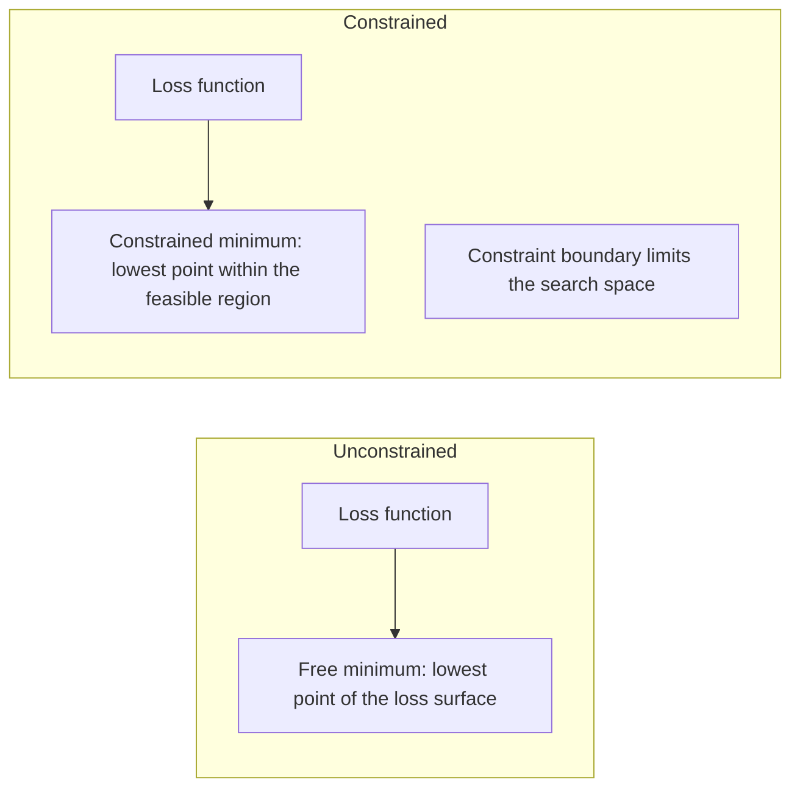
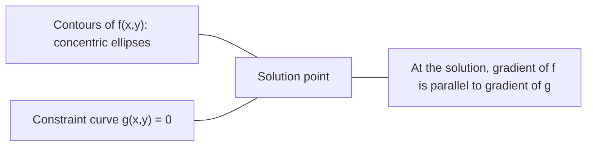

# संकुचित अनुकूलन

> संकुचित समस्याओं में एक घाटी होती है, न्यूरल नेटवर्क में लाखों होते हैं। अंतर को जानना महत्वपूर्ण है।

**Type:** Build
**Language:**पायथन
**Prerequisites:** Phase 1, Lessons 04 (Calculus for ML), 08 (Optimization)
**Time:** ~90 minutes

## सीखने के लक्ष्य

- परिभाषा, दूसरा व्युत्पन्न और हेसन मानदंडों का उपयोग करके परीक्षण करें कि क्या एक फ़ंक्शन घुमावदार है
- न्यूटन की विधि को लागू करें और उसके वर्गिक अभिसरण की तुलना ग्रेडिएंट गिरावट के साथ करें
- लैग्रेंज गुणक का उपयोग करके सीमित अनुकूलन समस्याओं को हल करें और केकेटी स्थितियों की व्याख्या करें
- समझाएं कि तंत्रिका नेटवर्क हानि परिदृश्य क्यों गैर-कंक्रीट हैं, लेकिन एसजीडी अभी भी अच्छे समाधान ढूंढता है

## समस्या

पाठ 08 ने आपको ग्रेडिएंट गिरावट, गति और आदम सिखाया। ये ऑप्टिमाइज़र किसी भी सतह पर नीचे जाते हैं। लेकिन वे कोई गारंटी के साथ आते हैं। गैर-कंकल परिदृश्य पर ग्रेडिएंट गिरावट खराब स्थानीय न्यूनतम में उतर सकती है, एक सaddle point पर फंस सकती है, या हमेशा के लिए टहल सकती है। आपने इसे वैसे भी इस्तेमाल किया क्योंकि तंत्रिका नेटवर्क गैर-कंकल हैं और कोई विकल्प नहीं है।

लेकिन मशीन लर्निंग में कई समस्याएं संकुचित हैं। रैखिक प्रतिगमन, लॉजिस्टिक प्रतिगमन, एसवीएम, लासो, रिज प्रतिगमन। इन के लिए, कुछ मजबूत मौजूद हैः गणितीय गारंटी के साथ अनुकूलन। संकुचित समस्या में एक ही घाटी है। नीचे चलने वाला कोई भी एल्गोरिथ्म वैश्विक न्यूनतम तक पहुंच जाएगा। कोई पुनरारंभ की आवश्यकता नहीं है। कोई सीखने की दर कार्यक्रम नहीं। कोई प्रार्थना नहीं।

संकुचितता को समझना तीन चीजें करता है. पहला, यह आपको बताता है कि आपकी समस्या कब आसान (संकुचित) है (गैर-संकुचित) के खिलाफ कठिन (गैर-संकुचित) है। दूसरा, यह आपको संकुचित समस्याओं के लिए न्यूटन की विधि जैसे तेज़ उपकरण देता है। तीसरा, यह अवधारणाओं की व्याख्या करता है जो एमएल में दिखाई देती हैंः एक बाधा के रूप में नियमितता, एसवीएम में द्वैतता, और क्यों गहरी सीखने का काम करता है आपको हर अच्छी संपत्ति का उल्लंघन करने के बावजूद संकुचितता देता है।

## अवधारणा

### कंवेक्स सेट

एक सेट $S$यदि किसी भी दो बिंदुओं के लिए $S$, उनके बीच लाइन खंड भी पूरी तरह से स्थित है $S$. .

| Convex sets | Not convex |
|---|---|
| **Rectangle**: any two points inside can be connected by a line segment that stays inside | **Star/crescent shape**: a line between two interior points can pass outside the set |
| **Triangle**: same property holds for all interior points | **Donut/annulus**: the hole means some line segments leave the set |
| The line segment between any two points stays within the set | The line segment between some pairs of points exits the set |

औपचारिक परीक्षण: किसी भी बिंदु के लिए $x, y$में $S$और किसी भी$t \in [0, 1]$, मुद्दा $tx + (1-t)y$$S$. .

कंवेक्स सेट के उदाहरणः
- एक लाइन, एक विमान, सब कुछ $\mathbb{R}^n$
- एक गेंद (चक्र, गोला, हाइपरस्फीयर)
- एक आधे स्थान: $\lbrace x : a^T x \le b \rbrace$
- किसी भी संख्या में घुमावदार सेट का चौराहा

गैर-कंकुष्ठ सेट के उदाहरणः
- एक डोनट (एनुलस)
- दो विघटित वृत्तों का संघ
- "डेंट" या "होल" के साथ कोई भी सेट

### घुमावदार फ़ंक्शन

एक कार्य$f$यदि इसका डोमेन एक संकुचित सेट है और किसी भी दो बिंदुओं के लिए संकुचित है $x, y$अपने क्षेत्र में और किसी भी $t \in [0, 1]$:

```math
f(tx + (1-t)y) \le t f(x) + (1-t) f(y)
```

ज्यामितीय रूप सेः ग्राफ पर किसी भी दो बिंदुओं के बीच रेखा खंड ग्राफ के ऊपर या ग्राफ पर स्थित है।

| Property | Convex function | Non-convex function |
|---|---|---|
| **Line segment test** | The line between any two points on the graph lies **above or on** the curve | The line between some points on the graph dips **below** the curve |
| **Shape** | Single bowl/valley curving upward | Multiple peaks and valleys with mixed curvature |
| **Local minima** | Every local minimum is the global minimum | Multiple local minima may exist at different heights |

सामान्य संकुचित कार्यः
- $f(x) = x^2$(पाराबोला)
- $f(x) = \lvert x \rvert$(मूर्त मूल्य)
- $f(x) = e^x$(उत्पादक)
- $f(x) = \max(0, x)$(ReLU, हालांकि टुकड़ा के रूप में रैखिक)
- $f(x) = -\log(x)$के लिए$x > 0$(नकारात्मक लॉग)
- कोई भी रैखिक फ़ंक्शन $f(x) = a^T x + b$(कंकड़ और कंकड़ दोनों)

### संकुचितता पर परीक्षण

तीन व्यावहारिक परीक्षण, सबसे आसान से सबसे कठोर तक।

**Test 1: Second derivative test (1D).**यदि$f''(x) \ge 0$सभी के लिए$x$, तो $f$घुंघराली है।

- $f(x) = x^2$$f''(x) = 2 \ge 0$- घुमावदार।
- $f(x) = x^3$$f''(x) = 6x$. नकारात्मक के लिए$x < 0$. . घुमावदार नहीं.
- $f(x) = e^x$$f''(x) = e^x > 0$- घुमावदार।

**Test 2: Hessian test (multivariate).**यदि हेसियन मैट्रिक्स $H(x)$सभी के लिए सकारात्मक अर्ध-परिभाषित है $x$, तो $f$हेसियन दूसरे आंशिक व्युत्पन्नों का मैट्रिक्स है।

**Test 3: Definition test.**असमानता की जाँच करें $f(tx + (1-t)y) \le t f(x) + (1-t) f(y)$सीधे. परिणतों की गणना करने में मुश्किल होने वाले कार्यों के लिए उपयोगी।

### क्यों संकुचन महत्वपूर्ण है

संकुचित अनुकूलन का केंद्रीय प्रमेय:

**For a convex function, every local minimum is a global minimum.**

इसका मतलब है कि ग्रेडिएंट डाउन को फंसाया नहीं जा सकता है। किसी भी डाउनहिल पथ से एक ही उत्तर मिलता है। एल्गोरिथ्म को इष्टतम समाधान के लिए अभिसरण की गारंटी है।



परिणाम:
- यादृच्छिक पुनः आरंभ करने की कोई आवश्यकता नहीं
- परिष्कृत सीखने की दर की आवश्यकता नहीं है
- अभिसरण प्रमाण संभव हैं (दर फ़ंक्शन गुणों पर निर्भर करती है)
- समाधान अद्वितीय है (सपाट क्षेत्रों तक)

### ML में घुमावदार बनाम गैर घुमावदार

| Problem | Convex? | Why |
|---------|---------|-----|
| Linear regression (MSE) | Yes | Loss is quadratic in weights |
| Logistic regression | Yes | Log-loss is convex in weights |
| SVM (hinge loss) | Yes | Maximum of linear functions |
| LASSO (L1 regression) | Yes | Sum of convex functions is convex |
| Ridge regression (L2) | Yes | Quadratic + quadratic = convex |
| Neural network (any loss) | No | Nonlinear activations create non-convex landscape |
| k-means clustering | No | Discrete assignment step |
| Matrix factorization | No | Product of unknowns |

विभक्ति हानि के साथ रैखिक मॉडल विभक्ति हैं. जब आप गैर-रेखीय सक्रियण के साथ छिपे परतों जोड़ते हैं, विभक्ति टूट जाता है.

### हेसियन मैट्रिक्स

हेसियन $H$किसी कार्य के $f: \mathbb{R}^n \to \mathbb{R}$$n \times n$दूसरे आंशिक व्युत्पन्नों का मैट्रिक्स।

```math
H_{ij} = \frac{\partial^2 f}{\partial x_i \, \partial x_j}
```

के लिए$f(x, y) = x^2 + 3xy + y^2$:

```math
\begin{gathered}
\begin{aligned}
\frac{\partial f}{\partial x} &= 2x + 3y & \frac{\partial^2 f}{\partial x^2} &= 2 & \frac{\partial^2 f}{\partial x \, \partial y} &= 3 \\
\frac{\partial f}{\partial y} &= 3x + 2y & \frac{\partial^2 f}{\partial y \, \partial x} &= 3 & \frac{\partial^2 f}{\partial y^2} &= 2
\end{aligned} \\[8pt]
H = \begin{bmatrix} 2 & 3 \\ 3 & 2 \end{bmatrix}
\end{gathered}
```

हेसियन आपको वक्रता के बारे में बताता हैः
- सभी सकारात्मक स्वमूल्यः फ़ंक्शन हर दिशा में ऊपर की ओर घुमाता है (उस बिंदु पर घुमावदार)
- सभी ऋणात्मक स्वमूल्यः प्रत्येक दिशा में नीचे की वक्र (कुंकुआ, स्थानीय अधिकतम)
- मिश्रित संकेतः सड़ल बिंदु (कुछ दिशाओं में ऊपर, अन्य दिशाओं में नीचे)
- शून्य स्वमूल्यः उस दिशा में फ्लैट (डिजेनेरेट)

संकुचितता के लिए, हेसियन को सकारात्मक अर्ध-परिभाषित होना चाहिए (सभी स्व-मूल्य $\ge 0$) हर जगह, केवल एक ही बिंदु पर नहीं।

### न्यूटन की विधि

ग्रेडिएंट अवतरण प्रथम क्रम की जानकारी (ग्रेडिएंट) का उपयोग करता है। न्यूटन की विधि द्वितीय क्रम की जानकारी (हेसियन) का उपयोग करती है। यह वर्तमान बिंदु पर एक वर्गिक अनुमान फिट बैठता है और सीधे उस वर्गिक के न्यूनतम पर कूदता है।

```math
\begin{aligned}
\text{Update rule:} \quad & x_{\text{new}} = x - H^{-1} \cdot \text{gradient} \\
\text{Compare to gradient descent:} \quad & x_{\text{new}} = x - \text{lr} \cdot \text{gradient}
\end{aligned}
```

न्यूटन की विधि स्कॉलर सीखने की दर को उल्टा हेसियन से बदल देती है। यह स्वचालित रूप से स्थानीय वक्रता के आधार पर चरण आकार और दिशा को समायोजित करती है।



लाभ:
- न्यूनतम के निकट चतुर्भुज अभिसरण (हर चरण में त्रुटि वर्ग)
- कोई सीखने की दर के लिए ट्यून
- स्केल-इंवर्टेंट (प्रश्न को आप कैसे पैरामीटर करते हैं, इससे कोई फर्क नहीं पड़ता कि यह कैसे काम करता है)

नुकसान:
- हेसियन लागतों की गणना $O(n^2)$स्मृति और $O(n^3)$उल्टा करना
- एक लाख वजन के साथ एक तंत्रिका नेटवर्क के लिए, यह है $10^{12}$प्रविष्टियाँ और $10^{18}$संचालन
- गहन शिक्षा के लिए व्यावहारिक नहीं

### सीमित अनुकूलन

बिना किसी सीमा के अनुकूलनः न्यूनतम $f(x)$सब पर$x$. .
सीमित अनुकूलनः न्यूनतम $f(x)$प्रतिबंधों के अधीन।

वास्तविक समस्याओं में बाधाएं होती हैं आप लागत को कम करना चाहते हैं लेकिन आपका बजट सीमित है आप त्रुटि को कम करना चाहते हैं लेकिन आपकी मॉडल जटिलता सीमित है।



### लॅग्रेंज गुणक

लैग्रेंज गुणकों की विधि एक सीमित समस्या को एक निर्बंधित समस्या में परिवर्तित करती है।

समस्या: कम से कम करें $f(x)$$g(x) = 0$. .

समाधान: एक नया चर (लैगरेंज गुणक) पेश करें $\lambda$) और अनियंत्रित समस्या को हल करेंः

```math
L(x, \lambda) = f(x) + \lambda g(x)
```

समाधान पर, $L$शून्य है:

```math
\begin{aligned}
\frac{\partial L}{\partial x} &= \frac{\partial f}{\partial x} + \lambda \frac{\partial g}{\partial x} = 0 \\
\frac{\partial L}{\partial \lambda} &= g(x) = 0
\end{aligned}
```

ज्यामितीय अंतर्ज्ञानः सीमित न्यूनतम पर, $f$बाध्यता के ग्रेडिएंट के समानांतर होना चाहिए $g$यदि वे समानांतर नहीं थे, तो आप बाधा सतह के साथ आगे बढ़ सकते हैं और कम कर सकते हैं$f$आगे।



उदाहरण: न्यूनतम $f(x,y) = x^2 + y^2$$x + y = 1$. .

```math
\begin{aligned}
L &= x^2 + y^2 + \lambda(x + y - 1) \\[4pt]
\frac{\partial L}{\partial x} &= 2x + \lambda = 0 \implies x = -\lambda/2 \\
\frac{\partial L}{\partial y} &= 2y + \lambda = 0 \implies y = -\lambda/2 \\
\frac{\partial L}{\partial \lambda} &= x + y - 1 = 0 \\[4pt]
&\text{From first two: } x = y \\
&\text{Substituting: } 2x = 1, \text{ so } x = y = 0.5, \ \lambda = -1
\end{aligned}
```

रेखा पर निकटतम बिंदु $x + y = 1$मूल से है $(0.5, 0.5)$. .

### केकेटी की शर्तें

करुश-कुहन-टकर स्थितियां लैग्रेंज गुणकों को असमानता प्रतिबंधों तक विस्तारित करती हैं।

समस्या: कम से कम करें $f(x)$$g_i(x) \le 0$के लिए$i = 1, \ldots, m$. .

KKT की शर्तें (उपमाइश के लिए आवश्यक):

```math
\begin{aligned}
&\text{1. Stationarity:} && \frac{\partial f}{\partial x} + \sum_i \lambda_i \frac{\partial g_i}{\partial x} = 0 \\
&\text{2. Primal feasibility:} && g_i(x) \le 0 \quad \text{for all } i \\
&\text{3. Dual feasibility:} && \lambda_i \ge 0 \quad \text{for all } i \\
&\text{4. Complementary slackness:} && \lambda_i \, g_i(x) = 0 \quad \text{for all } i
\end{aligned}
```

अतिरिक्त ढीलापन मुख्य अंतर्दृष्टि हैः या तो प्रतिबंध सक्रिय है ($g_i = 0$, समाधान सीमा पर बैठता है) या गुणक शून्य है (प्रतिबंध कोई फर्क नहीं पड़ता है) । एक प्रतिबन्ध जो समाधान को प्रभावित नहीं करता है $\lambda = 0$. .

केकेटी स्थितियां एसवीएम के लिए केंद्रीय हैं। समर्थन वेक्टर डेटा बिंदु हैं जहां प्रतिबंध सक्रिय है ($\lambda > 0$) अन्य सभी डेटा बिंदुओं में $\lambda = 0$और निर्णय सीमा को प्रभावित नहीं करते।

### सीमित अनुकूलन के रूप में नियमन

L1 और L2 नियमितता मनमाने तरीके से नहीं होती बल्कि वे सीमित अनुकूलन समस्याएं हैं जो लुढ़कती हैं।

**L2 regularization (Ridge):**

```math
\begin{aligned}
&\text{minimize } \text{Loss}(w) \text{ subject to } \lVert w \rVert^2 \le t \\[4pt]
&\text{Equivalent unconstrained form:} \\
&\text{minimize } \text{Loss}(w) + \lambda \lVert w \rVert^2
\end{aligned}
```

बाध्यता $\lVert w \rVert^2 \le t$एक गेंद को परिभाषित करता है (चक्र 2D में, गोला 3D में) समाधान है जहां हानि कंतोरे पहली बार इस गेंद को छूते हैं।

**L1 regularization (LASSO):**

```math
\begin{aligned}
&\text{minimize } \text{Loss}(w) \text{ subject to } \lVert w \rVert_1 \le t \\[4pt]
&\text{Equivalent unconstrained form:} \\
&\text{minimize } \text{Loss}(w) + \lambda \lVert w \rVert_1
\end{aligned}
```

बाध्यता $\lVert w \rVert_1 \le t$एक हीरा (दो आयामी में घुमाया हुआ वर्ग) को परिभाषित करता है।

| Property | L2 constraint (circle) | L1 constraint (diamond) |
|---|---|---|
| **Constraint shape** | Circle (sphere in higher dims) | Diamond (rotated square in 2D) |
| **Where loss contour touches** | Smooth boundary — any point on the circle | Corner — aligned with an axis |
| **Solution behavior** | Weights are small but nonzero | Some weights are exactly zero (sparse) |
| **Result** | Weight shrinkage | Feature selection |

यह बताता है कि L1 क्यों दुर्लभ मॉडल (विशेषताओं का चयन) का उत्पादन करता है जबकि L2 केवल वजन को छोटा करता है। हीरे के कुएं धुरी के साथ संरेखित हैं। नुकसान के कंटूर को एक कोण को छूने की अधिक संभावना है, एक या अधिक वजन को बिल्कुल शून्य तक सेट करता है।

### द्वैतता

प्रत्येक सीमित अनुकूलन समस्या (प्राथमिक) में एक साथी समस्या (द्वैध) होती है। संकुचित समस्याओं के लिए, प्राथमिक और द्वैध का समान इष्टतम मूल्य होता है। यह मजबूत द्वैधता है।

लैग्रंजियन डबल फ़ंक्शनः

```math
\begin{aligned}
&\text{Primal:} && \text{minimize } f(x) \text{ subject to } g(x) \le 0 \\
&\text{Lagrangian:} && L(x, \lambda) = f(x) + \lambda g(x) \\
&\text{Dual function:} && d(\lambda) = \min_x L(x, \lambda) \\
&\text{Dual problem:} && \text{maximize } d(\lambda) \text{ subject to } \lambda \ge 0
\end{aligned}
```

द्वैतता क्यों महत्वपूर्ण हैः
- दोहरी समस्या को कभी-कभी मूल समस्या से हल करना आसान होता है
- एसवीएम अपने दोहरे रूप में हल कर रहे हैं, जहां समस्या डेटा बिंदुओं के बीच बिंदु उत्पादों पर निर्भर करता है (कर्नल ट्रिक सक्षम)
- दोहरी मूल इष्टतम पर एक निचली सीमा प्रदान करती है, समाधान की गुणवत्ता की जांच के लिए उपयोगी

विशेष रूप से एसवीएम के लिएः

```
Primal: find w, b that maximize the margin 2/||w|| subject to
        y_i(w^T x_i + b) >= 1 for all i

Dual:   maximize sum(alpha_i) - 0.5 * sum_ij(alpha_i * alpha_j * y_i * y_j * x_i^T x_j)
        subject to alpha_i >= 0 and sum(alpha_i * y_i) = 0

The dual only involves dot products x_i^T x_j.
Replace x_i^T x_j with K(x_i, x_j) to get the kernel trick.
```

### क्यों गहरी शिक्षा गैर-संभ्रम के बावजूद काम करती है

न्यूरल नेटवर्क हानि फ़ंक्शन बेहद गैर-कंकड़ हैं। प्रत्येक क्लासिक उपाय द्वारा, उन्हें अनुकूलित करने में विफल होना चाहिए। फिर भी स्टोकास्टिक ग्रेडिएंट गिरावट विश्वसनीय रूप से अच्छे समाधान ढूंढती है। कई कारक इसे समझाते हैं।

**Most local minima are good enough.**उच्च-आयामी स्थानों में, यादृच्छिक महत्वपूर्ण बिंदु (जहां ग्रेडिएंट शून्य है) स्थानीय न्यूनतम नहीं, बल्कि भारी मात्रा में सaddle बिंदु हैं। मौजूद कुछ स्थानीय न्यूनतम में वैश्विक न्यूनतम के करीब हानि मूल्य होते हैं। जब पैरामीटर स्थान में लाखों आयाम होते हैं तो भयानक स्थानीय न्यूनतम में फंसने की बहुत संभावना नहीं होती है।

**Saddle points, not local minima, are the real obstacle.** के साथ एक समारोह में$n$पैरामीटर, एक सaddle point में सकारात्मक और नकारात्मक वक्रता दिशाओं का मिश्रण होता है। उच्च आयामों में एक यादृच्छिक महत्वपूर्ण बिंदु के लिए, सभी की संभावना $n$स्वमूल्य सकारात्मक होने (स्थानीय न्यूनतम) लगभग $2^{-n}$लगभग सभी महत्वपूर्ण बिंदुओं सेटल बिंदुओं हैं एसजीडी की शोर उन्हें बचने में मदद करता है।

**Overparameterization smooths the landscape.**प्रशिक्षण उदाहरणों की तुलना में अधिक मापदंडों वाले नेटवर्क में अधिक चिकनी, अधिक जुड़े नुकसान सतहें होती हैं। व्यापक नेटवर्क में कम खराब स्थानीय न्यूनतम होते हैं। यह विपरीत है लेकिन अनुभवजन्य रूप से सुसंगत है।

**Loss landscape structure:**

| Property | Low-dimensional space | High-dimensional space |
|---|---|---|
| **Landscape** | Many isolated peaks and valleys | Smoothly connected valleys |
| **Minima** | Many isolated local minima | Few bad local minima; most are near-optimal |
| **Navigation** | Hard to find global minimum | Many paths lead to good solutions |
| **Critical points** | Mix of local minima and saddle points | Overwhelmingly saddle points, not local minima |

**Stochastic noise acts as implicit regularization.**मिनी-बैच एसजीडी शोर जोड़ता है जो तेज न्यूनतम में बसने से रोकता है। तेज न्यूनतम ओवरफिट; सपाट न्यूनतम सामान्यीकरण। शोर नुकसान परिदृश्य के सपाट क्षेत्रों की ओर अनुकूलन को अनुकूलित करता है।

### अभ्यास में द्वितीय श्रेणी की विधियाँ

न्यूटन की विधि बड़े मॉडल के लिए अप्रैक्टिकल है। कई अनुमानों से दूसरी श्रेणी की जानकारी उपयोग में आती है।

**L-BFGS (Limited-memory BFGS):**पिछले का उपयोग करके विपरीत हेसियन के करीब $m$ग्रेडिएंट अंतर।$O(mn)$स्मृति के बजाय $O(n^2)$. ~ 10,000 पैरामीटर तक की समस्याओं के लिए अच्छी तरह से काम करता है। शास्त्रीय एमएल (लॉजिस्टिक रिग्रेशन, सीआरएफ) में उपयोग किया जाता है लेकिन गहन सीखने में नहीं।

**Natural gradient:**मानक हेसियन के बजाय फिशर सूचना मैट्रिक्स (लॉग-संभाव्यता के अपेक्षित हेसियन) का उपयोग करता है। यह संभावना वितरण की ज्यामिति का कारण बनता है। K-FAC (क्रोनकर-कारक अनुमानित वक्रता) फिशर मैट्रिक्स को एक क्रोनकर उत्पाद के रूप में अनुमानित करता है, जिससे यह तंत्रिका नेटवर्क के लिए व्यावहारिक हो जाता है।

**Hessian-free optimization:**हल करने के लिए संयोग gradient का उपयोग करता है $Hx = g$बिना कभी बनकर$H$. केवल हेसन वेक्टर उत्पादों की आवश्यकता होती है, जो गणना में किया जा सकता है $O(n)$समय स्वचालित विभेदन के माध्यम से।

**Diagonal approximations:**एडम का दूसरा क्षण हेसियन के विकर्ण के एक विकर्ण समीकरण है। एडहेसियन हचिनसन के अनुमानक के माध्यम से वास्तविक हेसियन विकर्ण तत्वों का उपयोग करके इसे बढ़ाता है।

| Method | Memory | Per-step cost | When to use |
|--------|--------|--------------|-------------|
| Gradient descent | $O(n)$ | $O(n)$ | Baseline, large models |
| Newton's method | $O(n^2)$ | $O(n^3)$ | Small convex problems |
| L-BFGS | $O(mn)$ | $O(mn)$ | Medium convex problems |
| Adam | $O(n)$ | $O(n)$ | Deep learning default |
| K-FAC | $O(n)$ | $O(n)$ per layer | Research, large-batch training |

```figure
convex-vs-nonconvex
```

## इसे बनाओ

### चरण 1: संकुचनता जांच

एक फ़ंक्शन बनाएं जो नमूने लेने और परिभाषा की जांच करके अनुकरणीयता का अनुभवजन्य रूप से परीक्षण करता है।

```python
import random
import math

def check_convexity(f, dim, bounds=(-5, 5), samples=1000):
    violations = 0
    for _ in range(samples):
        x = [random.uniform(*bounds) for _ in range(dim)]
        y = [random.uniform(*bounds) for _ in range(dim)]
        t = random.uniform(0, 1)
        mid = [t * xi + (1 - t) * yi for xi, yi in zip(x, y)]
        lhs = f(mid)
        rhs = t * f(x) + (1 - t) * f(y)
        if lhs > rhs + 1e-10:
            violations += 1
    return violations == 0, violations
```

### चरण 2: 2D के लिए न्यूटन की विधि

स्पष्ट हेसियन का उपयोग करके न्यूटन की विधि लागू करें.

```python
def newtons_method(f, grad_f, hessian_f, x0, steps=50, tol=1e-12):
    x = list(x0)
    history = [x[:]]
    for _ in range(steps):
        g = grad_f(x)
        H = hessian_f(x)
        det = H[0][0] * H[1][1] - H[0][1] * H[1][0]
        if abs(det) < 1e-15:
            break
        H_inv = [
            [H[1][1] / det, -H[0][1] / det],
            [-H[1][0] / det, H[0][0] / det],
        ]
        dx = [
            H_inv[0][0] * g[0] + H_inv[0][1] * g[1],
            H_inv[1][0] * g[0] + H_inv[1][1] * g[1],
        ]
        x = [x[0] - dx[0], x[1] - dx[1]]
        history.append(x[:])
        if sum(gi ** 2 for gi in g) < tol:
            break
    return history
```

### चरण 3: लैग्रेंज गुणक समाधान

लैग्रंजियन पर ग्रेडिएंट अवतरण का उपयोग करके सीमित अनुकूलन को हल करें।

```python
def lagrange_solve(f_grad, g_val, g_grad, x0, lr=0.01,
                   lr_lambda=0.01, steps=5000):
    x = list(x0)
    lam = 0.0
    history = []
    for _ in range(steps):
        fg = f_grad(x)
        gv = g_val(x)
        gg = g_grad(x)
        x = [
            xi - lr * (fgi + lam * ggi)
            for xi, fgi, ggi in zip(x, fg, gg)
        ]
        lam = lam + lr_lambda * gv
        history.append((x[:], lam, gv))
    return history
```

### चरण 4: प्रथम श्रेणी की तुलना द्वितीय श्रेणी की तुलना करें

उसी वर्गिक फ़ंक्शन पर ग्रेडिएंट अवतरण और न्यूटन की विधि चलाएं।

```python
def quadratic(x):
    return 5 * x[0] ** 2 + x[1] ** 2

def quadratic_grad(x):
    return [10 * x[0], 2 * x[1]]

def quadratic_hessian(x):
    return [[10, 0], [0, 2]]
```

न्यूटन की विधि 1 चरण में एक दूसरे से मिलती है (यह चतुर्भुज के लिए सटीक है) । ग्रेडिएंट अवतरण सैकड़ों चरणों को लेगा क्योंकि हेसियन के स्वमूल्य 5 गुणा भिन्न होते हैं, जिससे एक लम्बी घाटी बनती है।

## इसका प्रयोग करें

एमएल मॉडल और सॉल्वर चुनते समय संकुचनता विश्लेषण सीधे लागू होता है।

कंवेक्स समस्याओं के लिए (लॉजिस्टिक रेग्रेशन, एसवीएम, लॅसो):
- समर्पित हलकों का उपयोग करें (लिबलाइनर, CVXPY, scipy.optimize.minimize के साथ method='L-BFGS-B')
- एक अद्वितीय वैश्विक समाधान की अपेक्षा करें
- दूसरी श्रेणी के तरीके व्यावहारिक और तेज़ हैं

गैर-कुंभन समस्याओं (निरोगिक नेटवर्क) के लिएः
- प्रथम श्रेणी के तरीकों का प्रयोग करें (एसजीडी, एडम)
- स्वीकार करें कि समाधान आरंभिकता और यादृच्छिकता पर निर्भर करता है
- अतिपरिमाणीकरण, शोर और सीखने की दर के कार्यक्रमों का उपयोग संवेदी नियमितता के रूप में करें
- वैश्विक न्यूनतम की तलाश में समय बर्बाद न करें। एक अच्छा स्थानीय न्यूनतम पर्याप्त है।

```python
from scipy.optimize import minimize

result = minimize(
    fun=lambda w: sum((y - X @ w) ** 2) + 0.1 * sum(w ** 2),
    x0=np.zeros(d),
    method='L-BFGS-B',
    jac=lambda w: -2 * X.T @ (y - X @ w) + 0.2 * w,
)
```

SVM के लिए, दोहरे सूत्र आप कर्नेल चाल का उपयोग करने की अनुमति देता हैः

```python
from sklearn.svm import SVC

svm = SVC(kernel='rbf', C=1.0)
svm.fit(X_train, y_train)
print(f"Support vectors: {svm.n_support_}")
```

## व्यायाम

1. **Convexity gallery.**चेकर का उपयोग करके इन कार्यों की संकुचनता के लिए परीक्षण करेंः $f(x) = x^4$,$f(x) = \sin(x)$,$f(x,y) = x^2 + y^2$,$f(x,y) = xy$,$f(x) = \max(x, 0)$. . . . . . . . . . . . . . . . . . . . . . . . . . . . . . . . . . . . . . . . . . . . . . . . . . . . . . . . . . . . . . . . . . . . . . . . . . . . . . . . . . . . . . . . . . . . . . . . . . . . . . . . . . . . . . . . . . . . . . . . . . . . . . . . . . . . . . . . . . . . . . . . . . . . . . . . . . . . . . . . . . . . . . . . . . . . . . . . . . . . . . . . . . . . . . . . . . . . . . . . . . . . . . . . . . . . . . . . . . . . . . . . . . . . . . . . . . . . . . . . . . . . . . . . . . . . . . . . . . . . . . . . . . . . . . . . . . . . . . . . . . . . . . . . . . . . . . . . . . . . . . . . . . . . . . . . . . . . . . . . . . . . . . . . . . . . . . . . . . . . . . . . . . . . . . . . . . . . . . . . . . . . . . . . . . . . . . . . . . . . . . . . . . . . . . . . . . . . . . . . . . . . . . . . . . . . . . . . . . . . . . . . . . . . . . . . . . . . . . . . . . . . . . . . . . . . . . . . . . . . . . . . . . . . . . . . . . . . . . . . . . . . . . . . . . . . . . . . . . . . . . . . . . . . . .

2. **Newton vs gradient descent race.**दोनों तरीकों को चलाएँ $f(x,y) = 50x^2 + y^2$प्रारंभ बिंदु से $(10, 10)$. हर एक नुकसान < 1e-10 तक पहुंचने के लिए कितने चरणों की आवश्यकता होती है? स्थिति संख्या (सबसे बड़ा से सबसे छोटा हेसियन स्वयं मूल्य का अनुपात) बढ़ते समय ग्रेडिएंट गिरावट का क्या होता है?

3. **Lagrange multiplier geometry.**कम से कम करें$f(x,y) = (x-3)^2 + (y-3)^2$$x + 2y = 4$. समाधान की जांच करके कि $f$ के ग्रेडिएंट के समानांतर है$g$समाधान पर।

4. **Regularization constraint.**L1 सीमित अनुकूलन लागू करेंः न्यूनतम $(x-3)^2 + (y-2)^2$$\lvert x \rvert + \lvert y \rvert \le 1$. दिखाएं कि समाधान का एक निर्देशांक शून्य के बराबर है (चिलहरी बाधा से विखंडन) ।

5. **Hessian eigenvalue analysis.**(1,1) और (-1,1) पर रोजेनब्रोक फ़ंक्शन के हेसनियन की गणना करें। दोनों बिंदुओं पर स्व-मूल्यों की गणना करें। स्व-मूल्यों आपको न्यूनतम बनाम उससे दूर वक्रता के बारे में क्या बताते हैं?

### संकेत

**Exercise 1.**दौड़ने से पहले प्रत्येक परिणाम की भविष्यवाणी करें `check_convexity`: एक आयाम में, संकेत को देखें $f''(x)$दो आयामों में, हेसियन के स्व-मूल्यों को देखें।$f(x,y) = xy$, हेसियन के पास स्वमान 1 और -1 हैं, इसलिए चेकर को रिपोर्ट करना चाहिए कि यह घुमावदार नहीं है।

**Exercise 2.**कॉल`optimize_gd`और `newtons_method` के ग्रेडिएंट और हेसियन के साथ$f$न्यूटन की विधि एक चरण में एक वर्ग हल करता है. ग्रेडिएंट अवतरण के लिए, सीखने की दर से कम होना चाहिए$2/100$$50x^2$शब्द, तो $y$दिशा धीरे-धीरे आगे बढ़ती है।$100x^2$और फिर से कदम गिनें।

**Exercise 3.**उपयोग करें`lagrange_solve`के साथ$g(x,y) = x + 2y - 4$. जवाब पर, यह जाँचें कि$x + 2y = 4$और यह $\nabla f = (2(x-3), 2(y-3))$$\nabla g = (1, 2)$. .

**Exercise 4.**असीमित न्यूनतम (3, 2) हीरे के बाहर है, इसलिए उत्तर इसकी सीमा पर है। अनुमानित ग्रेडिएंट अवतरण का उपयोग करेंः ग्रेडिएंट चरण लें, फिर वापस पर प्रक्षेपित करें $\lvert x \rvert + \lvert y \rvert \le 1$. जाँचें कि परिणाम समानता के साथ प्रतिबन्ध को पूरा करता है और इसकी तुलना करें `demo_regularization_geometry`. .

**Exercise 5.**कॉल`rosenbrock_hessian`प्रत्येक बिंदु पर और परिणाम को पारित करने के लिए `hessian_eigenvalues_2d`. (1, 1) पर दोनों स्वमूल्य सकारात्मक हैं और उनका अनुपात बहुत बड़ा है, इसलिए एक दिशा में घाटी संकीर्ण और दूसरी दिशा में सपाट है। उस अनुपात की तुलना (-1, 1) पर अनुपात से करें।

## प्रमुख शर्तें

| Term | What it means |
|------|---------------|
| Convex set | A set where the line segment between any two points in the set stays inside the set |
| Convex function | A function where the line between any two points on its graph lies above or on the graph. Equivalently, Hessian is positive semidefinite everywhere |
| Local minimum | A point lower than all nearby points. For convex functions, every local minimum is the global minimum |
| Global minimum | The lowest point of a function over its entire domain |
| Hessian matrix | The matrix of all second partial derivatives. Encodes curvature information |
| Positive semidefinite | A matrix whose eigenvalues are all non-negative. The multidimensional analogue of "second derivative >= 0" |
| Condition number | Ratio of largest to smallest eigenvalue of the Hessian. High condition number means elongated valleys and slow gradient descent |
| Newton's method | Second-order optimizer that uses the inverse Hessian to determine step direction and size. Quadratic convergence near the minimum |
| Lagrange multiplier | A variable introduced to convert a constrained optimization problem into an unconstrained one |
| KKT conditions | Necessary conditions for optimality with inequality constraints. Generalize Lagrange multipliers |
| Complementary slackness | At the solution, either a constraint is active or its multiplier is zero. Never both nonzero |
| Duality | Every constrained problem has a companion dual problem. For convex problems, both have the same optimal value |
| Strong duality | Primal and dual optimal values are equal. Holds for convex problems satisfying Slater's condition |
| L-BFGS | Approximate second-order method that stores the last $m$ gradient differences instead of the full Hessian |
| Saddle point | A point where the gradient is zero but it is a minimum in some directions and a maximum in others |
| Overparameterization | Using more parameters than training examples. Smooths the loss landscape and reduces bad local minima |

## आगे पढ़ना

- [Boyd & Vandenberghe: Convex Optimization](https://web.stanford.edu/~boyd/cvxbook/)- मानक पाठ्यपुस्तक, ऑनलाइन मुक्त रूप से उपलब्ध
- [Bottou, Curtis, Nocedal: Optimization Methods for Large-Scale Machine Learning (2018)](https://arxiv.org/abs/1606.04838)- पूल संकुचित अनुकूलन सिद्धांत और गहन सीखने अभ्यास
- [Choromanska et al.: The Loss Surfaces of Multilayer Networks (2015)](https://arxiv.org/abs/1412.0233)- क्यों गैर-कुंभन तंत्रिका नेटवर्क परिदृश्य इतना बुरा नहीं है जितना वे लगते हैं
- [Nocedal & Wright: Numerical Optimization](https://link.springer.com/book/10.1007/978-0-387-40065-5)- न्यूटन की विधि, L-BFGS के लिए व्यापक संदर्भ और सीमित अनुकूलन
