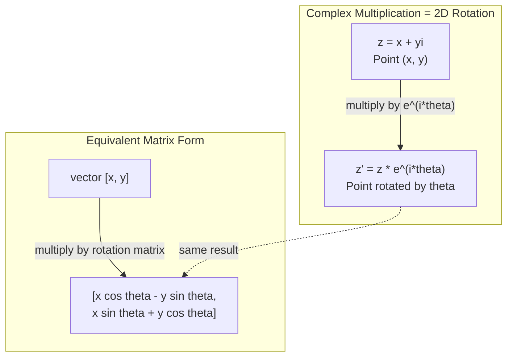
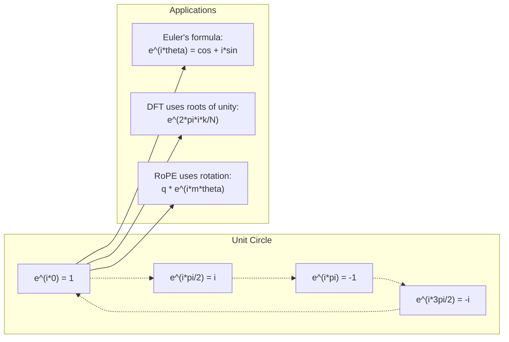

# एआई के लिए जटिल संख्याएँ

> -1 की वर्गमूल कल्पना नहीं है, यह घूर्णन, आवृत्तियों और सिग्नल प्रसंस्करण के आधे भाग की कुंजी है।

**Type:** Learn
**Language:**पायथन
**Prerequisites:** Phase 1, Lessons 01-04 (linear algebra, calculus)
**Time:** ~60 minutes

## सीखने के लक्ष्य

- आयताकार और ध्रुवीय दोनों रूपों में जटिल अंकगणित (जोड़ें, गुणा करें, विभाजित करें, जोड़ें) करें
- जटिल एक्सपोनेंशियल और त्रिकोणमिति कार्यों के बीच परिवर्तित करने के लिए एयूलर के सूत्र का उपयोग करें
- एकता की जटिल जड़ों का उपयोग करके डिस्क्रिट फ़ूरियर ट्रांसफॉर्म को लागू करें
- ट्रांसफार्मर में रोपी और सिनोसाइडल पोजिशनिंग कोडिंग के जटिल रोटेशन कैसे अंतर्निहित हैं, इसकी व्याख्या करें

## समस्या

आप फ़ूरियर परिवर्तन पर एक पेपर खोलें और वहाँ है`i`आप ट्रांसफार्मर स्थिति कोडिंग देख सकते हैं और देख सकते हैं`sin`और `cos`आप क्वांटम कंप्यूटिंग के बारे में पढ़ते हैं और जटिल वेक्टर स्पेस में व्यक्त सब कुछ पा सकते हैं।

जटिल संख्याएं अमूर्त लगती हैं। -1 की वर्गमूल पर निर्मित संख्या प्रणाली एक गणितीय चाल की तरह लगती है। लेकिन यह कोई चाल नहीं है। यह घूर्णन और घर्षण की प्राकृतिक भाषा है। जब भी कुछ घूमता है, कंपन करता है या घर्षण करता है, तो जटिल संख्याएं सही उपकरण हैं।

जटिल संख्याओं को समझने के बिना, आप डिस्क्रिट फ़ूरियर ट्रांसफॉर्म को नहीं समझ सकते हैं। आप एफएफटी को नहीं समझ सकते हैं। आप नहीं समझ सकते कि आधुनिक भाषा मॉडल में रोपी (रोटरी पोजीशन एम्बेडिंग) कैसे काम करता है। आप नहीं समझ सकते कि मूल ट्रांसफार्मर पेपर में सिनोसाइडल पोजीशनल एन्कोडिंग्स ने वे आवृत्तियों का उपयोग क्यों किया है।

यह पाठ जटिल अंकगणित को खरोंच से बनाता है, इसे ज्यामिति से जोड़ता है, और आपको दिखाता है कि मशीन लर्निंग में जटिल संख्याएं कहां दिखाई देती हैं।

## अवधारणा

### जटिल संख्या क्या है?

एक जटिल संख्या में दो भाग होते हैंः एक वास्तविक भाग और एक कल्पनात्मक भाग।

```
z = a + bi

where:
  a is the real part
  b is the imaginary part
  i is the imaginary unit, defined by i^2 = -1
```

यह है. आप संख्या रेखा को एक विमान में विस्तारित करते हैं. वास्तविक संख्या एक अक्ष पर बैठती है. कल्पनात्मक संख्या दूसरी पर बैठती है. प्रत्येक जटिल संख्या इस विमान में एक बिंदु है.

### जटिल अंकगणित

**Addition.**वास्तविक भागों को एक साथ जोड़ें, कल्पनात्मक भागों को एक साथ जोड़ें।

```math
\begin{aligned}
(a + bi) + (c + di) &= (a + c) + (b + d)i \\[4pt]
\text{Example: } (3 + 2i) + (1 + 4i) &= 4 + 6i
\end{aligned}
```

**Multiplication.**वितरण कानून का उपयोग करें और याद रखें कि$i^2 = -1$. .

```math
\begin{aligned}
(a + bi)(c + di) &= ac + adi + bci + bdi^2 \\
&= ac + adi + bci - bd \\
&= (ac - bd) + (ad + bc)i \\[8pt]
\text{Example: } (3 + 2i)(1 + 4i) &= 3 + 12i + 2i + 8i^2 \\
&= 3 + 14i - 8 \\
&= -5 + 14i
\end{aligned}
```

**Conjugate.**कल्पनात्मक भाग के संकेत को मोड़ें।

```math
\text{conjugate of } (a + bi) = a - bi
```

एक जटिल संख्या और उसके संयोग का गुणक हमेशा वास्तविक होता हैः

```math
(a + bi)(a - bi) = a^2 + b^2
```

**Division.**संकेतक के संयोग से संख्या और संज्ञाकार को गुणा करें।

```math
\frac{a + bi}{c + di} = \frac{(a + bi)(c - di)}{c^2 + d^2}
```

इससे नामकरण से कल्पनात्मक भाग को हटा दिया जाता है, जिससे आपको एक शुद्ध जटिल संख्या मिलती है।

### जटिल विमान

जटिल विमान प्रत्येक जटिल संख्या को 2D बिंदु पर मैप करता है क्षैतिज अक्ष वास्तविक अक्ष है, ऊर्ध्वाधर अक्ष काल्पनिक अक्ष है।

```
z = 3 + 2i  corresponds to the point (3, 2)
z = -1 + 0i corresponds to the point (-1, 0) on the real axis
z = 0 + 4i  corresponds to the point (0, 4) on the imaginary axis
```

एक जटिल संख्या एक ही समय में मूल से एक बिंदु और एक वेक्टर है। यह दोहरी व्याख्या ही जटिल संख्याओं को ज्यामिति के लिए उपयोगी बनाती है।

### ध्रुवीय रूप

विमान में किसी भी बिंदु को मूल से इसकी दूरी और सकारात्मक वास्तविक अक्ष से उसके कोण द्वारा वर्णित किया जा सकता है।

```math
\begin{aligned}
z &= r (\cos\theta + i \sin\theta) \\[4pt]
\text{where: } r &= |z| = \sqrt{a^2 + b^2} \quad \text{(magnitude, or modulus)} \\
\theta &= \mathop{\mathrm{atan2}}(b, a) \quad \text{(phase, or argument)}
\end{aligned}
```

आयताकार रूप $(a + bi)$ध्रुवीय रूप $(r, \theta)$गुणन के लिए अच्छा है।

**Multiplication in polar form.**परिमाणों को गुणा करें, कोण जोड़ें।

```math
\begin{aligned}
z_1 &= r_1 e^{i\theta_1} \\
z_2 &= r_2 e^{i\theta_2} \\[4pt]
z_1 z_2 &= (r_1 r_2) \, e^{i(\theta_1 + \theta_2)}
\end{aligned}
```

यही कारण है कि जटिल संख्याएं घूर्णन के लिए एकदम सही हैं। परिमाण 1 के साथ जटिल संख्या से गुणा करना शुद्ध घूर्णन है।

### यूलर का सूत्र

जटिल एक्सपोनेंशियल और त्रिकोणमिति के बीच पुलः

```math
e^{i\theta} = \cos\theta + i \sin\theta
```

यह इस पाठ का सबसे महत्वपूर्ण सूत्र है।$\theta = \pi$:

```math
\begin{aligned}
e^{i\pi} &= \cos\pi + i \sin\pi = -1 + 0i = -1 \\[4pt]
\text{Therefore: } e^{i\pi} + 1 &= 0
\end{aligned}
```

पांच मूलभूत स्थिरताएं ($e$,$i$,$\pi$, 1, 0) एक समीकरण में जुड़ा हुआ है।

### एमएल के लिए ईलर का सूत्र क्यों मायने रखता है

एयूलर के सूत्र में कहा गया है कि$e^{i\theta}$इकाई वृत्त को $\theta$भिन्नता।$\theta = 0$, आप पर हैं $(1, 0)$.$\theta = \pi/2$, आप पर हैं $(0, 1)$.$\theta = \pi$, आप पर हैं $(-1, 0)$.$\theta = 3\pi/2$, आप पर हैं $(0, -1)$. एक पूर्ण घूर्णन है $\theta = 2\pi$. .

इसका मतलब है कि जटिल एक्सपोनेंटल ARE घूर्णन हैं और घूर्णन संकेत प्रसंस्करण और ML में हर जगह हैं।

### 2D घूर्णन से कनेक्शन

जटिल संख्या को गुणा करना $(x + yi)$द्वारा $e^{i\theta}$बिंदु को घुमाता है $(x, y)$कोण से $\theta$मूल के बारे में।

```math
\begin{aligned}
&\text{Rotation via complex multiplication:} \\
&\quad (x + yi)(\cos\theta + i \sin\theta) = (x \cos\theta - y \sin\theta) + (x \sin\theta + y \cos\theta)i \\[8pt]
&\text{Rotation via matrix multiplication:} \\
&\quad \begin{bmatrix} \cos\theta & -\sin\theta \\ \sin\theta & \cos\theta \end{bmatrix} \begin{bmatrix} x \\ y \end{bmatrix} = \begin{bmatrix} x \cos\theta - y \sin\theta \\ x \sin\theta + y \cos\theta \end{bmatrix}
\end{aligned}
```

वे समान परिणाम देते हैं. जटिल गुणा 2D घूर्णन है. घूर्णन मैट्रिक्स सिर्फ मैट्रिक्स संकेतन में लिखा जटिल गुणा है.



### फासर और घूर्णन संकेत

एक जटिल घातीय $e^{i\omega t}$कोणीय आवृत्ति पर इकाई वृत्त के चारों ओर घूमती एक बिंदु है $\omega$. . .$t$बढ़ता है, बिंदु चक्र का पता चलता है।

इस घूर्णन बिंदु का वास्तविक हिस्सा है $\cos(\omega t)$. . कल्पनात्मक भाग है$\sin(\omega t)$एक सिनोसाइडल सिग्नल घूर्णन जटिल संख्या की छाया है।

```math
\begin{aligned}
e^{i\omega t} &= \cos(\omega t) + i \sin(\omega t) \\[4pt]
\text{Real part: } & \cos(\omega t) \quad \text{-- a cosine wave} \\
\text{Imaginary part: } & \sin(\omega t) \quad \text{-- a sine wave}
\end{aligned}
```

यह चरण का प्रतिनिधित्व है. एक घुमावदार सिनेस तरंग को ट्रैक करने के बजाय, आप एक सुचारू रूप से घूमते तीर को ट्रैक करते हैं। चरण शिफ्ट कोण ऑफसेट बन जाते हैं। परिमाण परिवर्तन परिमाण परिवर्तन बन जाते हैं। संकेतों का जोड़ वेक्टर योग बन जाता है।

### एकता की जड़ें

$N$- एकता की जड़ें हैं $N$इकाई वृत्त पर समान रूप से अलग-अलग बिंदुः

```math
w_k = e^{2\pi i k/N} \quad \text{for } k = 0, 1, 2, \ldots, N-1
```

के लिए$N = 4$, जड़ें हैंः $1, i, -1, -i$(चार कम्पास बिंदुओं) ।
के लिए$N = 8$, आप चार कम्पास बिंदुओं के साथ चार विघात प्राप्त करते हैं।

एकता की जड़ें डिस्क्रिट फ़ूरियर ट्रांसफॉर्म की नींव हैं। डीएफटी इन पर संकेत को घटकों में तोड़ देता है।$N$समान-अंतर आवृत्तियों।

### डीएफटी से कनेक्शन

एक संकेत का एक गुप्त फ़ूरियर परिवर्तन $x[0], x[1], \ldots, x[N-1]$है:

```math
X[k] = \sum_{n=0}^{N-1} x[n] \, e^{-2\pi i k n/N}
```

प्रत्येक $X[k]$यह मापता है कि संकेत $k$-एकता की जड़ - एक जटिल आवृत्ति पर sinusoid$k$. डीएफटी एक संकेत को तोड़ता है $N$घूर्णन चरणों और आप प्रत्येक के amplitude और चरण बताता है।

### मैं कल्पना क्यों नहीं कर रहा हूँ

"कल्पना" शब्द एक ऐतिहासिक दुर्घटना है. डेसकार्ट्स ने इसे अस्वीकार करने के लिए इस्तेमाल किया।$i$नकारात्मक संख्याओं का जवाब है "आप क्या प्राप्त करने के लिए 3 से 5 घटाएं? " काल्पनिक इकाई जवाब है "आप क्या प्राप्त करने के लिए -1 करने के लिए वर्ग? "

अधिक उपयोगी रूप से: $i$90 डिग्री घूर्णन ऑपरेटर है. वास्तविक संख्या से गुणा करें$i$एक बार, आप 90 डिग्री परिकल्पना अक्ष के लिए घूमते हैं.$i$फिर से ($i^2$), आप एक और 90 डिग्री घूमते हैं - अब आप नकारात्मक वास्तविक दिशा में इंगित कर रहे हैं। यही कारण है कि$i^2 = -1$यह रहस्यमय नहीं है. यह दो चौथाई मोड़ से निर्मित आधा मोड़ है.

यही कारण है कि इंजीनियरिंग में जटिल संख्याएं हर जगह हैं. जो भी घूमती है -- विद्युत चुम्बकीय तरंगें, क्वांटम अवस्थाएँ, संकेत घिसान, स्थिति कोडिंग -- स्वाभाविक रूप से जटिल संख्याओं द्वारा वर्णित होती है।

### जटिल एक्सपोनेंटियल बनाम त्रिकोणमितिक फ़ंक्शन

यूलर के सूत्र से पहले, इंजीनियरों ने संकेतों को लिखा था जैसे $A \cos(\omega t + \phi)$-- परिमाण $A$, आवृत्ति $\omega$, चरण $\phi$यह काम करता है, लेकिन अंकगणित दर्दनाक बनाता है. दो अलग-अलग चरणों के साथ दो cosines जोड़ने के लिए त्रिकोणमितिक पहचान की आवश्यकता होती है.

जटिल एक्सपोनेंटियल के साथ, एक ही संकेत है $A e^{i(\omega t + \phi)}$. दो संकेत जोड़ना सिर्फ दो जटिल संख्याओं को जोड़ना है. गुणा (मॉड्यूलेशन) केवल परिमाणों को गुणा करना और कोण जोड़ना है. चरण शिफ्ट कोण जोड़ने बन जाते हैं. आवृत्ति शिफ्ट चरणों द्वारा गुणन बन जाते हैं।

सिग्नल प्रोसेसिंग का पूरा क्षेत्र जटिल एक्सपोनेंशियल नोटेशन में बदल गया क्योंकि गणित स्वच्छ है। "वास्तविक संकेत" हमेशा जटिल प्रतिनिधित्व का वास्तविक हिस्सा होता है। कल्पनात्मक भाग को लेखांकन के रूप में साथ ले जाया जाता है, जिससे सभी बीजगणित स्वाभाविक रूप से काम करते हैं।

### ट्रांसफार्मर से कनेक्शन

**Sinusoidal positional encodings**(मूल ट्रांसफार्मर पेपर):

```math
\begin{aligned}
PE(pos, 2i) &= \sin\left(pos / 10000^{2i/d}\right) \\
PE(pos, 2i+1) &= \cos\left(pos / 10000^{2i/d}\right)
\end{aligned}
```

पाप और कॉस जोड़े विभिन्न आवृत्तियों पर जटिल एक्सपोनेंटियल के वास्तविक और कल्पनात्मक भाग हैं। प्रत्येक आवृत्ति कोडिंग स्थिति के लिए एक अलग "रिज़ॉल्यूशन" प्रदान करती है। कम आवृत्तियां धीरे-धीरे बदलती हैं (गहरे स्थिति) । उच्च आवृत्तियां तेजी से बदलती हैं (अच्छी स्थिति) । साथ में वे प्रत्येक स्थिति को एक अद्वितीय आवृत्ति फिंगरप्रिंट देते हैं।

**RoPE (Rotary Position Embedding)**यह स्पष्ट रूप से जटिल घूर्णन मैट्रिक्स द्वारा क्वेरी और कुंजी वेक्टर को गुणा करता है। दो टोकन के बीच सापेक्ष स्थिति घूर्णन कोण बन जाती है। इन घूर्णन वेक्टरों का उपयोग करके ध्यान की गणना की जाती है, जिससे मॉडल जटिल गुणा के माध्यम से सापेक्ष स्थिति के प्रति संवेदनशील होता है।

| Operation | Algebraic Form | Geometric Meaning |
|-----------|---------------|-------------------|
| Addition | $(a+c) + (b+d)i$ | Vector addition in the plane |
| Multiplication | $(ac-bd) + (ad+bc)i$ | Rotate and scale |
| Conjugate | $a - bi$ | Reflect over real axis |
| Magnitude | $\sqrt{a^2 + b^2}$ | Distance from origin |
| Phase | $\mathop{\mathrm{atan2}}(b, a)$ | Angle from positive real axis |
| Division | multiply by conjugate | Reverse rotation and rescale |
| Power | $r^n e^{in\theta}$ | Rotate $n$ times, scale by $r^n$ |



```figure
roots-of-unity
```

## इसे बनाओ

### चरण 1: जटिल कक्षा

एक जटिल संख्या वर्ग का निर्माण करें जो आयताकार और ध्रुवीय रूपों के बीच अंकगणित, परिमाण, चरण और रूपांतरण का समर्थन करता है।

```python
import math

class Complex:
    def __init__(self, real, imag=0.0):
        self.real = real
        self.imag = imag

    def __add__(self, other):
        return Complex(self.real + other.real, self.imag + other.imag)

    def __mul__(self, other):
        r = self.real * other.real - self.imag * other.imag
        i = self.real * other.imag + self.imag * other.real
        return Complex(r, i)

    def __truediv__(self, other):
        denom = other.real ** 2 + other.imag ** 2
        r = (self.real * other.real + self.imag * other.imag) / denom
        i = (self.imag * other.real - self.real * other.imag) / denom
        return Complex(r, i)

    def magnitude(self):
        return math.sqrt(self.real ** 2 + self.imag ** 2)

    def phase(self):
        return math.atan2(self.imag, self.real)

    def conjugate(self):
        return Complex(self.real, -self.imag)
```

### चरण 2: ध्रुवीय रूपांतरण और एयूलर का सूत्र

```python
def to_polar(z):
    return z.magnitude(), z.phase()

def from_polar(r, theta):
    return Complex(r * math.cos(theta), r * math.sin(theta))

def euler(theta):
    return Complex(math.cos(theta), math.sin(theta))
```

सत्यापित करेंः `euler(theta).magnitude()`हमेशा 1.0 होना चाहिए।`euler(0)`देना चाहिए (1, 0). `euler(pi)`(-1, 0) देना चाहिए।

### चरण 3: घूर्णन

एक बिंदु पर घूमना $(x, y)$कोण से $\theta$एक जटिल गुणा हैः

```python
point = Complex(3, 4)
rotated = point * euler(math.pi / 4)
```

केवल कोण बदलता है।

### चरण 4: जटिल अंकगणित से डीएफटी

```python
def dft(signal):
    N = len(signal)
    result = []
    for k in range(N):
        total = Complex(0, 0)
        for n in range(N):
            angle = -2 * math.pi * k * n / N
            total = total + Complex(signal[n], 0) * euler(angle)
        result.append(total)
    return result
```

यह है $O(N^2)$प्रत्येक आउटपुट $X[k]$संकेत नमूने का योग है जो एकता की जड़ों से गुणा किया गया है।

### चरण 5: उल्टा डीएफटी

उल्टा डीएफटी अपने स्पेक्ट्रम से मूल संकेत को पुनर्निर्माण करता है। आगे के डीएफटी से केवल परिवर्तनः एक्सपोनेंट में संकेत को पलटकर विभाजित करें।$N$. .

```python
def idft(spectrum):
    N = len(spectrum)
    result = []
    for n in range(N):
        total = Complex(0, 0)
        for k in range(N):
            angle = 2 * math.pi * k * n / N
            total = total + spectrum[k] * euler(angle)
        result.append(Complex(total.real / N, total.imag / N))
    return result
```

यह आपको सही पुनर्निर्माण देता है. DFT लागू करें, फिर IDFT, और आप मशीन सटीकता के लिए मूल संकेत वापस मिलता है. कोई जानकारी खो नहीं है.

### चरण 6: एकता की जड़ें

```python
def roots_of_unity(N):
    return [euler(2 * math.pi * k / N) for k in range(N)]
```

दो गुणों की जांच करेंः
- प्रत्येक जड़ का परिमाण 1 होता है।
- सभी का योग $N$जड़ें शून्य हैं (वे सममितता द्वारा रद्द कर दी जाती हैं) ।

ये गुण हैं जो डीएफटी को परिवर्तनीय बनाते हैं। एकता की जड़ें आवृत्ति क्षेत्र के लिए एक ऑर्थोगनल आधार बनाते हैं।

## इसका प्रयोग करें

पायथन में अंतर्निहित जटिल संख्या समर्थन है।`j`कल्पना की इकाई का प्रतिनिधित्व करता है।

```python
z = 3 + 2j
w = 1 + 4j

print(z + w)
print(z * w)
print(abs(z))

import cmath
print(cmath.phase(z))
print(cmath.exp(1j * cmath.pi))
```

सरणी के लिए, नम्पी जटिल संख्याओं को मूल रूप से संभालती हैः

```python
import numpy as np

z = np.array([1+2j, 3+4j, 5+6j])
print(np.abs(z))
print(np.angle(z))
print(np.conj(z))
print(np.real(z))
print(np.imag(z))

signal = np.sin(2 * np.pi * 5 * np.linspace(0, 1, 128))
spectrum = np.fft.fft(signal)
freqs = np.fft.fftfreq(128, d=1/128)
```

## इसे भेजें

दौड़ें`code/complex_numbers.py`उत्पन्न करने के लिए `outputs/skill-complex-arithmetic.md`. .

## व्यायाम

1. **Complex arithmetic by hand.**गणना $(2 + 3i)(4 - i)$और कोड के साथ सत्यापित करें. फिर गणना$(5 + 2i) / (1 - 3i)$जटिल विमान पर दोनों परिणामों को खींचें और जांचें कि गुणा ने पहले नंबर को घुमाया और स्केल किया।

2. **Rotation sequence.**बिंदु से शुरू करें $(1, 0)$. से गुणा करें $e^{i\pi/6}$12 बार. सुनिश्चित करें कि आप वापस आ रहे हैं.$(1, 0)$प्रत्येक चरण पर निर्देशांक प्रिंट करें और पुष्टि करें कि वे एक नियमित 12gon का पता लगाते हैं।

3. **DFT of a known signal.**एक संकेत बनाएँ जो कि राशि है $\sin(2\pi \cdot 3t)$और $0.5 \sin(2\pi \cdot 7t)$32 बिंदुओं पर नमूना. अपने DFT चलाओ. सत्यापित करें कि परिमाण स्पेक्ट्रम 3 और 7 आवृत्तियों पर चोटी है, 7 पर चोटी 3 पर चोटी की ऊंचाई का आधा है.

4. **Roots of unity visualization.**इकाई की आठवीं जड़ की गणना करें, जांचें कि वे शून्य तक योग हैं, जांचें कि किसी भी जड़ को आदिम जड़ से गुणा करना है$e^{2\pi i/8}$अगले जड़ देता है।

5. **Rotation matrix equivalence.**10 यादृच्छिक कोणों और 10 यादृच्छिक बिंदुओं के लिए, यह सत्यापित करें कि जटिल गुणा 2x2 घूर्णन मैट्रिक्स के साथ मैट्रिक्स-वेक्टर गुणा के समान परिणाम देता है। अधिकतम संख्यात्मक अंतर प्रिंट करें।

### संकेत

**Exercise 1.** के साथ उत्पाद का विस्तार करें$i^2 = -1$, फिर उपरोक्त और नीचे के साथ जोड़कर विभाजित करें $1 + 3i$उत्पाद की जांच करें`Complex(2, 3) * Complex(4, -1)``magnitude()`दो परिमाणों के गुणक के बराबर होना चाहिए, और इसकी `phase()`दोनों चरणों का योग बराबर होना चाहिए।

**Exercise 2.**`euler(math.pi / 6)`और 12 बार गुणा करें. प्रत्येक चरण में, जांचें कि परिमाण 1 रहता है और कोण 30 डिग्री बढ़ता है। अंतिम बिंदु (1, 0) के भीतर लगभग 1e-12 होना चाहिए।

**Exercise 3.**समय बिंदुओं को $t = n/32$और कॉल`dft`. केवल 0 से 15 तक के डिब्बे को देखें, क्योंकि ऊपरी आधा एक दर्पण छवि है.$k$एक संदिग्धता के लिए$A$है $AN/2$, तो बाइन 3 पर लगभग 16 और बाइन 7 पर लगभग 8 की उम्मीद करें।

**Exercise 4.**कॉल`roots_of_unity(8)`और जड़ें जोड़ेंः योग की मात्रा 0 के करीब होना चाहिए. प्रत्येक जड़ को पिछले जड़ से विभाजित करें और जांचें कि प्रत्येक परिणाम बराबर है।`euler(2 * math.pi / 8)`. .

**Exercise 5.**घूर्णन मैट्रिक्स [[cos t, -sin t], [sin t, cos t] है। प्रत्येक कोण और बिंदु के लिए, गणना करें `euler(t) * Complex(x, y)`और मैट्रिक्स उत्पाद, तो रिकॉर्ड सबसे बड़ा निरपेक्ष अंतर। एक मूल्य के करीब उम्मीद $10^{-15}$. .

## प्रमुख शर्तें

| Term | What it means |
|------|---------------|
| Complex number | A number $a + bi$ where $a$ is the real part, $b$ is the imaginary part, and $i^2 = -1$ |
| Imaginary unit | The number $i$, defined by $i^2 = -1$. Not imaginary in the philosophical sense -- it is a rotation operator |
| Complex plane | The 2D plane where the x-axis is real and the y-axis is imaginary. Also called the Argand plane |
| Magnitude (modulus) | The distance from the origin: $\sqrt{a^2 + b^2}$. Written as $\lvert z \rvert$ |
| Phase (argument) | The angle from the positive real axis: $\mathop{\mathrm{atan2}}(b, a)$. Written as $\arg(z)$ |
| Conjugate | The mirror image across the real axis: conjugate of $a + bi$ is $a - bi$ |
| Polar form | Expressing $z$ as $r e^{i\theta}$ instead of $a + bi$. Makes multiplication easy |
| Euler's formula | $e^{i\theta} = \cos\theta + i \sin\theta$. Connects exponentials to trigonometry |
| Phasor | A rotating complex number $e^{i\omega t}$ representing a sinusoidal signal |
| Roots of unity | The $N$ complex numbers $e^{2\pi i k/N}$ for $k = 0$ to $N-1$. $N$ equally spaced points on the unit circle |
| DFT | Discrete Fourier Transform. Decomposes a signal into complex sinusoidal components using roots of unity |
| RoPE | Rotary Position Embedding. Uses complex multiplication to encode relative position in transformer attention |

## आगे पढ़ना

- [Visual Introduction to Euler's Formula](https://betterexplained.com/articles/intuitive-understanding-of-eulers-formula/)- भारी नोटेशन के बिना ज्यामितीय अंतर्ज्ञान का निर्माण करता है
- [Su et al.: RoFormer (2021)](https://arxiv.org/abs/2104.09864)- जटिल रोटेशन का उपयोग करके रोटरी पोजीशन एम्बेडिंग की शुरूआत करने वाला पेपर
- [Vaswani et al.: Attention Is All You Need (2017)](https://arxiv.org/abs/1706.03762)- मूळ ट्रांसफार्मर पेपर विसोनसियल पोजिशनिंग कोडिंग्स के साथ
- [3Blue1Brown: Euler's formula with introductory group theory](https://www.youtube.com/watch?v=mvmuCPvRoWQ)- इसकी दृश्य व्याख्या$e^{i\pi} = -1$
- [Needham: Visual Complex Analysis](https://global.oup.com/academic/product/visual-complex-analysis-9780198534464)- जटिल संख्याओं का सर्वोत्तम दृश्य उपचार, ज्यामितीय अंतर्दृष्टि से भरा
- [Strang: Introduction to Linear Algebra, Ch. 10](https://math.mit.edu/~gs/linearalgebra/)- रैखिक बीजगणित और स्वमान के संदर्भ में जटिल संख्याएं
