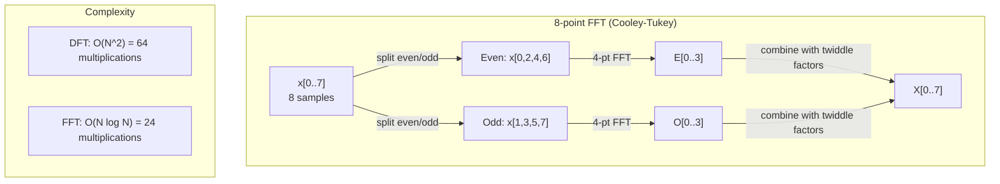
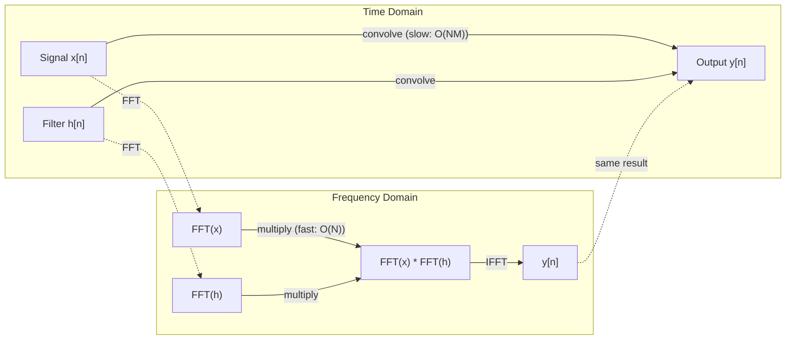

# फ़ूरियर परिवर्तन

> प्रत्येक संकेत सिनेस तरंगों का योग है. फ़ूरियर परिवर्तन आपको बताता है कि कौन से हैं.

**Type:** Build
**Language:**पायथन
**Prerequisites:** Phase 1, Lessons 01-04, 19 (complex numbers)
**Time:** ~90 minutes

## सीखने के लक्ष्य

- DFT को खरोंच से लागू करें और इसे $O(N \log N)$कुली-टुकई एफएफटी
- आवृत्ति गुणांक की व्याख्या करेंः संकेत से amplitude, phase, and power spectrum निकालें
- FFT गुणन के माध्यम से संभलण करने के लिए संभलण प्रमेय को लागू करें
- ट्रांसफार्मर स्थिति एन्कोडिंग और सीएनएन संवर्धन परतों के लिए फ़्यूरियर आवृत्ति विघटन कनेक्ट करें

## समस्या

ऑडियो रिकॉर्डिंग समय के साथ दबाव माप का एक अनुक्रम है। स्टॉक मूल्य दिनों के दौरान मानों का एक अनुक्रम है। एक छवि अंतरिक्ष पर पिक्सेल तीव्रता की एक ग्रिड है। ये सभी समय डोमेन (या अंतरिक्ष डोमेन) में डेटा हैं। आप कुछ सूचकांक के साथ मान बदलते देखते हैं।

लेकिन समय क्षेत्र में कई पैटर्न अदृश्य हैं। क्या यह ऑडियो सिग्नल एक शुद्ध स्वर या एक स्वर है? क्या इस शेयर मूल्य में एक साप्ताहिक चक्र है? क्या इस छवि में दोहराया जाने वाला बनावट है? ये प्रश्न आवृत्ति सामग्री के बारे में हैं, और समय क्षेत्र इसे छिपाता है।

फ़ूरियर परिवर्तन समय क्षेत्र से डेटा को आवृत्ति क्षेत्र में परिवर्तित करता है। यह एक संकेत लेता है और इसे विभिन्न आवृत्तियों की सिनेस तरंगों में विघटित करता है। प्रत्येक सिनेस तरंग में एक परिमाण (यह कितना मजबूत है) और एक चरण (जहां यह शुरू होता है) होता है। फ़ूरियर परिवर्तन आपको दोनों बताता है।

यह एमएल के लिए मायने रखता है क्योंकि आवृत्ति-क्षेत्र सोच हर जगह दिखाई देती है। संकुचन तंत्रिका नेटवर्क संकुचन करते हैं, जो आवृत्ति क्षेत्र में गुणा है। ट्रांसफार्मर स्थिति कोडिंग स्थिति को दर्शाने के लिए आवृत्ति विघटन का उपयोग करती है। ऑडियो मॉडल (भाषण पहचान, संगीत उत्पादन) स्पेक्ट्रोग्राम पर काम करते हैं - ध्वनि की आवृत्ति प्रतिनिधित्व। समय श्रृंखला मॉडल आवधिक पैटर्न की तलाश करते हैं। फ़ूरियर परिवर्तन को समझना आपको इन सभी के साथ काम करने के लिए शब्दावली देता है।

## अवधारणा

### डीएफटी परिभाषा

दी गई $N$नमूने $x[0], x[1], \ldots, x[N-1]$, विशुद्ध फ़ूरियर परिवर्तन उत्पादन करता है $N$आवृत्ति गुणांक $X[0], X[1], \ldots, X[N-1]$:

```math
X[k] = \sum_{n=0}^{N-1} x[n] \, e^{-2\pi i k n/N} \qquad \text{for } k = 0, 1, \ldots, N-1
```

प्रत्येक $X[k]$यह एक जटिल संख्या है। इसका परिमाण$\lvert X[k] \rvert$आपको आवृत्ति की amplitude बताता है $k$. . . . . . . . . . . . . . . . . . . . . . . . . . . . . . . . . . . . . . . . . . . . . . . . . . . . . . . . . . . . . . . . . . . . . . . . . . . . . . . . . . . . . . . . . . . . . . . . . . . . . . . . . . . . . . . . . . . . . . . . . . . . . . . . . . . . . . . . . . . . . . . . . . . . . . . . . . . . . . . . . . . . . . . . . . . . . . . . . . . . . . . . . . . . . . . . . . . . . . . . . . . . . . . . . . . . . . . . . . . . . . . . . . . . . . . . . . . . . . . . . . . . . . . . . . . . . . . . . . . . . . . . . . . . . . . . . . . . . . . . . . . . . . . . . . . . . . . . . . . . . . . . . . . . . . . . . . . . . . . . . . . . . . . . . . . . . . . . . . . . . . . . . . . . . . . . . . . . . . . . . . . . . . . . . . . . . . . . . . . . . . . . . . . . . . . . . . . . . . . . . . . . . . . . . . . . . . . . . . . . . . . . . . . . . . . . . . . . . . . . . . . . . . . . . . . . . . . . . . . . . . . . . . . . . . . . . . . . . . . . . . . . . . . . . . . . . . . . . . . . . . . . . . . . . .$\angle X[k]$आपको उस आवृत्ति के चरण ऑफसेट बताता है।

मुख्य जानकारी:$e^{-2\pi i k n/N}$आवृत्ति पर घूर्णन करने वाला फासर है $k$. डीएफटी संकेत और प्रत्येक के बीच संबंध की गणना करता है $N$यदि संकेत में आवृत्ति पर ऊर्जा होती है$k$यदि नहीं, तो यह शून्य के करीब है।

### प्रत्येक गुणांक का अर्थ क्या है

**$X[0]$: the DC component.**यह सभी नमूनों का योग है -- औसत के समानुपातिक. यह संकेत की निरंतर (शून्य आवृत्ति) ऑफसेट का प्रतिनिधित्व करता है.

```math
X[0] = \sum_{n=0}^{N-1} x[n] \, e^0 = \text{sum of all samples}
```

**$X[k]$ for $1 \le k \le N/2$: positive frequencies.** $X[k]$आवृत्ति का प्रतिनिधित्व करता है $k$प्रति चक्र$N$नमूने। उच्चतर $k$उच्च आवृत्ति (अति तेज़ घर्षण) का अर्थ है।

**$X[N/2]$: the Nyquist frequency.**उच्चतम आवृत्ति आप प्रतिनिधित्व कर सकते हैं के साथ $N$इस के ऊपर, आप उपनाम प्राप्त करते हैं -- उच्च आवृत्तियों को कम के रूप में लुका।

**$X[k]$ for $N/2 < k < N$: negative frequencies.**वास्तविक मूल्य वाले संकेतों के लिए, $X[N-k] = \overline{X[k]}$नकारात्मक आवृत्तियों सकारात्मक आवृत्तियों की दर्पण छवियां हैं। यही कारण है कि उपयोगी जानकारी पहले में है।$N/2 + 1$गुणांक।

### उल्टा डीएफटी

उल्टा डीएफटी अपने आवृत्ति गुणांक से मूल संकेत को पुनः निर्माण करता हैः

```math
x[n] = \frac{1}{N} \sum_{k=0}^{N-1} X[k] \, e^{2\pi i k n/N} \qquad \text{for } n = 0, 1, \ldots, N-1
```

आगे की DFT से केवल अंतरः एक्सपोनेंट में संकेत सकारात्मक है (नकारात्मक नहीं), और वहाँ है $1/N$सामान्यीकरण कारक।

उल्टा डीएफटी सही पुनर्निर्माण है. कोई जानकारी नहीं खोई जाती है. आप समय डोमेन से आवृत्ति डोमेन और वापस बिना किसी त्रुटि के जा सकते हैं. डीएफटी आधार परिवर्तन है - यह एक अलग निर्देशांक प्रणाली में एक ही जानकारी को फिर से व्यक्त करता है.

### FFT: इसे तेज करना

ऊपर परिभाषित DFT $O(N^2)$: प्रत्येक के लिए $N$आउटपुट गुणांक, आप योग $N$इनपुट नमूने।$N$= 1 मिलियन, यानी $10^{12}$संचालन।

फास्ट फ़ूरियर ट्रांसफॉर्म (एफएफटी)  में एक ही परिणाम की गणना करता है$O(N \log N)$. . के लिए .$N$= 1 मिलियन, जो एक ट्रिलियन के बजाय लगभग 20 मिलियन संचालन है. यह है कि आवृत्ति विश्लेषण व्यावहारिक बनाता है.

कोली-टुकई एल्गोरिथ्म (सबसे आम एफएफटी) विभाजित और जीतकर काम करता हैः

1. सिग्नल को सम अनुक्रमित और विषम अनुक्रमित नमूनों में विभाजित करें।
2. प्रत्येक आधे की DFT की पुनरावर्ती गणना करें।
3. "विंडल फैक्टर" का उपयोग करके दो अर्ध-आकार के डीएफटी को मिलाएं $e^{-2\pi i k/N}$. .

```math
\begin{aligned}
X[k] &= E[k] + e^{-2\pi i k/N} \, O[k] && \text{for } k = 0, \ldots, N/2 - 1 \\
X[k + N/2] &= E[k] - e^{-2\pi i k/N} \, O[k] && \text{for } k = 0, \ldots, N/2 - 1 \\[6pt]
\text{where } E &= \text{DFT of even-indexed samples} \\
O &= \text{DFT of odd-indexed samples}
\end{aligned}
```

सममितता का अर्थ है कि प्रत्येक स्तर के पुनरावृत्ति करता है $O(N)$काम, और वहाँ हैं $\log_2(N)$स्तर। कुलः $O(N \log N)$. .



एफएफटी के लिए संकेत की लंबाई 2 की शक्ति होनी चाहिए। व्यवहार में, संकेतों को 2 की अगली शक्ति के लिए शून्य-पैड किया जाता है।

### स्पेक्ट्रम विश्लेषण

**power spectrum**है $\lvert X[k] \rvert^2$-- प्रत्येक आवृत्ति गुणांक का वर्ग आयाम. यह दर्शाता है कि प्रत्येक आवृत्ति पर कितना ऊर्जा है.

**phase spectrum**है $\angle X[k]$अधिकांश विश्लेषण कार्यों के लिए, आप बिजली स्पेक्ट्रम की परवाह करते हैं और चरण को अनदेखा करते हैं।

```math
\begin{aligned}
\text{Power at frequency } k: \quad P[k] &= |X[k]|^2 = \mathop{\mathrm{Re}}(X[k])^2 + \mathop{\mathrm{Im}}(X[k])^2 \\
\text{Phase at frequency } k: \quad \phi[k] &= \mathop{\mathrm{atan2}}(\mathop{\mathrm{Im}}(X[k]), \mathop{\mathrm{Re}}(X[k]))
\end{aligned}
```

### आवृत्ति संकल्प

डीएफटी का आवृत्ति संकल्प नमूने की संख्या पर निर्भर करता है $N$और नमूना लेने की दर $f_s$. .

```math
\begin{aligned}
\text{Frequency of bin } k: \quad & f_k = k \cdot f_s / N \\
\text{Frequency resolution:} \quad & \Delta f = f_s / N \\
\text{Maximum frequency:} \quad & f_{\max} = f_s / 2 \quad \text{(Nyquist)}
\end{aligned}
```

दो आवृत्तियों को हल करने के लिए जो एक दूसरे के करीब हैं, आपको अधिक नमूनों की आवश्यकता है। उच्च आवृत्तियों को पकड़ने के लिए, आपको उच्च नमूनाकरण दर की आवश्यकता है।

### संकुचन प्रमेय

यह सिग्नल प्रसंस्करण में सबसे महत्वपूर्ण परिणामों में से एक है और सीएनएन के लिए सीधे प्रासंगिक है।

**Convolution in the time domain equals pointwise multiplication in the frequency domain.**

```math
\begin{aligned}
& x * h = \text{IFFT}(\text{FFT}(x) \cdot \text{FFT}(h)) \\[4pt]
& \text{where } * \text{ is convolution and } \cdot \text{ is element-wise multiplication}
\end{aligned}
```

यह क्यों मायने रखता हैः

- लम्बाई के दो संकेतों का सीधा घुमाव $N$और $M$लेता है$O(NM)$संचालन।
- एफएफटी आधारित संभलण लेता है $O(N \log N)$: दोनों को बदल दें, गुणा करें, वापस बदल दें।
- बड़े कर्नल के लिए, एफएफटी संकुचन नाटकीय रूप से तेज़ है।
- यह ठीक वही है जो बड़े रिसेप्टिव फील्ड के साथ घुमावदार परतों में होता है।

नोटः डीएफटी परिपत्र घुमाव की गणना करता है (सिग्नल घुमाव की तरह घुमाव) रैखिक घुमाव के लिए (कोई घुमाव नहीं), शून्य पैड दोनों संकेतों की लंबाई तक $N + M - 1$कम्प्यूटिंग से पहले।



### खिड़की

डीएफटी का मानना है कि संकेत आवधिक है - यह $N$यदि संकेत एक ही मान पर शुरू और समाप्त नहीं होता है, तो यह सीमा पर एक विरामचिह्न पैदा करता है, जो उच्च आवृत्ति सामग्री के रूप में दिखाई देता है। इसे स्पेक्ट्रल लीक कहा जाता है।

विंडोइंग डीएफटी की गणना से पहले दोनों छोरों पर सिग्नल को शून्य तक कम करके रिसाव को कम करता है।

सामान्य खिड़कियांः

| Window | Shape | Main lobe width | Side lobe level | Use case |
|--------|-------|----------------|-----------------|----------|
| Rectangular | Flat (no window) | Narrowest | Highest (-13 dB) | When signal is exactly periodic in N samples |
| Hann | Raised cosine | Moderate | Low (-31 dB) | General purpose spectral analysis |
| Hamming | Modified cosine | Moderate | Lower (-42 dB) | Audio processing, speech analysis |
| Blackman | Triple cosine | Wide | Very low (-58 dB) | When side lobe suppression is critical |

```math
\begin{aligned}
\text{Hann window:} \quad & w[n] = 0.5 \left(1 - \cos\frac{2\pi n}{N-1}\right) \\
\text{Hamming window:} \quad & w[n] = 0.54 - 0.46 \cos\frac{2\pi n}{N-1}
\end{aligned}
```

DFT से पहले के संकेत के साथ तत्व-wise गुणा करके विंडो को लागू करेंः `X = DFT(x * w)`. .

### डीएफटी गुण

| Property | Time Domain | Frequency Domain |
|----------|-------------|-----------------|
| Linearity | $ax + by$ | $aX + bY$ |
| Time shift | $x[n - k]$ | $X[f] e^{-2\pi i f k/N}$ |
| Frequency shift | $x[n] e^{2\pi i f_0 n/N}$ | $X[f - f_0]$ |
| Convolution | $x * h$ | $X \cdot H$ (pointwise) |
| Multiplication | $x \cdot h$ (pointwise) | $X * H$ (circular convolution, scaled by $1/N$) |
| Parseval's theorem | $\sum \lvert x[n] \rvert^2$ | $\frac{1}{N} \sum \lvert X[k] \rvert^2$ |
| Conjugate symmetry (real input) | $x[n]$ real | $X[k] = \overline{X[N-k]}$ |

पार्सेवल का प्रमेय कहता है कि दोनों क्षेत्रों में कुल ऊर्जा समान है। ऊर्जा परिवर्तन के माध्यम से संरक्षित होती है।

### स्थिति कोडिंग से कनेक्शन

मूल ट्रांसफार्मर sinusidal स्थिति एन्कोडिंग का उपयोग करता हैः

```math
\begin{aligned}
PE(pos, 2i) &= \sin\left(pos / 10000^{2i/d_{\text{model}}}\right) \\
PE(pos, 2i+1) &= \cos\left(pos / 10000^{2i/d_{\text{model}}}\right)
\end{aligned}
```

प्रत्येक आयाम जोड़ी $(2i, 2i+1)$यह एक अलग आवृत्ति पर टहलता है। आवृत्तियों को ज्यामितीय रूप से उच्च (आयामी 0.1) से कम (अंतिम आयाम) तक रखा गया है। यह प्रत्येक स्थिति को सभी आवृत्ति बैंड में एक अद्वितीय पैटर्न देता है - जैसा कि फ़ूरियर गुणांक एक संकेत को अद्वितीय रूप से पहचानते हैं।

इसमें उपलब्ध प्रमुख गुण हैंः

- **Uniqueness:**कोई दो स्थानों एक ही एन्कोडिंग है.
- **Bounded values:**पाप और पाप हमेशा में हैं $[-1, 1]$. .
- **Relative position:**स्थिति कोडिंग $p+k$स्थिति पर एन्कोडिंग के रैखिक फ़ंक्शन के रूप में व्यक्त किया जा सकता है $p$. मॉडल सापेक्ष पदों पर ध्यान देना सीख सकता है.

### सीएनएन से संबंध

एक संभलण परत सिग्नल या छवि के माध्यम से स्लाइड करके इनपुट पर एक सीखा गया फ़िल्टर (कर्नेल) लागू करती है। गणितीय रूप से, यह संभलण ऑपरेशन है।

संकुचन प्रमेय के अनुसार, यह निम्न के बराबर हैः
1. FFT इनपुट
2. FFT नाभिक
3. आवृत्ति क्षेत्र में गुणा करें
4. परिणाम

मानक सीएनएन कार्यान्वयन प्रत्यक्ष संरेखण (छोटे 3x3 कर्नल के लिए तेज़) का उपयोग करते हैं। लेकिन बड़े कर्नल या वैश्विक संरेखण के लिए, एफएफटी-आधारित दृष्टिकोण काफी तेज़ हैं। कुछ वास्तुकला (जैसे एफएनट) पूरी तरह से एफएफटी के साथ ध्यान को बदल देती हैं, जिससे प्रतिस्पर्धी सटीकता प्राप्त होती है।$O(N \log N)$इसके बजाय $O(N^2)$जटिलता।

### स्पेक्ट्रोग्राम और अल्पकालिक फ़ूरियर परिवर्तन

एक एकल एफएफटी आपको पूरे सिग्नल की आवृत्ति सामग्री देता है, लेकिन आपको यह नहीं बताता कि वे आवृत्तियां कब होती हैं। एक चिप (एक सिग्नल जिसकी आवृत्ति समय के साथ बढ़ जाती है) और एक कॉर्ड (सभी आवृत्तियां एक साथ मौजूद हैं) में एक ही परिमाण स्पेक्ट्रम हो सकता है।

शॉर्ट-टाइम फ़ूरियर ट्रांसफॉर्म (STFT) इस समस्या को सिग्नल की ओवरलैप खिड़कियों पर एफएफटी की गणना करके हल करता है। परिणाम एक स्पेक्ट्रोग्राम हैः एक अक्ष पर समय और दूसरी पर आवृत्ति के साथ एक 2D प्रतिनिधित्व। प्रत्येक बिंदु पर तीव्रता उस समय उस आवृत्ति पर ऊर्जा को दर्शाता है।

```
STFT procedure:
1. Choose a window size (e.g., 1024 samples)
2. Choose a hop size (e.g., 256 samples -- 75% overlap)
3. For each window position:
   a. Extract the windowed segment
   b. Apply a Hann/Hamming window
   c. Compute FFT
   d. Store the magnitude spectrum as one column of the spectrogram
```

स्पेक्ट्रोग्राम ऑडियो एमएल मॉडल के लिए मानक इनपुट प्रतिनिधित्व हैं। भाषण पहचान मॉडल (विस्पर, डीप स्पीच) मेल-स्पेक्ट्रोग्राम पर काम करते हैं - मेल पैमाने पर मैप की गई आवृत्तियों के साथ स्पेक्ट्रोग्राम, जो मानव पिच धारणा से बेहतर मेल खाता है।

### उपनाम

यदि किसी सिग्नल में उच्चतर आवृत्तियां होती हैं $f_s/2$(निक्विस्ट आवृत्ति), दर पर नमूनाकरण $f_s$एक 90 हर्ट्ज संकेत 100 हर्ट्ज पर नमूना लिया है 10 हर्ट्ज संकेत के समान दिखता है. अकेले नमूने से उन्हें अलग करने का कोई तरीका नहीं है.

```
Example:
  True signal: 90 Hz sine wave
  Sampling rate: 100 Hz
  Apparent frequency: 100 - 90 = 10 Hz

  The samples from the 90 Hz signal at 100 Hz sampling rate
  are identical to the samples from a 10 Hz signal.
  No amount of math can recover the original 90 Hz.
```

इसीलिए एनालॉग-टू-डिजिटल कन्वर्टर्स में एंटी-एलिज़िंग फ़िल्टर शामिल हैं जो नमूना लेने से पहले नैक्विस्ट से ऊपर आवृत्तियों को हटा देते हैं। एमएल में, कुछ वास्तुकलाएं इसे एंटी-एलिज़िंग पूलिंग परतों के साथ संबोधित करती हैं।

### शून्य पैडिंग से रिज़ॉल्यूशन नहीं बढ़ता है

एक आम गलत धारणाः एफएफटी से पहले सिग्नल को शून्य पैडिंग से आवृत्ति रिज़ॉल्यूशन में सुधार होता है। यह नहीं करता है। शून्य पैडिंग मौजूदा आवृत्ति डिब्बे के बीच इंटरपोलेट करता है, जिससे आपको एक चिकनी दिखने वाला स्पेक्ट्रम मिलता है। लेकिन यह आवृत्ति विवरण का पता नहीं लगा सकता है जो मूल नमूनों में मौजूद नहीं था।

वास्तविक आवृत्ति संकल्प केवल अवलोकन समय पर निर्भर करता है $T = N / f_s$. दो आवृत्तियों को हल करने के लिए अलग $\Delta f$, आप कम से कम की जरूरत है$T = 1 / \Delta f$शून्य-पैडिंग की कोई मात्रा इस मौलिक सीमा को बदलती है।

```figure
fourier-synthesis
```

## इसे बनाओ

### चरण 1: खरोंच से डीएफटी

$O(N^2)$डीएफटी परिभाषा से सीधे तौर पर निहित है।

```python
import math

class Complex:
    ...

def dft(x):
    N = len(x)
    result = []
    for k in range(N):
        total = Complex(0, 0)
        for n in range(N):
            angle = -2 * math.pi * k * n / N
            w = Complex(math.cos(angle), math.sin(angle))
            xn = x[n] if isinstance(x[n], Complex) else Complex(x[n])
            total = total + xn * w
        result.append(total)
    return result
```

### चरण 2: उल्टा डीएफटी

समान संरचना, सकारात्मक गुणांक, विभाजित करें$N$. .

```python
def idft(X):
    N = len(X)
    result = []
    for n in range(N):
        total = Complex(0, 0)
        for k in range(N):
            angle = 2 * math.pi * k * n / N
            w = Complex(math.cos(angle), math.sin(angle))
            total = total + X[k] * w
        result.append(Complex(total.real / N, total.imag / N))
    return result
```

### चरण 3: एफएफटी (कौली-टुकई)

पुनरावर्ती FFT को 2 की लंबाई की शक्ति की आवश्यकता होती है। इसे समान और विषम, पुनरावर्ती में विभाजित करें, ट्विडल कारकों के साथ संयोजन करें।

```python
def fft(x):
    N = len(x)
    if N <= 1:
        return [x[0] if isinstance(x[0], Complex) else Complex(x[0])]
    if N % 2 != 0:
        return dft(x)

    even = fft([x[i] for i in range(0, N, 2)])
    odd = fft([x[i] for i in range(1, N, 2)])

    result = [Complex(0)] * N
    for k in range(N // 2):
        angle = -2 * math.pi * k / N
        twiddle = Complex(math.cos(angle), math.sin(angle))
        t = twiddle * odd[k]
        result[k] = even[k] + t
        result[k + N // 2] = even[k] - t
    return result
```

### चरण 4: स्पेक्ट्रम विश्लेषण सहायक

```python
def power_spectrum(X):
    return [xk.real ** 2 + xk.imag ** 2 for xk in X]

def convolve_fft(x, h):
    N = len(x) + len(h) - 1
    padded_N = 1
    while padded_N < N:
        padded_N *= 2

    x_padded = x + [0.0] * (padded_N - len(x))
    h_padded = h + [0.0] * (padded_N - len(h))

    X = fft(x_padded)
    H = fft(h_padded)

    Y = [xk * hk for xk, hk in zip(X, H)]

    y = idft(Y)
    return [y[n].real for n in range(N)]
```

## इसका प्रयोग करें

वास्तविक काम के लिए, numpy के FFT का उपयोग करें जो अत्यधिक अनुकूलित C पुस्तकालयों द्वारा समर्थित है।

```python
import numpy as np

signal = np.sin(2 * np.pi * 5 * np.arange(256) / 256)
spectrum = np.fft.fft(signal)
freqs = np.fft.fftfreq(256, d=1/256)

power = np.abs(spectrum) ** 2

positive_freqs = freqs[:len(freqs)//2]
positive_power = power[:len(power)//2]
```

खिड़की और अधिक उन्नत स्पेक्ट्रल विश्लेषण के लिएः

```python
from scipy.signal import windows, stft

window = windows.hann(256)
windowed = signal * window
spectrum = np.fft.fft(windowed)
```

संभल के लिएः

```python
from scipy.signal import fftconvolve

result = fftconvolve(signal, kernel, mode='full')
```

स्पेक्ट्रोग्राम के लिएः

```python
from scipy.signal import stft

frequencies, times, Zxx = stft(signal, fs=sample_rate, nperseg=256)
spectrogram = np.abs(Zxx) ** 2
```

स्पेक्ट्रोग्राम मैट्रिक्स का आकार (n_frequencies, n_time_frames) होता है। प्रत्येक स्तंभ एक समय विंडो पर पावर स्पेक्ट्रम होता है। यह वही है जो ऑडियो एमएल मॉडल इनपुट के रूप में खपत करते हैं।

## इसे भेजें

दौड़ें`code/fourier.py`उत्पन्न करने के लिए `outputs/prompt-spectral-analyzer.md`. .

## व्यायाम

1. **Pure tone identification.**एक अनाम आवृत्ति (1 से 50 हर्ट्ज के बीच) पर एक सिंगल सिग्नल सिग्नल बनाएं, जो 128 हर्ट्ज पर 1 सेकंड के लिए नमूना लिया जाए। आवृत्ति की पहचान करने के लिए अपने डीएफटी का उपयोग करें। उत्तर मैचों की जांच करें। अब मानक विचलन 0.5 के साथ गौशियन शोर जोड़ें और दोहराएं। शोर स्पेक्ट्रम को कैसे प्रभावित करता है?

2. **FFT vs DFT verification.**लंबाई 64 का यादृच्छिक संकेत उत्पन्न करें। दोनों डीएफटी ($O(N^2){}$) और FFT. यह सत्यापित करें कि सभी गुणांक 1e-10 के भीतर मेल खाते हैं। समय दोनों लंबाई 256, 512, 1024, और 2048 के संकेतों पर कार्य करता है। DFT समय के अनुपात को FFT समय के अनुपात में रेखांकित करें।

3. **Convolution theorem proof by example.**सिग्नल x = [1, 2, 3, 4, 0, 0, 0, 0] बनाएं और h = [1, 1, 1, 0, 0, 0, 0, 0] फ़िल्टर करें। उनके परिपत्र घुमाव को सीधे (निस्ट लूप) गणना करें। फिर इसे FFT (परिवर्तन, गुणा, उलट परिवर्तन) के माध्यम से गणना करें। परिणाम मिलान की जांच करें। अब शून्य-पैडिंग द्वारा रैखिक घुमाव को उचित रूप से करें।

4. **Windowing effects.**एक संकेत बनाएं जो 10 हर्ट्ज और 12 हर्ट्ज (बहुत करीब) पर दो सिनेस तरंगों का योग है। 1 सेकंड के लिए 128 हर्ट्ज पर नमूना लें। विंडो के बिना पावर स्पेक्ट्रम, हैन विंडो और हैमिंग विंडो की गणना करें। किस विंडो से दोनों शिखरों को अलग करना सबसे आसान है? क्यों?

5. **Positional encoding analysis.**d_model = 128 और max_pos = 512 के लिए sinusidal स्थिति एन्कोडिंग उत्पन्न करें। प्रत्येक स्थिति के लिए $(p_1, p_2)$, अपने एन्कोडिंग के डॉट उत्पाद की गणना करें। दिखाएं कि डॉट उत्पाद केवल पर निर्भर करता है$\lvert p_1 - p_2 \rvert$बिंदुओं के गुण के साथ क्या होता है दूरी बढ़ता है?

### संकेत

**Exercise 1.**1 सेकंड में 128 नमूनों के साथ,$k$है $k$Hz, तो एक पूर्णांक आवृत्ति के लिए 1 से 63 तक के डिब्बे में सबसे बड़ा मूल्य का सूचकांक आवृत्ति है। हर्ट्ज की एक पूर्णांक संख्या चुनें। दो डिब्बे के बीच एक आवृत्ति अपने पड़ोसियों में फैलती है, और शिखर केवल निकटतम डिब्बे देता है। उपयोग `generate_signal`और `magnitude_spectrum`शोर जोड़ने के बाद, जांचें कि शिखर अभी भी एक ही कचरे पर है जबकि अन्य कचरे बढ़ते हैं।

**Exercise 2.**दो लंबाई की शक्ति का उपयोग करें, क्योंकि `fft`सिग्नल को आधे में विभाजित करता है. जांचें.`max(abs(a - b))`समय अनुपात लगभग $N / \log_2 N$. .

**Exercise 3.**परिपत्र घुमाव के लिए, गणना करें $y[n] = \sum_k h[k] x[(n-k) \bmod 8]$$n$= 0, 1 और 2, और  के पहले तीन मानों की तुलना करें`convolve_direct`और `convolve_fft`. रैखिक घुमाव की लंबाई 4 + 3 - 1 = 6 है, इसलिए पहले जांचें कि क्या लंबाई 8 पहले से ही पर्याप्त है।

**Exercise 4.**उपयोग करें`hann_window`,`hamming_window`,`apply_window`और `power_spectrum`10 Hz और 12 Hz दोनों ही 1 सेकंड में पूरे चक्र पूरा करते हैं, इसलिए कोई भी खिड़की सबसे अच्छी लग सकती है। 10.5 Hz और 12.5 Hz के साथ दोहराएं ताकि खिड़कियों को कम करने वाले रिसाव को देखा जा सके।

**Exercise 5.**प्रत्येक एन्कोडिंग को गणना करें `positional_encoding(pos, 128)`. पदों के लिए बिंदु गुणक (0, 10) की तुलना (100, 110) के लिए बिंदु गुणक के साथ करेंः दोनों मानों को लगभग 1e-10 के साथ मेल खाना चाहिए।$\lvert p_1 - p_2 \rvert$एक निश्चित के लिए $p_1$. .

## प्रमुख शर्तें

| Term | What it means |
|------|---------------|
| DFT (Discrete Fourier Transform) | Converts $N$ time-domain samples into $N$ frequency-domain coefficients. Each coefficient is the correlation with a complex sinusoid at that frequency |
| FFT (Fast Fourier Transform) | An $O(N \log N)$ algorithm to compute the DFT. The Cooley-Tukey algorithm splits even/odd indices recursively |
| Inverse DFT | Reconstructs the time-domain signal from frequency coefficients. Same formula as DFT with flipped exponent sign and $1/N$ scaling |
| Frequency bin | Each index $k$ in the DFT output represents frequency $k f_s/N$ Hz. The "bin" is the discrete frequency slot |
| DC component | $X[0]$, the zero-frequency coefficient. Proportional to the signal mean |
| Nyquist frequency | $f_s/2$, the maximum frequency representable at sampling rate $f_s$. Frequencies above this alias |
| Power spectrum | $\lvert X[k] \rvert^2$, the squared magnitude of each frequency coefficient. Shows energy distribution across frequencies |
| Phase spectrum | $\angle X[k]$, the phase offset of each frequency component. Often ignored in analysis |
| Spectral leakage | Spurious frequency content caused by treating a non-periodic signal as periodic. Reduced by windowing |
| Window function | A tapering function (Hann, Hamming, Blackman) applied before DFT to reduce spectral leakage |
| Twiddle factor | The complex exponential $e^{-2\pi i k/N}$ used to combine sub-DFTs in the FFT butterfly computation |
| Convolution theorem | Convolution in time domain equals pointwise multiplication in frequency domain. Fundamental to signal processing and CNNs |
| Circular convolution | Convolution where the signal wraps around. This is what the DFT naturally computes |
| Linear convolution | Standard convolution without wraparound. Achieved by zero-padding before DFT |
| Parseval's theorem | Total energy is preserved through the Fourier transform. $\sum \lvert x[n] \rvert^2 = \frac{1}{N} \sum \lvert X[k] \rvert^2$ |
| Aliasing | When frequencies above Nyquist appear as lower frequencies due to insufficient sampling rate |

## आगे पढ़ना

- [Cooley & Tukey: An Algorithm for the Machine Calculation of Complex Fourier Series (1965)](https://www.ams.org/journals/mcom/1965-19-090/S0025-5718-1965-0178586-1/)- मूल एफएफटी पेपर जो कंप्यूटिंग को बदलता है
- [3Blue1Brown: But what is the Fourier Transform?](https://www.youtube.com/watch?v=spUNpyF58BY)- फ़ूरियर परिवर्तनों का सबसे अच्छा दृश्य परिचय
- [Lee-Thorp et al.: FNet: Mixing Tokens with Fourier Transforms (2021)](https://arxiv.org/abs/2105.03824)- ट्रांसफार्मर में FFT से स्व-विचार की जगह लेता है
- [Smith: The Scientist and Engineer's Guide to Digital Signal Processing](http://www.dspguide.com/)- एफएफटी, विंडोइंग और स्पेक्ट्रल एनालिसिस को गहराई से कवर करने वाली मुफ्त ऑनलाइन पाठ्यपुस्तक
- [Vaswani et al.: Attention Is All You Need (2017)](https://arxiv.org/abs/1706.03762)- फोरेयर आवृत्ति विघटन से प्राप्त सिनोसोइडल स्थिति कोड
- [Radford et al.: Whisper (2022)](https://arxiv.org/abs/2212.04356)- इनपुट प्रतिनिधित्व के रूप में मेल-स्पेक्ट्रोग्राम का उपयोग करके भाषण पहचान
