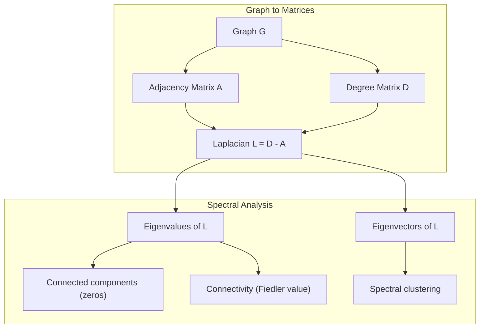
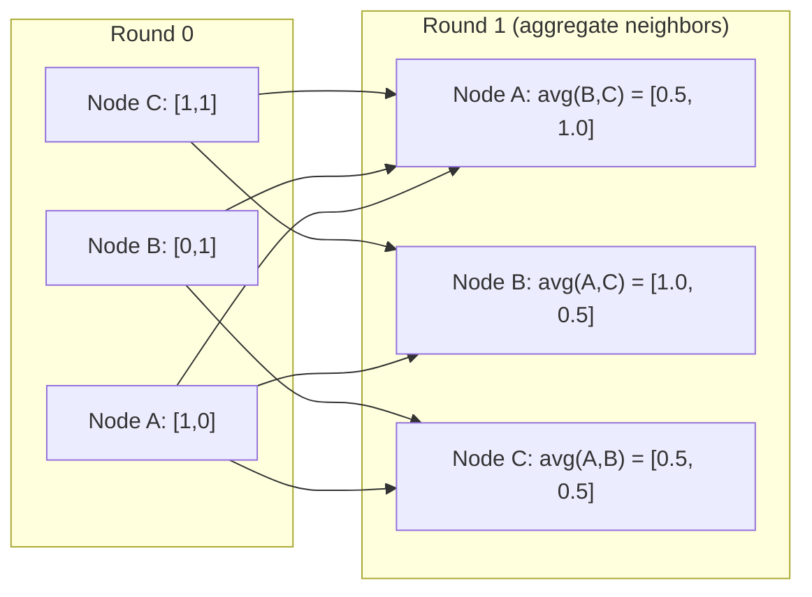

# मशीन लर्निंग के लिए ग्राफ थ्योरी

> ग्राफ संबंध के डेटा संरचना है. यदि आपके डेटा में कनेक्शन हैं, तो आपको ग्राफ सिद्धांत की आवश्यकता है.

**Type:** Build
**Language:**पायथन
**Prerequisites:** Phase 1, Lessons 01-03 (linear algebra, matrices)
**Time:** ~90 minutes

## सीखने के लक्ष्य

- आसन्नता मैट्रिक्स/सूची प्रतिनिधित्वों के साथ एक ग्राफ वर्ग का निर्माण करें और BFS और DFS पार करना लागू करें
- ग्राफ लैप्लाशियन की गणना करें और जुड़े घटकों और क्लस्टर नोड्स का पता लगाने के लिए इसके स्व-मूल्यों का उपयोग करें
- एक राउंड GNN शैली संदेश को एक सामान्यीकृत आसन्नता मैट्रिक्स गुणा के रूप में पारित करना
- फिडलर वेक्टर का उपयोग करके ग्राफ को विभाजन करने के लिए स्पेक्ट्रल क्लस्टरिंग लागू करें

## समस्या

सामाजिक नेटवर्क, अणु, ज्ञान आधार, उद्धरण नेटवर्क, रोड मैप - ये सभी ग्राफ हैं. पारंपरिक एमएल डेटा को सपाट तालिकाओं के रूप में व्यवहार करता है. प्रत्येक पंक्ति स्वतंत्र है. प्रत्येक विशेषता एक स्तंभ है. लेकिन जब कनेक्शन की संरचना महत्वपूर्ण है, तालिकाएं विफल हो जाती हैं.

एक सामाजिक नेटवर्क पर विचार करें. आप यह अनुमान लगाना चाहते हैं कि एक उपयोगकर्ता किस उत्पाद को खरीदता है। उनके खरीद इतिहास मायने रखता है। लेकिन उनके दोस्तों के खरीद इतिहास अधिक मायने रखता है। कनेक्शन संकेत ले जाते हैं।

या एक अणु पर विचार करें. आप यह अनुमान लगाना चाहते हैं कि क्या यह एक प्रोटीन से बंधेगा। परमाणु महत्वपूर्ण हैं, लेकिन वास्तव में मायने रखता है कि परमाणु एक दूसरे से कैसे बंधे हैं। संरचना डेटा है।

ग्राफ न्यूरल नेटवर्क (GNN) गहन सीखने में सबसे तेजी से बढ़ते क्षेत्र हैं। वे दवा खोज, सामाजिक सिफारिश, धोखाधड़ी का पता लगाने और ज्ञान ग्राफ तर्क को संचालित करते हैं। प्रत्येक GNN एक ही नींव पर बना हैः बुनियादी ग्राफ सिद्धांत।

आपको चार चीजों की जरूरत हैः
1. एक तरीका है मैट्रिक्स के रूप में ग्राफ को प्रतिनिधित्व करने के लिए (तो आप उन्हें गुणा कर सकते हैं)
2. ग्राफ संरचना की खोज के लिए पारगमन एल्गोरिदम
3. लैप्लाशियन -- स्पेक्ट्रल ग्राफ सिद्धांत में सबसे महत्वपूर्ण एकल मैट्रिक्स
4. संदेश पारित करना - GNNs को काम करने का कार्य

## अवधारणा

### ग्राफः नोड्स और एज

एक ग्राफ $G = (V, E)$शिखरों (नोड्स) से बना होता है $V$और किनारों $E$प्रत्येक किनारे दो नोड्स को जोड़ता है।

**Directed vs undirected.**एक अप्रयुक्त ग्राफ में, किनारा $(u, v)$अर्थ$u$ से जुड़ता है$v$और $v$ से जुड़ता है$u$. एक निर्देशित ग्राफ (डिग्राफ), किनारा $(u, v)$अर्थ$u$$v$, लेकिन जरूरी नहीं कि इसके विपरीत।

**Weighted vs unweighted.**एक अनवज़न वाले ग्राफ में, किनारे या तो मौजूद हैं या नहीं। एक वज़न वाले ग्राफ में, प्रत्येक किनारे का एक संख्यात्मक वजन होता है - दूरी, लागत, ताकत।

| Graph type | Example |
|-----------|---------|
| Undirected, unweighted | Facebook friendship network |
| Directed, unweighted | Twitter follow network |
| Undirected, weighted | Road map (distances) |
| Directed, weighted | Web page links (PageRank scores) |

### निकटता मैट्रिक्स

आसन्नता मैट्रिक्स $A$के साथ एक ग्राफ के लिए $n$नोड्सः

```math
A[i][j] = \begin{cases} 1 & \text{if there is an edge from node } i \text{ to node } j \\ 0 & \text{otherwise} \end{cases}
```

अननिर्देशित ग्राफ के लिए, $A$सममित है: $A[i][j] = A[j][i]$. वजन वाले ग्राफ के लिए, $A[i][j]$= किनारे का वजन $(i, j)$. .

**Example -- a triangle:**

```
Nodes: 0, 1, 2
Edges: (0,1), (1,2), (0,2)

A = [[0, 1, 1],
     [1, 0, 1],
     [1, 1, 0]]
```

आसन्नता मैट्रिक्स प्रत्येक GNN के लिए इनपुट है।$A$ग्राफ पर संचालन के अनुरूप है।

### डिग्री

नोड की डिग्री उस से जुड़ी किनारों की संख्या है। निर्देशित ग्राफ के लिए, आपके पास डिग्री (आने वाले किनारे) और डिग्री (बहे जाने वाले किनारे) हैं।

डिग्री मैट्रिक्स $D$विभक्ति है

```math
\begin{aligned}
D[i][i] &= \text{degree of node } i \\
D[i][j] &= 0 \quad \text{for } i \ne j
\end{aligned}
```

त्रिकोण उदाहरण के लिएः $D = \mathop{\mathrm{diag}}(2, 2, 2)$क्योंकि प्रत्येक नोड दो अन्य से कनेक्ट होता है।

डिग्री आपको नोड महत्व के बारे में बताती है। उच्च डिग्री = हब नोड। नेटवर्क का डिग्री वितरण इसकी संरचना का पता चलता है। सामाजिक नेटवर्क बिजली के नियमों का पालन करते हैं (कुछ हब, कई पत्ते के नोड) । यादृच्छिक ग्राफ में पोज़न-वितरित डिग्री होती है।

### बीएफएस और डीएफएस

दो बुनियादी ग्राफ क्रॉसिंग एल्गोरिदम. आपको दोनों की जरूरत है.

**Breadth-First Search (BFS):**पहले सभी पड़ोसियों की खोज करें, फिर पड़ोसियों के पड़ोसियों का उपयोग करें।

```
BFS from node 0:
  Visit 0
  Queue: [1, 2]        (neighbors of 0)
  Visit 1
  Queue: [2, 3]        (add neighbors of 1)
  Visit 2
  Queue: [3]           (neighbors of 2 already visited)
  Visit 3
  Queue: []            (done)
```

BFS अनवज़न वाले ग्राफ में सबसे छोटे पथ ढूंढता है। किसी भी नोड से शुरुआत से दूरी BFS स्तर के बराबर है जिस पर उस नोड को पहली बार खोजा गया है। यही कारण है कि BFS का उपयोग सामाजिक नेटवर्क में हॉप-कंट दूरी के लिए किया जाता है।

**Depth-First Search (DFS):**पीछे हटने से पहले जितना संभव हो उतना गहराई तक जाएं। एक स्टैक (LIFO) या पुनरावृत्ति का उपयोग करें।

```
DFS from node 0:
  Visit 0
  Stack: [1, 2]        (neighbors of 0)
  Visit 2               (pop from stack)
  Stack: [1, 3]         (add neighbors of 2)
  Visit 3               (pop from stack)
  Stack: [1]
  Visit 1               (pop from stack)
  Stack: []             (done)
```

डीएफएस निम्नलिखित के लिए उपयोगी हैः
- जुड़े घटकों को ढूंढना (अनिवारित नोड्स से DFS चलाएं)
- चक्र का पता लगाना (डीएफएस पेड़ में पीछे के किनारे)
- टोपोलॉजिकल सॉर्टिंग (डिफ़ॉल्ट डीएफएस फिनिश क्रम)

| Algorithm | Data structure | Finds | Use case |
|-----------|---------------|-------|----------|
| BFS | Queue | Shortest paths | Social network distance, knowledge graph traversal |
| DFS | Stack | Components, cycles | Connectivity, topological sort |

### ग्राफ लैप्लाशियन

$L = D - A$स्पेक्ट्रल ग्राफ सिद्धांत में सबसे महत्वपूर्ण मैट्रिक्स।

त्रिकोण के लिएः

```math
D = \begin{bmatrix} 2 & 0 & 0 \\ 0 & 2 & 0 \\ 0 & 0 & 2 \end{bmatrix} \qquad A = \begin{bmatrix} 0 & 1 & 1 \\ 1 & 0 & 1 \\ 1 & 1 & 0 \end{bmatrix} \qquad L = \begin{bmatrix} 2 & -1 & -1 \\ -1 & 2 & -1 \\ -1 & -1 & 2 \end{bmatrix}
```

लैप्लाशियन में उल्लेखनीय गुण हैंः

1. **$L$ is positive semi-definite.**सभी स्व-मूल्य हैं $\ge 0$. .

2. **The number of zero eigenvalues equals the number of connected components.**एक जुड़े हुए ग्राफ में एक शून्य स्वमूल्य है. 3 से जुड़े घटकों के साथ एक ग्राफ में तीन शून्य स्वमूल्य हैं.

3. **The smallest non-zero eigenvalue (Fiedler value) measures connectivity.**एक बड़ा Fiedler मान का मतलब है कि ग्राफ अच्छी तरह से जुड़ा हुआ है. एक छोटे Fiedler मान का मतलब है कि ग्राफ एक कमजोर बिंदु है - एक बोतल गला.

4. **The eigenvector of the Fiedler value (Fiedler vector) reveals the best split.**सकारात्मक मान वाले नोड्स एक समूह में जाते हैं, नकारात्मक मान वाले नोड्स दूसरे समूह में जाते हैं। यह स्पेक्ट्रल क्लस्टरिंग है।



### स्पेक्ट्रल गुण

आसन्नता मैट्रिक्स और लैप्लाशियन के स्व-मूल्य किसी भी पार के बिना संरचनात्मक गुण प्रकट करते हैं।

**Spectral clustering**इस तरह काम करता हैः
1. लैप्लाशियन की गणना करें $L$
2. $k$ के सबसे छोटे स्ववेक्टर$L$(पहले को छोड़ दें, जो जुड़े ग्राफ के लिए सभी-एक है)
3. प्रत्येक नोड के लिए नए निर्देशांक के रूप में उन स्वयं वेक्टरों का उपयोग करें
4. दौड़ें$k$- उन निर्देशांक पर अर्थ

यह काम क्यों करता है?$L$ग्राफ पर "सबसे चिकनी" कार्यों को एन्कोड करें। अच्छी तरह से जुड़े नोड्स को समान स्वयं वेक्टर मान प्राप्त होते हैं। एक बोतल गला से अलग नोड्स को अलग-अलग मान प्राप्त होते हैं। स्वयं वेक्टर स्वाभाविक रूप से समूहों को अलग करते हैं।

**Random walk connection.**सामान्यीकृत लैप्लाशियन ग्राफ पर यादृच्छिक चलने से संबंधित है। यादृच्छिक चलने का स्थिर वितरण नोड डिग्री के समानुपातिक है। मिश्रण समय (चलाव कितनी तेजी से अभिसरण करता है) स्पेक्ट्रल अंतर पर निर्भर करता है।

### संदेश पारित करना

ग्राफ न्यूरल नेटवर्क का मूल कार्य। प्रत्येक नोड अपने पड़ोसियों से संदेश एकत्र करता है, उन्हें एकत्र करता है, और अपनी स्थिति को अपडेट करता है।

```math
h_v^{(k+1)} = \text{UPDATE}\left(h_v^{(k)}, \text{AGGREGATE}\left(\{h_u^{(k)} : u \in \text{neighbors}(v)\}\right)\right)
```

सरलतम रूप में, एग्रीगेट = औसत, और अपडेट = रैखिक परिवर्तन + सक्रियणः

```math
h_v^{(k+1)} = \sigma\left(W \cdot \text{mean}\left(\{h_u^{(k)} : u \in \text{neighbors}(v)\}\right)\right)
```

यह एक मैट्रिक्स गुणा है जो लुका हुआ है।$H$सभी नोड सुविधाओं की मैट्रिक्स है और $A$निकटता मैट्रिक्स हैः

```math
H^{(k+1)} = \sigma\left(A_{\text{norm}} H^{(k)} W\right)
```

कहाँ$A_{\text{norm}}$सामान्यीकृत आसन्नता मैट्रिक्स (प्रत्येक पंक्ति 1 तक योग है) है।

संदेश के एक दौर के माध्यम से प्रत्येक नोड को अपने निकटतम पड़ोसियों को "देखने" देता है। दो दौर उसे पड़ोसियों के पड़ोसियों को देखने देते हैं। $K$राउंड्स प्रत्येक नोड को अपनी $K$-हॉप पड़ोस.



### अवधारणाएँ और एमएल अनुप्रयोग

| Concept | ML Application |
|---------|---------------|
| Adjacency matrix | GNN input representation |
| Graph Laplacian | Spectral clustering, community detection |
| BFS/DFS | Knowledge graph traversal, path finding |
| Degree distribution | Node importance, feature engineering |
| Message passing | GNN layers (GCN, GAT, GraphSAGE) |
| Eigenvalues of L | Community detection, graph partitioning |
| Spectral clustering | Unsupervised node grouping |
| PageRank | Node importance, web search |

```figure
graph-degree-distribution
```

## इसे बनाओ

### चरण 1: ग्राफ क्लास खरोंच से

```python
class Graph:
    def __init__(self, n_nodes, directed=False):
        self.n = n_nodes
        self.directed = directed
        self.adj = {i: {} for i in range(n_nodes)}

    def add_edge(self, u, v, weight=1.0):
        self.adj[u][v] = weight
        if not self.directed:
            self.adj[v][u] = weight

    def neighbors(self, node):
        return list(self.adj[node].keys())

    def degree(self, node):
        return len(self.adj[node])

    def adjacency_matrix(self):
        import numpy as np
        A = np.zeros((self.n, self.n))
        for u in range(self.n):
            for v, w in self.adj[u].items():
                A[u][v] = w
        return A

    def degree_matrix(self):
        import numpy as np
        D = np.zeros((self.n, self.n))
        for i in range(self.n):
            D[i][i] = self.degree(i)
        return D

    def laplacian(self):
        return self.degree_matrix() - self.adjacency_matrix()
```

आसन्नता सूची (`self.adj`आसन्नता मैट्रिक्स रूपांतरण में नम्पी का उपयोग किया जाता है क्योंकि सभी स्पेक्ट्रल ऑपरेशनों को इसकी आवश्यकता होती है।

### चरण 2: बीएफएस और डीएफएस

```python
from collections import deque

def bfs(graph, start):
    visited = set()
    order = []
    distances = {}
    queue = deque([(start, 0)])
    visited.add(start)
    while queue:
        node, dist = queue.popleft()
        order.append(node)
        distances[node] = dist
        for neighbor in graph.neighbors(node):
            if neighbor not in visited:
                visited.add(neighbor)
                queue.append((neighbor, dist + 1))
    return order, distances


def dfs(graph, start):
    visited = set()
    order = []
    stack = [start]
    while stack:
        node = stack.pop()
        if node in visited:
            continue
        visited.add(node)
        order.append(node)
        for neighbor in reversed(graph.neighbors(node)):
            if neighbor not in visited:
                stack.append(neighbor)
    return order
```

बीएफएस एक डेक (डबल-एंड कतार) का उपयोग करता है $O(1)$DFS एक सूची को एक स्टैक के रूप में उपयोग करता है. दोनों प्रत्येक नोड पर एक बार ठीक से जाएँ -$O(V + E)$समय।

### चरण 3: जुड़े घटक और लैप्लाशियन स्वमूल्य

```python
def connected_components(graph):
    visited = set()
    components = []
    for node in range(graph.n):
        if node not in visited:
            order, _ = bfs(graph, node)
            visited.update(order)
            components.append(order)
    return components


def laplacian_eigenvalues(graph):
    import numpy as np
    L = graph.laplacian()
    eigenvalues = np.linalg.eigvalsh(L)
    return eigenvalues
```

`eigvalsh`यह सममित मैट्रिक्स के लिए है - लैप्लाशियन हमेशा निर्देशन ग्राफ के लिए सममित है. यह बढ़ते क्रम में स्वमान वापस करता है. जुड़ा घटकों की संख्या खोजने के लिए शून्य गिनें.

### चरण 4: स्पेक्ट्रल क्लस्टरिंग

```python
def spectral_clustering(graph, k=2):
    import numpy as np
    L = graph.laplacian()
    eigenvalues, eigenvectors = np.linalg.eigh(L)
    features = eigenvectors[:, 1:k+1]

    labels = np.zeros(graph.n, dtype=int)
    for i in range(graph.n):
        if features[i, 0] >= 0:
            labels[i] = 0
        else:
            labels[i] = 1
    return labels
```

के लिए$k=2$, फिडलर वेक्टर के संकेत को दो क्लस्टर में विभाजित करता है।$k>2$, आप भाग जाएगा$k$-पहले पर मतलब है $k$स्व-वेक्टर (सहानगर सभी-एक स्व-वेक्टर को छोड़कर) ।

### चरण 5: संदेश पारित करना

```python
def message_passing(graph, features, weight_matrix):
    import numpy as np
    A = graph.adjacency_matrix()
    row_sums = A.sum(axis=1, keepdims=True)
    row_sums[row_sums == 0] = 1
    A_norm = A / row_sums
    aggregated = A_norm @ features
    output = aggregated @ weight_matrix
    return output
```

यह GNN संदेश पारित करने का एक दौर है। प्रत्येक नोड की नई विशेषताएं अपने पड़ोसी की विशेषताओं का वजन औसत हैं, जो वजन मैट्रिक्स द्वारा परिवर्तित होती हैं। जानकारी को आगे बढ़ाने के लिए कई राउंड स्टैक करें।

## इसका प्रयोग करें

नेटवर्कएक्स और नम्पई के साथ, समान ऑपरेशन एक पंक्ति के होते हैंः

```python
import networkx as nx
import numpy as np

G = nx.karate_club_graph()

A = nx.adjacency_matrix(G).toarray()
L = nx.laplacian_matrix(G).toarray()

eigenvalues = np.linalg.eigvalsh(L.astype(float))
print(f"Smallest eigenvalues: {eigenvalues[:5]}")
print(f"Connected components: {nx.number_connected_components(G)}")

communities = nx.community.greedy_modularity_communities(G)
print(f"Communities found: {len(communities)}")

pr = nx.pagerank(G)
top_nodes = sorted(pr.items(), key=lambda x: x[1], reverse=True)[:5]
print(f"Top 5 PageRank nodes: {top_nodes}")
```

networkx अनुकूलित सी बैकेंड के साथ किसी भी आकार के ग्राफ को संभालता है। इसे उत्पादन में उपयोग करें। यह क्या करता है समझने के लिए अपने खरोंच से कार्यान्वयन का उपयोग करें।

### नम्बिया स्पेक्ट्रल विश्लेषण

```python
import numpy as np

A = np.array([
    [0, 1, 1, 0, 0],
    [1, 0, 1, 0, 0],
    [1, 1, 0, 1, 0],
    [0, 0, 1, 0, 1],
    [0, 0, 0, 1, 0]
])

D = np.diag(A.sum(axis=1))
L = D - A

eigenvalues, eigenvectors = np.linalg.eigh(L)
print(f"Eigenvalues: {np.round(eigenvalues, 4)}")
print(f"Fiedler value: {eigenvalues[1]:.4f}")
print(f"Fiedler vector: {np.round(eigenvectors[:, 1], 4)}")

fiedler = eigenvectors[:, 1]
group_a = np.where(fiedler >= 0)[0]
group_b = np.where(fiedler < 0)[0]
print(f"Cluster A: {group_a}")
print(f"Cluster B: {group_b}")
```

फिडलर वेक्टर भारी भार उठाने का काम करता है. एक क्लस्टर में सकारात्मक प्रविष्टियाँ, दूसरे में नकारात्मक. कोई पुनरावर्ती अनुकूलन की आवश्यकता नहीं है - केवल एक स्वयं संरचना।

## इसे भेजें

इस पाठ से उत्पन्न होता हैः
- `outputs/skill-graph-analysis.md`-- ग्राफ-संरचित डेटा का विश्लेषण करने के लिए एक कौशल संदर्भ

## संबंध

| Concept | Where it shows up |
|---------|------------------|
| Adjacency matrix | GCN, GAT, GraphSAGE input |
| Laplacian | Spectral clustering, ChebNet filters |
| BFS | Knowledge graph traversal, shortest path queries |
| Message passing | Every GNN layer, neural message passing |
| Spectral gap | Graph connectivity, mixing time of random walks |
| Degree distribution | Power-law networks, node feature engineering |
| Connected components | Preprocessing, handling disconnected graphs |
| PageRank | Node importance ranking, attention initialization |

जीएनएन विशेष रूप से उल्लेख के योग्य हैं। जीएनएन में ग्राफ कन्वॉल्यूशन ऑपरेशन (किप और वेलिंग, 2017) में आसन्नता मैट्रिक्स का उपयोग स्वयं लूप्स के साथ किया जाता है।$\hat{A} = A + I$:

```math
H^{(l+1)} = \sigma\left(\hat{D}^{-1/2} \hat{A} \hat{D}^{-1/2} H^{(l)} W^{(l)}\right)
```

कहाँ$\hat{A} = A + I$(अडजेंस प्लस स्व-लूप) और $\hat{D}$ की डिग्री मैट्रिक्स है$\hat{A}$. स्वयं लूप सुनिश्चित प्रत्येक नोड एकत्रीकरण के दौरान अपने स्वयं के सुविधाओं को शामिल करता है। यह सही संदेश पार करने के साथ सममित सामान्यीकरण है। $\hat{D}^{-1/2} \hat{A} \hat{D}^{-1/2}$लैप्लाशियन दिखाई देता है क्योंकि यह सामान्यीकरण से संबंधित है$L_{\text{sym}} = I - D^{-1/2} A D^{-1/2}$लैप्लाशियन को समझना मतलब है कि जीसीएन क्यों काम करते हैं।

## व्यायाम

1. **Implement PageRank from scratch.**प्रत्येक चरण में: स्कोर(v) = (1-d) /n + d * योगफल(score(u) /out_degree(u)) सभी u के लिए v की ओर इशारा करते हुए। d=0.85 का उपयोग करें। अभिसरण (बदला < 1e-6) तक चलाएं। एक छोटे वेब ग्राफ पर परीक्षण करें।

2. **Find communities using spectral clustering.**दो स्पष्ट रूप से अलग समूहों (जैसे, एक ही किनारे से जुड़े दो क्लिक) के साथ एक ग्राफ बनाएं। स्पेक्ट्रल क्लस्टरिंग चलाएं और सत्यापित करें कि यह सही विभाजन पाता है। जब आप अधिक क्रॉस-क्लास्टर किनारे जोड़ते हैं तो क्या होता है?

3. **Implement Dijkstra's algorithm**समान भार वाले एक ही ग्राफ पर BFS के परिणामों की तुलना करें।

4. **Build a 2-layer message passing network.**संदेश को दो बार अलग-अलग वजन मैट्रिक्स के साथ पारित करना लागू करें। दिखाएं कि 2 राउंड के बाद, प्रत्येक नोड में अपने 2-हॉप पड़ोस से जानकारी है।

5. **Analyze a real-world graph.**कराटे क्लब ग्राफ (34 नोड्स, 78 किनारे) का उपयोग करें। डिग्री वितरण, लैप्लाशियन स्व-मूल्य और स्पेक्ट्रल क्लस्टरिंग की गणना करें। स्पेक्ट्रल क्लस्टरिंग परिणाम की तुलना ज्ञात ग्राउंड सत्य विभाजन से करें।

### संकेत

**Exercise 1.**अभ्यास से सूत्र का उपयोग करें। एक नोड के बिना आउटगोइंग किनारे सभी नोड के साथ अपने स्कोर को समान रूप से साझा करना चाहिए, या कुल 1 से नीचे गिर जाता है। जांचें कि प्रत्येक चरण के बाद स्कोर 1 तक जोड़ते हैं और अपने परिणाम की तुलना करें `pagerank(graph)`. .

**Exercise 2.**दो क्लिक का निर्माण करें `add_edge`, उन्हें एक किनारे से जोड़ें, और कॉल `spectral_clustering(graph, k=2)`. जाँच करें कि प्रत्येक क्लिक एक लेबल मिलता है. जब आप क्रॉस किनारे जोड़ते हैं, प्रिंट करने के लिए दूसरे सबसे छोटे स्वयं मूल्य के `laplacian()`, जो दोनों समूहों के जुड़ने के साथ बढ़ता है।

**Exercise 3.** के साथ प्राथमिकता कतार रखें`heapq`और हमेशा ज्ञात सबसे छोटी दूरी के साथ नोड का विस्तार करें। प्रत्येक वजन 1 बनाएं और जांचें कि प्रत्येक Dijkstra दूरी उस नोड की BFS परत के बराबर है`bfs(graph, start)`. .

**Exercise 4.**पहचान मैट्रिक्स का उपयोग `features`, ताकि प्रत्येक स्तंभ एक नोड चिह्नित, और लागू `message_passing`दो बार. फिर नोड के लिए पंक्ति में गैर-शून्य प्रविष्टियों$v$दिखाएँ कि कौन से नोड्स तक पहुंचे $v$. एक चौड़ाई से पहले खोज की दूरी 2 के भीतर नोड्स के साथ उस सेट की तुलना करें.

**Exercise 5.** `networkx.karate_club_graph()`नोड विशेषता में किनारे सूची और जमीन सत्य देता है `club`. एक में किनारों को कॉपी`Graph`और जाँचें कि यह 34 नोड्स और 78 किनारों है। लेबल की तुलना करें`spectral_clustering`के साथ `club`मानों को बदलना और दोनों लेबल नामों को आदान-प्रदान करने की अनुमति देना।

## प्रमुख शर्तें

| Term | What people say | What it actually means |
|------|----------------|----------------------|
| Graph | "Nodes and edges" | A mathematical structure $G=(V,E)$ encoding pairwise relationships |
| Adjacency matrix | "The connection table" | An $n \times n$ matrix where $A[i][j] = 1$ if nodes $i$ and $j$ are connected |
| Degree | "How connected a node is" | The number of edges touching a node |
| Laplacian | "D minus A" | $L = D - A$, the matrix whose eigenvalues reveal graph structure |
| Fiedler value | "The algebraic connectivity" | The smallest non-zero eigenvalue of $L$, measuring how well-connected the graph is |
| BFS | "Level-by-level search" | Traversal that visits all neighbors before going deeper, finds shortest paths |
| DFS | "Go deep first" | Traversal that follows one path to its end before backtracking |
| Message passing | "Nodes talk to neighbors" | Each node aggregates information from its neighbors, the core of GNNs |
| Spectral clustering | "Cluster by eigenvectors" | Partition a graph using eigenvectors of its Laplacian |
| Connected component | "A separate piece" | A maximal subgraph where every node can reach every other node |

## आगे पढ़ना

- **Kipf & Welling (2017)**-- "ग्राफ कन्भल्यूशनल नेटवर्क के साथ अर्ध-निरीक्षण वर्गीकरण।" आधुनिक जीएनएन शुरू करने वाला पेपर। दिखाता है कि स्पेक्ट्रल ग्राफ कन्भल्यूशन संदेश पारित करने के लिए सरलता।
- **Spielman (2012)**-- "स्पेक्ट्रल ग्राफ थ्योरी" व्याख्यान नोट्स। लैप्लाशियन, स्पेक्ट्रल रिक्तियों, और ग्राफ विभाजन के लिए अंतिम परिचय।
- **Hamilton (2020)**-- "ग्राफ प्रतिनिधित्व सीखने. " पुस्तक जो मूलभूत से अनुप्रयोगों तक जीएनएन को कवर करती है।
- **Bronstein et al. (2021)**-- "आकृति विज्ञान गहन शिक्षाः ग्रिड, समूह, ग्राफ, भूविज्ञान और माप। " एकीकरणकारी ढांचे का पेपर।
- **Veličković et al. (2018)**-- "ग्राफ ध्यान नेटवर्क". ध्यान तंत्र के साथ संदेश पारित करने का विस्तार करता है।
