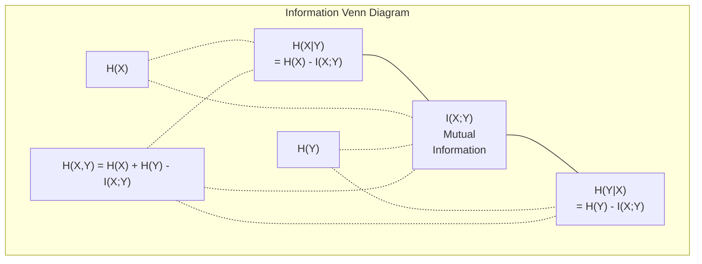

# Teoria da informação

> A teoria da informação mede a surpresa.

**Type:** Learn
**Language:**Python
**Prerequisites:** Phase 1, Lesson 06 (Probability)
**Time:** ~60 minutes

## Objetivos de aprendizagem

- Compute a entropia, a entropia cruzada e a divergência KL a partir do zero e explique sua relação
- Derivar por que minimizar a perda de entropia cruzada é equivalente a maximizar a probabilidade de log
- Calcular informações mútuas entre características e um alvo para classificar a importância das características
- Explique a perplexidade como o tamanho do vocabulário eficaz que um modelo de linguagem escolhe entre

## O problema

Tu ligas .`CrossEntropyLoss()`Em cada modelo de classificação que você treina, você vê "perplexidade" em cada modelo de idioma. Você lê sobre divergência KL em VAEs, destilação e RLHF. Estes não são conceitos desconectados.

A teoria da informação dá-lhe a linguagem para raciocinar sobre incerteza, compressão e previsão. Claude Shannon inventou-o em 1948 para resolver problemas de comunicação.

Esta lição construiu todas as fórmulas a partir do zero para que você veja de onde vêm e por que funcionam.

## O conceito

### Conteúdo de informação (surpresa)

Quando algo improvável acontece, ele carrega mais informações.

O conteúdo de informação de um evento com probabilidade $p$é:

```math
I(x) = -\log(p(x))
```

Usando o log base 2 dá bits, usando o log natural dá nats, a mesma ideia, unidades diferentes.

```
Event              Probability    Surprise (bits)
Fair coin heads    0.5            1.0
Rolling a 6        0.167          2.58
1-in-1000 event    0.001          9.97
Certain event      1.0            0.0
```

Alguns eventos não contêm informação, já sabias que acontecerão.

### Entropia (surpresa média)

Entropia é a surpresa esperada em todos os resultados possíveis de uma distribuição.

```math
H(P) = -\sum_{x} p(x) \log(p(x))
```

Uma moeda justa tem entropia máxima para uma variável binária: 1 bit. Uma moeda tendenciosa (99% de cabeças) tem entropia baixa: 0,08 bits. Você já sabe o que vai acontecer, então cada virada diz-lhe quase nada.

```math
\begin{aligned}
\text{Fair coin:} \quad & H = -(0.5 \log_2(0.5) + 0.5 \log_2(0.5)) = 1.0 \text{ bit} \\
\text{Biased coin:} \quad & H = -(0.99 \log_2(0.99) + 0.01 \log_2(0.01)) = 0.08 \text{ bits}
\end{aligned}
```

A entropia mede a incerteza irredutível numa distribuição.

### A entropia cruzada (a função de perda que você usa todos os dias)

A entropia cruzada mede a surpresa média quando se usa a distribuição $Q$para codificar eventos que realmente vêm da distribuição $P$- Não .

```math
H(P, Q) = -\sum_{x} p(x) \log(q(x))
```

$P$É a distribuição verdadeira (os rótulos). $Q$É a previsão do seu modelo.$Q$- Correntes$P$Perfeitamente, a entropia cruzada é igual à entropia. Qualquer desajuste torna-a maior.

Em classificação, $P$é um vetor de um só calor (a classe verdadeira tem probabilidade 1, tudo o resto 0).

```math
H(P, Q) = -\log(q(\text{true\_class}))
```

Isso é toda a fórmula de perda de entropia cruzada para classificação. Maximizar a probabilidade prevista da classe correta.

### KL Divergência (Distança entre Distribuições)

A divergência KL mede a quantidade de surpresa extra que você recebe ao usar $Q$Em vez de$P$- Não .

```math
\begin{aligned}
D_{KL}(P \,\|\, Q) &= \sum_{x} p(x) \log(p(x) / q(x)) \\
&= H(P, Q) - H(P)
\end{aligned}
```

A entropia cruzada é entropia mais divergência KL. Como a entropia da distribuição verdadeira é constante durante o treinamento, minimizar a entropia cruzada é o mesmo que minimizar a divergência KL. Você está empurrando a distribuição do seu modelo para a distribuição verdadeira.

A divergência KL não é simétrica: $D_{KL}(P \Vert Q) \ne D_{KL}(Q \Vert P)$Não é uma métrica de distância real.

### Informações mútuas

A informação mútua mede o quanto saber uma variável diz-lhe sobre outra.

```math
\begin{aligned}
I(X; Y) &= H(X) - H(X \mid Y) \\
&= H(X) + H(Y) - H(X, Y)
\end{aligned}
```

Se$X$E ...$Y$Se eles estão perfeitamente correlacionados, a informação mútua é igual à entropia de qualquer uma das variáveis.

Na seleção de características, uma alta informação mútua entre uma característica e o alvo significa que a característica é útil.

### Entropia condicional

$H(Y \mid X)$Medem a incerteza que permanece sobre o$Y$Depois de observares.$X$- Não .

```math
H(Y \mid X) = H(X,Y) - H(X)
```

Dois extremos:
- Se$X$Determina completamente.$Y$, então$H(Y \mid X) = 0$- Saber .$X$Elimina toda a incerteza sobre o$Y$- Exemplo:$X$= temperatura em Celsius,$Y$= temperatura em Fahrenheit.
- Se$X$Não lhe diz nada sobre isso .$Y$, então$H(Y \mid X) = H(Y)$- Saber .$X$Não reduz a sua incerteza.$X$= lançamento de moeda,$Y$= o tempo de amanhã.

A entropia condicional é sempre não negativa e nunca excede .$H(Y)$- Não .

```math
0 \le H(Y \mid X) \le H(Y)
```

Em aprendizado de máquina, a entropia condicional aparece nas árvores de decisão.$X$que minimiza $H(Y \mid X)$-- a característica que elimina a maior incerteza sobre o rótulo $Y$- Não .

### Entropia conjunta

$H(X,Y)$é a entropia da distribuição conjunta de $X$E ...$Y$- juntos.

```math
H(X,Y) = -\sum_{x} \sum_{y} p(x,y) \log(p(x,y))
```

Propriedade chave:

```math
H(X,Y) \le H(X) + H(Y)
```

A igualdade é válida quando $X$E ...$Y$A entropia conjunta é menor que a soma das entropías individuais.



As relações:
- $H(X,Y) = H(X) + H(Y \mid X) = H(Y) + H(X \mid Y)$
- $I(X;Y) = H(X) - H(X \mid Y) = H(Y) - H(Y \mid X)$
- $H(X,Y) = H(X) + H(Y) - I(X;Y)$

### Informações mútuas (mergulho profundo)

Informação mútua $I(X;Y)$quantifica o quanto o conhecimento de uma variável reduz a incerteza sobre a outra.

```math
\begin{aligned}
I(X;Y) &= H(X) - H(X \mid Y) \\
&= H(Y) - H(Y \mid X) \\
&= H(X) + H(Y) - H(X,Y) \\
&= \sum_{x} \sum_{y} p(x,y) \log\left(\frac{p(x,y)}{p(x) \, p(y)}\right)
\end{aligned}
```

Propriedades:
- $I(X;Y) \ge 0$Nunca perdemos informações observando alguma coisa.
- $I(X;Y) = 0$Se e somente se $X$E ...$Y$são independentes.
- $I(X;Y) = I(Y;X)$É simétrico, ao contrário da divergência KL.
- $I(X;X) = H(X)$Uma variável compartilha todas as suas informações consigo mesma.

**Mutual information for feature selection.**Em ML, você quer recursos que sejam informativos sobre o alvo.

1. Para cada característica $X_i$, computação $I(X_i; Y)$onde$Y$é a variável-alvo.
2. Características de classificação por pontuação MI.
3. Mantém o topo .$k$características.

Isto funciona para qualquer relação entre característica e alvo -- linear, não linear, monótono ou não. A correlação só capta relações lineares.

| Method | Detects | Computational cost | Handles categorical? |
|--------|---------|-------------------|---------------------|
| Pearson correlation | Linear relationships | $O(n)$ | No |
| Spearman correlation | Monotonic relationships | $O(n \log n)$ | No |
| Mutual information | Any statistical dependency | $O(n \log n)$ with binning | Yes |

### Limeamento de etiquetas e entropia cruzada

A classificação padrão usa alvos duros: [0, 0, 1, 0]. A classe verdadeira recebe probabilidade 1, tudo o resto recebe 0.

```math
\text{soft\_target} = (1 - \epsilon) \cdot \text{hard\_target} + \epsilon / \text{num\_classes}
```

Com o$\epsilon = 0.1$e 4 classes:
- Alvo duro: [0, 0, 1, 0]
- Alvo suave: [0,025, 0,025, 0,925, 0,025]

De uma perspectiva da teoria da informação, o suavizamento de rótulos aumenta a entropia da distribuição de alvos. Alvos rígidos com um só calor têm entropia 0 - não há incerteza. Alvos moles têm entropia positiva.

Por que isso ajuda:
- Impede que o modelo conduza logits para valores extremos (seria necessário logits infinitos para combinar perfeitamente um alvo de uma única temperatura em entropia cruzada)
- A atuação como regularização: o modelo não pode ser 100% confiante
- Melhora a calibração: as probabilidades previstas refletem melhor a verdadeira incerteza
- Reduz a diferença entre o treinamento e o comportamento de inferência

A perda de entropia cruzada com o suavização da etiqueta torna-se:

```math
L = (1 - \epsilon) \cdot \text{CE}(\text{hard\_target}, \text{prediction}) + \epsilon \cdot H_{\text{uniform}}(\text{prediction})
```

O segundo termo penaliza previsões que estão longe de ser uniformes -- uma regularização direta da confiança.

### Por que a entropia cruzada é a perda de classificação

Três perspectivas, a mesma conclusão.

**Information theory view.**A entropia cruzada mede quantos bits você desperdiça usando a distribuição do modelo em vez da distribuição real. Minimizando isso, o modelo torna-se o codificador mais eficiente da realidade.

**Maximum likelihood view.**Para o$N$- de formação de amostras com classes reais $y_i$- Não .

```math
\begin{aligned}
\text{Likelihood} &= \prod_i q(y_i) \\
\text{Log-likelihood} &= \sum_i \log(q(y_i)) \\
\text{Negative log-likelihood} &= -\sum_i \log(q(y_i))
\end{aligned}
```

Minimizar a entropia cruzada = maximizar a probabilidade dos dados de treinamento sob o seu modelo.

**Gradient view.**O gradiente de entropia cruzada em relação às logitas é simples (previsto - verdadeiro). limpo, estável e rápido de calcular.

### Bits vs Nats

A única diferença é a base do log.

```
log base 2   -> bits      (information theory tradition)
log base e   -> nats      (machine learning convention)
log base 10  -> hartleys  (rarely used)
```

1 nat = $1/\ln(2)$PyTorch e TensorFlow usam logs naturais (nats) por padrão.

### Perplexidade

A perplexidade é o exponencial da entropia cruzada.

```math
\begin{aligned}
\text{Perplexity} &= 2^{H(P,Q)} \quad \text{(if using bits)} \\
\text{Perplexity} &= e^{H(P,Q)} \quad \text{(if using nats)}
\end{aligned}
```

Um modelo de linguagem com perplexidade 50 é, em média, tão confuso como se tivesse que escolher uniformemente entre 50 tokens possíveis.

O GPT-2 alcançou uma perplexidade de ~30 em referências comuns.

```figure
entropy-kl
```

## Construí-lo

### Passo 1: Conteúdo da informação e entropia

```python
import math

def information_content(p, base=2):
    if p <= 0 or p > 1:
        return float('inf') if p <= 0 else 0.0
    return -math.log(p) / math.log(base)

def entropy(probs, base=2):
    return sum(
        p * information_content(p, base)
        for p in probs if p > 0
    )

fair_coin = [0.5, 0.5]
biased_coin = [0.99, 0.01]
fair_die = [1/6] * 6

print(f"Fair coin entropy:   {entropy(fair_coin):.4f} bits")
print(f"Biased coin entropy: {entropy(biased_coin):.4f} bits")
print(f"Fair die entropy:    {entropy(fair_die):.4f} bits")
```

### Passo 2: Entropia cruzada e divergência KL

```python
def cross_entropy(p, q, base=2):
    total = 0.0
    for pi, qi in zip(p, q):
        if pi > 0:
            if qi <= 0:
                return float('inf')
            total += pi * (-math.log(qi) / math.log(base))
    return total

def kl_divergence(p, q, base=2):
    return cross_entropy(p, q, base) - entropy(p, base)

true_dist = [0.7, 0.2, 0.1]
good_model = [0.6, 0.25, 0.15]
bad_model = [0.1, 0.1, 0.8]

print(f"Entropy of true dist:     {entropy(true_dist):.4f} bits")
print(f"CE (good model):          {cross_entropy(true_dist, good_model):.4f} bits")
print(f"CE (bad model):           {cross_entropy(true_dist, bad_model):.4f} bits")
print(f"KL divergence (good):     {kl_divergence(true_dist, good_model):.4f} bits")
print(f"KL divergence (bad):      {kl_divergence(true_dist, bad_model):.4f} bits")
```

### Passo 3: Entropia cruzada como perda de classificação

```python
def softmax(logits):
    max_logit = max(logits)
    exps = [math.exp(z - max_logit) for z in logits]
    total = sum(exps)
    return [e / total for e in exps]

def cross_entropy_loss(true_class, logits):
    probs = softmax(logits)
    return -math.log(probs[true_class])

logits = [2.0, 1.0, 0.1]
true_class = 0

probs = softmax(logits)
loss = cross_entropy_loss(true_class, logits)

print(f"Logits:      {logits}")
print(f"Softmax:     {[f'{p:.4f}' for p in probs]}")
print(f"True class:  {true_class}")
print(f"Loss:        {loss:.4f} nats")
print(f"Perplexity:  {math.exp(loss):.2f}")
```

### Passo 4: Entropia cruzada é igual à probabilidade de log negativo

```python
import random

random.seed(42)

n_samples = 1000
n_classes = 3
true_labels = [random.randint(0, n_classes - 1) for _ in range(n_samples)]
model_logits = [[random.gauss(0, 1) for _ in range(n_classes)] for _ in range(n_samples)]

ce_loss = sum(
    cross_entropy_loss(label, logits)
    for label, logits in zip(true_labels, model_logits)
) / n_samples

nll = -sum(
    math.log(softmax(logits)[label])
    for label, logits in zip(true_labels, model_logits)
) / n_samples

print(f"Cross-entropy loss:      {ce_loss:.6f}")
print(f"Negative log-likelihood: {nll:.6f}")
print(f"Difference:              {abs(ce_loss - nll):.2e}")
```

### Passo 5: Informação mútua

```python
def mutual_information(joint_probs, base=2):
    rows = len(joint_probs)
    cols = len(joint_probs[0])

    margin_x = [sum(joint_probs[i][j] for j in range(cols)) for i in range(rows)]
    margin_y = [sum(joint_probs[i][j] for i in range(rows)) for j in range(cols)]

    mi = 0.0
    for i in range(rows):
        for j in range(cols):
            pxy = joint_probs[i][j]
            if pxy > 0:
                mi += pxy * math.log(pxy / (margin_x[i] * margin_y[j])) / math.log(base)
    return mi

independent = [[0.25, 0.25], [0.25, 0.25]]
dependent = [[0.45, 0.05], [0.05, 0.45]]

print(f"MI (independent): {mutual_information(independent):.4f} bits")
print(f"MI (dependent):   {mutual_information(dependent):.4f} bits")
```

## Usá-lo

Os mesmos conceitos que usam o NumPy, a forma como os usará na prática:

```python
import numpy as np

def np_entropy(p):
    p = np.asarray(p, dtype=float)
    mask = p > 0
    result = np.zeros_like(p)
    result[mask] = p[mask] * np.log(p[mask])
    return -result.sum()

def np_cross_entropy(p, q):
    p, q = np.asarray(p, dtype=float), np.asarray(q, dtype=float)
    mask = p > 0
    return -(p[mask] * np.log(q[mask])).sum()

def np_kl_divergence(p, q):
    return np_cross_entropy(p, q) - np_entropy(p)

true = np.array([0.7, 0.2, 0.1])
pred = np.array([0.6, 0.25, 0.15])
print(f"Entropy:    {np_entropy(true):.4f} nats")
print(f"Cross-ent:  {np_cross_entropy(true, pred):.4f} nats")
print(f"KL div:     {np_kl_divergence(true, pred):.4f} nats")
```

Construiste a partir do nada o que ?`torch.nn.CrossEntropyLoss()`Agora sabe por que a perda diminui durante o treinamento: a distribuição prevista do seu modelo está a aproximar-se da distribuição real, medida em nats de informações desperdiçadas.

## Exercícios

1. Calcule a entropia do alfabeto inglês assumindo uma distribuição uniforme (26 letras).

2. Um modelo produz logits [5,0, 2.0, 0.5] para uma amostra com classe verdadeira 1. Calcule a perda de entropia cruzada à mão, em seguida, verifique com o seu `cross_entropy_loss`Qual logite daria perda zero?

3. Mostre que a divergência KL não é simétrica.$P$E ...$Q$e computação .$D_{KL}(P \Vert Q)$E ...$D_{KL}(Q \Vert P)$Explica porque são diferentes.

4. Construir uma função que calcula a perplexidade para uma sequência de previsões de tokens. Dada uma lista de pares (true_token_index, predicted_logits), retorne a perplexidade da sequência.

### Indicios

**Exercise 1.**Liga-me .`entropy`com 26 probabilidades iguais; o resultado deve ser $\log_2 26 \approx 4.70$As frequências reais das letras não são uniformes, por isso a entropia com elas deve ser menor.

**Exercise 2.**Computação`softmax`das logites, então $-\ln$de probabilidade no índice 1, e comparar com `cross_entropy_loss(1, logits)`• ambas devem estar próximas de 3,06. A perda aproxima-se de 0, apenas quando a logite para a classe 1 é muito maior do que as outras duas.

**Exercise 3.**Usar duas pequenas distribuições com formas diferentes, por exemplo $P = [0.9, 0.1]$E ...$Q = [0.5, 0.5]$, e ligar`kl_divergence`Os dois valores devem ser diferentes, porque cada direcção pesa a relação log por uma distribuição diferente.

**Exercise 4.**Para cada par, calcular `cross_entropy_loss(true_token_index, predicted_logits)`, tomar o meio, e passar para `perplexity`Verifique com os registos uniformes .$V$Tokens: a perplexidade deve ser $V$- Não .

## Termos-chave

| Term | What people say | What it actually means |
|------|----------------|----------------------|
| Information content | "Surprise" | The number of bits (or nats) needed to encode an event: $-\log(p)$ |
| Entropy | "Randomness" | The average surprise across all outcomes of a distribution. Measures irreducible uncertainty. |
| Cross-entropy | "The loss function" | Average surprise when using model distribution $Q$ to encode events from true distribution $P$. |
| KL divergence | "Distance between distributions" | Extra bits wasted by using $Q$ instead of $P$. Equals cross-entropy minus entropy. Not symmetric. |
| Mutual information | "How related are X and Y" | Reduction in uncertainty about $X$ from knowing $Y$. Zero means independent. |
| Softmax | "Turn logits into probabilities" | Exponentiate and normalize. Maps any real-valued vector to a valid probability distribution. |
| Perplexity | "How confused the model is" | Exponential of cross-entropy. The effective vocabulary size the model is choosing from at each step. |
| Bits | "Shannon's unit" | Information measured with log base 2. One bit resolves one fair coin flip. |
| Nats | "ML's unit" | Information measured with natural log. Used by PyTorch and TensorFlow by default. |
| Negative log-likelihood | "NLL loss" | Identical to cross-entropy loss for one-hot labels. Minimizing it maximizes the probability of correct predictions. |

## Mais leitura

- [Shannon 1948: A Mathematical Theory of Communication](https://people.math.harvard.edu/~ctm/home/text/others/shannon/entropy/entropy.pdf)- o papel original, ainda legível
- [Visual Information Theory (Chris Olah)](https://colah.github.io/posts/2015-09-Visual-Information/)- melhor explicação visual da entropia e da divergência KL
- [PyTorch CrossEntropyLoss docs](https://pytorch.org/docs/stable/generated/torch.nn.CrossEntropyLoss.html)- como o quadro implementa o que acaba de construir
