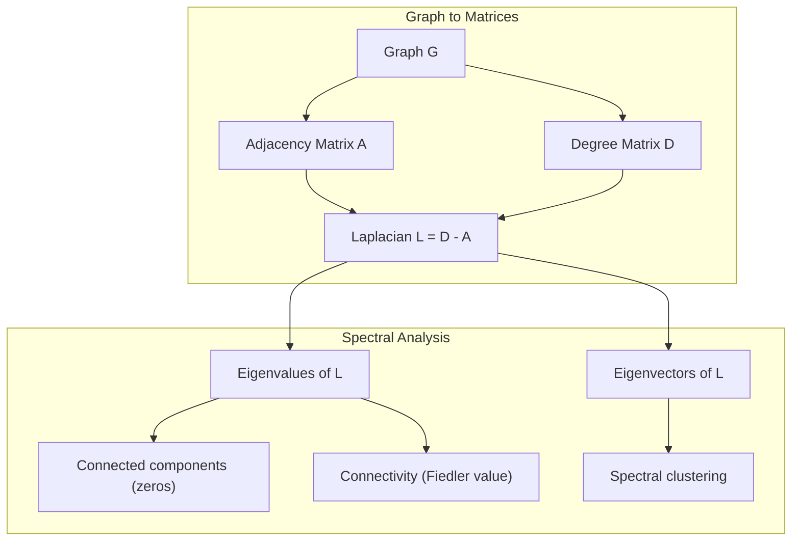
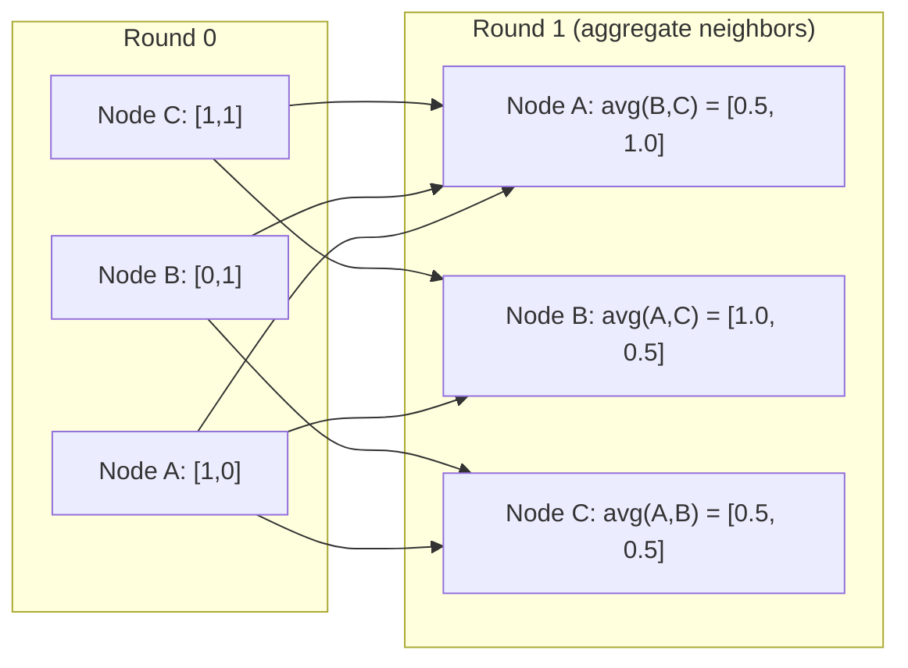

# Teoria do gráfico para aprendizado de máquina

> Os gráficos são a estrutura de dados das relações. Se os dados têm conexões, você precisa de teoria de gráficos.

**Type:** Build
**Language:**Python
**Prerequisites:** Phase 1, Lessons 01-03 (linear algebra, matrices)
**Time:** ~90 minutes

## Objetivos de aprendizagem

- Construir uma classe de gráfico com representações de matriz/lista adjacentes e implementar transmissões BFS e DFS
- Compute o gráfico Laplacian e use seus próprios valores para detectar componentes conectados e nós do cluster
- Implementar uma rodada de mensagem de estilo GNN passando como uma matriz de adjacência normalizada multiplicação
- Aplicar agrupamento espectral para particionar um gráfico usando o vetor Fiedler

## O problema

Redes sociais, moléculas, bases de conhecimento, redes de citações, mapas de estrada - são todos gráficos. A ML tradicional trata os dados como tabelas planas. Cada linha é independente. Cada característica é uma coluna. Mas quando a estrutura das conexões importa, as tabelas falham.

Considerem uma rede social. Você quer prever que produto um usuário vai comprar. Seu histórico de compra importa. Mas o histórico de compra de seus amigos importa mais. As conexões carregam sinal.

Ou, se pensarmos numa molécula, queremos prever se ela se liga a uma proteína. Os átomos são importantes, mas o que realmente importa é como os átomos estão ligados uns aos outros. A estrutura é os dados.

Graph Neural Networks (GNNs) são a área de mais rápido crescimento na aprendizagem profunda. Eles impulsionam a descoberta de drogas, recomendação social, detecção de fraude e raciocínio gráfico de conhecimento.

Precisas de quatro coisas:
1. Uma maneira de representar gráficos como matrizes (para que você possa multiplicá-los)
2. Algoritmos de travessia para explorar a estrutura do gráfico
3. O Laplacian - a matriz mais importante na teoria dos gráficos espectrais
4. Passagem de mensagens - a operação que faz com que GNNs funcionem

## O conceito

### Gráficos: nós e bordas

Um gráfico .$G = (V, E)$Consiste em vértices (nodos) $V$e bordas $E$Cada borda liga dois nós.

**Directed vs undirected.**Em um gráfico não direcionado, borda $(u, v)$- Meio$u$liga-se a $v$E ...$v$liga-se a $u$Em um gráfico direcionado (digrafo), borda $(u, v)$- Meio$u$aponta para $v$, mas não necessariamente o contrário.

**Weighted vs unweighted.**Em um gráfico não ponderado, existem bordas ou não. Em um gráfico ponderado, cada bordas tem um peso numérico - uma distância, um custo, uma força.

| Graph type | Example |
|-----------|---------|
| Undirected, unweighted | Facebook friendship network |
| Directed, unweighted | Twitter follow network |
| Undirected, weighted | Road map (distances) |
| Directed, weighted | Web page links (PageRank scores) |

### A Matriz de Adjacência

A matriz de adjacência $A$é a representação do núcleo.$n$Nodos:

```math
A[i][j] = \begin{cases} 1 & \text{if there is an edge from node } i \text{ to node } j \\ 0 & \text{otherwise} \end{cases}
```

Para gráficos não direcionados, $A$é simétrica: $A[i][j] = A[j][i]$Para gráficos ponderados,$A[i][j]$= peso da borda $(i, j)$- Não .

**Example -- a triangle:**

```
Nodes: 0, 1, 2
Edges: (0,1), (1,2), (0,2)

A = [[0, 1, 1],
     [1, 0, 1],
     [1, 1, 0]]
```

A matriz de adjacência é a entrada para cada GNN.$A$correspondem às operações no gráfico.

### Graduação

O grau de um nó é o número de bordas conectadas a ele. Para gráficos direcionados, você tem grau (edges entering) e grau (edges going out).

A matriz de graus $D$é diagonal:

```math
\begin{aligned}
D[i][i] &= \text{degree of node } i \\
D[i][j] &= 0 \quad \text{for } i \ne j
\end{aligned}
```

Para o exemplo do triângulo: $D = \mathop{\mathrm{diag}}(2, 2, 2)$Porque cada nó se conecta a outros dois.

Graus diz-lhe sobre a importância do nó. Graus alto = nó de hub. A distribuição de graus de uma rede revela sua estrutura. Redes sociais seguem leis de potência (poucos hubs, muitos nós de folha). Graus aleatórios têm graus distribuídos por Poisson.

### BFS e DFS

Os dois algoritmos fundamentais de travesso de gráficos.

**Breadth-First Search (BFS):**Explore todos os vizinhos primeiro, depois os vizinhos dos vizinhos.

```
BFS from node 0:
  Visit 0
  Queue: [1, 2]        (neighbors of 0)
  Visit 1
  Queue: [2, 3]        (add neighbors of 1)
  Visit 2
  Queue: [3]           (neighbors of 2 already visited)
  Visit 3
  Queue: []            (done)
```

O BFS encontra os caminhos mais curtos em gráficos não ponderados. A distância do início a qualquer nó é igual ao nível BFS no qual esse nó é descoberto pela primeira vez.

**Depth-First Search (DFS):**- Vai o mais fundo possível antes de voltar atrás.

```
DFS from node 0:
  Visit 0
  Stack: [1, 2]        (neighbors of 0)
  Visit 2               (pop from stack)
  Stack: [1, 3]         (add neighbors of 2)
  Visit 3               (pop from stack)
  Stack: [1]
  Visit 1               (pop from stack)
  Stack: []             (done)
```

O DFS é útil para:
- Encontrar componentes conectados (exercer DFS a partir de nós não visitados)
- Detecção de ciclo (borda traseira na árvore DFS)
- Classificação topológica (ordem de finalização inversa do DFS)

| Algorithm | Data structure | Finds | Use case |
|-----------|---------------|-------|----------|
| BFS | Queue | Shortest paths | Social network distance, knowledge graph traversal |
| DFS | Stack | Components, cycles | Connectivity, topological sort |

### O gráfico laplaciano

$L = D - A$A matriz mais importante na teoria dos gráficos espectrais.

Para o triângulo:

```math
D = \begin{bmatrix} 2 & 0 & 0 \\ 0 & 2 & 0 \\ 0 & 0 & 2 \end{bmatrix} \qquad A = \begin{bmatrix} 0 & 1 & 1 \\ 1 & 0 & 1 \\ 1 & 1 & 0 \end{bmatrix} \qquad L = \begin{bmatrix} 2 & -1 & -1 \\ -1 & 2 & -1 \\ -1 & -1 & 2 \end{bmatrix}
```

O Laplaciano tem propriedades notáveis:

1. **$L$ is positive semi-definite.**Todos os valores próprios são$\ge 0$- Não .

2. **The number of zero eigenvalues equals the number of connected components.**Um gráfico conectado tem exatamente um valor próprio zero. Um gráfico com 3 componentes desconectados tem três valores próprios zero.

3. **The smallest non-zero eigenvalue (Fiedler value) measures connectivity.**Um grande valor Fiedler significa que o gráfico está bem conectado. Um pequeno valor Fiedler significa que o gráfico tem um ponto fraco - um gargalo de engarrafamento.

4. **The eigenvector of the Fiedler value (Fiedler vector) reveals the best split.**Os nós com valores positivos vão para um grupo, os nós com valores negativos vão para o outro.



### Propriedades Espectrais

Os valores próprios da matriz adjacente e do laplaciano revelam propriedades estruturais sem qualquer travessia.

**Spectral clustering**funciona assim:
1. Calcule o Laplaciano $L$
2. Encontrar o$k$os menores vetores próprios de $L$(salte o primeiro, que é todos-ones para gráficos conectados)
3. Use esses vetores próprios como novas coordenadas para cada nó
4. Corra .$k$- media nessas coordenadas

Por que isto funciona? Os próprios vetores de$L$Os nodos que estão bem conectados obtêm valores próprios similares. Os nodos separados por um gargalo de engarrafamento obtêm valores diferentes. Os próprios vetores separam naturalmente aglomerados.

**Random walk connection.**O laplaciano normalizado se relaciona com caminhadas aleatórias no gráfico. A distribuição estática de uma caminhada aleatória é proporcional ao grau de nó. O tempo de mistura (a rapidez com que a caminhada converge) depende da lacuna espectral.

### Mensagem de passagem

A operação central das redes neurais gráficas. Cada nó coleta mensagens de seus vizinhos, as agrega e atualiza seu próprio estado.

```math
h_v^{(k+1)} = \text{UPDATE}\left(h_v^{(k)}, \text{AGGREGATE}\left(\{h_u^{(k)} : u \in \text{neighbors}(v)\}\right)\right)
```

Na forma mais simples, AGGREGATE = média e UPDATE = transformação linear + ativação:

```math
h_v^{(k+1)} = \sigma\left(W \cdot \text{mean}\left(\{h_u^{(k)} : u \in \text{neighbors}(v)\}\right)\right)
```

Isto é multiplicação de matriz disfarçada.$H$é a matriz de todas as características do nó e $A$é a matriz de adjacência:

```math
H^{(k+1)} = \sigma\left(A_{\text{norm}} H^{(k)} W\right)
```

onde$A_{\text{norm}}$é a matriz de adjacência normalizada (cada linha é somada a 1).

Uma rodada de mensagem permite que cada nó "veja" seus vizinhos imediatos.$K$Rondas dão a cada nó informações de seu $K$- No bairro do Hop.



### Conceptos e aplicações de ML

| Concept | ML Application |
|---------|---------------|
| Adjacency matrix | GNN input representation |
| Graph Laplacian | Spectral clustering, community detection |
| BFS/DFS | Knowledge graph traversal, path finding |
| Degree distribution | Node importance, feature engineering |
| Message passing | GNN layers (GCN, GAT, GraphSAGE) |
| Eigenvalues of L | Community detection, graph partitioning |
| Spectral clustering | Unsupervised node grouping |
| PageRank | Node importance, web search |

```figure
graph-degree-distribution
```

## Construí-lo

### Passo 1: Classe de gráfico a partir do zero

```python
class Graph:
    def __init__(self, n_nodes, directed=False):
        self.n = n_nodes
        self.directed = directed
        self.adj = {i: {} for i in range(n_nodes)}

    def add_edge(self, u, v, weight=1.0):
        self.adj[u][v] = weight
        if not self.directed:
            self.adj[v][u] = weight

    def neighbors(self, node):
        return list(self.adj[node].keys())

    def degree(self, node):
        return len(self.adj[node])

    def adjacency_matrix(self):
        import numpy as np
        A = np.zeros((self.n, self.n))
        for u in range(self.n):
            for v, w in self.adj[u].items():
                A[u][v] = w
        return A

    def degree_matrix(self):
        import numpy as np
        D = np.zeros((self.n, self.n))
        for i in range(self.n):
            D[i][i] = self.degree(i)
        return D

    def laplacian(self):
        return self.degree_matrix() - self.adjacency_matrix()
```

A lista de adjacências (`self.adj`A conversão de matriz adjacente utiliza o numpy porque todas as operações espectrais precisam dele.

### Passo 2: BFS e DFS

```python
from collections import deque

def bfs(graph, start):
    visited = set()
    order = []
    distances = {}
    queue = deque([(start, 0)])
    visited.add(start)
    while queue:
        node, dist = queue.popleft()
        order.append(node)
        distances[node] = dist
        for neighbor in graph.neighbors(node):
            if neighbor not in visited:
                visited.add(neighbor)
                queue.append((neighbor, dist + 1))
    return order, distances


def dfs(graph, start):
    visited = set()
    order = []
    stack = [start]
    while stack:
        node = stack.pop()
        if node in visited:
            continue
        visited.add(node)
        order.append(node)
        for neighbor in reversed(graph.neighbors(node)):
            if neighbor not in visited:
                stack.append(neighbor)
    return order
```

O BFS utiliza uma fila de dois limites para $O(1)$DFS usa uma lista como uma pilha. Ambos visitam cada nó exatamente uma vez -$O(V + E)$- O tempo.

### Passo 3: Componentes conectados e valores próprios laplacianos

```python
def connected_components(graph):
    visited = set()
    components = []
    for node in range(graph.n):
        if node not in visited:
            order, _ = bfs(graph, node)
            visited.update(order)
            components.append(order)
    return components


def laplacian_eigenvalues(graph):
    import numpy as np
    L = graph.laplacian()
    eigenvalues = np.linalg.eigvalsh(L)
    return eigenvalues
```

`eigvalsh`é para matrizes simétricas - o Laplacian é sempre simétrico para gráficos não direcionados. Retorna valores próprios em ordem ascendente. Conte os zeros para encontrar o número de componentes conectados.

### Passo 4: Agrupamento espectral

```python
def spectral_clustering(graph, k=2):
    import numpy as np
    L = graph.laplacian()
    eigenvalues, eigenvectors = np.linalg.eigh(L)
    features = eigenvectors[:, 1:k+1]

    labels = np.zeros(graph.n, dtype=int)
    for i in range(graph.n):
        if features[i, 0] >= 0:
            labels[i] = 0
        else:
            labels[i] = 1
    return labels
```

Para o$k=2$, o sinal do vetor Fiedler divide o gráfico em dois aglomerados.$k>2$, você iria correr .$k$- significa na primeira.$k$Vêctores próprios (excluindo o vetor próprio trivial de todos os únicos).

### Passo 5: Passagem de mensagem

```python
def message_passing(graph, features, weight_matrix):
    import numpy as np
    A = graph.adjacency_matrix()
    row_sums = A.sum(axis=1, keepdims=True)
    row_sums[row_sums == 0] = 1
    A_norm = A / row_sums
    aggregated = A_norm @ features
    output = aggregated @ weight_matrix
    return output
```

Esta é uma rodada de mensagem GNN passando. As novas características de cada nó são a média ponderada das características de seus vizinhos, transformada pela matriz de peso.

## Usá-lo

Com networkx e numpy, as mesmas operações são de linha única:

```python
import networkx as nx
import numpy as np

G = nx.karate_club_graph()

A = nx.adjacency_matrix(G).toarray()
L = nx.laplacian_matrix(G).toarray()

eigenvalues = np.linalg.eigvalsh(L.astype(float))
print(f"Smallest eigenvalues: {eigenvalues[:5]}")
print(f"Connected components: {nx.number_connected_components(G)}")

communities = nx.community.greedy_modularity_communities(G)
print(f"Communities found: {len(communities)}")

pr = nx.pagerank(G)
top_nodes = sorted(pr.items(), key=lambda x: x[1], reverse=True)[:5]
print(f"Top 5 PageRank nodes: {top_nodes}")
```

networkx lida com gráficos de qualquer tamanho com backends C otimizados. Use-o na produção. Use a sua implementação do zero para entender o que ele faz.

### Análise espectral de nómpia

```python
import numpy as np

A = np.array([
    [0, 1, 1, 0, 0],
    [1, 0, 1, 0, 0],
    [1, 1, 0, 1, 0],
    [0, 0, 1, 0, 1],
    [0, 0, 0, 1, 0]
])

D = np.diag(A.sum(axis=1))
L = D - A

eigenvalues, eigenvectors = np.linalg.eigh(L)
print(f"Eigenvalues: {np.round(eigenvalues, 4)}")
print(f"Fiedler value: {eigenvalues[1]:.4f}")
print(f"Fiedler vector: {np.round(eigenvectors[:, 1], 4)}")

fiedler = eigenvectors[:, 1]
group_a = np.where(fiedler >= 0)[0]
group_b = np.where(fiedler < 0)[0]
print(f"Cluster A: {group_a}")
print(f"Cluster B: {group_b}")
```

O vetor Fiedler faz o trabalho pesado. entradas positivas em um grupo, negativas no outro. Não é necessária otimização iterativa - apenas uma própria composição.

## Envia-o

Esta lição produz:
- `outputs/skill-graph-analysis.md`-- uma referência de habilidade para analisar dados estruturados em gráficos

## Relações

| Concept | Where it shows up |
|---------|------------------|
| Adjacency matrix | GCN, GAT, GraphSAGE input |
| Laplacian | Spectral clustering, ChebNet filters |
| BFS | Knowledge graph traversal, shortest path queries |
| Message passing | Every GNN layer, neural message passing |
| Spectral gap | Graph connectivity, mixing time of random walks |
| Degree distribution | Power-law networks, node feature engineering |
| Connected components | Preprocessing, handling disconnected graphs |
| PageRank | Node importance ranking, attention initialization |

As GNN merecem menção especial. A operação de convolução do gráfico em GCN (Kipf & Welling, 2017) usa a matriz de adjacência com loops auto adicionados, $\hat{A} = A + I$- Não .

```math
H^{(l+1)} = \sigma\left(\hat{D}^{-1/2} \hat{A} \hat{D}^{-1/2} H^{(l)} W^{(l)}\right)
```

onde$\hat{A} = A + I$(adjacência mais auto-loops) e $\hat{D}$é a matriz de graus de $\hat{A}$Os circuitos automáticos garantem que cada nó inclui suas próprias características durante a agregação.$\hat{D}^{-1/2} \hat{A} \hat{D}^{-1/2}$A Laplacian aparece porque esta normalização está relacionada com$L_{\text{sym}} = I - D^{-1/2} A D^{-1/2}$Entender o Laplaciano significa entender porque funcionam as GCN.

## Exercícios

1. **Implement PageRank from scratch.**Comece com pontuações uniformes. Em cada etapa: pontuação ((v) = (1-d) /n + d * soma (((pontuação ((u) /out_degree ((u)))) para todos os u apontando para v. Use d = 0,85. Corra até a convergência (mudança < 1e-6). Teste em um pequeno gráfico web.

2. **Find communities using spectral clustering.**Crie um gráfico com dois aglomerados claramente separados (por exemplo, duas cliques conectadas por uma única borda). Execute aglomeração espectral e verifique se encontra a divisão certa. O que acontece quando você adiciona mais bordas cruzadas?

3. **Implement Dijkstra's algorithm**Para os caminhos mais curtos em gráficos ponderados, compare os resultados com BFS no mesmo gráfico com pesos uniformes.

4. **Build a 2-layer message passing network.**Aplique mensagem passando duas vezes com matrizes de peso diferentes. Mostre que após 2 rodadas, cada nó tem informações de sua vizinhança de 2 saltos.

5. **Analyze a real-world graph.**Use o gráfico do Clube de Karate (34 nós, 78 bordas). Compute distribuição de graus, valores próprios laplacianos e agrupamento espectral. Compare o resultado do agrupamento espectral com a divisão de verdade do solo conhecida.

### Indicios

**Exercise 1.**Use a fórmula do exercício. Um nó sem bordas saindo deve compartilhar sua pontuação igualmente com todos os nós, ou o total cai abaixo de 1. Verifique se as pontuações somam até 1 após cada passo e compare seu resultado com `pagerank(graph)`- Não .

**Exercise 2.**Construir duas camaradas com `add_edge`Conecte-os com uma borda e ligue.`spectral_clustering(graph, k=2)`Verifique se cada clique recebe um rótulo. Quando você adicionar bordas cruzadas, imprimir o segundo menor valor próprio de `laplacian()`, que cresce à medida que os dois grupos se juntam.

**Exercise 3.**Mantenha uma fila de prioridade com `heapq`E sempre expandir o nó com a menor distância conhecida. Faça cada peso 1 e verifique se cada distância Dijkstra é igual à camada BFS do nó de `bfs(graph, start)`- Não .

**Exercise 4.**Use a matriz de identidade como `features`, para que cada coluna marque um nó, e aplicar `message_passing`Depois as entradas não-zero na linha para nós $v$Mostre quais nós chegaram $v$Compare esse conjunto com os nós a distância 2 de uma primeira busca de largura.

**Exercise 5.** `networkx.karate_club_graph()`dá a lista de bordas e a verdade do solo no atributo do nó `club`- Copie as bordas num`Graph`e verifique se tem 34 nós e 78 bordas.`spectral_clustering`com o `club`Os valores são alterados e os dois nomes de rótulos são trocados.

## Termos-chave

| Term | What people say | What it actually means |
|------|----------------|----------------------|
| Graph | "Nodes and edges" | A mathematical structure $G=(V,E)$ encoding pairwise relationships |
| Adjacency matrix | "The connection table" | An $n \times n$ matrix where $A[i][j] = 1$ if nodes $i$ and $j$ are connected |
| Degree | "How connected a node is" | The number of edges touching a node |
| Laplacian | "D minus A" | $L = D - A$, the matrix whose eigenvalues reveal graph structure |
| Fiedler value | "The algebraic connectivity" | The smallest non-zero eigenvalue of $L$, measuring how well-connected the graph is |
| BFS | "Level-by-level search" | Traversal that visits all neighbors before going deeper, finds shortest paths |
| DFS | "Go deep first" | Traversal that follows one path to its end before backtracking |
| Message passing | "Nodes talk to neighbors" | Each node aggregates information from its neighbors, the core of GNNs |
| Spectral clustering | "Cluster by eigenvectors" | Partition a graph using eigenvectors of its Laplacian |
| Connected component | "A separate piece" | A maximal subgraph where every node can reach every other node |

## Mais leitura

- **Kipf & Welling (2017)**-- "Classificação semi-supervisada com redes de convolução gráfica". O artigo que lançou as GNNs modernas. Mostra que as convoluções espetais dos gráficos simplificam a passagem de mensagens.
- **Spielman (2012)**- Notas de aula sobre "Teoria do Gráfico Espectrálico". A introdução definitiva aos Laplacianos, as lacunas espectrais e a partição do gráfico.
- **Hamilton (2020)**-- "Ler de representação gráfica". Livro que abrange GNNs desde os fundamentos até as aplicações.
- **Bronstein et al. (2021)**-- "A aprendizagem geométrica profunda: Grades, Grupos, Gráficos, Geodésicas e Medidores". O documento de enquadramento unificador.
- **Veličković et al. (2018)**-- "Graph Attention Networks". Estende a mensagem que passa com mecanismos de atenção.
