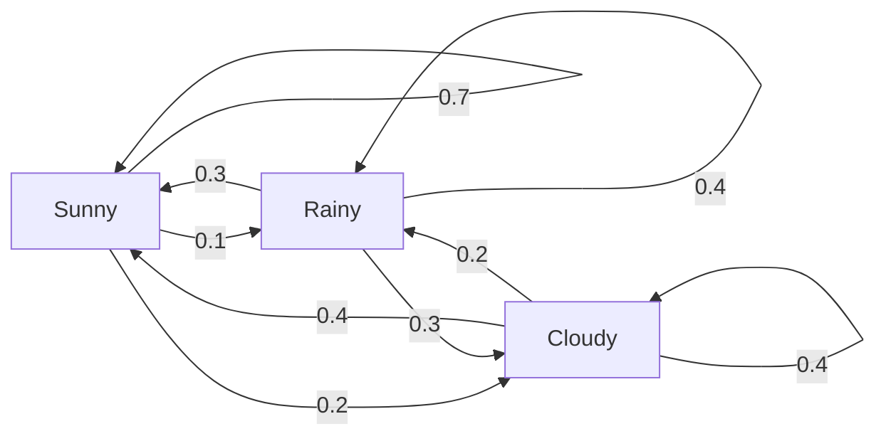
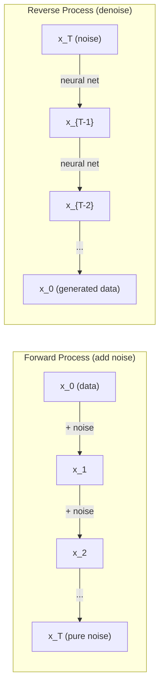

# Processos estocásticos

> A matemática por trás de caminhadas aleatórias, cadeias de Markov e modelos de difusão.

**Type:** Learn
**Language:**Python
**Prerequisites:** Phase 1, Lessons 06-07 (probability, Bayes)
**Time:** ~75 minutes

## Objetivos de aprendizagem

- Simulação de caminhadas aleatórias 1D e 2D e verificação do $\sqrt{n}$Escalada do deslocamento
- Construir um simulador de cadeia Markov e calcular sua distribuição estacionária através de sua própria composição
- Implementar a dinâmica MCMC e Langevin Metropolis-Hastings para a amostragem das distribuições-alvo
- Conecte o processo de difusão para a frente ao movimento de Brownian e explique como o processo inverso gera dados

## O problema

Muitos sistemas de IA envolvem aleatoriedade que evolui ao longo do tempo, não aleatoriedade estática -- aleatoriedade estruturada e seqüencial onde cada passo depende do que aconteceu antes.

Os modelos de linguagem geram tokens um a cada vez. Cada token depende do contexto anterior. O modelo produz uma distribuição de probabilidade, amostras a partir dele, e segue em frente. Isso é um processo estocástico.

Os modelos de difusão adicionam ruído a uma imagem passo a passo até que ela se torne pura estática. Em seguida, eles invertam o processo, denonciando passo a passo até que uma nova imagem emerge. O processo para a frente é uma cadeia de Markov. O processo inverso é uma cadeia de Markov aprendida correndo para trás.

Os agentes de aprendizagem de reforço tomam ações em um ambiente. Cada ação leva a um novo estado com alguma probabilidade. O agente segue uma política aleatória em um mundo aleatório.

A amostragem MCMC - a espinha dorsal da inferência Bayesiana - constrói uma cadeia de Markov cuja distribuição estática é a posterior da qual queremos amostragem.

Todas estas construem-se sobre quatro ideias fundamentais:
1. Caminhos aleatórios - o processo estocástico mais simples
2. Cadens de Markov -- aleatoriedade estruturada com uma matriz de transição
3. Dinâmica de Langevin - descida de gradiente com ruído
4. Metropolis-Hastings - amostragem de qualquer distribuição

## O conceito

### Caminhos aleatórios

Comece na posição 0. Em cada passo, lance uma moeda justa. cabeças: mover-se à direita (+1). caudas: mover-se à esquerda (-1).

Depois .$n$Passo, a sua posição é a soma de$n$acaso .$\pm 1$A posição esperada é de 0 (a caminhada é imparcial), mas a distância esperada da origem aumenta à medida que a$\sqrt{n}$- Não .

Isto é contra-intuitivo. A caminhada é justa - não deriva em qualquer direção. Mas ao longo do tempo, vai andando mais e mais longe do lugar onde começou.$n$Os passos são$\sqrt{n}$- Não .

```
Step 0:  Position = 0
Step 1:  Position = +1 or -1
Step 2:  Position = +2, 0, or -2
...
Step 100: Expected distance from origin ~ 10 (sqrt(100))
Step 10000: Expected distance from origin ~ 100 (sqrt(10000))
```

**In 2D**, o andar vai para cima, para baixo, para a esquerda ou para a direita com igual probabilidade.$\sqrt{n}$A escalação se aplica à distância da origem.

**Why $\sqrt{n}$?**Cada passo é +1 ou -1 com igual probabilidade.$n$Passo, posição.$S_n = X_1 + X_2 + \cdots + X_n$onde cada um $X_i$É o que é$\pm 1$A variância de cada passo é de 1, e os passos são independentes, então $\mathop{\mathrm{Var}}(S_n) = n$. Desvio padrão = $\sqrt{n}$Pelo teorema do limite central,$S_n / \sqrt{n}$converge para uma distribuição normal padrão.

Isto .$\sqrt{n}$A escala de escala aparece em todas as escalas de ruído do ML.$\sqrt{d}$A raiz quadrada é a assinatura de adições aleatórias independentes.

**Connection to Brownian motion.**Faça uma caminhada aleatória com o tamanho dos degraus .$1/\sqrt{n}$E ...$n$Passo por unidade de tempo.$n$Vai para o infinito, o caminho converge para o movimento browniano.$B(t)$-- um processo contínuo em que$B(t)$é normalmente distribuído com média 0 e variância $t$- Não .

O movimento browniano é a base matemática da difusão. Modela o balanço aleatório de partículas num fluido, as flutuações dos preços das ações e - crucialmente - o processo de ruído nos modelos de difusão.

**Gambler's ruin.**Um caminhador aleatório a partir da posição .$k$, com barreiras de absorção em 0 e $N$Qual é a probabilidade de atingir$N$Para um passeio justo:$P(\text{reach } N) = k/N$É surpreendentemente simples e elegante. Ele se conecta à teoria dos martingales - o caminho aleatório é um martingale (valor futuro esperado = valor atual).

### Cadeias de Markov

Uma cadeia de Markov é um sistema que faz transições entre estados de acordo com probabilidades fixas.

```math
P(X_{t+1} = j \mid X_t = i, X_{t-1} = \ldots) = P(X_{t+1} = j \mid X_t = i)
```

Isto é a propriedade Markov. Significa que você pode descrever toda a dinâmica com uma matriz de transição$P$- Não .

```math
P[i][j] = \text{probability of going from state } i \text{ to state } j
```

Cada linha de $P$As somas são de 1 (você tem que ir a algum lado).

**Example -- Weather:**

```
States: Sunny (0), Rainy (1), Cloudy (2)

P = [[0.7, 0.1, 0.2],    (if sunny: 70% sunny, 10% rainy, 20% cloudy)
     [0.3, 0.4, 0.3],    (if rainy: 30% sunny, 40% rainy, 30% cloudy)
     [0.4, 0.2, 0.4]]    (if cloudy: 40% sunny, 20% rainy, 40% cloudy)
```

Depois de muitas transições, a distribuição de estados converge para a distribuição estacionária.$\pi$, onde$\pi P = \pi$Este é o vetor próprio esquerdo de$P$com valor próprio 1.

Para a cadeia meteorológica, a distribuição estática é [0,55, 0,18, 0,27] - a longo prazo, é ensolarado 55% do tempo, independentemente do estado de partida.



**Computing the stationary distribution.**Há duas abordagens:

1. **Power method**: multiplicar qualquer distribuição inicial por $P$Depois de várias iterações, converge.
2. **Eigenvalue method**: encontrar o vetor próprio esquerdo de $P$com o valor próprio 1. Este é o próprio vetor de $P^T$com valor próprio 1.

Ambas as abordagens exigem que a cadeia satisfaça as condições de convergência.

**Convergence conditions.**Uma cadeia de Markov converge para uma distribuição estacionária única se for:
- **Irreducible**Todos os estados são acessíveis a partir de todos os outros estados
- **Aperiodic**: a cadeia não funciona com um período fixo

A maioria das cadeias que encontram no ML satisfazem ambas as condições.

**Absorbing states.**Um estado é absorvente se, uma vez que você entra nele, nunca sai ($P[i][i] = 1$Absorção de processos de modelo de cadeias de Markov com estados terminais - um jogo que termina, um cliente que se arregaça, uma sequência de tokens que atinge o token final do texto.

**Mixing time.**Quantos passos até que a cadeia esteja "quase" à distribuição estacionária? formalmente, o número de passos até que a distância total de variação da estacionariedade cai abaixo de algum limiar.$P$(1 menos o segundo maior valor próprio) controla o tempo de mistura.

### Conexão com modelos de linguagem

A geração de tokens em um modelo de linguagem é aproximadamente um processo de Markov. Dada a situação atual, o modelo produz uma distribuição sobre o próximo token.

```math
P(\text{token}_i) = \frac{\exp(\text{logit}_i / \text{temperature})}{\sum_j \exp(\text{logit}_j / \text{temperature})}
```

- Temperatura = 1,0: distribuição padrão
- Temperatura < 1,0: mais nítida (mais determinista)
- Temperatura > 1,0: mais plana (mais aleatória)
- Temperatura $\to 0$: argmax (avidas)

A amostragem de topo-k truncada para o $k$Os dados de probabilidade são de maior probabilidade.$p$Ambos modificam as probabilidades de transição de Markov.

### Movimento brownista

O limite de tempo contínuo da caminhada aleatória.$B(t)$tem três propriedades:
1. $B(0) = 0$
2. $B(t) - B(s)$é normalmente distribuído com média 0 e variância $t - s$(para $t > s$)
3. Os incrementos em intervalos não sobrepostos são independentes

O movimento browniano é contínuo, mas em nenhum lugar diferenciável, ele balança em todas as escalas.

Na simulação discreta, aproximamos o movimento de Brownian por:

```math
B(t + dt) = B(t) + \sqrt{dt} \, z, \quad \text{where } z \sim \mathcal{N}(0, 1)
```

O $\sqrt{dt}$A escala é importante, vem do teorema do limite central aplicado a caminhadas aleatórias.

### Dinâmica de Langevin

A descida gradual encontra o mínimo de uma função.$\exp(-U(x)/T)$, onde$U$é uma função energética e $T$É temperatura.

```math
x_{t+1} = x_t - dt \, \nabla U(x_t) + \sqrt{2 T \, dt} \, z_t
```

Duas forças agem sobre a partícula:
1. **Gradient force**($-dt \cdot \nabla U$): empurra em direcção a energia baixa (como descida de gradiente)
2. **Random force**($\sqrt{2T dt} \cdot z$): empurra em direções aleatórias (exploração)

A temperatura .$T = 0$A partícula explora a paisagem energética e passa mais tempo em regiões de baixa energia.

**Connection to diffusion models.**O processo avançado de um modelo de difusão é:

```math
x_t = \sqrt{\alpha_t} \, x_{t-1} + \sqrt{1 - \alpha_t} \cdot \text{noise}
```

Esta é uma cadeia Markov que gradualmente mistura os dados com ruído.$x_T$É um ruído gaussiano puro.

O processo inverso - passando do ruído de volta aos dados - é também uma cadeia de Markov, mas as probabilidades de transição são aprendidas por uma rede neural. A rede aprende a prever o ruído que foi adicionado em cada passo, e depois subtrai-o.



### MCMC: Markov Chain Monte Carlo

Às vezes, é preciso tomar amostras de uma distribuição.$p(x)$Os exames posteriores Bayesianos são o exemplo clássico - você sabe a probabilidade vezes o anterior, mas a constante de normalização é intratavel.

**Metropolis-Hastings**Construi uma cadeia de Markov cuja distribuição estática é$p(x)$- Não .

1. Comece em alguma posição .$x$
2. Propõe uma nova posição .$x'$de uma distribuição de propostas $Q(x' \mid x)$
3. Relação de aceitação de cálculo: $a = p(x') Q(x \mid x') / (p(x) Q(x' \mid x))$
4. Aceita .$x'$com probabilidade.$\min(1, a)$- Caso contrário , fica em .$x$- Não .
5. Repito. - Não.

Se$Q$é simétrica (por exemplo, $Q(x' \mid x) = Q(x \mid x') = \mathcal{N}(x, \sigma^2){}$), a relação é simplificada para $a = p(x') / p(x)$Só precisamos da proporção de probabilidades - a constante de normalização cancela.

A cadeia é garantida a convergência para $p(x)$A convergência pode ser lenta se a proposta for pequena demais (marcha aleatória) ou grande demais (alta rejeição).

**Why it works.**A taxa de aceitação garante um equilíbrio detalhado: a probabilidade de estar em $x$e mudar para$x'$é igual à probabilidade de estar em $x'$e mudar para$x$O equilíbrio detalhado implica que$p(x)$Então, depois de passos suficientes, as amostras vêm de$p(x)$- Não .

**Practical considerations:**
- **Burn-in**: descartem o primeiro $N$A cadeia precisa de tempo para chegar à distribuição estacionária a partir do seu ponto de partida.
- **Thinning**- Mantém-nos todos .$k$-a amostra para reduzir a autocorrelação.
- **Multiple chains**Se convergem para a mesma distribuição, há evidências de convergência.
- **Acceptance rate**: para as propostas de Gauss em $d$A redução da velocidade de produção é uma das principais consequências da redução da velocidade de produção, o que significa que a cadeia não se move muito.

### Processos estocásticos em IA

| Process | AI Application |
|---------|---------------|
| Random walk | Exploration in RL, Node2Vec embeddings |
| Markov chain | Text generation, MCMC sampling |
| Brownian motion | Diffusion models (forward process) |
| Langevin dynamics | Score-based generative models, SGLD |
| Markov decision process | Reinforcement learning |
| Metropolis-Hastings | Bayesian inference, posterior sampling |

```figure
random-walk-diffusion
```

## Construí-lo

### Passo 1: Simulador de caminhada aleatória

```python
import numpy as np

def random_walk_1d(n_steps, seed=None):
    rng = np.random.RandomState(seed)
    steps = rng.choice([-1, 1], size=n_steps)
    positions = np.concatenate([[0], np.cumsum(steps)])
    return positions


def random_walk_2d(n_steps, seed=None):
    rng = np.random.RandomState(seed)
    directions = rng.choice(4, size=n_steps)
    dx = np.zeros(n_steps)
    dy = np.zeros(n_steps)
    dx[directions == 0] = 1   # right
    dx[directions == 1] = -1  # left
    dy[directions == 2] = 1   # up
    dy[directions == 3] = -1  # down
    x = np.concatenate([[0], np.cumsum(dx)])
    y = np.concatenate([[0], np.cumsum(dy)])
    return x, y
```

A caminhada 1D armazena somas cumulativas. cada passo é +1 ou -1.$n$A variância aumenta linearmente com $n$, então o desvio padrão aumenta como $\sqrt{n}$- Não .

### Passo 2: Cadeia de Markov

```python
class MarkovChain:
    def __init__(self, transition_matrix, state_names=None):
        self.P = np.array(transition_matrix, dtype=float)
        self.n_states = len(self.P)
        self.state_names = state_names or [str(i) for i in range(self.n_states)]

    def step(self, current_state, rng=None):
        if rng is None:
            rng = np.random.RandomState()
        probs = self.P[current_state]
        return rng.choice(self.n_states, p=probs)

    def simulate(self, start_state, n_steps, seed=None):
        rng = np.random.RandomState(seed)
        states = [start_state]
        current = start_state
        for _ in range(n_steps):
            current = self.step(current, rng)
            states.append(current)
        return states

    def stationary_distribution(self):
        eigenvalues, eigenvectors = np.linalg.eig(self.P.T)
        idx = np.argmin(np.abs(eigenvalues - 1.0))
        stationary = np.real(eigenvectors[:, idx])
        stationary = stationary / stationary.sum()
        return np.abs(stationary)
```

A distribuição estacionária é o vetor próprio esquerdo de $P$com o valor próprio 1. Nós encontramos computação de vetores próprios de $P^T$(transponendo virando vetores próprios esquerdo em vetores próprios direito).

### Passo 3: Dinâmica de Langevin

```python
def langevin_dynamics(grad_U, x0, dt, temperature, n_steps, seed=None):
    rng = np.random.RandomState(seed)
    x = np.array(x0, dtype=float)
    trajectory = [x.copy()]
    for _ in range(n_steps):
        noise = rng.randn(*x.shape)
        x = x - dt * grad_U(x) + np.sqrt(2 * temperature * dt) * noise
        trajectory.append(x.copy())
    return np.array(trajectory)
```

O gradiente empurra .$x$A distribuição das amostras é proporcional à$\exp(-U(x)/\text{temperature})$- Não .

### Passo 4: Metrópole-Hastings

```python
def metropolis_hastings(target_log_prob, proposal_std, x0, n_samples, seed=None):
    rng = np.random.RandomState(seed)
    x = np.array(x0, dtype=float)
    samples = [x.copy()]
    accepted = 0
    for _ in range(n_samples - 1):
        x_proposed = x + rng.randn(*x.shape) * proposal_std
        log_ratio = target_log_prob(x_proposed) - target_log_prob(x)
        if np.log(rng.rand()) < log_ratio:
            x = x_proposed
            accepted += 1
        samples.append(x.copy())
    acceptance_rate = accepted / (n_samples - 1)
    return np.array(samples), acceptance_rate
```

O algoritmo propõe um novo ponto, verifica se ele tem maior probabilidade (ou aceita com probabilidade proporcional à proporção), e repete.

## Usá-lo

Na prática, usamos bibliotecas estabelecidas para esses algoritmos, mas entender a mecânica é importante para o depósito e sintonização.

```python
import numpy as np

rng = np.random.RandomState(42)
walk = np.cumsum(rng.choice([-1, 1], size=10000))
print(f"Final position: {walk[-1]}")
print(f"Expected distance: {np.sqrt(10000):.1f}")
print(f"Actual distance: {abs(walk[-1])}")
```

### Numpy para matrizes de transição

```python
import numpy as np

P = np.array([[0.7, 0.1, 0.2],
              [0.3, 0.4, 0.3],
              [0.4, 0.2, 0.4]])

distribution = np.array([1.0, 0.0, 0.0])
for _ in range(100):
    distribution = distribution @ P

print(f"Stationary distribution: {np.round(distribution, 4)}")
```

Multiplicar a distribuição inicial por $P$O sistema de energia é o método de potência para encontrar o vetor próprio esquerdo dominante.

### Conexões a estruturas reais

- **PyTorch diffusion:**O `DDPMScheduler`Em cara abraçada .`diffusers`Implementa as cadeias Markov para a frente e para trás
- **NumPyro / PyMC:**Usar MCMC (NUTS sampleler, que melhora em Metropolis-Hastings) para inferência bayesiana
- **Gymnasium (RL):**A função de etapa do ambiente define um processo de decisão de Markov

### Verificação da convergência da cadeia de Markov

```python
import numpy as np

P = np.array([[0.9, 0.1], [0.3, 0.7]])

eigenvalues = np.linalg.eigvals(P)
spectral_gap = 1 - sorted(np.abs(eigenvalues))[-2]
print(f"Eigenvalues: {eigenvalues}")
print(f"Spectral gap: {spectral_gap:.4f}")
print(f"Approximate mixing time: {1/spectral_gap:.1f} steps")
```

A lacuna espectral diz-nos quão rapidamente a cadeia esquece o seu estado inicial. Uma lacuna de 0,2 significa cerca de 5 passos para misturar. Uma lacuna de 0,01 significa cerca de 100 passos. Verifique sempre isso antes de executar simulações longas - um cálculo de resíduos de cadeia de mistura lenta.

## Envia-o

Esta lição produz:
- `outputs/prompt-stochastic-process-advisor.md`-- um prompt que ajuda a identificar qual estrutura de processo estocástico se aplica a um determinado problema

## Relações

| Concept | Where it shows up |
|---------|------------------|
| Random walk | Node2Vec graph embeddings, exploration in RL |
| Markov chain | Token generation in LLMs, MCMC sampling |
| Brownian motion | Forward diffusion process in DDPM, SDE-based models |
| Langevin dynamics | Score-based generative models, stochastic gradient Langevin dynamics (SGLD) |
| Stationary distribution | MCMC convergence target, PageRank |
| Metropolis-Hastings | Bayesian posterior sampling, simulated annealing |
| Temperature | LLM sampling, Boltzmann exploration in RL, simulated annealing |
| Mixing time | Convergence speed of MCMC, spectral gap analysis |
| Absorbing state | End-of-sequence token, terminal states in RL |
| Detailed balance | Correctness guarantee for MCMC samplers |

Os modelos de difusão merecem atenção especial. DDPM (Ho et al., 2020) define uma cadeia Markov avançada:

```math
q(x_t \mid x_{t-1}) = \mathcal{N}\left(x_t; \sqrt{1-\beta_t} \, x_{t-1}, \beta_t I\right)
```

onde$\beta_t$É um cronograma de ruído.$T$Passo,$x_T$é aproximadamente $\mathcal{N}(0, I)$O processo inverso é parametrizado por uma rede neural que prevê o ruído:

```math
p_\theta(x_{t-1} \mid x_t) = \mathcal{N}\left(x_{t-1}; \mu_\theta(x_t, t), \sigma_t^2 I\right)
```

Cada passo da geração é um passo numa cadeia de Markov aprendida.

A SGLD (Stochastic Gradient Langevin Dynamics) combina a descida de gradiente de mini-batch com o ruído de Langevin. Em vez de calcular o gradiente completo, usa uma estimativa estocástica e adiciona ruído calibrado. À medida que a taxa de aprendizagem declina, a SGLD passa da otimização para a amostragem -- obtemos amostras posteriores Bayesianas aproximadamente de graça. Esta é uma das formas mais simples de obter estimativas de incerteza de uma rede neural.

A principal ideia sobre todas estas conexões: os processos estocásticos não são apenas ferramentas teóricas. São os mecanismos computacionais dentro dos sistemas modernos de IA. Quando ajustes a temperatura de um LLM, estás a ajustar uma cadeia de Markov. Quando você treina um modelo de difusão, você está aprendendo a reverter um processo de movimento browniano. Quando executamos a inferência Bayesiana, estamos construindo uma cadeia que converge para o posterior.

## Exercícios

1. **Simulate 1000 random walks of 10000 steps.**Descreva a distribuição das posições finais. Verifique que é aproximadamente Gaussian com média 0 e desvio padrão $\sqrt{10000} = 100$- Não .

2. **Build a text generator using a Markov chain.**Treinar em um pequeno corpus: para cada palavra, contar transições para a próxima palavra. Construir a matriz de transição. Gerar novas frases através da amostragem da cadeia.

3. **Implement simulated annealing**Em primeiro lugar, a utilização de Metropolis-Hastings. Comece a uma temperatura elevada (aceite quase tudo) e descolhe gradualmente (aceite apenas melhorias).

4. **Compare Langevin dynamics at different temperatures.**Amostra de um potencial de poço duplo $U(x) = (x^2 - 1)^2$A temperatura baixa, as amostras se agrupam num poço, a alta, se espalham por ambos os lados, encontrando a temperatura crítica onde a cadeia se mistura entre os poços.

5. **Implement the forward diffusion process.**Comece com um sinal 1D (por exemplo, uma onda sinusal). Adicione ruído progressivamente em mais de 100 passos com um cronograma de ruído linear. Mostre como o sinal se degrada para ruído puro. Em seguida, implemente um denoizador simples que inverte o processo (mesmo um ingênuo que apenas subtrai o ruído estimado).

### Indicios

**Exercise 1.**Liga-me .`random_walk_1d(10000, seed=i)`Verifique se a média está perto de 0, o desvio padrão está perto de 100, e cerca de 68% das posições finais estão entre -100 e 100.

**Exercise 2.**Conte cada par de palavras, depois divida cada linha pelo total para que cada linha somar até 1. Passe a matriz para `MarkovChain(transition_matrix, state_names)`e ligar .`simulate`Verifique se cada par de palavras na sua saída também aparece no corpus.

**Exercise 3.**Aceita um ponto pior com probabilidade .$\exp(-\Delta / T)$e multiplicam .$T$Teste em uma função cujo mínimo você sabe, e verifique sua resposta contra uma busca de rede fina.

**Exercise 4.**O gradiente é $4x(x^2 - 1)$, então passa isso para `langevin_dynamics(grad_U, x0, dt, temperature, n_steps)`A barreira no$x = 0$Tem altura 1, então conta com que frequência o sinal de$x$As alterações de temperatura de 0,05 a 1 e procurar a temperatura em que a contagem começa a aumentar rapidamente.

**Exercise 5.**Liga-me .`diffusion_forward(signal, 100)`e computação .$\bar{\alpha}$O resultado da análise é o resultado da análise de dados.$(1 - \beta_t)$Se ...$\bar{\alpha}$Está longe de 0, o sinal ainda não é ruído puro, então eleve `beta_end`Teste o teu denoiser primeiro com o ruído verdadeiro .$(x_t - \sqrt{1 - \bar{\alpha}_t} \epsilon)/\sqrt{\bar{\alpha}_t}$Deve devolver o sinal original exactamente.

## Termos-chave

| Term | What people say | What it actually means |
|------|----------------|----------------------|
| Random walk | "Coin-flip movement" | A process where position changes by random increments at each step |
| Markov property | "Memoryless" | The future depends only on the present state, not on the history |
| Transition matrix | "The probability table" | $P[i][j]$ = probability of moving from state $i$ to state $j$ |
| Stationary distribution | "The long-run average" | The distribution $\pi$ where $\pi P = \pi$ -- the chain's equilibrium |
| Brownian motion | "Random jiggling" | The continuous-time limit of a random walk, $B(t) \sim \mathcal{N}(0, t)$ |
| Langevin dynamics | "Gradient descent with noise" | Update rule that combines deterministic gradient and random perturbation |
| MCMC | "Walking toward the target" | Constructing a Markov chain whose stationary distribution is the one you want |
| Metropolis-Hastings | "Propose and accept/reject" | MCMC algorithm that uses acceptance ratios to ensure convergence |
| Temperature | "The randomness knob" | Parameter controlling the tradeoff between exploration and exploitation |
| Diffusion process | "Noise in, noise out" | Forward: gradually add noise. Reverse: gradually remove it. Generates data. |

## Mais leitura

- **Ho, Jain, Abbeel (2020)**O artigo do DDPM que lançou a revolução do modelo de difusão.
- **Song & Ermon (2019)**-- "Modelagem gerativa estimando gradientes da distribuição de dados".
- **Roberts & Rosenthal (2004)**"Cadenas Markovs do espaço e algoritmos MCMC". A teoria por trás de quando e porquê o MCMC funciona.
- **Norris (1997)**"Cadenas de Markov". O livro padrão, abrange convergência, distribuições estacionárias e tempos de batimento.
- **Welling & Teh (2011)**"Aprendizagem Bayesiana através da Dinâmica de Langevin Gradiente Estocástico". Combina SGD com Dinâmica de Langevin para inferência Bayesiana escalável.
