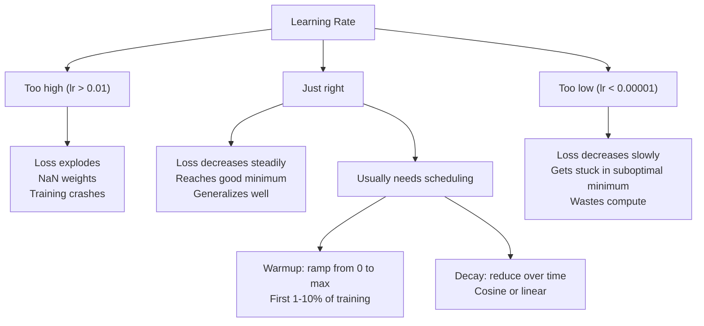
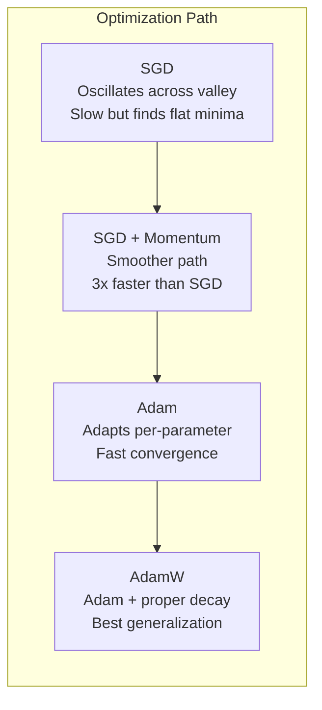
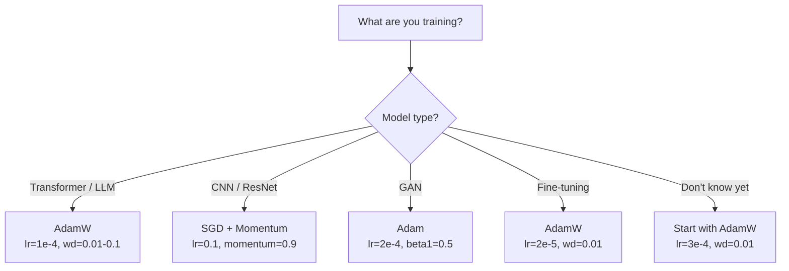

# Otimizadores

> A descida gradiente diz-lhe em que direcção se mover, não diz nada sobre a distância ou a velocidade.

**Type:** Build
**Languages:** Python
**Prerequisites:** Lesson 03.05 (Loss Functions)
**Time:** ~75 minutes

## Objetivos de aprendizagem

- Implementar SGD, SGD com impulso, Adam e AdamW optimizadores a partir do zero em Python
- Explique como a correção de preconceito de Adão compensa as estimativas de momento initializadas em zero nas primeiras etapas de treinamento
- Demonstrar por que o AdamW produz uma melhor generalização do que o Adam com regularização L2 na mesma tarefa
- Selecione o optimizador adequado e os hiperparâmetros padrão para transformadores, CNNs, GANs e ajustes finos

## O problema

Você calculou os gradientes. Você sabe que o peso # 4.721 deve diminuir 0,003 para reduzir a perda. Mas 0,003 em que unidades? Escalado por que? E você deve mover a mesma quantidade no passo 1 como no passo 1,000?

A descida do gradiente de vanilla aplica a mesma taxa de aprendizagem a todos os parâmetros em cada etapa: $w = w - \text{lr} \cdot \text{gradient}$Isto cria três problemas que tornam doloroso o treinamento das redes neurais na prática.

Primeiro, oscilação. A paisagem de perdas raramente tem a forma de uma tigela lisa. É mais como um vale longo e estreito. A gradiente aponta através do vale (direção íngreme), não ao longo dele (direção de fundo). A descida gradual rebote para frente e para trás através da dimensão estreita, enquanto faz pequenos progressos ao longo da útil. Viste isto: a perda cai rapidamente depois dos planaltos, não porque o modelo converge mas porque está oscilando.

Em segundo lugar, uma taxa de aprendizagem para todos os parâmetros é errada. Alguns pesos precisam de grandes atualizações (eles estão no estágio inicial, de falta de ajuste). Outros precisam de pequenas atualizações (eles estão perto de seu valor ideal).

Terceiro, pontos de sela. Em dimensões altas, a paisagem de perdas tem vastas regiões planas onde o gradiente é próximo de zero. SGD de vainilha rasteja através delas à velocidade do gradiente, que é efetivamente zero. O modelo parece preso. Não está preso - está em uma região plana com descida útil do outro lado. Mas SGD não tem nenhum mecanismo para empurrar através.

O Adam resolve as três. Mantém duas médias em execução por parâmetro - o gradiente médio (momento, manipula oscilação) e o gradiente quadrado médio (taxa adaptativa, manipula escalas diferentes). Combinado com correção de preconceito para as primeiras etapas, dá-lhe um único optimizador que funciona em 80% dos problemas com hiperparâmetros padrão. Esta lição construiu-o do zero para que você entenda exatamente quando e por que falha nos outros 20%.

## O conceito

### Descenso de gradiente estocástico (SGD)

Otimizador mais simples: calcular o gradiente num mini-batch e dar um passo na direção oposta.

```math
w = w - \text{lr} \cdot \text{gradient}
```

O "estocástico" significa que se usa um subconjunto aleatório (mini-batch) de dados para estimar o gradiente, em vez do conjunto completo de dados. Este ruído é realmente útil - ajuda a escapar a mínimos locais nítidos. Mas o ruído também causa oscilação.

A taxa de aprendizagem é a única ponta. Muito alta: a perda diverge. Muito baixa: o treinamento leva para sempre. O valor ideal depende da arquitetura, dos dados, do tamanho do lote e da fase atual do treinamento. Para a SGD de baunilha nas redes modernas, os valores típicos variam de 0,01 a 0,1. Mas mesmo dentro de uma única corrida de treinamento, a taxa de aprendizagem ideal muda.

### Impulso

A analogia de bola-rolando-descer é excessivamente usada, mas precisa. Em vez de pisar apenas o gradiente, você mantém uma velocidade que se acumula em gradientes anteriores.

```math
\begin{aligned}
m_t &= \beta \, m_{t-1} + \text{gradient} \\
w &= w - \text{lr} \cdot m_t
\end{aligned}
```

Beta (normalmente 0,9) controla a quantidade de história a manter.$\beta = 0.9$, o momento é aproximadamente a média dos últimos 10 gradientes ($1 / (1 - 0.9) = 10$)).

Por que isso corrige a oscilação: gradientes que apontam na mesma direção se acumulam. Gradientes que desviam a direção cancelam. Nesse vale estreito, o componente "cross" vira a marca de cada passo e diminui. O componente "along" permanece consistente e se amplifica. O resultado é uma aceleração suave na direção útil.

Os números reais: só o SGD num cenário de perdas mal condicionado pode levar 10 000 passos.$\beta = 0.9$O processo de aceleração não é marginal.

### RMSProp

O primeiro método de taxa de aprendizagem adaptativa por parâmetro que realmente funcionou. Proposto por Hinton em uma palestra do Coursera (nunca publicado formalmente).

```math
\begin{aligned}
s_t &= \beta \, s_{t-1} + (1 - \beta) \cdot \text{gradient}^2 \\
w &= w - \text{lr} \cdot \frac{\text{gradient}}{\sqrt{s_t} + \epsilon}
\end{aligned}
```

$s_t$Os parâmetros com gradientes consistentemente grandes são divididos por um grande número (taxa de aprendizagem eficaz menor).

Isto resolve o problema de "uma taxa de aprendizagem para todos os parâmetros". Um peso que já recebeu grandes atualizações provavelmente está perto do seu objetivo - desacelerá-lo. Um peso que recebeu pequenas atualizações pode ser subtraído - acelerá-lo.

O Epsilon (tipicamente 1e-8) impede a divisão por zero quando um parâmetro não foi atualizado.

### Adam: Momentum + RMSProp

Adam combina ambas as ideias, mantendo duas médias móveis exponenciais por parâmetro:

```math
\begin{aligned}
m_t &= \beta_1 m_{t-1} + (1 - \beta_1) \cdot \text{gradient} && \text{(first moment: mean)} \\
v_t &= \beta_2 v_{t-1} + (1 - \beta_2) \cdot \text{gradient}^2 && \text{(second moment: variance)}
\end{aligned}
```

**Bias correction**É o detalhe chave que a maioria das explicações não dá.$m_1 = (1 - \beta_1) \cdot \text{gradient}$- Com o$\beta_1 = 0.9$- Não, não.$0.1 \cdot \text{gradient}$A média móvel ainda não aqueceu.

```math
\begin{aligned}
\hat{m} &= \frac{m_t}{1 - \beta_1^t} \\
\hat{v} &= \frac{v_t}{1 - \beta_2^t}
\end{aligned}
```

No primeiro passo com $\beta_1 = 0.9$- Não .$\hat{m} = m_1 / (1 - 0.9) = m_1 / 0.1 =$O gradiente real.$(1 - 0.9^{100})$A correção de bias importa para os primeiros ~ 10 passos e é irrelevante após ~ 50.

A actualização:

```math
w = w - \text{lr} \cdot \frac{\hat{m}}{\sqrt{\hat{v}} + \epsilon}
```

Adão por defeito: $\text{lr} = 0.001$- Não .$\beta_1 = 0.9$- Não .$\beta_2 = 0.999$- Não .$\epsilon = 10^{-8}$Estes padrões funcionam para 80% dos problemas.$\beta_2$Quase nunca mudam .$\beta_1$ou $\epsilon$- Não .

### A perda de peso foi feita corretamente

A regularização L2 adiciona $\lambda w^2$Em SGD de baunilha, isto é equivalente a decadência de peso (subtraindo$\lambda w$Em Adão, esta equivalência rompe.

A visão de Loshchilov & Hutter: quando adicionamos L2 à perda e depois Adam processa o gradiente, a taxa de aprendizagem adaptativa escala o termo de regularização também. Parâmetros com grande variação de gradiente obtêm menos regularização. Parâmetros com pequena variação obtêm mais. Isto não é o que você quer - você quer regularização uniforme independentemente das estatísticas de gradiente.

A AdamW corrige isto aplicando a perda de peso diretamente aos pesos, após a atualização do Adam:

```math
w = w - \text{lr} \cdot \frac{\hat{m}}{\sqrt{\hat{v}} + \epsilon} - \text{lr} \cdot \lambda w
```

O termo de declínio do peso ($\text{lr} \cdot \lambda w$Cada parâmetro tem a mesma contração proporcional.

Isto parece um detalhe menor. Não é. O AdamW converge para melhores soluções do que a regularização de Adam + L2 em praticamente todas as tarefas. É o optimizador padrão no PyTorch para treinamento de transformadores, modelos de difusão e a maioria das arquiteturas modernas. BERT, GPT, LLaMA, Diffusão estável - todos treinados com o AdamW.

### Taxa de aprendizagem: o hiperparâmetro mais importante



Se ajustar um hiperparâmetro, ajuste a taxa de aprendizagem. Uma mudança 10x na taxa de aprendizagem importa mais do que qualquer decisão arquitetônica que você tome.

- SGD: lr = 0,01 a 0,1
- Adam/AdamW: lr = 1e-4 a 3e-4
- Modelos pré-treinados para ajuste fino: lr = 1e-5 a 5e-5
- Aquecimento da taxa de aprendizagem: rampa linear durante os primeiros 1-10% das etapas

### Comparador de Optimização



### Quando cada optimizador ganha



```figure
optimizer-trajectory
```

## Construí-lo

### Passo 1: SGD de vainilha

```python
class SGD:
    def __init__(self, lr=0.01):
        self.lr = lr

    def step(self, params, grads):
        for i in range(len(params)):
            params[i] -= self.lr * grads[i]
```

### Passo 2: SGD com Momentum

```python
class SGDMomentum:
    def __init__(self, lr=0.01, beta=0.9):
        self.lr = lr
        self.beta = beta
        self.velocities = None

    def step(self, params, grads):
        if self.velocities is None:
            self.velocities = [0.0] * len(params)
        for i in range(len(params)):
            self.velocities[i] = self.beta * self.velocities[i] + grads[i]
            params[i] -= self.lr * self.velocities[i]
```

### Passo 3: Adão

```python
import math

class Adam:
    def __init__(self, lr=0.001, beta1=0.9, beta2=0.999, epsilon=1e-8):
        self.lr = lr
        self.beta1 = beta1
        self.beta2 = beta2
        self.epsilon = epsilon
        self.m = None
        self.v = None
        self.t = 0

    def step(self, params, grads):
        if self.m is None:
            self.m = [0.0] * len(params)
            self.v = [0.0] * len(params)

        self.t += 1

        for i in range(len(params)):
            self.m[i] = self.beta1 * self.m[i] + (1 - self.beta1) * grads[i]
            self.v[i] = self.beta2 * self.v[i] + (1 - self.beta2) * grads[i] ** 2

            m_hat = self.m[i] / (1 - self.beta1 ** self.t)
            v_hat = self.v[i] / (1 - self.beta2 ** self.t)

            params[i] -= self.lr * m_hat / (math.sqrt(v_hat) + self.epsilon)
```

### Passo 4: AdamW

```python
class AdamW:
    def __init__(self, lr=0.001, beta1=0.9, beta2=0.999, epsilon=1e-8, weight_decay=0.01):
        self.lr = lr
        self.beta1 = beta1
        self.beta2 = beta2
        self.epsilon = epsilon
        self.weight_decay = weight_decay
        self.m = None
        self.v = None
        self.t = 0

    def step(self, params, grads):
        if self.m is None:
            self.m = [0.0] * len(params)
            self.v = [0.0] * len(params)

        self.t += 1

        for i in range(len(params)):
            self.m[i] = self.beta1 * self.m[i] + (1 - self.beta1) * grads[i]
            self.v[i] = self.beta2 * self.v[i] + (1 - self.beta2) * grads[i] ** 2

            m_hat = self.m[i] / (1 - self.beta1 ** self.t)
            v_hat = self.v[i] / (1 - self.beta2 ** self.t)

            params[i] -= self.lr * m_hat / (math.sqrt(v_hat) + self.epsilon)
            params[i] -= self.lr * self.weight_decay * params[i]
```

### Passo 5: Comparar a formação

Treinar a mesma rede de duas camadas no conjunto de dados do círculo da lição 05 com os quatro optimizadores.

```python
import random

def sigmoid(x):
    x = max(-500, min(500, x))
    return 1.0 / (1.0 + math.exp(-x))

def make_circle_data(n=200, seed=42):
    random.seed(seed)
    data = []
    for _ in range(n):
        x = random.uniform(-2, 2)
        y = random.uniform(-2, 2)
        label = 1.0 if x * x + y * y < 1.5 else 0.0
        data.append(([x, y], label))
    return data


class OptimizerTestNetwork:
    def __init__(self, optimizer, hidden_size=8):
        random.seed(0)
        self.hidden_size = hidden_size
        self.optimizer = optimizer

        self.w1 = [[random.gauss(0, 0.5) for _ in range(2)] for _ in range(hidden_size)]
        self.b1 = [0.0] * hidden_size
        self.w2 = [random.gauss(0, 0.5) for _ in range(hidden_size)]
        self.b2 = 0.0

    def get_params(self):
        params = []
        for row in self.w1:
            params.extend(row)
        params.extend(self.b1)
        params.extend(self.w2)
        params.append(self.b2)
        return params

    def set_params(self, params):
        idx = 0
        for i in range(self.hidden_size):
            for j in range(2):
                self.w1[i][j] = params[idx]
                idx += 1
        for i in range(self.hidden_size):
            self.b1[i] = params[idx]
            idx += 1
        for i in range(self.hidden_size):
            self.w2[i] = params[idx]
            idx += 1
        self.b2 = params[idx]

    def forward(self, x):
        self.x = x
        self.z1 = []
        self.h = []
        for i in range(self.hidden_size):
            z = self.w1[i][0] * x[0] + self.w1[i][1] * x[1] + self.b1[i]
            self.z1.append(z)
            self.h.append(max(0.0, z))

        self.z2 = sum(self.w2[i] * self.h[i] for i in range(self.hidden_size)) + self.b2
        self.out = sigmoid(self.z2)
        return self.out

    def compute_grads(self, target):
        eps = 1e-15
        p = max(eps, min(1 - eps, self.out))
        d_loss = -(target / p) + (1 - target) / (1 - p)
        d_sigmoid = self.out * (1 - self.out)
        d_out = d_loss * d_sigmoid

        grads = [0.0] * (self.hidden_size * 2 + self.hidden_size + self.hidden_size + 1)
        idx = 0
        for i in range(self.hidden_size):
            d_relu = 1.0 if self.z1[i] > 0 else 0.0
            d_h = d_out * self.w2[i] * d_relu
            grads[idx] = d_h * self.x[0]
            grads[idx + 1] = d_h * self.x[1]
            idx += 2

        for i in range(self.hidden_size):
            d_relu = 1.0 if self.z1[i] > 0 else 0.0
            grads[idx] = d_out * self.w2[i] * d_relu
            idx += 1

        for i in range(self.hidden_size):
            grads[idx] = d_out * self.h[i]
            idx += 1

        grads[idx] = d_out
        return grads

    def train(self, data, epochs=300):
        losses = []
        for epoch in range(epochs):
            total_loss = 0.0
            correct = 0
            for x, y in data:
                pred = self.forward(x)
                grads = self.compute_grads(y)
                params = self.get_params()
                self.optimizer.step(params, grads)
                self.set_params(params)

                eps = 1e-15
                p = max(eps, min(1 - eps, pred))
                total_loss += -(y * math.log(p) + (1 - y) * math.log(1 - p))
                if (pred >= 0.5) == (y >= 0.5):
                    correct += 1
            avg_loss = total_loss / len(data)
            accuracy = correct / len(data) * 100
            losses.append((avg_loss, accuracy))
            if epoch % 75 == 0 or epoch == epochs - 1:
                print(f"    Epoch {epoch:3d}: loss={avg_loss:.4f}, accuracy={accuracy:.1f}%")
        return losses
```

## Usá-lo

Os otimizadores PyTorch tratam grupos de parâmetros, corte de gradientes e agendamento de taxa de aprendizagem:

```python
import torch
import torch.optim as optim

model = torch.nn.Sequential(
    torch.nn.Linear(784, 256),
    torch.nn.ReLU(),
    torch.nn.Linear(256, 10),
)

optimizer = optim.AdamW(model.parameters(), lr=3e-4, weight_decay=0.01)

scheduler = optim.lr_scheduler.CosineAnnealingLR(optimizer, T_max=100)

for epoch in range(100):
    optimizer.zero_grad()
    output = model(torch.randn(32, 784))
    loss = torch.nn.functional.cross_entropy(output, torch.randint(0, 10, (32,)))
    loss.backward()
    torch.nn.utils.clip_grad_norm_(model.parameters(), max_norm=1.0)
    optimizer.step()
    scheduler.step()
```

O padrão é sempre: zero_grad, para frente, perda, para trás, (clip), passo, (orágio). Memorize essa ordem.

Para os CNNs, muitos praticantes ainda preferem SGD + impulso (lr=0,1, impulso=0,9, peso_descaso=1e-4) com um cronograma de passo ou cosino. SGD encontra mínimos mais planos, que geralmente se generalizam melhor. Para transformadores e LLM, AdamW com aquecimento + decadência cosina é o padrão universal. Não lute contra o consenso sem uma razão medida.

## Envia-o

Esta lição produz:
- `outputs/prompt-optimizer-selector.md`-- um impulso de decisão para escolher otimizador certo e taxa de aprendizagem para qualquer arquitetura

## Exercícios

1. Implementar o momento de Nesterov, onde você calcula o gradiente na posição "lookhead" ($w - \text{lr} \cdot \beta v$Compare a convergência com o impulso padrão no conjunto de dados do círculo.

2. Implementar um cronograma de aquecimento de aprendizagem: rampa linear de 0 a max_lr durante os primeiros 10% das etapas de treinamento, em seguida, decadência cosina para 0. Treinar com Adam + aquecimento vs. Adam sem aquecimento. Medir quantas épocas é necessário para atingir 90% de precisão no conjunto de dados do círculo.

3. A taxa de aprendizagem eficaz para cada parâmetro durante o treinamento de Adam.$\text{lr} \cdot \hat{m} / (\sqrt{\hat{v}} + \epsilon)$- Descrever a distribuição das taxas efetivas após 10, 50 e 200 passos.

4. Implemente o corte de gradiente (clipe por norma global). Defina a norma de gradiente máximo para 1.0. Treine com e sem corte usando uma alta taxa de aprendizagem (lr=0,01 para Adam). Conte quantas corridas divergem (perda vai para NaN) com e sem corte de mais de 10 sementes aleatórias.

5. Compare Adam vs. AdamW em uma rede com grandes pesos. Iniciar todos os pesos para valores aleatórios em [-5, 5] (muito maior do que o normal). Treinar por 200 épocas com peso_decay = 0,1.

## Termos-chave

| Term | What people say | What it actually means |
|------|----------------|----------------------|
| Learning rate | "Step size" | The scalar multiplier on the gradient update; the single most impactful hyperparameter in training |
| SGD | "Basic gradient descent" | Stochastic gradient descent: update weights by subtracting $\text{lr} \cdot \text{gradient}$, computed on a mini-batch |
| Momentum | "Rolling ball analogy" | Exponential moving average of past gradients; dampens oscillation and accelerates consistent directions |
| RMSProp | "Adaptive learning rate" | Divides each parameter's gradient by the running RMS of its recent gradients; equalizes learning rates |
| Adam | "The default optimizer" | Combines momentum (first moment) and RMSProp (second moment) with bias correction for the initial steps |
| AdamW | "Adam done right" | Adam with decoupled weight decay; applies regularization directly to weights rather than through the gradient |
| Bias correction | "Warmup for running averages" | Dividing by $(1 - \beta^t)$ to compensate for the zero-initialization of Adam's moment estimates |
| Weight decay | "Shrink the weights" | Subtracting a fraction of the weight value at each step; a regularizer that penalizes large weights |
| Learning rate schedule | "Changing lr over time" | A function that adjusts the learning rate during training; warmup + cosine decay is the modern default |
| Gradient clipping | "Capping the gradient norm" | Scaling down the gradient vector when its norm exceeds a threshold; prevents exploding gradient updates |

## Mais leitura

- Kingma & Ba, "Adam: Um Método para a Optimização Stocástica" (2014) -- o original papel Adam com análise de convergência e a derivação de correção de viés
- Loshchilov & Hutter, "Regularização Decadência de Peso Desacoplada" (2017) -- provou que a regularização de L2 e a perda de peso não são equivalentes em Adam, e propôs AdamW
- Smith, "Taxas de aprendizagem cíclicas para treinamento de redes neurais" (2017) -- introduziu o teste de faixa LR e os horários cíclicos que removem a necessidade de ajustar uma taxa de aprendizagem fixa
- Ruder, "Uma visão geral dos algoritmos de otimização de descida gradual" (2016) - a melhor pesquisa única de todas as variantes do optimizador, com comparações e intuições claras
