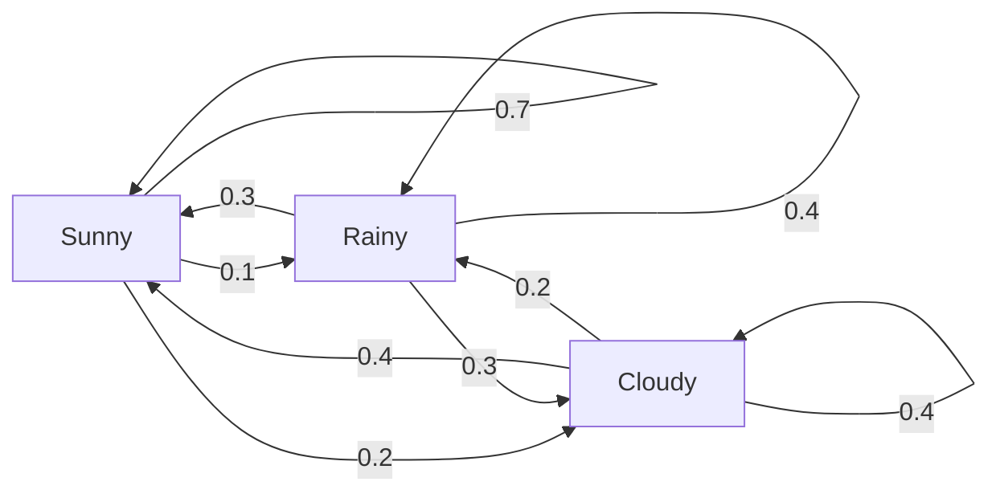
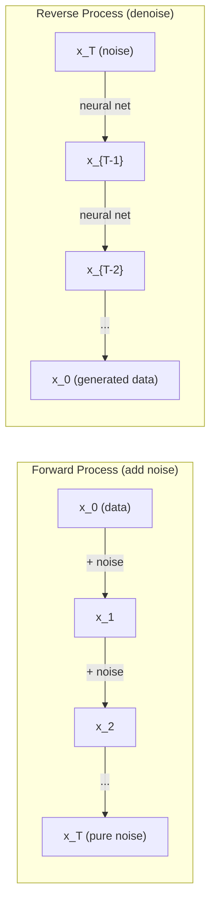

# Stochastic Prosesler

> Rastgele yürüyüşlerin, Markov zincirlerinin ve difüzyon modellerinin arkasındaki matematik.

**Type:** Learn
**Language:**Python
**Prerequisites:** Phase 1, Lessons 06-07 (probability, Bayes)
**Time:** ~75 minutes

## Öğrenme Hedefleri

- 1D ve 2D rastgele yürüyüşleri simüle edin ve $\sqrt{n}$Yer değiştirme oranı
- Markov zinciri simülatörü oluşturun ve kendi kompozisyon yoluyla sabit dağılımını hesaplayın
- Metropolis-Hastings MCMC ve Langevin dinamiklerini hedef dağıtımlardan örnek almak için uygula
- Önceki difüzyon sürecini Brownian hareketi ile bağlayın ve ters süreçten veri nasıl üretildiğini açıklayın

## Sorun

Birçok AI sistemi zamanla gelişen rastlantıyı içerir. Statik rastlantıyı değil, her adımın daha önce gelenlere bağlı olduğu yapılandırılmış, sıralı rastlantıyı.

Dil modelleri bir seferde birer token oluşturur. Her token önceki bağlamdan bağlıdır. Model bir olasılık dağılımını, örnekleri çıkarır ve ilerler. Bu bir stohastik süreçtir.

Diffusion modelleri saf statik olana kadar bir görüntüye adım adım gürültü ekler. Sonra da süreci tersine çevirirler, yeni bir görüntü ortaya çıkana kadar adım adım denetler. Önüme giden süreç Markov zinciridir. Geriye giden süreç, geriye giden öğrenilmiş bir Markov zinciridir.

Bir ortamda güçlendirme öğrenme ajanları eylemler yapar. Her eylem bir olasılık ile yeni bir duruma yol açar. Bir rastgele dünyada rastgele bir politika izler. Tüm şey bir Markov karar süreci.

MCMC örneklemesi Bayesian sonuçlarının omurgası, Markov zincirini oluşturur.

Bunların hepsi dört temel fikir üzerine kuruluyor:
1. Rastgele yürüyüşler -- en basit stohastik süreç
2. Markov zincirleri -- geçiş matrisi ile yapılandırılmış rastlantı
3. Langevin dinamikleri - gürültü ile gradient düşüşü
4. Metropolis-Hastings - herhangi bir dağıtımdan örnek almak

## Anlaşım

### - Rastgele Yürüyüşler

0 pozisyonundan başlayın. Her adımda adil bir madeni para atın. Başlar: sağ (+1) hareket et. Kuyruklar: sola (-1) hareket et.

Sonra .$n$Adımlar, pozisyonunuz toplamdır.$n$ rastgele$\pm 1$Bu değerler, beklenen konum 0'dur (yolculuk tarafsızdır).$\sqrt{n}$- Evet .

Bu mantıklı değil. Yürüyüş adil. Her iki yönde de hareket etmez. Ama zamanla, başlangıçtan daha da uzaklaşır.$n$adımlar $\sqrt{n}$- Evet .

```
Step 0:  Position = 0
Step 1:  Position = +1 or -1
Step 2:  Position = +2, 0, or -2
...
Step 100: Expected distance from origin ~ 10 (sqrt(100))
Step 10000: Expected distance from origin ~ 100 (sqrt(10000))
```

**In 2D**, yürüyüş yukarı, aşağı, sola veya sağa doğru aynı olasılıkla hareket eder.$\sqrt{n}$Skalalama, kökenden uzaklıkta geçer.

**Why $\sqrt{n}$?**Her adım aynı olasılıkla +1 veya -1'dir.$n$Adımlar, pozisyon $S_n = X_1 + X_2 + \cdots + X_n$her biri$X_i$- Evet .$\pm 1$. Her adımın farkı 1 ve adımlar bağımsızdır, bu yüzden $\mathop{\mathrm{Var}}(S_n) = n$. Standart sapma = $\sqrt{n}$Merkez sınır teoremi ile,$S_n / \sqrt{n}$standart normal bir dağılım ile birleşti.

Bu ...$\sqrt{n}$Skalalama ML'de her yerde görünür. SGD gürültü ölçekleri 1/sqrt(batch_size olarak yerleştirilmiştir.$\sqrt{d}$- Karek kök bağımsız rastgele eklemlerin imzası.

**Connection to Brownian motion.**Adım boyutları ile rastgele yürüyüş yapın .$1/\sqrt{n}$ve $n$Zaman biriminde adımlar.$n$Sonsuzluğa giderken, yürüyüş Brownian hareketine doğru birleşti.$B(t)$-- sürekli bir süreçtir.$B(t)$Normalde ortalama 0 ve varyansa ile paylaşılan bir $t$- Evet .

Brownian hareketi, difüzyonun matematiksel temelidir. Bir sıvıdaki parçacıkların rastgele titreşimini, hisse senet fiyatlarının dalgalanmasını ve - en önemlisi - difüzyon modellerinde gürültü sürecini modellemektedir.

**Gambler's ruin.**Bir random yürüyüşcü pozisyonundan başlayarak .$k$, absorber engeller 0 ve $N$- Başarılı olma olasılığı nedir ?$N$- Doğru bir yürüyüş için:$P(\text{reach } N) = k/N$Bu şaşırtıcı derecede basit ve zarif. Martingale teorisi ile bağlantılıdır -- adil rastgele yürüyüş bir martingale (bütün beklenen gelecek değeri = mevcut değer).

### Markov Zincirleri

Markov zinciri, sabit olasılıklara göre eyaletler arasında geçiş yapan bir sistemdir. Ana özellik: bir sonraki devlet sadece tarihte değil, mevcut durumda bağlıdır.

```math
P(X_{t+1} = j \mid X_t = i, X_{t-1} = \ldots) = P(X_{t+1} = j \mid X_t = i)
```

Bu Markov özelliği. Tüm dinamikleri geçiş matrisi ile tarif edebilirsiniz.$P$- ...

```math
P[i][j] = \text{probability of going from state } i \text{ to state } j
```

Her satır $P$1'e kadar bir miktar (bir yere gitmelisin).

**Example -- Weather:**

```
States: Sunny (0), Rainy (1), Cloudy (2)

P = [[0.7, 0.1, 0.2],    (if sunny: 70% sunny, 10% rainy, 20% cloudy)
     [0.3, 0.4, 0.3],    (if rainy: 30% sunny, 40% rainy, 30% cloudy)
     [0.4, 0.2, 0.4]]    (if cloudy: 40% sunny, 20% rainy, 40% cloudy)
```

Birçok geçişten sonra, devletlerin dağılımı sabit dağılımlara yaklaşıyor.$\pi$, nerede $\pi P = \pi$Bu sol öz vektörü.$P$1. öz değerli.

Hava zinciri için, sabit dağılım [0.55, 0.18, 0.27] -- uzun vadede, başlangıç durumundan bağımsız olarak, zamanın %55'inde güneşli.



**Computing the stationary distribution.**İki yaklaşım vardır:

1. **Power method**: herhangi bir başlangıç dağıtımını çarpı $P$Yeterli tekrarlardan sonra, birbiriyle yaklaşıyor.
2. **Eigenvalue method**: sol öz vektörü bul $P$Bu öz vektörü $P^T$1. öz değerli.

Her iki yaklaşım da zincirin konverjense koşullarını karşılamasını gerektirir.

**Convergence conditions.**Bir Markov zinciri, eğer:
- **Irreducible**Her eyalete diğer eyaletlerden ulaşılabilir.
- **Aperiodic**: zincir belirli bir süreyle döngülenmez

ML'de karşılaştığınız zincirlerin çoğu her iki şartı da karşılar.

**Absorbing states.**Bir devlet içine girdiğin zaman asla çıkmazsan, onu içine alıyorsun.$P[i][i] = 1$Markov zincirlerini terminal durumlarla modellemenin içine alıyor. Sonlanan bir oyun, çırpınan bir müşteri, metin sonundaki bir token'e çarpan bir token dizisi.

**Mixing time.**Düzgün dağılım zincirinin "yaklaşması" için kaç adım var? Formal olarak, düzgünlüğün toplam değişim mesafesine kadar adım sayısı bir eşiğin altında düşer.$P$(1 eksi ikinci en büyük öz değeri) karıştırma süresini kontrol eder.

### Dil Modelleri ile Bağlantı

Bir dil modelinde simge üretimi yaklaşık olarak Markov işlemidir. Şu anki bağlamı göz önüne alarak, model bir sonraki simge üzerinde bir dağılım çıkarır.

```math
P(\text{token}_i) = \frac{\exp(\text{logit}_i / \text{temperature})}{\sum_j \exp(\text{logit}_j / \text{temperature})}
```

- Sıcaklık = 1,0: standart dağılım
- Temperatür < 1,0: keskin (öntemsel)
- Temperatür > 1,0: daha düz (daha rastgele)
-               $\to 0$: argmax (açık)

Üst-k örnekleme kesikleri $k$En yüksek olasılıklı tokenler. Top-p (nukleus) örnekleme, toplu olasılıktan daha büyük olan en küçük token kümesine kısaltılır $p$Her ikisi de Markov geçiş olasılığını değiştirir.

### Brownian Hareketi

- Rastgele yürüyüşün sürekli zaman sınırı.$B(t)$üç özelliklere sahiptir:
1. $B(0) = 0$
2. $B(t) - B(s)$Normalde ortalama 0 ve varyansa ile paylaşılan bir $t - s$(çünkü)$t > s$)
3. Dönüşmeyen aralıklarda artışlar bağımsızdır.

Brownian hareketi sürekli ama hiçbir yerde ayırt edilemez. Her ölçekte titreşiyor. Yolu düzlemde fraktal boyut 2'e sahiptir.

Ayrı simülasyonda Brownian hareketi ile yaklaşır:

```math
B(t + dt) = B(t) + \sqrt{dt} \, z, \quad \text{where } z \sim \mathcal{N}(0, 1)
```

- Evet .$\sqrt{dt}$Bu, rastgele yürüyüşlere uygulanan merkezi sınır teoreminden geliyor.

### Langevin Dinamikleri

Langevin dinamikleri olasılıkla dağılımın $\exp(-U(x)/T)$, nerede $U$enerji fonksiyonu ve $T$sıcaklık.

```math
x_{t+1} = x_t - dt \, \nabla U(x_t) + \sqrt{2 T \, dt} \, z_t
```

Parçacık üzerinde iki güç etkilidir:
1. **Gradient force**($-dt \cdot \nabla U$): düşük enerjiye doğru (gredyen düşüşü gibi) itmektedir
2. **Random force**($\sqrt{2T dt} \cdot z$): rastgele yönlerde itme (kaşlama)

        $T = 0$Bu, yüksek sıcaklıklarda neredeyse rastgele bir yürüyüştür. Doğru sıcaklıkta, parçacık enerji manzarasını keşfeder ve düşük enerji bölgelerinde daha fazla zaman geçirir.

**Connection to diffusion models.**Bir difüzyon modelinin ileriye doğru süreci:

```math
x_t = \sqrt{\alpha_t} \, x_{t-1} + \sqrt{1 - \alpha_t} \cdot \text{noise}
```

Bu Markov zinciri, veriyi gürültü ile yavaş yavaş karıştırıyor.$x_T$saf Gaussian gürültüsü.

Geri dönüş süreci - gürültüden veriye dönüş - aynı zamanda Markov zinciri, ama geçiş olasılığı bir nöral ağ tarafından öğrenilmiştir. Ağ her adımda eklenen gürültüyü tahmin etmeyi öğrenir, sonra da onu çıkarır.



### MCMC: Markov Chain Monte Carlo

Bazen bir dağıtımdan örnek almak gerekir.$p(x)$Bayesian pozteriörleri klasik örnekler -- olasılığı önceden çarpıyor, ama normalleştirme sabitleri çözülemez.

**Metropolis-Hastings**Markov zinciri inşa ederken sabit dağılımları $p(x)$- ...

1. Bir pozisyondan başla.$x$
2. Yeni bir pozisyon önerin .$x'$Teklif dağıtımından$Q(x' \mid x)$
3. Hesaplama kabul oranı: $a = p(x') Q(x \mid x') / (p(x) Q(x' \mid x))$
4. Kabul et .$x'$- Büyük ihtimalle .$\min(1, a)$Yoksa kalın .$x$- Evet .
5. Tekrar ediyorum.

- Eğer$Q$simetriktir (örneğin, $Q(x' \mid x) = Q(x \mid x') = \mathcal{N}(x, \sigma^2){}$), oranı $a = p(x') / p(x)$Sadece olasılık oranına ihtiyacınız var. Normalleşen sabitler iptal edilir.

Zincir , $p(x)$Ancak, bir önerinin çok küçük olması (hassasi yürüyüş) veya çok büyük olması (yüksek reddedilme) durumunda, birleşme yavaş olabilir.

**Why it works.**Kabul oranı detaylı dengeni sağlar: $x$ve $x'$                                                                                                                                                                                                                                                                                                                                                                                                                                                                                                                             $x'$ve $x$Detaylı denge , $p(x)$Bu da zincirin sabit dağılımıdır.$p(x)$- Evet .

**Practical considerations:**
- **Burn-in**: ilkini at $N$zincir, başlangıç noktasından sabit dağıtımına ulaşmak için zaman gerektirir.
- **Thinning**: her birini tut .$k$-Auto-korrelasyonu azaltmak için.
- **Multiple chains**Eğer aynı dağılımlara doğru birleştilerse, birleştiği kanıtları elde edebilirsiniz.
- **Acceptance rate**: Gaussian önerileri için$d$Bu nedenle, bu zincirlerin en yüksek seviyelerinde, en iyi kabul oranı yaklaşık %23'dir (Roberts & Rosenthal, 2001).

### AI'de Stochastic Prosesler

| Process | AI Application |
|---------|---------------|
| Random walk | Exploration in RL, Node2Vec embeddings |
| Markov chain | Text generation, MCMC sampling |
| Brownian motion | Diffusion models (forward process) |
| Langevin dynamics | Score-based generative models, SGLD |
| Markov decision process | Reinforcement learning |
| Metropolis-Hastings | Bayesian inference, posterior sampling |

```figure
random-walk-diffusion
```

## Yapın

### Adım 1: Rastgele yürüyüş simülatörü

```python
import numpy as np

def random_walk_1d(n_steps, seed=None):
    rng = np.random.RandomState(seed)
    steps = rng.choice([-1, 1], size=n_steps)
    positions = np.concatenate([[0], np.cumsum(steps)])
    return positions


def random_walk_2d(n_steps, seed=None):
    rng = np.random.RandomState(seed)
    directions = rng.choice(4, size=n_steps)
    dx = np.zeros(n_steps)
    dy = np.zeros(n_steps)
    dx[directions == 0] = 1   # right
    dx[directions == 1] = -1  # left
    dy[directions == 2] = 1   # up
    dy[directions == 3] = -1  # down
    x = np.concatenate([[0], np.cumsum(dx)])
    y = np.concatenate([[0], np.cumsum(dy)])
    return x, y
```

1D yürüyüşü toplam toplamı saklar. her adım +1 veya -1.$n$Bu da bir değişikliğin bir kısmıdır.$n$, yani standart sapma $\sqrt{n}$- Evet .

### Adım 2: Markov zinciri

```python
class MarkovChain:
    def __init__(self, transition_matrix, state_names=None):
        self.P = np.array(transition_matrix, dtype=float)
        self.n_states = len(self.P)
        self.state_names = state_names or [str(i) for i in range(self.n_states)]

    def step(self, current_state, rng=None):
        if rng is None:
            rng = np.random.RandomState()
        probs = self.P[current_state]
        return rng.choice(self.n_states, p=probs)

    def simulate(self, start_state, n_steps, seed=None):
        rng = np.random.RandomState(seed)
        states = [start_state]
        current = start_state
        for _ in range(n_steps):
            current = self.step(current, rng)
            states.append(current)
        return states

    def stationary_distribution(self):
        eigenvalues, eigenvectors = np.linalg.eig(self.P.T)
        idx = np.argmin(np.abs(eigenvalues - 1.0))
        stationary = np.real(eigenvectors[:, idx])
        stationary = stationary / stationary.sum()
        return np.abs(stationary)
```

Duruşsuz dağılım sol öz vektörüdür $P$Bu değerleri kendi değerleri ile hesaplayarak buluruz.$P^T$(transposing sol öz vektörleri sağ öz vektörlere dönüştürür).

### Adım 3: Langevin dinamikleri

```python
def langevin_dynamics(grad_U, x0, dt, temperature, n_steps, seed=None):
    rng = np.random.RandomState(seed)
    x = np.array(x0, dtype=float)
    trajectory = [x.copy()]
    for _ in range(n_steps):
        noise = rng.randn(*x.shape)
        x = x - dt * grad_U(x) + np.sqrt(2 * temperature * dt) * noise
        trajectory.append(x.copy())
    return np.array(trajectory)
```

Yürüyüşte baskı yapılıyor .$x$Bu nedenle, bu durum, bir grup grup grup grup tarafından daha fazla kontrol edilmesini sağlayan bir sistemdir.$\exp(-U(x)/\text{temperature})$- Evet .

### Dördüncü Adım: Metropolis-Hastings

```python
def metropolis_hastings(target_log_prob, proposal_std, x0, n_samples, seed=None):
    rng = np.random.RandomState(seed)
    x = np.array(x0, dtype=float)
    samples = [x.copy()]
    accepted = 0
    for _ in range(n_samples - 1):
        x_proposed = x + rng.randn(*x.shape) * proposal_std
        log_ratio = target_log_prob(x_proposed) - target_log_prob(x)
        if np.log(rng.rand()) < log_ratio:
            x = x_proposed
            accepted += 1
        samples.append(x.copy())
    acceptance_rate = accepted / (n_samples - 1)
    return np.array(samples), acceptance_rate
```

Algoritm yeni bir noktayı önerir, daha yüksek olasılıkla olup olmadığını kontrol eder (veya oranla oranla kabul eder) ve tekrarlar. İyi karıştırma için kabul oranı yaklaşık 23-50% olmalıdır.

## Kullan

Bu algoritmalar için pratikte mevcut kütüphaneler kullanılır ama mekanikleri anlamak debugging ve ayarlama için önemlidir.

```python
import numpy as np

rng = np.random.RandomState(42)
walk = np.cumsum(rng.choice([-1, 1], size=10000))
print(f"Final position: {walk[-1]}")
print(f"Expected distance: {np.sqrt(10000):.1f}")
print(f"Actual distance: {abs(walk[-1])}")
```

### geçiş matrisleri için numpy

```python
import numpy as np

P = np.array([[0.7, 0.1, 0.2],
              [0.3, 0.4, 0.3],
              [0.4, 0.2, 0.4]])

distribution = np.array([1.0, 0.0, 0.0])
for _ in range(100):
    distribution = distribution @ P

print(f"Stationary distribution: {np.round(distribution, 4)}")
```

İlk dağıtımı  ile çarpın .$P$Bu, baskın sol öz vektörü bulmak için güç yöntemi.

### Gerçek çerçevelere bağlantılar

- **PyTorch diffusion:**- Evet .`DDPMScheduler`Yüzü sarılmış .`diffusers`Ön ve ters Markov zincirlerini uyguluyor
- **NumPyro / PyMC:**Bayesian sonuçları için MCMC (Metropolis-Hastings'de gelişen NUTS örneklemeci) kullanın
- **Gymnasium (RL):**Çevre adım işlevi Markov karar süreci tanımlar

### Markov zincirinin yakınlaşmasını doğrulama

```python
import numpy as np

P = np.array([[0.9, 0.1], [0.3, 0.7]])

eigenvalues = np.linalg.eigvals(P)
spectral_gap = 1 - sorted(np.abs(eigenvalues))[-2]
print(f"Eigenvalues: {eigenvalues}")
print(f"Spectral gap: {spectral_gap:.4f}")
print(f"Approximate mixing time: {1/spectral_gap:.1f} steps")
```

Spektral boşluk, zincirin başlangıç durumunu ne kadar hızlı unutuyor olduğunu gösterir. 0,2 boşluk yaklaşık 5 adım karışmak demektir. 0.01 boşluk yaklaşık 100 adım demektir. Uzun simülasyonlar çalıştırmadan önce bunu her zaman kontrol edin.

## Gönder

Bu ders şunları ortaya çıkarır:
- `outputs/prompt-stochastic-process-advisor.md`-- hangi stohastik süreç çerçevesinin belirli bir soruya uygulanacağını belirlemeye yardımcı olan bir ipucu

## Bağlantılar

| Concept | Where it shows up |
|---------|------------------|
| Random walk | Node2Vec graph embeddings, exploration in RL |
| Markov chain | Token generation in LLMs, MCMC sampling |
| Brownian motion | Forward diffusion process in DDPM, SDE-based models |
| Langevin dynamics | Score-based generative models, stochastic gradient Langevin dynamics (SGLD) |
| Stationary distribution | MCMC convergence target, PageRank |
| Metropolis-Hastings | Bayesian posterior sampling, simulated annealing |
| Temperature | LLM sampling, Boltzmann exploration in RL, simulated annealing |
| Mixing time | Convergence speed of MCMC, spectral gap analysis |
| Absorbing state | End-of-sequence token, terminal states in RL |
| Detailed balance | Correctness guarantee for MCMC samplers |

DDPM (Ho et al., 2020) ileri Markov zinciri tanımlar:

```math
q(x_t \mid x_{t-1}) = \mathcal{N}\left(x_t; \sqrt{1-\beta_t} \, x_{t-1}, \beta_t I\right)
```

nerede$\beta_t$- Bu bir gürültü programı.$T$adımlar,$x_T$Yaklaşık olarak $\mathcal{N}(0, I)$Geri dönüş süreci , gürültüyü tahmin eden bir nöral ağ tarafından parametrelidir:

```math
p_\theta(x_{t-1} \mid x_t) = \mathcal{N}\left(x_{t-1}; \mu_\theta(x_t, t), \sigma_t^2 I\right)
```

Her aşama öğrenilmiş bir Markov zincirinde bir adımdır. Markov zincirlerini anlamak, difüzyon modellerinin nasıl ve neden verileri ürettiğini anlamak demektir.

SGLD (Stochastic Gradient Langevin Dynamics) mini-batch gradient düşüşünü Langevin gürültüsü ile birleştirir. Tam gradiyenti hesaplamak yerine, bir stohastik tahmin kullanır ve kalibrli gürültü eklersiniz. Öğrenme hızı azalırken, SGLD optimizasyondan örnek alma geçişleri yapar -- Bayesian arka örnekleri ücretsiz olarak elde edersiniz. Bu, bir sinir ağından belirsizlik tahminlerini elde etmenin en basit yollarından biridir.

Tüm bu bağlantıların anahtar anlayışı: Stochastic süreçler sadece teorik araçlar değildir. Bunlar modern AI sistemlerinin içindeki hesaplama mekanizmaları. Bir LLM'nin sıcaklığını ayarladığında, Markov zincirini ayarlıyorsun. Bir difüzyon modeli eğitildiğinde, Brownian hareket benzeri bir süreci tersine çevirmeyi öğreniyorsun. Bayesian sonucu kullanırken, arka tarafına doğru bir zincir oluşturursunuz.

## Egzersizler

1. **Simulate 1000 random walks of 10000 steps.**Son pozisyonların dağılımını çizin. ortalama 0 ve standart sapma ile yaklaşık olarak Gaussian olduğunu doğrulayın.$\sqrt{10000} = 100$- Evet .

2. **Build a text generator using a Markov chain.**Küçük bir korpus üzerinde eğit: her kelime için, bir sonraki kelimeye geçişleri sayın. Değişim matrisi oluşturun. Zincirden örnek alarak yeni cümleler oluşturun.

3. **Implement simulated annealing**Metropolis-Hastings'i kullanın. Yüksek sıcaklıkta başlayın (geleneksel olarak her şeyi kabul edin) ve yavaş yavaş soğurun (sadece geliştirmeleri kabul edin).

4. **Compare Langevin dynamics at different temperatures.**İki tane kuyu potansiyelinden örnek$U(x) = (x^2 - 1)^2$Düşük sıcaklıkta örnekler bir kuyunun içinde toplanır. Yüksek sıcaklıkta, her iki kuyunun arasında karışan kritik sıcaklığı bulurlar.

5. **Implement the forward diffusion process.**1 boyutlu bir sinyalle başlayın (örneğin sinüs dalgası). Sıcak bir gürültü programı ile 100 adımdan fazla gürültü ekleyin. Sinyalın saf gürültüye nasıl düştüğünü gösterin. Sonra süreci tersine çeviren basit bir denoizer uygulayın (hətta tahmin edilen gürültüyü sadece çıkarırsa dahi saf bir şey).

### İpuçlar

**Exercise 1.**Arama .`random_walk_1d(10000, seed=i)`1000 tohum için ve her son pozisyonunu tutun. ortalamanın 0'ya yakın olup olmadığını kontrol edin, standart sapma 100'e yakın olup olmadığını ve son pozisyonların yaklaşık% 68'inin -100 ile 100 arasında olduğunu kontrol edin.

**Exercise 2.**Her kelime çiftini sayın, sonra her satırı toplamına bölün, böylece her satır 1'e kadar eklenir. Matrisi `MarkovChain(transition_matrix, state_names)`Ve aramak .`simulate`Çıkışınızdaki her kelime çiftinin de korpusda oluştuğunu kontrol edin.

**Exercise 3.**Daha kötü bir noktayı olasılık ile kabul et .$\exp(-\Delta / T)$ve kat kat .$T$Her adımda 0.99 gibi bir faktörle. En az bildiğiniz bir fonksiyon üzerinde test edin ve cevaplarınızı ince bir şebekede arama ile kontrol edin.

**Exercise 4.**- Değişiklik .$4x(x^2 - 1)$, o yüzden bunu `langevin_dynamics(grad_U, x0, dt, temperature, n_steps)`- Sınırın altında .$x = 0$1 yüksekliği var, bu yüzden işaretini sayın.$x$Temperatürlerin değişmesi için 0,05'den 1'e kadar ve sayının hızla yükselmeye başladığı sıcaklık için bak.

**Exercise 5.**Arama .`diffusion_forward(signal, 100)`ve hesaplama.$\bar{\alpha}$Son aşamada $(1 - \beta_t)$- Eğer ...$\bar{\alpha}$0'dan uzakta, sinyal henüz saf gürültü değil, bu yüzden yükselt.`beta_end`Önce denoiserinizi gerçek gürültü ile test edin .$(x_t - \sqrt{1 - \bar{\alpha}_t} \epsilon)/\sqrt{\bar{\alpha}_t}$Orijinal sinyalini tam olarak geri vermeli.

## Anahtar Terimler

| Term | What people say | What it actually means |
|------|----------------|----------------------|
| Random walk | "Coin-flip movement" | A process where position changes by random increments at each step |
| Markov property | "Memoryless" | The future depends only on the present state, not on the history |
| Transition matrix | "The probability table" | $P[i][j]$ = probability of moving from state $i$ to state $j$ |
| Stationary distribution | "The long-run average" | The distribution $\pi$ where $\pi P = \pi$ -- the chain's equilibrium |
| Brownian motion | "Random jiggling" | The continuous-time limit of a random walk, $B(t) \sim \mathcal{N}(0, t)$ |
| Langevin dynamics | "Gradient descent with noise" | Update rule that combines deterministic gradient and random perturbation |
| MCMC | "Walking toward the target" | Constructing a Markov chain whose stationary distribution is the one you want |
| Metropolis-Hastings | "Propose and accept/reject" | MCMC algorithm that uses acceptance ratios to ensure convergence |
| Temperature | "The randomness knob" | Parameter controlling the tradeoff between exploration and exploitation |
| Diffusion process | "Noise in, noise out" | Forward: gradually add noise. Reverse: gradually remove it. Generates data. |

## Daha Fazla Okumak

- **Ho, Jain, Abbeel (2020)**- "Difusion Model Probability Models'i Kulaklayan". - DDPM makalesinde, difüzyon model devrimini başlattı.
- **Song & Ermon (2019)**-- "Verilerin dağıtımının gradiyentlerini tahmin ederek jeneratif modellerleme".
- **Roberts & Rosenthal (2004)**"Genel devlet uzay Markov zincirleri ve MCMC algoritmaları". MCMC'nin ne zaman ve neden çalıştığını ortaya koyan teori.
- **Norris (1997)**- "Markov Zincirleri". Standart ders kitabı.
- **Welling & Teh (2011)**- "Stochastic Gradient Langevin Dinamikleri üzerinden Bayesian Öğrenimi".
