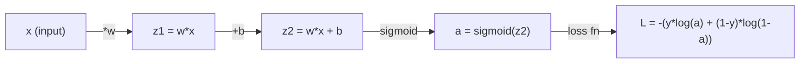
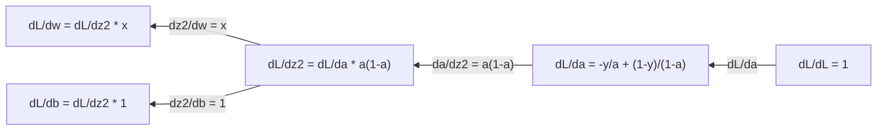
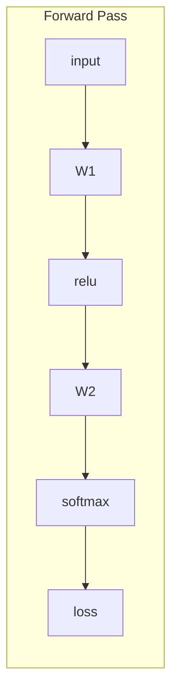
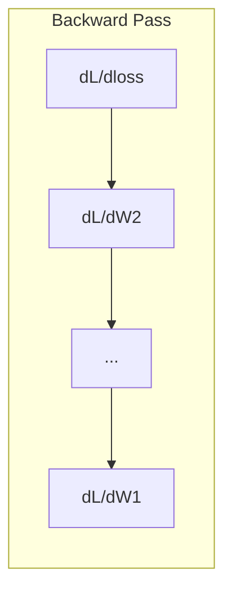

# Lượng tính toán cho máy học

> Các dẫn xuất cho bạn biết hướng xuống là gì. Đó là tất cả những gì một mạng thần kinh cần phải học.

**Type:** Learn
**Language:**Python
**Prerequisites:** Phase 1, Lessons 01-03
**Time:** ~60 minutes

## Mục tiêu học tập

- Xét số và phân tích dẫn xuất cho các hàm ML chung ($x^2$, sigmoid, cross-entropy)
- Thực hiện giảm gradient từ đầu để giảm thiểu hàm mất mát trong 1D và 2D
- Thuộc dẫn gradient của mô hình hồi quy tuyến tính và đào tạo nó thông qua cập nhật trọng lượng thủ công
- Giải thích các matrix Hessian, các phép so sánh chuỗi Taylor và mối liên hệ của chúng với các phương pháp tối ưu hóa

## Vấn đề

Bạn có một mạng lưới thần kinh với hàng triệu trọng lượng, mỗi trọng lượng là một nút, bạn cần phải tìm ra hướng nào để xoay mỗi nút để làm cho mô hình ít sai hơn một chút.

Nếu không có tính toán, đào tạo một mạng thần kinh sẽ có nghĩa là thử những thay đổi ngẫu nhiên và hy vọng cho tốt nhất. Với các phái sinh, bạn biết chính xác mỗi trọng lượng ảnh hưởng đến sai lầm. Bạn xoay mỗi nút đúng hướng, mỗi lần.

## Khái niệm

### Một dẫn xuất là gì?

Một phái sinh đo lường tỷ lệ thay đổi.$y = f(x)$, phái sinh $f'(x)$nói với bạn: nếu bạn đẩy $x$bằng một số lượng nhỏ, bao nhiêu là $y$thay đổi?

Về mặt hình học, dẫn xuất là độ nghiêng của đường ngã ở một điểm.

**$f(x) = x^2$:**

| $x$ | $f(x)$ | $f'(x)$ (slope) |
|---|------|---------------|
| 0 | 0    | 0 (flat, at the bottom) |
| 1 | 1    | 2 |
| 2 | 4    | 4 (tangent line slope at this point) |
| 3 | 9    | 6 |

Tại $x=2$, độ nghiêng là 4. Nếu bạn di chuyển $x$một chút về bên phải,$y$tăng khoảng 4 lần số tiền đó.$x=0$, độ nghiêng là 0. Bạn đang ở dưới cùng của bát.

Định nghĩa chính thức:

```math
f'(x) = \lim_{h \to 0} \frac{f(x + h) - f(x)}{h}
```

Trong mã, bạn bỏ qua giới hạn và chỉ sử dụng một rất nhỏ $h$Đó là dẫn xuất số.

### Các phái sinh một phần: một biến tại một thời điểm

Các hàm thực có nhiều đầu vào. Một mất mạng thần kinh phụ thuộc vào hàng ngàn trọng lượng. Một dẫn xuất một phần giữ tất cả các biến liên tục ngoại trừ một, sau đó lấy dẫn xuất liên quan đến một.

```math
\begin{aligned}
f(x, y) &= x^2 + 3xy + y^2 \\[4pt]
\frac{\partial f}{\partial x} &= 2x + 3y \quad \text{(treat } y \text{ as a constant)} \\
\frac{\partial f}{\partial y} &= 3x + 2y \quad \text{(treat } x \text{ as a constant)}
\end{aligned}
```

Mỗi dẫn xuất một phần trả lời: nếu tôi đẩy chỉ một trọng lượng này, làm thế nào để mất thay đổi?

### Các gradient: vector của tất cả các phái sinh một phần

gradient thu thập mọi dẫn xuất phân trong một vector.$f(x, y, z)$, độ nghiêng là:

```math
\nabla f = \left[ \frac{\partial f}{\partial x}, \frac{\partial f}{\partial y}, \frac{\partial f}{\partial z} \right]
```

Đi độ hướng về hướng leo cao nhất. Để giảm thiểu một chức năng, đi theo hướng ngược lại.

**Contour plot of $f(x,y) = x^2 + y^2$:**

Chức năng hình thành một hình thức bát với các vòng tròn tập trung như đường đường.

| Point | $\nabla f$ | $-\nabla f$ (descent direction) |
|-------|--------|----------------------------|
| (1, 1) | [2, 2] (points uphill, away from minimum) | [-2, -2] (points downhill, toward minimum) |
| (0, 0) | [0, 0] (flat, at the minimum) | [0, 0] |

Đây là sự giảm gradient trong một bức ảnh.

### Kết nối với tối ưu hóa

Việc đào tạo mạng thần kinh là tối ưu hóa.$L(w_1, w_2, \ldots, w_n)$bạn muốn giảm thiểu nó.

```
Gradient descent update rule:

  w_new = w_old - learning_rate * dL/dw

For every weight:
  1. Compute the partial derivative of loss with respect to that weight
  2. Subtract a small multiple of it from the weight
  3. Repeat
```

Tốc độ học tập kiểm soát kích thước bước quá lớn và bạn vượt quá.

**Loss landscape (1D slice):**

Chức năng mất mát $L(w)$hình thành một đường cong với đỉnh và thung lũng như trọng lượng $w$khác nhau.

| Feature | Description |
|---------|-------------|
| Global minimum | The lowest point on the entire curve -- the best solution |
| Local minimum | A valley that is lower than its neighbors but not the lowest overall |
| Slope | Gradient descent follows the slope downhill from any starting point |

Sự giảm dần theo chiều dốc xuống đồi. Nó có thể bị mắc kẹt trong các mức tối thiểu địa phương, nhưng trong không gian có chiều cao (millions of weights) điều này hiếm khi là một vấn đề thực tế.

### Các phái sinh số và phân tích

Có hai cách để tính toán một phái sinh.

Phân tích: áp dụng các quy tắc toán học bằng tay.$f(x) = x^2$, dẫn xuất là $f'(x) = 2x$Đúng rồi, nhanh thôi.

Số: ước tính sử dụng định nghĩa.$f(x+h)$và $f(x-h)$cho một cái nhỏ $h$, sau đó sử dụng sự khác biệt.

```
Numerical (central difference):

f'(x) ~= f(x + h) - f(x - h)
          -----------------------
                  2h

h = 0.0001 works well in practice
```

Các dẫn xuất số chậm hơn nhưng hoạt động cho bất kỳ chức năng nào. Các dẫn xuất phân tích nhanh nhưng đòi hỏi bạn phải dẫn xuất công thức. Các khung mạng thần kinh sử dụng một cách tiếp cận thứ ba: phân biệt tự động, tính toán các dẫn xuất chính xác bằng cơ học. Bạn sẽ thấy điều đó trong giai đoạn 3.

### Các phái sinh bằng tay cho các hàm đơn giản

Đây là các phái sinh mà bạn sẽ thấy nhiều lần trong ML.

```
Function        Derivative       Used in
--------        ----------       -------
f(x) = x^2     f'(x) = 2x      Loss functions (MSE)
f(x) = wx + b  f'(w) = x        Linear layer (gradient w.r.t. weight)
                f'(b) = 1        Linear layer (gradient w.r.t. bias)
                f'(x) = w        Linear layer (gradient w.r.t. input)
f(x) = e^x     f'(x) = e^x     Softmax, attention
f(x) = ln(x)   f'(x) = 1/x     Cross-entropy loss
f(x) = 1/(1+e^-x)  f'(x) = f(x)(1-f(x))   Sigmoid activation
```

Vì $f(x) = x^2$- Có thể là:

```
f(x) = x^2    f'(x) = 2x

  x    f(x)   f'(x)   meaning
  -2    4      -4      slope tilts left (decreasing)
  -1    1      -2      slope tilts left (decreasing)
   0    0       0      flat (minimum!)
   1    1       2      slope tilts right (increasing)
   2    4       4      slope tilts right (increasing)
```

Vì $f(w) = wx + b$với $x=3$- $b=1$- Có thể là:

```
f(w) = 3w + 1    f'(w) = 3

The derivative with respect to w is just x.
If x is big, a small change in w causes a big change in output.
```

### Quy tắc chuỗi

Khi các hàm được kết hợp, quy tắc chuỗi cho bạn biết cách phân biệt.

```
If y = f(g(x)), then dy/dx = f'(g(x)) * g'(x)

Example: y = (3x + 1)^2
  outer: f(u) = u^2       f'(u) = 2u
  inner: g(x) = 3x + 1    g'(x) = 3
  dy/dx = 2(3x + 1) * 3 = 6(3x + 1)
```

Các mạng thần kinh là chuỗi các chức năng: đầu vào -> tuyến tính -> kích hoạt -> tuyến tính -> kích hoạt -> mất mát. Phân bố lại là quy tắc chuỗi được áp dụng lặp đi lặp lại từ đầu ra vào đầu vào. Đó là toàn bộ thuật toán.

### Matrix Hessian

Điểm nghiêng cho bạn biết đường nghiêng.

Hessian là các matrix của các phái sinh phân số thứ hai.$f(x_1, x_2, \ldots, x_n)$, nhập khẩu$(i, j)$của Hessian là:

```math
H_{ij} = \frac{\partial^2 f}{\partial x_i \, \partial x_j}
```

Đối với hàm 2 biến $f(x, y)$- Có thể là:

```math
H = \begin{bmatrix} \dfrac{\partial^2 f}{\partial x^2} & \dfrac{\partial^2 f}{\partial x \, \partial y} \\[8pt] \dfrac{\partial^2 f}{\partial y \, \partial x} & \dfrac{\partial^2 f}{\partial y^2} \end{bmatrix}
```

**What the Hessian tells you at a critical point (where gradient = 0):**

| Hessian property | Meaning | Example surface |
|-----------------|---------|-----------------|
| Positive definite (all eigenvalues > 0) | Local minimum | Bowl pointing up |
| Negative definite (all eigenvalues < 0) | Local maximum | Bowl pointing down |
| Indefinite (mixed eigenvalues) | Saddle point | Horse saddle shape |

**Example:** $f(x, y) = x^2 - y^2$(một chức năng saddle)

```
df/dx = 2x       df/dy = -2y
d^2f/dx^2 = 2    d^2f/dy^2 = -2    d^2f/dxdy = 0

H = | 2   0 |
    | 0  -2 |

Eigenvalues: 2 and -2 (one positive, one negative)
--> Saddle point at (0, 0)
```

So sánh với $f(x, y) = x^2 + y^2$(một bát):

```
H = | 2  0 |
    | 0  2 |

Eigenvalues: 2 and 2 (both positive)
--> Local minimum at (0, 0)
```

**Why the Hessian matters in ML:**

Phương pháp của Newton sử dụng phương pháp Hessian để thực hiện các bước tối ưu hóa tốt hơn so với giảm gradient.

```math
\begin{aligned}
\text{Newton's update:} \quad & w_{\text{new}} = w_{\text{old}} - H^{-1} \cdot \text{gradient} \\
\text{Gradient descent:} \quad & w_{\text{new}} = w_{\text{old}} - \text{lr} \cdot \text{gradient}
\end{aligned}
```

Phương pháp Newton hội tụ nhanh hơn bởi vì Hessian "đổi lại" độ lệch -- hướng thẳng đứng có bước nhỏ hơn, hướng phẳng có bước lớn hơn.

Việc bắt: cho một mạng lưới thần kinh với $N$Các tham số, Hessian là $N \times N$Một mô hình với 1 triệu tham số sẽ cần một số lượng matrix nhập 1 nghìn tỷ.

| Method | What it uses | Cost | Convergence |
|--------|-------------|------|-------------|
| Gradient descent | First derivatives only | $O(N)$ per step | Slow (linear) |
| Newton's method | Full Hessian | $O(N^3)$ per step | Fast (quadratic) |
| L-BFGS | Approximate Hessian from gradient history | $O(N)$ per step | Medium (superlinear) |
| Adam | Per-parameter adaptive rates (diagonal Hessian approx) | $O(N)$ per step | Medium |
| Natural gradient | Fisher information matrix (statistical Hessian) | $O(N^2)$ per step | Fast |

Trong thực tế, Adam là người tối ưu hóa mặc định cho học sâu. Nó gần gũi thông tin thứ hai giá rẻ bằng cách theo dõi trung bình chạy và sự biến động của gradient cho mỗi tham số.

### Phương pháp tiếp cận của chuỗi Taylor

Bất kỳ hàm mượt mà nào có thể được ước tính tại địa phương bằng một đa nôn:

```math
f(x + h) = f(x) + f'(x)\,h + \frac{1}{2} f''(x)\,h^2 + \frac{1}{6} f'''(x)\,h^3 + \cdots
```

Bạn càng thêm nhiều thuật ngữ, thì sự gần gũi càng tốt - nhưng chỉ gần điểm$x$- Tôi không biết.

**Why Taylor series matter for ML:**

- **First-order Taylor = gradient descent.**Khi sử dụng$f(x + h) \approx f(x) + f'(x) h$, bạn đang làm một sự gần gũi tuyến tính.$h = -\text{lr} \cdot f'(x)$- Tôi không biết.

- **Second-order Taylor = Newton's method.**Sử dụng $f(x + h) \approx f(x) + f'(x) h + \frac{1}{2} f''(x) h^2$, bạn có một mô hình hình vuông.$h = -f'(x)/f''(x)$- Bước của Newton.

- **Loss function design.**MSE và cross-entropy đều trơn tru, có nghĩa là sự mở rộng Taylor của chúng có hành vi tốt.

```
Approximation order    What it captures    Optimization method
-------------------    -----------------   -------------------
0th order (constant)   Just the value      Random search
1st order (linear)     Slope               Gradient descent
2nd order (quadratic)  Curvature           Newton's method
Higher orders          Finer structure     Rarely used in ML
```

Ý tưởng chính: tất cả các phương pháp tối ưu hóa dựa trên gradient thực sự là về việc gần gũi với hàm mất tích tại địa phương và bước đến mức tối thiểu của sự gần gũi đó.

### Các phần nguyên tố trong ML

Các dẫn xuất cho bạn biết tỷ lệ thay đổi. Các nguyên tố tính toán tích lũy - diện tích dưới một đường cong.

Trong ML, bạn hiếm khi tính toán tích hợp bằng tay, nhưng khái niệm này ở khắp mọi nơi:

**Probability.**Đối với một biến ngẫu nhiên liên tục với mật độ $p(x)$- Có thể là:

```math
P(a < X < b) = \int_a^b p(x) \, dx
```

Khu vực dưới đường cong mật độ xác suất giữa $a$và $b$là khả năng hạ cánh trong phạm vi đó.

**Expected value.**Kết quả trung bình cân bằng xác suất:

```math
\mathbb{E}[f(X)] = \int f(x) \, p(x) \, dx
```

Sự mất mát dự kiến trên phân phối dữ liệu là một phần không thể thiếu.

**KL divergence.**Đường độ phân phối hai phân phối khác nhau như thế nào:

```math
\mathrm{KL}(p \,\|\, q) = \int p(x) \log \frac{p(x)}{q(x)} \, dx
```

Được sử dụng trong VAEs, chưng cất kiến thức và suy luận Bayesian.

**Normalization constants.**Trong suy luận Bayesian:

```math
p(w \mid \text{data}) = \frac{p(\text{data} \mid w) \, p(w)}{\int p(\text{data} \mid w) \, p(w) \, dw}
```

Tên gọi là một phần tích hợp trên tất cả các giá trị tham số có thể. Nó thường không thể giải quyết được, đó là lý do tại sao chúng tôi sử dụng các ước tính như MCMC và suy luận biến.

| Integral concept | Where it appears in ML |
|-----------------|----------------------|
| Area under curve | Probability from density functions |
| Expected value | Loss functions, risk minimization |
| KL divergence | VAEs, policy optimization, distillation |
| Normalization | Bayesian posteriors, softmax denominator |
| Marginal likelihood | Model comparison, evidence lower bound (ELBO) |

### Quy tắc chuỗi đa biến trong biểu đồ tính toán

Quy tắc chuỗi không chỉ áp dụng cho các chức năng scalar trong một đường. Trong một mạng thần kinh, các biến mở ra và hợp nhất. Đây là cách các phái sinh chảy qua một chuyển tiếp tiến đơn giản:



Điểm trượt ngược tính toán gradient từ phải sang trái:



Mỗi mũi tên nhân bằng dẫn xuất địa phương. gradient cho bất kỳ tham số nào là sản phẩm của tất cả các dẫn xuất địa phương dọc theo con đường từ mất đến tham số đó. Khi các con đường nhánh và hợp nhất, bạn tổng cộng các đóng góp (quyền chuỗi đa biến).

Đây là sự lây lan ngược: quy tắc chuỗi được áp dụng một cách có hệ thống thông qua biểu đồ tính toán, từ đầu ra đến đầu vào.

### Matrix Jacobian

Khi một hàm lập bản đồ một vector đến một vector (như một lớp mạng thần kinh), dẫn xuất của nó là một matrix.

Vì $f: \mathbb{R}^n \to \mathbb{R}^m$, Giacobia $J$là một $m \times n$Matrix:

| | $x_1$ | $x_2$ | ... | $x_n$ |
|---|---|---|---|---|
| $f_1$ | $\partial f_1/\partial x_1$ | $\partial f_1/\partial x_2$ | ... | $\partial f_1/\partial x_n$ |
| $f_2$ | $\partial f_2/\partial x_1$ | $\partial f_2/\partial x_2$ | ... | $\partial f_2/\partial x_n$ |
| ... | ... | ... | ... | ... |
| $f_m$ | $\partial f_m/\partial x_1$ | $\partial f_m/\partial x_2$ | ... | $\partial f_m/\partial x_n$ |

Bạn sẽ không tính toán Jacobians bằng tay cho các mạng thần kinh. PyTorch xử lý nó. Nhưng biết nó tồn tại giúp bạn hiểu hình dạng trong backpropagation: nếu một lớp bản đồ$\mathbb{R}^n$đến$\mathbb{R}^m$, nó là Jacobian $m \times n$. gradient chảy ngược qua chuyển giao của matrix này.

### Tại sao điều này quan trọng đối với các mạng thần kinh

Mỗi trọng lượng trong mạng thần kinh đều có một gradient. gradient cho bạn biết cách điều chỉnh trọng lượng đó để giảm mất.





Mỗi bản cập nhật trọng lượng:
- `W1 = W1 - lr * dL/dW1`
- `W2 = W2 - lr * dL/dW2`

Điền đi trước tính toán dự đoán và mất mát. Điền đi ngược tính toán độ nghiêng của mất mát đối với mỗi trọng lượng. Sau đó mỗi trọng lượng thực hiện một bước nhỏ xuống đồi.

```figure
derivative-tangent
```

## Hãy xây dựng nó

### Bước 1: Divi số từ đầu

```python
def numerical_derivative(f, x, h=1e-7):
    return (f(x + h) - f(x - h)) / (2 * h)

def f(x):
    return x ** 2

for x in [-2, -1, 0, 1, 2]:
    numerical = numerical_derivative(f, x)
    analytical = 2 * x
    print(f"x={x:2d}  f'(x) numerical={numerical:.6f}  analytical={analytical:.1f}")
```

Các dẫn xuất số phù hợp với phân tích một với nhiều điểm thập phân.

### Bước 2: Các phái sinh và gradient một phần

```python
def numerical_gradient(f, point, h=1e-7):
    gradient = []
    for i in range(len(point)):
        point_plus = list(point)
        point_minus = list(point)
        point_plus[i] += h
        point_minus[i] -= h
        partial = (f(point_plus) - f(point_minus)) / (2 * h)
        gradient.append(partial)
    return gradient

def f_multi(point):
    x, y = point
    return x**2 + 3*x*y + y**2

grad = numerical_gradient(f_multi, [1.0, 2.0])
print(f"Numerical gradient at (1,2): {[f'{g:.4f}' for g in grad]}")
print(f"Analytical gradient at (1,2): [2*1+3*2, 3*1+2*2] = [{2*1+3*2}, {3*1+2*2}]")
```

### Bước 3: Thấp xuống theo cấp để tìm được tối thiểu của f ((x) = x ^ 2

```python
x = 5.0
lr = 0.1
for step in range(20):
    grad = 2 * x
    x = x - lr * grad
    print(f"step {step:2d}  x={x:8.4f}  f(x)={x**2:10.6f}")
```

Bắt đầu từ $x=5$, mỗi bước tiến gần hơn $x=0$(tối thiểu).

### Bước 4: Thấp độ giảm trên một hàm 2D

```python
def f_2d(point):
    x, y = point
    return x**2 + y**2

point = [4.0, 3.0]
lr = 0.1
for step in range(30):
    grad = numerical_gradient(f_2d, point)
    point = [p - lr * g for p, g in zip(point, grad)]
    loss = f_2d(point)
    if step % 5 == 0 or step == 29:
        print(f"step {step:2d}  point=({point[0]:7.4f}, {point[1]:7.4f})  f={loss:.6f}")
```

### Bước 5: So sánh các phái sinh số và phân tích

```python
import math

test_functions = [
    ("x^2",      lambda x: x**2,          lambda x: 2*x),
    ("x^3",      lambda x: x**3,          lambda x: 3*x**2),
    ("sin(x)",   lambda x: math.sin(x),   lambda x: math.cos(x)),
    ("e^x",      lambda x: math.exp(x),   lambda x: math.exp(x)),
    ("1/x",      lambda x: 1/x,           lambda x: -1/x**2),
]

x = 2.0
print(f"{'Function':<12} {'Numerical':>12} {'Analytical':>12} {'Error':>12}")
print("-" * 50)
for name, f, df in test_functions:
    num = numerical_derivative(f, x)
    ana = df(x)
    err = abs(num - ana)
    print(f"{name:<12} {num:12.6f} {ana:12.6f} {err:12.2e}")
```

### Bước 6: Xét số Hessian

```python
def hessian_2d(f, x, y, h=1e-5):
    fxx = (f(x + h, y) - 2 * f(x, y) + f(x - h, y)) / (h ** 2)
    fyy = (f(x, y + h) - 2 * f(x, y) + f(x, y - h)) / (h ** 2)
    fxy = (f(x + h, y + h) - f(x + h, y - h) - f(x - h, y + h) + f(x - h, y - h)) / (4 * h ** 2)
    return [[fxx, fxy], [fxy, fyy]]

def saddle(x, y):
    return x ** 2 - y ** 2

def bowl(x, y):
    return x ** 2 + y ** 2

H_saddle = hessian_2d(saddle, 0.0, 0.0)
H_bowl = hessian_2d(bowl, 0.0, 0.0)
print(f"Saddle Hessian: {H_saddle}")  # [[2, 0], [0, -2]] -- mixed signs
print(f"Bowl Hessian:   {H_bowl}")    # [[2, 0], [0, 2]]  -- both positive
```

Hessian của hàm saddle có giá trị riêng 2 và -2 (tín hiệu hỗn hợp, xác nhận điểm saddle).

### Bước 7: Phương pháp gần gũi Taylor trong hành động

```python
import math

def taylor_approx(f, f_prime, f_double_prime, x0, h, order=2):
    result = f(x0)
    if order >= 1:
        result += f_prime(x0) * h
    if order >= 2:
        result += 0.5 * f_double_prime(x0) * h ** 2
    return result

x0 = 0.0
for h in [0.1, 0.5, 1.0, 2.0]:
    true_val = math.sin(h)
    t1 = taylor_approx(math.sin, math.cos, lambda x: -math.sin(x), x0, h, order=1)
    t2 = taylor_approx(math.sin, math.cos, lambda x: -math.sin(x), x0, h, order=2)
    print(f"h={h:.1f}  sin(h)={true_val:.4f}  order1={t1:.4f}  order2={t2:.4f}")
```

Gần $x_0=0$- $\sin(x) \approx x$(Taylor thứ nhất).$h$Nhưng nó sẽ bị phá vỡ cho lớn $h$Đó là lý do tại sao sự giảm gradient hoạt động tốt nhất với tỷ lệ học tập nhỏ - mỗi bước giả định sự gần gũi tuyến tính là chính xác.

### Bước 8: Tại sao điều này quan trọng đối với một mạng lưới thần kinh

```python
import random

random.seed(42)

w = random.gauss(0, 1)
b = random.gauss(0, 1)
lr = 0.01

xs = [1.0, 2.0, 3.0, 4.0, 5.0]
ys = [3.0, 5.0, 7.0, 9.0, 11.0]

for epoch in range(200):
    total_loss = 0
    dw = 0
    db = 0
    for x, y in zip(xs, ys):
        pred = w * x + b
        error = pred - y
        total_loss += error ** 2
        dw += 2 * error * x
        db += 2 * error
    dw /= len(xs)
    db /= len(xs)
    total_loss /= len(xs)
    w -= lr * dw
    b -= lr * db
    if epoch % 40 == 0 or epoch == 199:
        print(f"epoch {epoch:3d}  w={w:.4f}  b={b:.4f}  loss={total_loss:.6f}")

print(f"\nLearned: y = {w:.2f}x + {b:.2f}")
print(f"Actual:  y = 2x + 1")
```

Mỗi vòng đào tạo dựa trên gradient theo mô hình này: dự đoán, mất tính toán, gradient tính toán, nâng cấp trọng lượng.

## Sử dụng nó

Với NumPy, các hoạt động tương tự nhanh hơn và ngắn gọn hơn:

```python
import numpy as np

x = np.array([1, 2, 3, 4, 5], dtype=float)
y = np.array([3, 5, 7, 9, 11], dtype=float)

w, b = np.random.randn(), np.random.randn()
lr = 0.01

for epoch in range(200):
    pred = w * x + b
    error = pred - y
    loss = np.mean(error ** 2)
    dw = np.mean(2 * error * x)
    db = np.mean(2 * error)
    w -= lr * dw
    b -= lr * db

print(f"Learned: y = {w:.2f}x + {b:.2f}")
```

PyTorch tự động hóa tính toán gradient, nhưng vòng lặp cập nhật là giống nhau.

## Các bài tập

1. Thực hiện`numerical_second_derivative(f, x)`sử dụng `numerical_derivative`xác minh rằng phái sinh thứ hai của $x^3$$x=2$là 12.
2. Sử dụng độ giảm gradient để tìm được tối thiểu của $f(x, y) = (x - 3)^2 + (y + 1)^2$Bắt đầu từ$(0, 0)$Câu trả lời nên hội tụ với $(3, -1)$- Tôi không biết.
3. Thêm động lực vào vòng tròn giảm gradient: duy trì một vector tốc độ tích lũy gradient trước. So sánh tốc độ hội tụ với và không động lực trên $f(x) = x^4 - 3x^2$- Tôi không biết.

### Những gợi ý

**Exercise 1.**Định nghĩa một người giúp đỡ trở lại `numerical_derivative(f, x)`và đưa người giúp đỡ đó đến `numerical_derivative`Nếu kết quả là tiếng ồn, sử dụng một bước lớn hơn như `h=1e-4`cho cả hai cuộc gọi; giá trị tại $x=2$Phải gần 12 rồi.

**Exercise 2.**Viết gradient $(2(x - 3), 2(y + 1))$hoặc sử dụng `numerical_gradient`, và gọi `gradient_descent_nd`từ $(0, 0)$Bác in điểm mỗi 10 bước; nó phải di chuyển về phía $(3, -1)$và thua lỗ phải giảm xuống gần 0.

**Exercise 3.**Giữ tốc độ `v`, cập nhật nó như `v = momentum * v - lr * grad`, sau đó thêm `v`đến`x`. Đếm các bước mà mỗi phương pháp cần để đạt đến một gradient gần 0; tối thiểu là ở $x = \pm\sqrt{1.5} \approx \pm 1.225$- Tôi không biết.

## Các điều khoản chính

| Term | What people say | What it actually means |
|------|----------------|----------------------|
| Derivative | "The slope" | The rate of change of a function at a point. Tells you how much the output changes per unit change in input. |
| Partial derivative | "Derivative of one variable" | The derivative with respect to one variable while all others are held constant. |
| Gradient | "Direction of steepest ascent" | A vector of all partial derivatives. Points in the direction that increases the function fastest. |
| Gradient descent | "Go downhill" | Subtract the gradient (times a learning rate) from the parameters to reduce the loss. The core of neural network training. |
| Learning rate | "Step size" | A scalar that controls how big each gradient descent step is. Too large: diverge. Too small: converge slowly. |
| Chain rule | "Multiply the derivatives" | The rule for differentiating composed functions: $\frac{df}{dx} = \frac{df}{dg} \cdot \frac{dg}{dx}$. The mathematical basis of backpropagation. |
| Jacobian | "Matrix of derivatives" | When a function maps vectors to vectors, the Jacobian is the matrix of all partial derivatives of outputs with respect to inputs. |
| Numerical derivative | "Finite differences" | Approximating a derivative by evaluating the function at two nearby points and computing the slope between them. |
| Backpropagation | "Reverse-mode autodiff" | Computing gradients layer by layer from output to input using the chain rule. How neural networks learn. |
| Hessian | "Matrix of second derivatives" | The matrix of all second-order partial derivatives. Describes the curvature of a function. Positive definite Hessian at a critical point means local minimum. |
| Taylor series | "Polynomial approximation" | Approximating a function near a point using its derivatives: $f(x+h) \approx f(x) + f'(x)h + \frac{1}{2}f''(x)h^2 + \cdots$ The basis for understanding why gradient descent and Newton's method work. |
| Integral | "Area under the curve" | The accumulation of a quantity over a range. In ML, integrals define probabilities, expected values, and KL divergence. |

## Đọc thêm

- [3Blue1Brown: Essence of Calculus](https://www.3blue1brown.com/topics/calculus)- trực giác thị giác cho các phái sinh, tích hợp và quy tắc chuỗi
- [Stanford CS231n: Backpropagation](https://cs231n.github.io/optimization-2/)- cách gradient chảy qua các lớp mạng thần kinh
