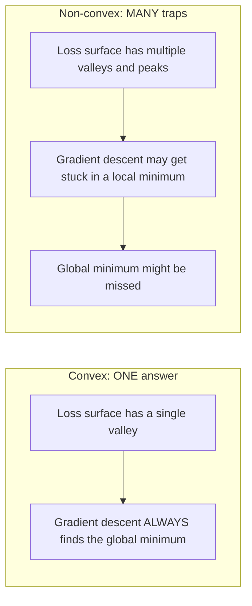
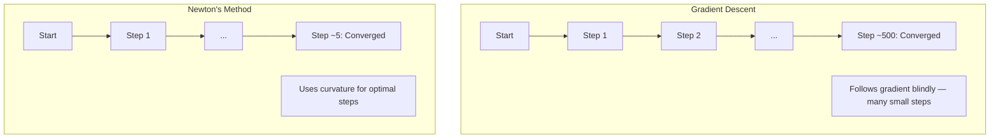
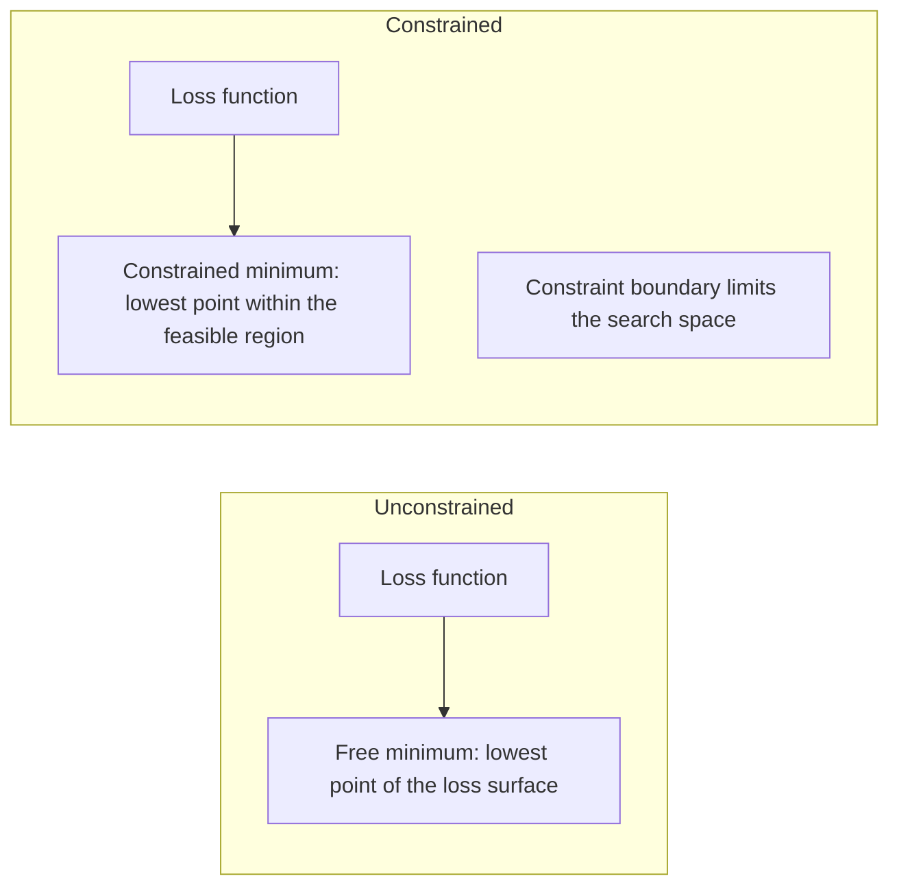
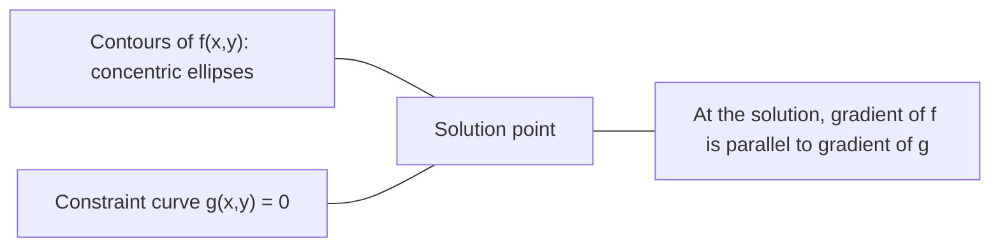

# Tối ưu hóa cong

> Những vấn đề ngọc có một thung lũng, mạng thần kinh có hàng triệu, biết sự khác biệt là quan trọng.

**Type:** Build
**Language:**Python
**Prerequisites:** Phase 1, Lessons 04 (Calculus for ML), 08 (Optimization)
**Time:** ~90 minutes

## Mục tiêu học tập

- Kiểm tra xem một hàm có ngọc không bằng cách sử dụng định nghĩa, dẫn xuất thứ hai và tiêu chí Hessian
- Thực hiện phương pháp của Newton và so sánh sự hội tụ vuông của nó với sự giảm gradient
- Giải quyết các vấn đề tối ưu hóa hạn chế bằng cách sử dụng nhân Lagrange và giải thích các điều kiện KKT
- Giải thích tại sao các cảnh mất mạng thần kinh không phải là ngón nhưng SGD vẫn tìm thấy các giải pháp tốt

## Vấn đề

Bài học 08 dạy bạn giảm gradient, động lực và Adam. Những người tối ưu hóa đi xuống dốc trên bất kỳ bề mặt nào. Nhưng họ không có đảm bảo. giảm gradient trên một cảnh quan không ngón có thể rơi vào mức tối thiểu địa phương xấu, bị mắc kẹt trên một điểm saddle, hoặc dao động mãi mãi. Bạn đã sử dụng nó dù sao vì mạng thần kinh không ngón và không có lựa chọn nào khác.

Nhưng nhiều vấn đề trong máy học đều ngập cong. Lịch ngược tuyến tính, ngập cong logistics, SVMs, LASSO, ngập cong. Đối với những vấn đề này, có một cái gì đó mạnh hơn: tối ưu hóa với các đảm bảo toán học. Một vấn đề ngập cong có chính xác một thung lũng. Bất kỳ thuật toán nào đi xuống đồi sẽ đạt được mức tối thiểu toàn cầu. Không cần khởi động lại. Không có lịch trình tốc độ học tập. Không có lời cầu nguyện.

Việc hiểu sự ngập cong làm ba điều. Thứ nhất, nó cho bạn biết khi nào vấn đề của bạn là dễ dàng (ngập cong) so với khó khăn (không ngập cong). Thứ hai, nó cho bạn các công cụ nhanh hơn như phương pháp Newton cho các vấn đề ngập cong. Thứ ba, nó giải thích các khái niệm xuất hiện trong suốt ML: quy định hóa như một hạn chế, sự hai chiều trong SVM, và tại sao việc học sâu hoạt động mặc dù vi phạm mọi tính chất ngập cong tốt cho bạn.

## Khái niệm

### Bộ trục trục

Một bộ $S$là tròn nếu cho bất kỳ hai điểm trong $S$, đoạn đường giữa chúng cũng nằm hoàn toàn trong $S$- Tôi không biết.

| Convex sets | Not convex |
|---|---|
| **Rectangle**: any two points inside can be connected by a line segment that stays inside | **Star/crescent shape**: a line between two interior points can pass outside the set |
| **Triangle**: same property holds for all interior points | **Donut/annulus**: the hole means some line segments leave the set |
| The line segment between any two points stays within the set | The line segment between some pairs of points exits the set |

Kiểm tra chính thức: cho bất kỳ điểm nào $x, y$trong $S$và bất cứ$t \in [0, 1]$, điểm $tx + (1-t)y$cũng trong $S$- Tôi không biết.

Ví dụ về các bộ trục trặc:
- Một đường, một máy bay, tất cả.$\mathbb{R}^n$
- Một quả bóng (thây tròn, quả cầu, siêu cầu)
- Một nửa không gian:$\lbrace x : a^T x \le b \rbrace$
- Sự giao lộ của bất kỳ số lượng tập hợp ngọc nào

Ví dụ về các bộ không ngón:
- Một món bánh quy (annulus)
- Sự hợp nhất của hai vòng tròn không liên kết
- Bất kỳ bộ nào có "dent" hoặc "lỗ"

### Các hàm trục trĩ

Một chức năng$f$là ngọc nếu vùng của nó là một tập hợp ngọc và cho bất kỳ hai điểm $x, y$trong phạm vi của nó và bất kỳ $t \in [0, 1]$- Có thể là:

```math
f(tx + (1-t)y) \le t f(x) + (1-t) f(y)
```

Về mặt địa hình: đoạn đường giữa hai điểm trên biểu đồ nằm trên hoặc trên biểu đồ.

| Property | Convex function | Non-convex function |
|---|---|---|
| **Line segment test** | The line between any two points on the graph lies **above or on** the curve | The line between some points on the graph dips **below** the curve |
| **Shape** | Single bowl/valley curving upward | Multiple peaks and valleys with mixed curvature |
| **Local minima** | Every local minimum is the global minimum | Multiple local minima may exist at different heights |

Các chức năng nhòm chung:
- $f(x) = x^2$(công ngữ)
- $f(x) = \lvert x \rvert$(tín hiệu tuyệt đối)
- $f(x) = e^x$(tự động)
- $f(x) = \max(0, x)$(ReLU, mặc dù mảnh tuyến tính)
- $f(x) = -\log(x)$cho $x > 0$(trọng lượng âm)
- Bất kỳ hàm tuyến tính nào $f(x) = a^T x + b$(cả ngọc và ngọc)

### Kiểm tra độ ngập

Ba bài kiểm tra thực tế, từ dễ nhất đến nghiêm ngặt nhất.

**Test 1: Second derivative test (1D).**Nếu$f''(x) \ge 0$cho tất cả mọi người$x$, sau đó $f$là tròn.

- $f(x) = x^2$$f''(x) = 2 \ge 0$- Trọng trọng.
- $f(x) = x^3$$f''(x) = 6x$- Không .$x < 0$Không nhòm.
- $f(x) = e^x$$f''(x) = e^x > 0$- Trọng trọng.

**Test 2: Hessian test (multivariate).**Nếu các Hessian matrix $H(x)$là dương tính bán xác định cho tất cả $x$, sau đó $f$Hessian là các tử liệu dẫn xuất phân tử thứ hai.

**Test 3: Definition test.**Kiểm tra sự bất bình đẳng $f(tx + (1-t)y) \le t f(x) + (1-t) f(y)$hữu ích cho các hàm mà các phái sinh khó tính toán.

### Tại sao sự ngập lỏng quan trọng

Các định lý trung tâm của tối ưu hóa ngọc:

**For a convex function, every local minimum is a global minimum.**

Điều này có nghĩa là sự giảm gradient không thể bị mắc kẹt. Bất kỳ đường xuống đồi nào dẫn đến câu trả lời tương tự.



Kết quả:
- Không cần phải khởi động lại ngẫu nhiên
- Không cần lịch trình học tập phức tạp
- Các chứng minh hội tụ có thể (tỷ lệ phụ thuộc vào các tính chất hàm)
- Giải pháp là duy nhất (trong các vùng bằng phẳng)

### Convex vs non-convex trong ML

| Problem | Convex? | Why |
|---------|---------|-----|
| Linear regression (MSE) | Yes | Loss is quadratic in weights |
| Logistic regression | Yes | Log-loss is convex in weights |
| SVM (hinge loss) | Yes | Maximum of linear functions |
| LASSO (L1 regression) | Yes | Sum of convex functions is convex |
| Ridge regression (L2) | Yes | Quadratic + quadratic = convex |
| Neural network (any loss) | No | Nonlinear activations create non-convex landscape |
| k-means clustering | No | Discrete assignment step |
| Matrix factorization | No | Product of unknowns |

Các mô hình tuyến tính với lỗ hổng ngọc là ngọc. Khi bạn thêm các lớp ẩn với kích hoạt không tuyến tính, ngọc sẽ bị phá vỡ.

### Matrix Hessian

Người Hessian $H$của một chức năng $f: \mathbb{R}^n \to \mathbb{R}$là $n \times n$Matrix của các phái sinh phân tử thứ hai.

```math
H_{ij} = \frac{\partial^2 f}{\partial x_i \, \partial x_j}
```

Vì $f(x, y) = x^2 + 3xy + y^2$- Có thể là:

```math
\begin{gathered}
\begin{aligned}
\frac{\partial f}{\partial x} &= 2x + 3y & \frac{\partial^2 f}{\partial x^2} &= 2 & \frac{\partial^2 f}{\partial x \, \partial y} &= 3 \\
\frac{\partial f}{\partial y} &= 3x + 2y & \frac{\partial^2 f}{\partial y \, \partial x} &= 3 & \frac{\partial^2 f}{\partial y^2} &= 2
\end{aligned} \\[8pt]
H = \begin{bmatrix} 2 & 3 \\ 3 & 2 \end{bmatrix}
\end{gathered}
```

Người Hessian nói với bạn về sự cong cong:
- Eigenvalues tất cả tích cực: hàm cong lên theo mọi hướng (cập ở điểm đó)
- Giá trị riêng tất cả âm: đường cong xuống ở mọi hướng (thường cong, một max địa phương)
- Các dấu hiệu hỗn hợp: điểm lăn (đối cao theo một số hướng, xuống ở những hướng khác)
- Giá trị bản chất không: phẳng theo hướng đó (từ)

Đối với độ ngập, Hessian phải là tích cực bán xác định (tất cả các giá trị riêng $\ge 0$) ở khắp mọi nơi, không chỉ ở một điểm.

### Phương pháp của Newton

Phương pháp của Newton sử dụng thông tin thứ hai (Hessian). Nó phù hợp với một phương pháp gần gũi hình vuông tại điểm hiện tại và nhảy thẳng đến mức tối thiểu của hình vuông đó.

```math
\begin{aligned}
\text{Update rule:} \quad & x_{\text{new}} = x - H^{-1} \cdot \text{gradient} \\
\text{Compare to gradient descent:} \quad & x_{\text{new}} = x - \text{lr} \cdot \text{gradient}
\end{aligned}
```

Phương pháp của Newton thay thế tốc độ học đường thang bằng Hessian ngược. Điều này tự động điều chỉnh kích thước và hướng bước dựa trên độ cong địa phương.



Lợi ích:
- Sự hội tụ vuông gần mức tối thiểu (trường vuông lỗi mỗi bước)
- Không có tốc độ học tập để điều chỉnh
- Scale-invariant (được làm bất kể bạn định nghĩa vấn đề như thế nào)

Khối thâm điểm:
- Xét chi phí Hessian $O(n^2)$trí nhớ và$O(n^3)$để đảo ngược
- Đối với một mạng thần kinh với 1 triệu trọng lượng, đó là $10^{12}$Các mục và $10^{18}$hoạt động
- Không thực tế cho việc học sâu

### Tối ưu hóa hạn chế

Tối ưu hóa không hạn chế: giảm thiểu $f(x)$trên tất cả mọi thứ$x$- Tôi không biết.
Tối ưu hóa hạn chế: giảm thiểu $f(x)$có thể bị hạn chế.

Các vấn đề thực sự có những hạn chế. Bạn muốn giảm chi phí nhưng ngân sách của bạn là hạn chế. Bạn muốn giảm thiểu lỗi nhưng phức tạp của mô hình của bạn là giới hạn.



### Các nhân nhân hạch

Phương pháp nhân nhân Lagrange chuyển đổi một vấn đề bị hạn chế thành một vấn đề không bị hạn chế.

Vấn đề: giảm thiểu $f(x)$theo quy định của$g(x) = 0$- Tôi không biết.

Giải pháp: giới thiệu một biến mới (Lagrange nhân $\lambda$) và giải quyết vấn đề không bị ràng buộc:

```math
L(x, \lambda) = f(x) + \lambda g(x)
```

Tại giải pháp, độ nghiêng của $L$là 0:

```math
\begin{aligned}
\frac{\partial L}{\partial x} &= \frac{\partial f}{\partial x} + \lambda \frac{\partial g}{\partial x} = 0 \\
\frac{\partial L}{\partial \lambda} &= g(x) = 0
\end{aligned}
```

Nhận thức hình học: ở mức tối thiểu bị hạn chế, độ nghiêng của $f$phải song song với độ nghiêng của sự hạn chế $g$Nếu chúng không song song, bạn có thể di chuyển dọc theo bề mặt hạn chế và giảm $f$- Cứ đi xa hơn nữa.



Ví dụ: giảm thiểu $f(x,y) = x^2 + y^2$theo quy định của$x + y = 1$- Tôi không biết.

```math
\begin{aligned}
L &= x^2 + y^2 + \lambda(x + y - 1) \\[4pt]
\frac{\partial L}{\partial x} &= 2x + \lambda = 0 \implies x = -\lambda/2 \\
\frac{\partial L}{\partial y} &= 2y + \lambda = 0 \implies y = -\lambda/2 \\
\frac{\partial L}{\partial \lambda} &= x + y - 1 = 0 \\[4pt]
&\text{From first two: } x = y \\
&\text{Substituting: } 2x = 1, \text{ so } x = y = 0.5, \ \lambda = -1
\end{aligned}
```

Điểm gần nhất trên đường dây $x + y = 1$đến nguồn gốc là $(0.5, 0.5)$- Tôi không biết.

### Điều kiện KKT

Các điều kiện Karush-Kuhn-Tucker mở rộng nhân Lagrange đến các hạn chế bất bình đẳng.

Vấn đề: giảm thiểu $f(x)$theo quy định của$g_i(x) \le 0$cho $i = 1, \ldots, m$- Tôi không biết.

Các điều kiện KKT (cần thiết cho sự tối ưu):

```math
\begin{aligned}
&\text{1. Stationarity:} && \frac{\partial f}{\partial x} + \sum_i \lambda_i \frac{\partial g_i}{\partial x} = 0 \\
&\text{2. Primal feasibility:} && g_i(x) \le 0 \quad \text{for all } i \\
&\text{3. Dual feasibility:} && \lambda_i \ge 0 \quad \text{for all } i \\
&\text{4. Complementary slackness:} && \lambda_i \, g_i(x) = 0 \quad \text{for all } i
\end{aligned}
```

Sự lười biếng bổ sung là cái nhìn chính: hoặc sự ràng buộc đang hoạt động ($g_i = 0$, giải pháp nằm trên biên giới) hoặc nhân số là không (sự hạn chế không quan trọng).$\lambda = 0$- Tôi không biết.

Các điều kiện KKT là trung tâm của SVM. Các vector hỗ trợ là các điểm dữ liệu nơi mà sự hạn chế hoạt động ($\lambda > 0$Tất cả các điểm dữ liệu khác đều có$\lambda = 0$và không ảnh hưởng đến ranh giới quyết định.

### Chuẩn bị như là tối ưu hóa hạn chế

L1 và L2 đều không phải là những trò lừa đảo tùy ý.

**L2 regularization (Ridge):**

```math
\begin{aligned}
&\text{minimize } \text{Loss}(w) \text{ subject to } \lVert w \rVert^2 \le t \\[4pt]
&\text{Equivalent unconstrained form:} \\
&\text{minimize } \text{Loss}(w) + \lambda \lVert w \rVert^2
\end{aligned}
```

Sự hạn chế $\lVert w \rVert^2 \le t$định nghĩa một quả bóng (thây tròn trong 2D, quả cầu trong 3D). Giải pháp là nơi đường viền mất chạm đầu tiên vào quả bóng này.

**L1 regularization (LASSO):**

```math
\begin{aligned}
&\text{minimize } \text{Loss}(w) \text{ subject to } \lVert w \rVert_1 \le t \\[4pt]
&\text{Equivalent unconstrained form:} \\
&\text{minimize } \text{Loss}(w) + \lambda \lVert w \rVert_1
\end{aligned}
```

Sự hạn chế $\lVert w \rVert_1 \le t$định nghĩa một viên kim cương (trường xoay 2D).

| Property | L2 constraint (circle) | L1 constraint (diamond) |
|---|---|---|
| **Constraint shape** | Circle (sphere in higher dims) | Diamond (rotated square in 2D) |
| **Where loss contour touches** | Smooth boundary — any point on the circle | Corner — aligned with an axis |
| **Solution behavior** | Weights are small but nonzero | Some weights are exactly zero (sparse) |
| **Result** | Weight shrinkage | Feature selection |

Điều này giải thích tại sao L1 sản xuất các mô hình hiếm (chuyển chọn tính năng) trong khi L2 chỉ thu hẹp trọng lượng. Kim cương có các góc được thẳng hàng với trục.

### Sự hai chiều

Mỗi vấn đề tối ưu hóa hạn chế (bản nguyên) có một vấn đề đồng hành (bản đôi). Đối với các vấn đề ngọc, nguyên và song có cùng một giá trị tối ưu. Đây là sự hai chiều mạnh mẽ.

Hàm hàm Lagrangian:

```math
\begin{aligned}
&\text{Primal:} && \text{minimize } f(x) \text{ subject to } g(x) \le 0 \\
&\text{Lagrangian:} && L(x, \lambda) = f(x) + \lambda g(x) \\
&\text{Dual function:} && d(\lambda) = \min_x L(x, \lambda) \\
&\text{Dual problem:} && \text{maximize } d(\lambda) \text{ subject to } \lambda \ge 0
\end{aligned}
```

Tại sao sự hai chiều quan trọng:
- Vấn đề đôi khi dễ giải quyết hơn vấn đề ban đầu
- SVM được giải quyết trong hình thức kép của họ, nơi vấn đề phụ thuộc vào các sản phẩm điểm giữa các điểm dữ liệu (cho phép thủ thuật hạt nhân)
- Sự đôi cung cấp một ranh giới dưới của tối ưu nguyên tố, hữu ích để kiểm tra chất lượng dung dịch

Đối với SVM cụ thể:

```
Primal: find w, b that maximize the margin 2/||w|| subject to
        y_i(w^T x_i + b) >= 1 for all i

Dual:   maximize sum(alpha_i) - 0.5 * sum_ij(alpha_i * alpha_j * y_i * y_j * x_i^T x_j)
        subject to alpha_i >= 0 and sum(alpha_i * y_i) = 0

The dual only involves dot products x_i^T x_j.
Replace x_i^T x_j with K(x_i, x_j) to get the kernel trick.
```

### Tại sao việc học sâu có hiệu quả mặc dù không có sự ngập trung

Các chức năng mất mạng thần kinh là vô cùng không ngập. Theo mọi biện pháp cổ điển, tối ưu hóa chúng sẽ thất bại. Tuy nhiên, giảm gradient stochastic tìm thấy các giải pháp tốt đáng tin cậy.

**Most local minima are good enough.**Trong không gian chiều cao, các điểm quan trọng ngẫu nhiên (nơi độ nghiêng là không) là điểm đạp, không phải là các tối thiểu địa phương.

**Saddle points, not local minima, are the real obstacle.**Trong một chức năng với $n$Các thông số của các điểm, một điểm saddle có sự pha trộn của các hướng cong tích cực và tiêu cực.$n$giá trị riêng là tích cực (đối thiểu địa phương) là khoảng $2^{-n}$Hầu hết các điểm quan trọng đều là điểm đạp.

**Overparameterization smooths the landscape.**Các mạng có nhiều tham số hơn các ví dụ đào tạo có bề mặt mất mát trơn tru hơn, kết nối hơn. Các mạng rộng hơn có ít tối thiểu địa phương xấu hơn. Điều này trái ngược trực giác nhưng theo học nghiệm.

**Loss landscape structure:**

| Property | Low-dimensional space | High-dimensional space |
|---|---|---|
| **Landscape** | Many isolated peaks and valleys | Smoothly connected valleys |
| **Minima** | Many isolated local minima | Few bad local minima; most are near-optimal |
| **Navigation** | Hard to find global minimum | Many paths lead to good solutions |
| **Critical points** | Mix of local minima and saddle points | Overwhelmingly saddle points, not local minima |

**Stochastic noise acts as implicit regularization.**SGD mini-batch thêm tiếng ồn ngăn chặn việc định cư vào mức tối thiểu sắc nét.

### Các phương pháp thứ hai trong thực tế

Phương pháp Newton tinh khiết không thực tế cho các mô hình lớn.

**L-BFGS (Limited-memory BFGS):**Ghi gần Hessian ngược bằng cách sử dụng cuối cùng $m$Sự khác biệt về độ nghiêng.$O(mn)$trí nhớ thay vì $O(n^2)$. Hành động tốt cho các vấn đề với tối đa ~ 10.000 tham số. được sử dụng trong ML cổ điển (kết hồi logistics, CRFs) nhưng không phải học sâu.

**Natural gradient:**Sử dụng các hình thức phân phối xác suất của các hệ thống Hessian thông tin Fisher (hình thức Hessian dự kiến của xác suất log) thay vì Hessian tiêu chuẩn.

**Hessian-free optimization:**Sử dụng gradient kết hợp để giải quyết $Hx = g$Không bao giờ hình thành$H$Chỉ cần các sản phẩm vector Hessian, có thể được tính toán trong $O(n)$thời gian thông qua phân biệt tự động.

**Diagonal approximations:**Khoảnh khắc thứ hai của Adam là một sự gần gũi đường vạch của đường vạch của Hessian. AdaHessian mở rộng điều này bằng cách sử dụng các yếu tố đường vạch Hessian thực tế thông qua ước tính của Hutchinson.

| Method | Memory | Per-step cost | When to use |
|--------|--------|--------------|-------------|
| Gradient descent | $O(n)$ | $O(n)$ | Baseline, large models |
| Newton's method | $O(n^2)$ | $O(n^3)$ | Small convex problems |
| L-BFGS | $O(mn)$ | $O(mn)$ | Medium convex problems |
| Adam | $O(n)$ | $O(n)$ | Deep learning default |
| K-FAC | $O(n)$ | $O(n)$ per layer | Research, large-batch training |

```figure
convex-vs-nonconvex
```

## Hãy xây dựng nó

### Bước 1: Kiểm tra độ ngập

Xây dựng một hàm kiểm tra độ ngập lưỡng bằng cách lấy mẫu và kiểm tra định nghĩa.

```python
import random
import math

def check_convexity(f, dim, bounds=(-5, 5), samples=1000):
    violations = 0
    for _ in range(samples):
        x = [random.uniform(*bounds) for _ in range(dim)]
        y = [random.uniform(*bounds) for _ in range(dim)]
        t = random.uniform(0, 1)
        mid = [t * xi + (1 - t) * yi for xi, yi in zip(x, y)]
        lhs = f(mid)
        rhs = t * f(x) + (1 - t) * f(y)
        if lhs > rhs + 1e-10:
            violations += 1
    return violations == 0, violations
```

### Bước 2: Phương pháp của Newton cho 2D

Thực hiện phương pháp Newton bằng cách sử dụng một Hessian rõ ràng. So sánh tốc độ hội tụ với sự giảm gradient.

```python
def newtons_method(f, grad_f, hessian_f, x0, steps=50, tol=1e-12):
    x = list(x0)
    history = [x[:]]
    for _ in range(steps):
        g = grad_f(x)
        H = hessian_f(x)
        det = H[0][0] * H[1][1] - H[0][1] * H[1][0]
        if abs(det) < 1e-15:
            break
        H_inv = [
            [H[1][1] / det, -H[0][1] / det],
            [-H[1][0] / det, H[0][0] / det],
        ]
        dx = [
            H_inv[0][0] * g[0] + H_inv[0][1] * g[1],
            H_inv[1][0] * g[0] + H_inv[1][1] * g[1],
        ]
        x = [x[0] - dx[0], x[1] - dx[1]]
        history.append(x[:])
        if sum(gi ** 2 for gi in g) < tol:
            break
    return history
```

### Bước 3: Solver nhân nhân Lagrange

Giải quyết tối ưu hóa hạn chế bằng cách sử dụng sự giảm gradient trên Lagrangian.

```python
def lagrange_solve(f_grad, g_val, g_grad, x0, lr=0.01,
                   lr_lambda=0.01, steps=5000):
    x = list(x0)
    lam = 0.0
    history = []
    for _ in range(steps):
        fg = f_grad(x)
        gv = g_val(x)
        gg = g_grad(x)
        x = [
            xi - lr * (fgi + lam * ggi)
            for xi, fgi, ggi in zip(x, fg, gg)
        ]
        lam = lam + lr_lambda * gv
        history.append((x[:], lam, gv))
    return history
```

### Bước 4: So sánh thứ hai và thứ nhất

Cứ chạy đường hạ độ và phương pháp Newton trên cùng một hàm hình vuông.

```python
def quadratic(x):
    return 5 * x[0] ** 2 + x[1] ** 2

def quadratic_grad(x):
    return [10 * x[0], 2 * x[1]]

def quadratic_hessian(x):
    return [[10, 0], [0, 2]]
```

Phương pháp Newton sẽ hội tụ trong 1 bước (đó chính xác cho phương pháp hình chữ).

## Sử dụng nó

Phân tích độ ngập liên quan được áp dụng trực tiếp khi lựa chọn các mô hình và giải pháp ML.

Đối với các vấn đề ngọc (khuyết phục hậu cần, SVM, LASSO):
- Sử dụng các giải pháp chuyên dụng (liblinear, CVXPY, scipy.optimize.minimize với method='L-BFGS-B')
- Hi vọng một giải pháp toàn cầu độc đáo
- Các phương pháp thứ hai là thực tế và nhanh chóng

Đối với các vấn đề không ngón (mạng thần kinh):
- Sử dụng các phương pháp thứ nhất (SGD, Adam)
- Hãy chấp nhận rằng giải pháp phụ thuộc vào sự khởi tạo và ngẫu nhiên
- Sử dụng quá trình phân định, tiếng ồn và lịch học tập như là điều chỉnh ngầm
- Đừng lãng phí thời gian tìm kiếm mức tối thiểu toàn cầu.

```python
from scipy.optimize import minimize

result = minimize(
    fun=lambda w: sum((y - X @ w) ** 2) + 0.1 * sum(w ** 2),
    x0=np.zeros(d),
    method='L-BFGS-B',
    jac=lambda w: -2 * X.T @ (y - X @ w) + 0.2 * w,
)
```

Đối với SVM, công thức kép cho phép bạn sử dụng thủ thuật hạt nhân:

```python
from sklearn.svm import SVC

svm = SVC(kernel='rbf', C=1.0)
svm.fit(X_train, y_train)
print(f"Support vectors: {svm.n_support_}")
```

## Các bài tập

1. **Convexity gallery.**Kiểm tra các chức năng này để tìm ra độ ngập lưỡng bằng cách sử dụng bộ kiểm tra: $f(x) = x^4$- $f(x) = \sin(x)$- $f(x,y) = x^2 + y^2$- $f(x,y) = xy$- $f(x) = \max(x, 0)$Hãy giải thích tại sao mỗi kết quả đều có ý nghĩa.

2. **Newton vs gradient descent race.**Động hành cả hai phương pháp $f(x,y) = 50x^2 + y^2$Từ điểm khởi đầu $(10, 10)$. Mỗi bước cần bao nhiêu bước để đạt được mất < 1e-10? Điều gì xảy ra với sự giảm gradient khi số điều kiện ( tỷ lệ của giá trị bản thân Hessian lớn nhất đến nhỏ nhất) tăng lên?

3. **Lagrange multiplier geometry.**Giảm thiểu $f(x,y) = (x-3)^2 + (y-3)^2$theo quy định của$x + 2y = 4$Kiểm tra giải pháp bằng cách kiểm tra rằng độ nghiêng của $f$là song song với gradient của $g$ở giải pháp.

4. **Regularization constraint.**Thực hiện tối ưu hóa hạn chế L1: giảm thiểu $(x-3)^2 + (y-2)^2$theo quy định của$\lvert x \rvert + \lvert y \rvert \le 1$. Cụ thể hóa rằng giải pháp có một phối hợp bằng không (sparsity từ giới hạn kim cương).

5. **Hessian eigenvalue analysis.**Xét Hessian của hàm Rosenbrock ở (1,1) và ở (-1,1). Xét các giá trị riêng ở cả hai điểm.

### Những gợi ý

**Exercise 1.**Hãy dự đoán từng kết quả trước khi chạy `check_convexity`: trong một chiều, nhìn vào dấu hiệu của$f''(x)$; trong hai chiều, hãy xem các giá trị riêng của Hessian.$f(x,y) = xy$, Hessian có giá trị riêng 1 và -1, vì vậy kiểm tra phải báo cáo rằng nó không phải là ngọc.

**Exercise 2.**Gọi`optimize_gd`và `newtons_method`với độ nghiêng và Hessian của $f$Phương pháp Newton giải quyết một phương pháp hình vuông trong một bước.$2/100$vì $50x^2$thuật ngữ, do đó $y$hướng di chuyển chậm.$100x^2$và đếm lại các bước.

**Exercise 3.**Sử dụng `lagrange_solve`với $g(x,y) = x + 2y - 4$- Đáp lại, hãy kiểm tra.$x + 2y = 4$Và đó là$\nabla f = (2(x-3), 2(y-3))$là một nhân của $\nabla g = (1, 2)$- Tôi không biết.

**Exercise 4.**Điểm tối thiểu không bị hạn chế (3, 2) nằm bên ngoài kim cương, vì vậy câu trả lời nằm ở biên giới của nó. Sử dụng hạ độ nghiêng dự đoán: thực hiện một bước nghiêng, sau đó chiếu trở lại trên $\lvert x \rvert + \lvert y \rvert \le 1$Kiểm tra kết quả đáp ứng hạn chế bằng bình đẳng và so sánh nó với`demo_regularization_geometry`- Tôi không biết.

**Exercise 5.**Gọi`rosenbrock_hessian`ở mỗi điểm và chuyển kết quả cho `hessian_eigenvalues_2d`Ở (1, 1), cả hai giá trị tự đều tích cực và tỷ lệ của chúng rất lớn, vì vậy thung lũng là hẹp ở một hướng và phẳng ở hướng khác. So sánh tỷ lệ đó với tỷ lệ ở (-1, 1).

## Các điều khoản chính

| Term | What it means |
|------|---------------|
| Convex set | A set where the line segment between any two points in the set stays inside the set |
| Convex function | A function where the line between any two points on its graph lies above or on the graph. Equivalently, Hessian is positive semidefinite everywhere |
| Local minimum | A point lower than all nearby points. For convex functions, every local minimum is the global minimum |
| Global minimum | The lowest point of a function over its entire domain |
| Hessian matrix | The matrix of all second partial derivatives. Encodes curvature information |
| Positive semidefinite | A matrix whose eigenvalues are all non-negative. The multidimensional analogue of "second derivative >= 0" |
| Condition number | Ratio of largest to smallest eigenvalue of the Hessian. High condition number means elongated valleys and slow gradient descent |
| Newton's method | Second-order optimizer that uses the inverse Hessian to determine step direction and size. Quadratic convergence near the minimum |
| Lagrange multiplier | A variable introduced to convert a constrained optimization problem into an unconstrained one |
| KKT conditions | Necessary conditions for optimality with inequality constraints. Generalize Lagrange multipliers |
| Complementary slackness | At the solution, either a constraint is active or its multiplier is zero. Never both nonzero |
| Duality | Every constrained problem has a companion dual problem. For convex problems, both have the same optimal value |
| Strong duality | Primal and dual optimal values are equal. Holds for convex problems satisfying Slater's condition |
| L-BFGS | Approximate second-order method that stores the last $m$ gradient differences instead of the full Hessian |
| Saddle point | A point where the gradient is zero but it is a minimum in some directions and a maximum in others |
| Overparameterization | Using more parameters than training examples. Smooths the loss landscape and reduces bad local minima |

## Đọc thêm

- [Boyd & Vandenberghe: Convex Optimization](https://web.stanford.edu/~boyd/cvxbook/)- sách giáo khoa tiêu chuẩn, có sẵn trực tuyến miễn phí
- [Bottou, Curtis, Nocedal: Optimization Methods for Large-Scale Machine Learning (2018)](https://arxiv.org/abs/1606.04838)- cầu thuyết tối ưu hóa ngọc và thực hành học tập sâu
- [Choromanska et al.: The Loss Surfaces of Multilayer Networks (2015)](https://arxiv.org/abs/1412.0233)- tại sao các khung cảnh mạng thần kinh không ngón không tệ như họ có vẻ
- [Nocedal & Wright: Numerical Optimization](https://link.springer.com/book/10.1007/978-0-387-40065-5)- tham chiếu toàn diện cho phương pháp Newton, L-BFGS, và tối ưu hóa hạn chế
