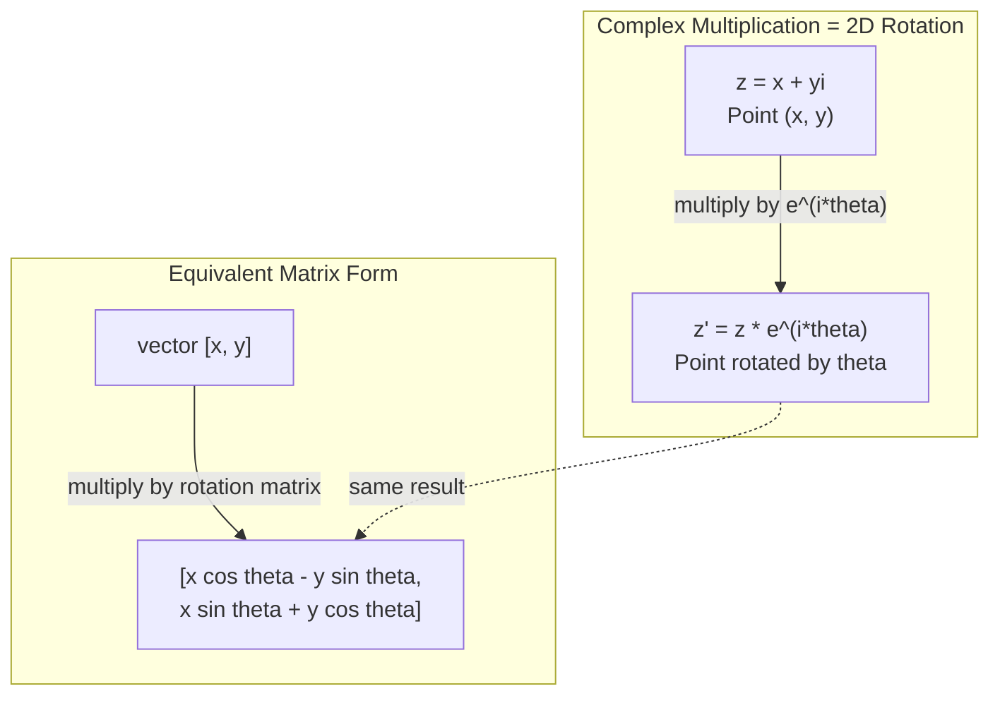
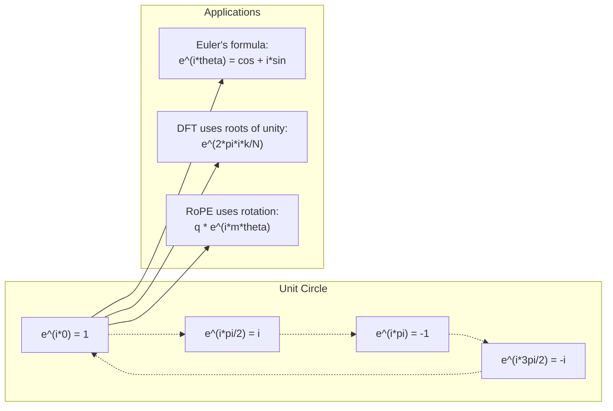

# Số phức tạp cho AI

> Nguồn vuông của -1 không phải là tưởng tượng. Nó là chìa khóa cho các quay, tần số và một nửa xử lý tín hiệu.

**Type:** Learn
**Language:**Python
**Prerequisites:** Phase 1, Lessons 01-04 (linear algebra, calculus)
**Time:** ~60 minutes

## Mục tiêu học tập

- Thực hiện toán học phức tạp (làm thêm, nhân, chia, kết hợp) trong hình chữ nhật và hình cực
- Sử dụng công thức của Euler để chuyển đổi giữa các hàm hàm phức tạp và hàm ba tính
- Thực hiện chuyển đổi Fourier riêng biệt bằng cách sử dụng các gốc phức tạp của sự thống nhất
- Giải thích cách quay phức tạp nằm dưới nền tảng của RoPE và mã hóa vị trí sinus trong các biến thể

## Vấn đề

Bạn mở một bài báo về Fourier biến đổi và có`i`Bạn nhìn vào mã hóa vị trí biến thể và thấy`sin`và `cos`bạn đọc về máy tính lượng tử và tìm thấy mọi thứ được thể hiện trong không gian vector phức tạp.

Các con số phức tạp có vẻ trừu tượng. Một hệ thống số được xây dựng trên gốc vuông của -1 cảm thấy như một trò lừa toán học. Nhưng nó không phải là một trò lừa. Đó là ngôn ngữ tự nhiên của xoay và dao động. Mỗi khi một thứ gì đó xoay, rung động hoặc dao động, các con số phức tạp là công cụ phù hợp.

Nếu bạn không hiểu được các con số phức tạp, bạn không thể hiểu được chuyển đổi Fourier phân biệt. Bạn không thể hiểu FFT. Bạn không thể hiểu cách RoPE (Rotary Position Embedding) hoạt động trong các mô hình ngôn ngữ hiện đại. Bạn không thể hiểu tại sao các mã hóa vị trí hình âm trong giấy Transformer gốc sử dụng tần số họ làm.

Bài học này xây dựng toán phức tạp từ đầu, kết nối nó với hình học, và cho bạn thấy chính xác những con số phức tạp xuất hiện ở máy học.

## Khái niệm

### Một con số phức tạp là gì?

Một số phức tạp có hai phần: một phần thực và một phần tưởng tượng.

```
z = a + bi

where:
  a is the real part
  b is the imaginary part
  i is the imaginary unit, defined by i^2 = -1
```

Đó là tất cả. bạn mở rộng đường số vào một trình. các số thực nằm trên một trục. các số tưởng tượng nằm trên trục khác. Mỗi số phức tạp là một điểm trong trình này.

### Phương pháp toán phức tạp

**Addition.**Thêm những phần thật vào nhau, thêm những phần tưởng tượng vào nhau.

```math
\begin{aligned}
(a + bi) + (c + di) &= (a + c) + (b + d)i \\[4pt]
\text{Example: } (3 + 2i) + (1 + 4i) &= 4 + 6i
\end{aligned}
```

**Multiplication.**Sử dụng luật phân phối và nhớ rằng$i^2 = -1$- Tôi không biết.

```math
\begin{aligned}
(a + bi)(c + di) &= ac + adi + bci + bdi^2 \\
&= ac + adi + bci - bd \\
&= (ac - bd) + (ad + bc)i \\[8pt]
\text{Example: } (3 + 2i)(1 + 4i) &= 3 + 12i + 2i + 8i^2 \\
&= 3 + 14i - 8 \\
&= -5 + 14i
\end{aligned}
```

**Conjugate.**Trật lại dấu hiệu của phần tưởng tượng.

```math
\text{conjugate of } (a + bi) = a - bi
```

Kết quả của một số phức tạp và kết hợp của nó luôn là thực:

```math
(a + bi)(a - bi) = a^2 + b^2
```

**Division.**Tăng số và tên nhân bằng kết hợp của tên nhân.

```math
\frac{a + bi}{c + di} = \frac{(a + bi)(c - di)}{c^2 + d^2}
```

Điều này loại bỏ phần tưởng tượng từ tên gọi, cho bạn một số phức tạp sạch.

### Bảng phức tạp

Bảng phức tạp lập bản đồ mọi số phức tạp đến một điểm 2D. Trục ngang là trục thực, trục thẳng đứng là trục tưởng tượng.

```
z = 3 + 2i  corresponds to the point (3, 2)
z = -1 + 0i corresponds to the point (-1, 0) on the real axis
z = 0 + 4i  corresponds to the point (0, 4) on the imaginary axis
```

Một số phức tạp là một điểm và một vector từ nguồn gốc. Sự giải thích kép này là điều làm cho các số phức tạp hữu ích cho hình học.

### Hình dạng cực

Bất kỳ điểm nào trong máy bay có thể được mô tả bằng cách cách xa xôi từ nguồn gốc và góc của nó từ trục thực tích cực.

```math
\begin{aligned}
z &= r (\cos\theta + i \sin\theta) \\[4pt]
\text{where: } r &= |z| = \sqrt{a^2 + b^2} \quad \text{(magnitude, or modulus)} \\
\theta &= \mathop{\mathrm{atan2}}(b, a) \quad \text{(phase, or argument)}
\end{aligned}
```

hình hình chữ nhật $(a + bi)$là tốt cho việc bổ sung.$(r, \theta)$là tốt cho nhân.

**Multiplication in polar form.**Bội số lớn, thêm các góc.

```math
\begin{aligned}
z_1 &= r_1 e^{i\theta_1} \\
z_2 &= r_2 e^{i\theta_2} \\[4pt]
z_1 z_2 &= (r_1 r_2) \, e^{i(\theta_1 + \theta_2)}
\end{aligned}
```

Đó là lý do tại sao các số phức hợp là hoàn hảo cho các vòng quay.

### Công thức của Euler

Cầu giữa các hàm hàm phức tạp và bộ ba chữ số:

```math
e^{i\theta} = \cos\theta + i \sin\theta
```

Đây là công thức quan trọng nhất trong bài học này.$\theta = \pi$- Có thể là:

```math
\begin{aligned}
e^{i\pi} &= \cos\pi + i \sin\pi = -1 + 0i = -1 \\[4pt]
\text{Therefore: } e^{i\pi} + 1 &= 0
\end{aligned}
```

Năm liên tục cơ bản ($e$- $i$- $\pi$, 1, 0) được liên kết trong một phương trình.

### Tại sao công thức của Euler quan trọng cho ML

Công thức của Euler nói rằng$e^{i\theta}$theo dõi vòng tròn đơn vị như $\theta$khác nhau.$\theta = 0$, anh đang ở $(1, 0)$- Tại $\theta = \pi/2$, anh đang ở $(0, 1)$- Tại $\theta = \pi$, anh đang ở $(-1, 0)$- Tại $\theta = 3\pi/2$, anh đang ở $(0, -1)$Một vòng quay đầy đủ là$\theta = 2\pi$- Tôi không biết.

Điều này có nghĩa là các hàm số phức tạp là quay và quay ở khắp mọi nơi trong xử lý tín hiệu và ML.

### Kết nối với quay 2D

Lặp số phức tạp $(x + yi)$bởi $e^{i\theta}$xoay điểm $(x, y)$theo góc độ$\theta$xung quanh nguồn gốc.

```math
\begin{aligned}
&\text{Rotation via complex multiplication:} \\
&\quad (x + yi)(\cos\theta + i \sin\theta) = (x \cos\theta - y \sin\theta) + (x \sin\theta + y \cos\theta)i \\[8pt]
&\text{Rotation via matrix multiplication:} \\
&\quad \begin{bmatrix} \cos\theta & -\sin\theta \\ \sin\theta & \cos\theta \end{bmatrix} \begin{bmatrix} x \\ y \end{bmatrix} = \begin{bmatrix} x \cos\theta - y \sin\theta \\ x \sin\theta + y \cos\theta \end{bmatrix}
\end{aligned}
```

Chúng tạo ra kết quả giống nhau. nhân phức là quay 2D. Matrix quay chỉ là nhân phức hợp được viết bằng dấu hiệu matrix.



### Phasor và tín hiệu xoay

Một hàm số phức tạp $e^{i\omega t}$là một điểm quay xung quanh vòng tròn đơn vị ở tần số góc $\omega$- Như vậy.$t$tăng lên, điểm theo dõi vòng tròn.

Phần thực sự của điểm quay này là$\cos(\omega t)$Phần tưởng tượng là$\sin(\omega t)$Một tín hiệu sinus là bóng của một số phức tạp quay.

```math
\begin{aligned}
e^{i\omega t} &= \cos(\omega t) + i \sin(\omega t) \\[4pt]
\text{Real part: } & \cos(\omega t) \quad \text{-- a cosine wave} \\
\text{Imaginary part: } & \sin(\omega t) \quad \text{-- a sine wave}
\end{aligned}
```

Đây là đại diện của phasor. Thay vì theo dõi một sóng xơ động, bạn theo dõi một mũi tên quay trơn tru. Thay đổi giai đoạn trở thành sự bù đắp góc. Thay đổi độ dải trở thành thay đổi độ lớn. Tích thêm tín hiệu trở thành sự gia tăng vector.

### Nguồn gốc của sự hiệp nhất

- $N$-các nguồn gốc của sự hiệp nhất là$N$Các điểm cách nhau bằng nhau trên vòng tròn đơn vị:

```math
w_k = e^{2\pi i k/N} \quad \text{for } k = 0, 1, 2, \ldots, N-1
```

Vì $N = 4$, gốc là: $1, i, -1, -i$(bốn điểm buso).
Vì $N = 8$, bạn có được bốn điểm buso cộng với bốn hình chéo.

Các gốc của sự thống nhất là nền tảng của chuyển đổi Fourier riêng biệt.$N$Tần số không gian bằng nhau.

### Kết nối với DFT

Chuyển đổi Fourier của tín hiệu$x[0], x[1], \ldots, x[N-1]$là:

```math
X[k] = \sum_{n=0}^{N-1} x[n] \, e^{-2\pi i k n/N}
```

Mỗi người$X[k]$đo mức độ tín hiệu tương quan với $k$-Căn gốc thứ hai của sự hiệp nhất - một sinus phức tạp ở tần số$k$DFT phá vỡ tín hiệu vào$N$và cho bạn biết độ lớn và giai đoạn của mỗi phasor.

### Tại sao tôi không phải là tưởng tượng

Từ "tưởng tượng" là một tai nạn lịch sử. Descartes sử dụng nó một cách khinh thường.$i$số âm trả lời "những gì bạn trừ 5 từ 3 để nhận được?" đơn vị tưởng tượng trả lời "những gì bạn bình phương để nhận được -1?"

Tốt hơn: $i$là một nhà điều hành quay 90 độ.$i$một lần, bạn xoay 90 độ về trục tưởng tượng.$i$một lần nữa ($i^2$), bạn quay lại 90 độ nữa -- bây giờ bạn đang chỉ ra hướng tiêu cực thực.$i^2 = -1$Nó không phải là bí ẩn. Nó là một vòng bán xoay được xây dựng từ hai vòng tròn.

Đó là lý do tại sao các con số phức tạp ở khắp mọi nơi trong kỹ thuật. Bất cứ thứ gì quay - sóng điện từ, trạng thái lượng tử, dao động tín hiệu, mã hóa vị trí - đều được mô tả tự nhiên bằng các con số phức tạp.

### Các hàm hàm phức tạp so với hàm trigonometric

Trước công thức của Euler, các kỹ sư đã viết các tín hiệu như$A \cos(\omega t + \phi)$-- độ dồn $A$, tần suất $\omega$, giai đoạn $\phi$Điều này hiệu quả nhưng làm cho toán học đau đớn.

Với các hàm số phức tạp, cùng một tín hiệu là $A e^{i(\omega t + \phi)}$Thêm hai tín hiệu chỉ là thêm hai số phức tạp. nhân (modulating) chỉ là nhân quy mô và thêm góc. chuyển động giai đoạn trở thành sự gia tăng góc. chuyển động tần số trở thành nhân bằng các pha.

Toàn bộ lĩnh vực xử lý tín hiệu chuyển sang ghi chú biểu diễn phức tạp vì toán học sạch hơn. " tín hiệu thực " luôn chỉ là phần thực của biểu diễn phức tạp. Phần tưởng tượng được mang theo như kế toán, làm cho tất cả các đại số hoạt động tự nhiên.

### Kết nối với các bộ biến đổi

**Sinusoidal positional encodings**(khác giấy gốc của Transformer):

```math
\begin{aligned}
PE(pos, 2i) &= \sin\left(pos / 10000^{2i/d}\right) \\
PE(pos, 2i+1) &= \cos\left(pos / 10000^{2i/d}\right)
\end{aligned}
```

Các cặp sin và cos là các phần thực và tưởng tượng của các hàm số phức tạp ở tần số khác nhau. Mỗi tần số cung cấp một "sự giải quyết" khác nhau cho vị trí mã hóa. tần số thấp thay đổi chậm ( vị trí thô). tần số cao thay đổi nhanh chóng ( vị trí tốt). Cùng nhau chúng mang lại cho mỗi vị trí một dấu vân tay tần số độc đáo.

**RoPE (Rotary Position Embedding)**Nó thường được tính toán bằng cách sử dụng các vector xoay, làm cho mô hình nhạy cảm với vị trí tương đối thông qua nhân phức tạp.

| Operation | Algebraic Form | Geometric Meaning |
|-----------|---------------|-------------------|
| Addition | $(a+c) + (b+d)i$ | Vector addition in the plane |
| Multiplication | $(ac-bd) + (ad+bc)i$ | Rotate and scale |
| Conjugate | $a - bi$ | Reflect over real axis |
| Magnitude | $\sqrt{a^2 + b^2}$ | Distance from origin |
| Phase | $\mathop{\mathrm{atan2}}(b, a)$ | Angle from positive real axis |
| Division | multiply by conjugate | Reverse rotation and rescale |
| Power | $r^n e^{in\theta}$ | Rotate $n$ times, scale by $r^n$ |



```figure
roots-of-unity
```

## Hãy xây dựng nó

### Bước 1: lớp học phức tạp

Xây dựng một lớp số phức tạp hỗ trợ toán học, quy mô, giai đoạn và chuyển đổi giữa hình dạng hình chữ nhật và cực.

```python
import math

class Complex:
    def __init__(self, real, imag=0.0):
        self.real = real
        self.imag = imag

    def __add__(self, other):
        return Complex(self.real + other.real, self.imag + other.imag)

    def __mul__(self, other):
        r = self.real * other.real - self.imag * other.imag
        i = self.real * other.imag + self.imag * other.real
        return Complex(r, i)

    def __truediv__(self, other):
        denom = other.real ** 2 + other.imag ** 2
        r = (self.real * other.real + self.imag * other.imag) / denom
        i = (self.imag * other.real - self.real * other.imag) / denom
        return Complex(r, i)

    def magnitude(self):
        return math.sqrt(self.real ** 2 + self.imag ** 2)

    def phase(self):
        return math.atan2(self.imag, self.real)

    def conjugate(self):
        return Complex(self.real, -self.imag)
```

### Bước 2: Chuyển đổi cực và công thức của Euler

```python
def to_polar(z):
    return z.magnitude(), z.phase()

def from_polar(r, theta):
    return Complex(r * math.cos(theta), r * math.sin(theta))

def euler(theta):
    return Complex(math.cos(theta), math.sin(theta))
```

Kiểm tra: `euler(theta).magnitude()`luôn luôn là 1.0. `euler(0)`nên đưa ra (1, 0). `euler(pi)`nên đưa ra (-1, 0).

### Bước 3: Chuyển

Chuyển một điểm$(x, y)$theo góc độ$\theta$là một nhân phức tạp:

```python
point = Complex(3, 4)
rotated = point * euler(math.pi / 4)
```

Tầm độ vẫn không thay đổi, chỉ có góc thay đổi.

### Bước 4: DFT từ toán học phức tạp

```python
def dft(signal):
    N = len(signal)
    result = []
    for k in range(N):
        total = Complex(0, 0)
        for n in range(N):
            angle = -2 * math.pi * k * n / N
            total = total + Complex(signal[n], 0) * euler(angle)
        result.append(total)
    return result
```

Đây là $O(N^2)$DFT. Mỗi đầu ra $X[k]$là tổng số mẫu tín hiệu nhân bằng các gốc của sự thống nhất.

### Bước 5: DFT ngược

DFT ngược tái tạo tín hiệu ban đầu từ quang phổ của nó. Những thay đổi duy nhất từ DFT phía trước: xoay tín hiệu trong nhân tố và chia bằng $N$- Tôi không biết.

```python
def idft(spectrum):
    N = len(spectrum)
    result = []
    for n in range(N):
        total = Complex(0, 0)
        for k in range(N):
            angle = 2 * math.pi * k * n / N
            total = total + spectrum[k] * euler(angle)
        result.append(Complex(total.real / N, total.imag / N))
    return result
```

Điều này cho bạn xây dựng lại hoàn hảo. áp dụng DFT, sau đó IDFT, và bạn có lại tín hiệu gốc để chính xác máy. Không có thông tin bị mất.

### Bước 6: Nguồn gốc của sự hiệp nhất

```python
def roots_of_unity(N):
    return [euler(2 * math.pi * k / N) for k in range(N)]
```

Kiểm tra hai tính chất:
- Mỗi gốc có độ lớn chính xác là 1.
- Tổng số của tất cả$N$gốc là không (bạn hủy bằng đối xứng).

Những tính chất này làm cho DFT trở nên đảo ngược. Rễ của đơn vị hình thành một cơ sở trực giác cho lĩnh vực tần số.

## Sử dụng nó

Python có hỗ trợ số phức tạp tích hợp.`j`đại diện cho đơn vị tưởng tượng.

```python
z = 3 + 2j
w = 1 + 4j

print(z + w)
print(z * w)
print(abs(z))

import cmath
print(cmath.phase(z))
print(cmath.exp(1j * cmath.pi))
```

Đối với các mảng, numpy xử lý các số phức tạp theo bản địa:

```python
import numpy as np

z = np.array([1+2j, 3+4j, 5+6j])
print(np.abs(z))
print(np.angle(z))
print(np.conj(z))
print(np.real(z))
print(np.imag(z))

signal = np.sin(2 * np.pi * 5 * np.linspace(0, 1, 128))
spectrum = np.fft.fft(signal)
freqs = np.fft.fftfreq(128, d=1/128)
```

## Chuyển nó

Đi chạy`code/complex_numbers.py`để tạo ra `outputs/skill-complex-arithmetic.md`- Tôi không biết.

## Các bài tập

1. **Complex arithmetic by hand.**Lưu ý$(2 + 3i)(4 - i)$và xác minh bằng mã.$(5 + 2i) / (1 - 3i)$. Chụp cả hai kết quả trên trình độ phức tạp và kiểm tra rằng nhân đúc quay và quy mô số đầu tiên.

2. **Rotation sequence.**Bắt đầu với điểm $(1, 0)$- Tăng lên $e^{i\pi/6}$12 lần.$(1, 0)$Bác in các phối hợp ở mỗi bước và xác nhận chúng theo dõi một 12gon thường.

3. **DFT of a known signal.**Tạo ra một tín hiệu là tổng của $\sin(2\pi \cdot 3t)$và $0.5 \sin(2\pi \cdot 7t)$kiểm tra rằng quang phổ độ lớn có đỉnh ở tần số 3 và 7, với đỉnh ở 7 là một nửa chiều cao của đỉnh ở 3.

4. **Roots of unity visualization.**Xét ra gốc thứ 8 của sự thống nhất. Kiểm tra xem chúng cộng đến không. Kiểm tra rằng nhân bất kỳ gốc nào bằng gốc nguyên thủy$e^{2\pi i/8}$cho ra gốc tiếp theo.

5. **Rotation matrix equivalence.**Đối với 10 góc ngẫu nhiên và 10 điểm ngẫu nhiên, xác minh rằng nhân phức hợp mang lại kết quả tương tự như nhân tử-vector với các 2x2 quay tử liệu.

### Những gợi ý

**Exercise 1.**Tăng sản phẩm với $i^2 = -1$, sau đó chia bằng cách nhân phần trên và dưới bằng conyugat $1 + 3i$Kiểm tra sản phẩm với `Complex(2, 3) * Complex(4, -1)`: của nó `magnitude()`phải bằng với nhân của hai cường độ, và nó `phase()`phải bằng với tổng của hai giai đoạn.

**Exercise 2.**Hãy bước đi với `euler(math.pi / 6)`và nhân 12 lần. Ở mỗi bước, kiểm tra rằng độ lớn vẫn là 1 và góc tăng thêm 30 độ. Điểm cuối cùng phải là trong khoảng 1e-12 của (1, 0).

**Exercise 3.**Hãy ghi thời gian với $t = n/32$và gọi`dft`Chỉ nhìn vào các thùng 0 đến 15, bởi vì nửa trên là hình ảnh gương.$k$cho một âm âm của độ lớn $A$là $AN/2$, nên mong đợi khoảng 16 ở Bin 3 và khoảng 8 ở Bin 7.

**Exercise 4.**Gọi`roots_of_unity(8)`và thêm các gốc: quy mô của tổng số phải gần 0. Chia mỗi gốc bằng gốc trước và kiểm tra rằng mọi kết quả đều bằng `euler(2 * math.pi / 8)`- Tôi không biết.

**Exercise 5.**Các mô hình quay là [[cos t, -sin t], [sin t, cos t]]. Đối với mỗi góc và điểm, tính toán `euler(t) * Complex(x, y)`và các sản phẩm tử liệu, sau đó ghi lại sự khác biệt tuyệt đối lớn nhất.$10^{-15}$- Tôi không biết.

## Các điều khoản chính

| Term | What it means |
|------|---------------|
| Complex number | A number $a + bi$ where $a$ is the real part, $b$ is the imaginary part, and $i^2 = -1$ |
| Imaginary unit | The number $i$, defined by $i^2 = -1$. Not imaginary in the philosophical sense -- it is a rotation operator |
| Complex plane | The 2D plane where the x-axis is real and the y-axis is imaginary. Also called the Argand plane |
| Magnitude (modulus) | The distance from the origin: $\sqrt{a^2 + b^2}$. Written as $\lvert z \rvert$ |
| Phase (argument) | The angle from the positive real axis: $\mathop{\mathrm{atan2}}(b, a)$. Written as $\arg(z)$ |
| Conjugate | The mirror image across the real axis: conjugate of $a + bi$ is $a - bi$ |
| Polar form | Expressing $z$ as $r e^{i\theta}$ instead of $a + bi$. Makes multiplication easy |
| Euler's formula | $e^{i\theta} = \cos\theta + i \sin\theta$. Connects exponentials to trigonometry |
| Phasor | A rotating complex number $e^{i\omega t}$ representing a sinusoidal signal |
| Roots of unity | The $N$ complex numbers $e^{2\pi i k/N}$ for $k = 0$ to $N-1$. $N$ equally spaced points on the unit circle |
| DFT | Discrete Fourier Transform. Decomposes a signal into complex sinusoidal components using roots of unity |
| RoPE | Rotary Position Embedding. Uses complex multiplication to encode relative position in transformer attention |

## Đọc thêm

- [Visual Introduction to Euler's Formula](https://betterexplained.com/articles/intuitive-understanding-of-eulers-formula/)- xây dựng trực giác hình học mà không có ghi chú nặng
- [Su et al.: RoFormer (2021)](https://arxiv.org/abs/2104.09864)- giấy giới thiệu việc nhúng vị trí xoay bằng cách sử dụng xoay phức tạp
- [Vaswani et al.: Attention Is All You Need (2017)](https://arxiv.org/abs/1706.03762)- giấy Transformer gốc với mã hóa vị trí chân lưng
- [3Blue1Brown: Euler's formula with introductory group theory](https://www.youtube.com/watch?v=mvmuCPvRoWQ)- giải thích trực quan về lý do tại sao $e^{i\pi} = -1$
- [Needham: Visual Complex Analysis](https://global.oup.com/academic/product/visual-complex-analysis-9780198534464)- xử lý hình ảnh tốt nhất của các con số phức tạp, đầy đủ thông tin hình học
- [Strang: Introduction to Linear Algebra, Ch. 10](https://math.mit.edu/~gs/linearalgebra/)- các số phức tạp trong bối cảnh đại số tuyến tính và giá trị riêng
