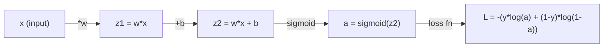
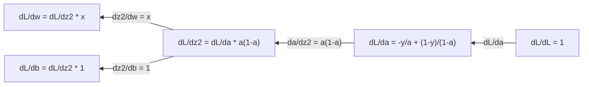
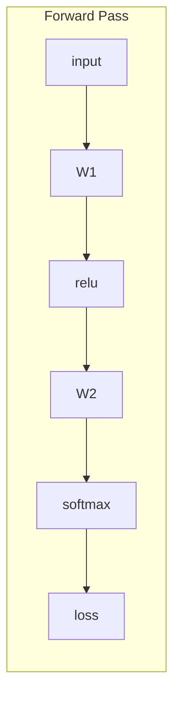
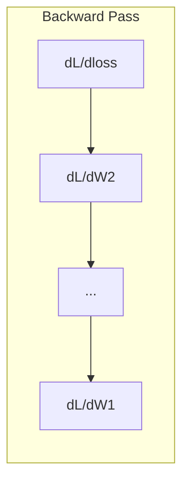

# 机器学习的计算

> 导体告诉你哪个方向下坡. 这就是神经网络需要学习的.

**Type:** Learn
**Language:**字符串
**Prerequisites:** Phase 1, Lessons 01-03
**Time:** ~60 minutes

## 学习目标

- 计算常见 ML函数的数值和分析衍生值 ($x^2$体,体,体
- 实现从零开始降梯度,以减少1D和2D中的损失函数
- 导出线性回归模型的梯度,并通过手动重量更新训练它
- 解释赫西矩阵,泰勒系列近似和它们与优化方法的联系

## 问题

你有一个数百万个重量的神经网络. 每个重量都是一个. 你需要弄清楚哪个方向转移每个,使模型变得略有不错. 计算给你这个方向.

没有计算,训练神经网络意味着尝试随机变化,希望得到最好的. 借助衍生品,你知道每个权重对错误的影响. 你每次都会把每个扣子转向正确的方向.

## 概念

### 导数是什么?

衍生品衡量变化率.$y = f(x)$衍生品$f'(x)$告诉你:如果你推$x$钱的小量,$y$改变?

几何学上,衍生品是线在某个点上的斜率.

**$f(x) = x^2$:**

| $x$ | $f(x)$ | $f'(x)$ (slope) |
|---|------|---------------|
| 0 | 0    | 0 (flat, at the bottom) |
| 1 | 1    | 2 |
| 2 | 4    | 4 (tangent line slope at this point) |
| 3 | 9    | 6 |

在$x=2$如果移动,$x$稍微向右,$y$增加了4倍左右.$x=0$向是0. 你在碗底部.

官方定义:

```math
f'(x) = \lim_{h \to 0} \frac{f(x + h) - f(x)}{h}
```

在代码中,你跳过了极限,只用一个非常小的$h$这就是数字衍生.

### 部分衍生品:一次性变量

实际函数有很多输入.神经网络损失取决于数千个权重. 一个部分衍生物保持除一个变量以外的所有变量是恒定的,然后取出与那个变量相对于的衍生物.

```math
\begin{aligned}
f(x, y) &= x^2 + 3xy + y^2 \\[4pt]
\frac{\partial f}{\partial x} &= 2x + 3y \quad \text{(treat } y \text{ as a constant)} \\
\frac{\partial f}{\partial y} &= 3x + 2y \quad \text{(treat } x \text{ as a constant)}
\end{aligned}
```

如果我推出这只重量,损失会如何改变?

### 梯度:所有部分衍生物的向量

渐变将每个部分衍生物集成成一个向量.$f(x, y, z)$向是:

```math
\nabla f = \left[ \frac{\partial f}{\partial x}, \frac{\partial f}{\partial y}, \frac{\partial f}{\partial z} \right]
```

梯指向最的升方向.

**Contour plot of $f(x,y) = x^2 + y^2$:**

函数形成一个碗形状,以圆为轮线.最小值为 (0, 0).

| Point | $\nabla f$ | $-\nabla f$ (descent direction) |
|-------|--------|----------------------------|
| (1, 1) | [2, 2] (points uphill, away from minimum) | [-2, -2] (points downhill, toward minimum) |
| (0, 0) | [0, 0] (flat, at the minimum) | [0, 0] |

这就是图像中的梯度下降.

### 优化的联系

训练神经网络是优化.$L(w_1, w_2, \ldots, w_n)$模型是多么错误的,你想尽量减少.

```
Gradient descent update rule:

  w_new = w_old - learning_rate * dL/dw

For every weight:
  1. Compute the partial derivative of loss with respect to that weight
  2. Subtract a small multiple of it from the weight
  3. Repeat
```

学习速度控制了步骤的尺寸,太大,你超越了,太小,你爬行了.

**Loss landscape (1D slice):**

损失函数$L(w)$形成一个曲线,峰值和谷口作为重量.$w$它们的数量有所不同.

| Feature | Description |
|---------|-------------|
| Global minimum | The lowest point on the entire curve -- the best solution |
| Local minimum | A valley that is lower than its neighbors but not the lowest overall |
| Slope | Gradient descent follows the slope downhill from any starting point |

渐进下降跟随坡坡下坡. 它可能会被局部最小限制限制,但在高维空间 (数百万重量) 中,这很少是实际的问题.

### 数字与分析衍生品

计算衍生值有两种方法.

分析:手动应用计算规则.$f(x) = x^2$导数是$f'(x) = 2x$确切,快速.

计算 计算 计算 计算 计算$f(x+h)$其他$f(x-h)$为了一个小的$h$然后使用差异.

```
Numerical (central difference):

f'(x) ~= f(x + h) - f(x - h)
          -----------------------
                  2h

h = 0.0001 works well in practice
```

数学衍生品较慢,但适用于任何函数.分析衍生品是快速的,但需要你衍生公式.神经网络框架采用第三种方法:自动差异化,它将精确衍生品进行机械计算.

### 简单函数的手动衍生品

这些衍生品,你会在ML中看到一次又一次.

```
Function        Derivative       Used in
--------        ----------       -------
f(x) = x^2     f'(x) = 2x      Loss functions (MSE)
f(x) = wx + b  f'(w) = x        Linear layer (gradient w.r.t. weight)
                f'(b) = 1        Linear layer (gradient w.r.t. bias)
                f'(x) = w        Linear layer (gradient w.r.t. input)
f(x) = e^x     f'(x) = e^x     Softmax, attention
f(x) = ln(x)   f'(x) = 1/x     Cross-entropy loss
f(x) = 1/(1+e^-x)  f'(x) = f(x)(1-f(x))   Sigmoid activation
```

为了$f(x) = x^2$其他:

```
f(x) = x^2    f'(x) = 2x

  x    f(x)   f'(x)   meaning
  -2    4      -4      slope tilts left (decreasing)
  -1    1      -2      slope tilts left (decreasing)
   0    0       0      flat (minimum!)
   1    1       2      slope tilts right (increasing)
   2    4       4      slope tilts right (increasing)
```

为了$f(w) = wx + b$随着$x=3$现在$b=1$其他:

```
f(w) = 3w + 1    f'(w) = 3

The derivative with respect to w is just x.
If x is big, a small change in w causes a big change in output.
```

### 链条规则

当函数组合时,链条规则告诉你如何区分.

```
If y = f(g(x)), then dy/dx = f'(g(x)) * g'(x)

Example: y = (3x + 1)^2
  outer: f(u) = u^2       f'(u) = 2u
  inner: g(x) = 3x + 1    g'(x) = 3
  dy/dx = 2(3x + 1) * 3 = 6(3x + 1)
```

神经网络是函数的链接:输入 -> 直线 -> 激活 -> 直线 -> 激活 -> 损失.反扩散是从输出到输入中反复应用的链条规则.这是整个算法.

### 赫西亚矩阵

梯度告诉你斜率,赫西亚式告诉你曲率.

对于函数,Hessian是二级部分衍生物的矩阵.$f(x_1, x_2, \ldots, x_n)$进入$(i, j)$赫西亚语是:

```math
H_{ij} = \frac{\partial^2 f}{\partial x_i \, \partial x_j}
```

对于一个2变量函数$f(x, y)$其他:

```math
H = \begin{bmatrix} \dfrac{\partial^2 f}{\partial x^2} & \dfrac{\partial^2 f}{\partial x \, \partial y} \\[8pt] \dfrac{\partial^2 f}{\partial y \, \partial x} & \dfrac{\partial^2 f}{\partial y^2} \end{bmatrix}
```

**What the Hessian tells you at a critical point (where gradient = 0):**

| Hessian property | Meaning | Example surface |
|-----------------|---------|-----------------|
| Positive definite (all eigenvalues > 0) | Local minimum | Bowl pointing up |
| Negative definite (all eigenvalues < 0) | Local maximum | Bowl pointing down |
| Indefinite (mixed eigenvalues) | Saddle point | Horse saddle shape |

**Example:** $f(x, y) = x^2 - y^2$(车功能)

```
df/dx = 2x       df/dy = -2y
d^2f/dx^2 = 2    d^2f/dy^2 = -2    d^2f/dxdy = 0

H = | 2   0 |
    | 0  -2 |

Eigenvalues: 2 and -2 (one positive, one negative)
--> Saddle point at (0, 0)
```

比较$f(x, y) = x^2 + y^2$子,子,子,子,子,子,子,子,子,子,子,子,子,子,子,子,子.

```
H = | 2  0 |
    | 0  2 |

Eigenvalues: 2 and 2 (both positive)
--> Local minimum at (0, 0)
```

**Why the Hessian matters in ML:**

牛顿的方法使用赫西式来采取比梯度下降更好的优化步骤.

```math
\begin{aligned}
\text{Newton's update:} \quad & w_{\text{new}} = w_{\text{old}} - H^{-1} \cdot \text{gradient} \\
\text{Gradient descent:} \quad & w_{\text{new}} = w_{\text{old}} - \text{lr} \cdot \text{gradient}
\end{aligned}
```

牛顿的方法更快地接近,因为赫西式"再加速度"的梯度 - - 方向得到更小的步骤,平方向得到更大的步骤.

捕获:用于一个与$N$设法,赫西亚是$N \times N$模型需要一个万参数的矩阵,所以我们使用了近似.

| Method | What it uses | Cost | Convergence |
|--------|-------------|------|-------------|
| Gradient descent | First derivatives only | $O(N)$ per step | Slow (linear) |
| Newton's method | Full Hessian | $O(N^3)$ per step | Fast (quadratic) |
| L-BFGS | Approximate Hessian from gradient history | $O(N)$ per step | Medium (superlinear) |
| Adam | Per-parameter adaptive rates (diagonal Hessian approx) | $O(N)$ per step | Medium |
| Natural gradient | Fisher information matrix (statistical Hessian) | $O(N^2)$ per step | Fast |

在实践中,亚当是深度学习的默认优化器.它通过追踪每参数的运行平均和梯度变化,便宜地接近二级信息.

### 泰勒系列近似

任何平滑函数可以通过多项式在本地进行近似:

```math
f(x + h) = f(x) + f'(x)\,h + \frac{1}{2} f''(x)\,h^2 + \frac{1}{6} f'''(x)\,h^3 + \cdots
```

接近的方法越好,但只有在点附近.$x$现在,我们要去.

**Why Taylor series matter for ML:**

- **First-order Taylor = gradient descent.**当您使用时$f(x + h) \approx f(x) + f'(x) h$渐进下降将这个线性模型最小化.$h = -\text{lr} \cdot f'(x)$现在,我们要去.

- **Second-order Taylor = Newton's method.**使用$f(x + h) \approx f(x) + f'(x) h + \frac{1}{2} f''(x) h^2$通过最小化,我们可以得到一个方形模型.$h = -f'(x)/f''(x)$- - 牛顿的步骤.

- **Loss function design.**它们的Taylor扩展是很好的. 这不是意外. 流的损失使得优化可以预测.

```
Approximation order    What it captures    Optimization method
-------------------    -----------------   -------------------
0th order (constant)   Just the value      Random search
1st order (linear)     Slope               Gradient descent
2nd order (quadratic)  Curvature           Newton's method
Higher orders          Finer structure     Rarely used in ML
```

关键见解:所有基于梯度的优化实际上是将损失函数在本地接近,

### 在ML中的整体

导数告诉你变化率.整体计算积累 - - 曲线下的区域.

在ML中,你很少手动计算整体,

**Probability.**对于一个连续的随机变量,$p(x)$其他:

```math
P(a < X < b) = \int_a^b p(x) \, dx
```

之间的概率密度曲线下的区域$a$其他$b$它们的降落率是

**Expected value.**根据概率权重的平均结果:

```math
\mathbb{E}[f(X)] = \int f(x) \, p(x) \, dx
```

预期的数据分布损失是不可或缺的.

**KL divergence.**测量两种分布的不同程度:

```math
\mathrm{KL}(p \,\|\, q) = \int p(x) \log \frac{p(x)}{q(x)} \, dx
```

在 VAEs,知识蒸和贝叶斯推理中使用.

**Normalization constants.**在贝叶斯推理中:

```math
p(w \mid \text{data}) = \frac{p(\text{data} \mid w) \, p(w)}{\int p(\text{data} \mid w) \, p(w) \, dw}
```

变量值是所有可能参数值的整体. 它通常是难以解决的,这就是为什么我们使用MCMC和变量推理等近似.

| Integral concept | Where it appears in ML |
|-----------------|----------------------|
| Area under curve | Probability from density functions |
| Expected value | Loss functions, risk minimization |
| KL divergence | VAEs, policy optimization, distillation |
| Normalization | Bayesian posteriors, softmax denominator |
| Marginal likelihood | Model comparison, evidence lower bound (ELBO) |

### 在计算图中多变量链条规则

链条规则不仅适用于线路中的规模函数.在神经网络中,变量扩展和合并.以下是衍生品通过简单的前进传递流动的方式:



后行计算右到左的梯度:



每个箭头乘以本地衍生值.任何参数的梯度是从损失到参数的路径沿线的所有本地衍生值的产量.当路径分支和合并时,你将贡献的数量 (多变链规则).

这就是反向传播:通过计算图系统地应用的链条规则,从输出到输入.

### 雅可比矩阵

当函数将向量映射到向量 (如神经网络层),其衍生物是矩阵. 雅可比安包含每个输出和每个输入的每个部分衍生物.

为了$f: \mathbb{R}^n \to \mathbb{R}^m$杰科比人$J$是一个$m \times n$矩阵:

| | $x_1$ | $x_2$ | ... | $x_n$ |
|---|---|---|---|---|
| $f_1$ | $\partial f_1/\partial x_1$ | $\partial f_1/\partial x_2$ | ... | $\partial f_1/\partial x_n$ |
| $f_2$ | $\partial f_2/\partial x_1$ | $\partial f_2/\partial x_2$ | ... | $\partial f_2/\partial x_n$ |
| ... | ... | ... | ... | ... |
| $f_m$ | $\partial f_m/\partial x_1$ | $\partial f_m/\partial x_2$ | ... | $\partial f_m/\partial x_n$ |

对于神经网络,你不会手动计算Jacobians. PyTorch处理它. 但知道它存在,有助于你理解背部传播的形状:如果一个层绘图$\mathbb{R}^n$为了$\mathbb{R}^m$哥比亚人是$m \times n$梯度通过这个矩阵的转移向后流.

### 为什么这对神经网络很重要

任何神经网络中的重量都得到一个梯度.梯度告诉你如何调整重量以减少损失.





每次重量更新:
- `W1 = W1 - lr * dL/dW1`
- `W2 = W2 - lr * dL/dW2`

进步计算了预测和损失. 倒退的通过计算了损失的梯度与每一个重量. 然后每一个重量都会下坡一步. 重复数百万步. 这就是深度学习.

```figure
derivative-tangent
```

## 建立它

### 步骤1:从零开始的数值衍生

```python
def numerical_derivative(f, x, h=1e-7):
    return (f(x + h) - f(x - h)) / (2 * h)

def f(x):
    return x ** 2

for x in [-2, -1, 0, 1, 2]:
    numerical = numerical_derivative(f, x)
    analytical = 2 * x
    print(f"x={x:2d}  f'(x) numerical={numerical:.6f}  analytical={analytical:.1f}")
```

数字衍生式与分析的一个相匹配,

### 步骤2:部分衍生品和梯度

```python
def numerical_gradient(f, point, h=1e-7):
    gradient = []
    for i in range(len(point)):
        point_plus = list(point)
        point_minus = list(point)
        point_plus[i] += h
        point_minus[i] -= h
        partial = (f(point_plus) - f(point_minus)) / (2 * h)
        gradient.append(partial)
    return gradient

def f_multi(point):
    x, y = point
    return x**2 + 3*x*y + y**2

grad = numerical_gradient(f_multi, [1.0, 2.0])
print(f"Numerical gradient at (1,2): {[f'{g:.4f}' for g in grad]}")
print(f"Analytical gradient at (1,2): [2*1+3*2, 3*1+2*2] = [{2*1+3*2}, {3*1+2*2}]")
```

### 步骤3: 渐进下降,以找到最小的 f ((x) = x^2

```python
x = 5.0
lr = 0.1
for step in range(20):
    grad = 2 * x
    x = x - lr * grad
    print(f"step {step:2d}  x={x:8.4f}  f(x)={x**2:10.6f}")
```

开始于$x=5$每一步都会走得更近$x=0$(最低限度)

### 步骤4: 2D函数上的渐进下降

```python
def f_2d(point):
    x, y = point
    return x**2 + y**2

point = [4.0, 3.0]
lr = 0.1
for step in range(30):
    grad = numerical_gradient(f_2d, point)
    point = [p - lr * g for p, g in zip(point, grad)]
    loss = f_2d(point)
    if step % 5 == 0 or step == 29:
        print(f"step {step:2d}  point=({point[0]:7.4f}, {point[1]:7.4f})  f={loss:.6f}")
```

### 步骤5:数值和分析衍生品的比较

```python
import math

test_functions = [
    ("x^2",      lambda x: x**2,          lambda x: 2*x),
    ("x^3",      lambda x: x**3,          lambda x: 3*x**2),
    ("sin(x)",   lambda x: math.sin(x),   lambda x: math.cos(x)),
    ("e^x",      lambda x: math.exp(x),   lambda x: math.exp(x)),
    ("1/x",      lambda x: 1/x,           lambda x: -1/x**2),
]

x = 2.0
print(f"{'Function':<12} {'Numerical':>12} {'Analytical':>12} {'Error':>12}")
print("-" * 50)
for name, f, df in test_functions:
    num = numerical_derivative(f, x)
    ana = df(x)
    err = abs(num - ana)
    print(f"{name:<12} {num:12.6f} {ana:12.6f} {err:12.2e}")
```

### 步骤 6: 数字计算赫西语

```python
def hessian_2d(f, x, y, h=1e-5):
    fxx = (f(x + h, y) - 2 * f(x, y) + f(x - h, y)) / (h ** 2)
    fyy = (f(x, y + h) - 2 * f(x, y) + f(x, y - h)) / (h ** 2)
    fxy = (f(x + h, y + h) - f(x + h, y - h) - f(x - h, y + h) + f(x - h, y - h)) / (4 * h ** 2)
    return [[fxx, fxy], [fxy, fyy]]

def saddle(x, y):
    return x ** 2 - y ** 2

def bowl(x, y):
    return x ** 2 + y ** 2

H_saddle = hessian_2d(saddle, 0.0, 0.0)
H_bowl = hessian_2d(bowl, 0.0, 0.0)
print(f"Saddle Hessian: {H_saddle}")  # [[2, 0], [0, -2]] -- mixed signs
print(f"Bowl Hessian:   {H_bowl}")    # [[2, 0], [0, 2]]  -- both positive
```

座函数的Hessian有2和 -2的本值 (混合符号,确认座点). 碗有2和2的本值 (两者都是正值,确认最小值).

### 步骤7:泰勒近似在行动中

```python
import math

def taylor_approx(f, f_prime, f_double_prime, x0, h, order=2):
    result = f(x0)
    if order >= 1:
        result += f_prime(x0) * h
    if order >= 2:
        result += 0.5 * f_double_prime(x0) * h ** 2
    return result

x0 = 0.0
for h in [0.1, 0.5, 1.0, 2.0]:
    true_val = math.sin(h)
    t1 = taylor_approx(math.sin, math.cos, lambda x: -math.sin(x), x0, h, order=1)
    t2 = taylor_approx(math.sin, math.cos, lambda x: -math.sin(x), x0, h, order=2)
    print(f"h={h:.1f}  sin(h)={true_val:.4f}  order1={t1:.4f}  order2={t2:.4f}")
```

接近$x_0=0$现在$\sin(x) \approx x$对于小小的情况来说,$h$但它会被破碎.$h$这就是为什么梯度下降最适合小学习率 - - 每一步都假设线性近似是准确的.

### 步骤8:为什么这对神经网络很重要

```python
import random

random.seed(42)

w = random.gauss(0, 1)
b = random.gauss(0, 1)
lr = 0.01

xs = [1.0, 2.0, 3.0, 4.0, 5.0]
ys = [3.0, 5.0, 7.0, 9.0, 11.0]

for epoch in range(200):
    total_loss = 0
    dw = 0
    db = 0
    for x, y in zip(xs, ys):
        pred = w * x + b
        error = pred - y
        total_loss += error ** 2
        dw += 2 * error * x
        db += 2 * error
    dw /= len(xs)
    db /= len(xs)
    total_loss /= len(xs)
    w -= lr * dw
    b -= lr * db
    if epoch % 40 == 0 or epoch == 199:
        print(f"epoch {epoch:3d}  w={w:.4f}  b={b:.4f}  loss={total_loss:.6f}")

print(f"\nLearned: y = {w:.2f}x + {b:.2f}")
print(f"Actual:  y = 2x + 1")
```

每个基于梯度的训练循环都遵循这个模式:预测,计算损失,计算梯度,更新权重.

## 用它

通过NumPy,相同的操作更快,更简洁:

```python
import numpy as np

x = np.array([1, 2, 3, 4, 5], dtype=float)
y = np.array([3, 5, 7, 9, 11], dtype=float)

w, b = np.random.randn(), np.random.randn()
lr = 0.01

for epoch in range(200):
    pred = w * x + b
    error = pred - y
    loss = np.mean(error ** 2)
    dw = np.mean(2 * error * x)
    db = np.mean(2 * error)
    w -= lr * dw
    b -= lr * db

print(f"Learned: y = {w:.2f}x + {b:.2f}")
```

光器自动化了光计算,但更新循环是相同的.

## 运动

1. 实施`numerical_second_derivative(f, x)`使用`numerical_derivative`检查第二个衍生值的$x^3$在$x=2$现在,我们要做什么?
2. 使用梯度下降来找到最小值$f(x, y) = (x - 3)^2 + (y + 1)^2$开始从$(0, 0)$答案应该与$(3, -1)$现在,我们要去.
3. 增加动力在梯度下降循环:保持一个速度向量,积累过去梯度.$f(x) = x^4 - 3x^2$现在,我们要去.

### 暗示

**Exercise 1.**定义一个回来的助手`numerical_derivative(f, x)`让那个助手去`numerical_derivative`如果结果很,请使用更大的步骤,如`h=1e-4`对于两个调用;$x=2$必须接近12个.

**Exercise 2.**写下梯度$(2(x - 3), 2(y + 1))$或使用`numerical_gradient`打电话`gradient_descent_nd`其他$(0, 0)$每10步印出一个点,必须向前移动.$(3, -1)$损失必须降到接近0.

**Exercise 3.**保持速度`v`更新如下`v = momentum * v - lr * grad`然后添加`v`为了`x`计算每个方法需要达到接近0的梯度的步骤;最低值为 $x = \pm\sqrt{1.5} \approx \pm 1.225$现在,我们要去.

## 关键词

| Term | What people say | What it actually means |
|------|----------------|----------------------|
| Derivative | "The slope" | The rate of change of a function at a point. Tells you how much the output changes per unit change in input. |
| Partial derivative | "Derivative of one variable" | The derivative with respect to one variable while all others are held constant. |
| Gradient | "Direction of steepest ascent" | A vector of all partial derivatives. Points in the direction that increases the function fastest. |
| Gradient descent | "Go downhill" | Subtract the gradient (times a learning rate) from the parameters to reduce the loss. The core of neural network training. |
| Learning rate | "Step size" | A scalar that controls how big each gradient descent step is. Too large: diverge. Too small: converge slowly. |
| Chain rule | "Multiply the derivatives" | The rule for differentiating composed functions: $\frac{df}{dx} = \frac{df}{dg} \cdot \frac{dg}{dx}$. The mathematical basis of backpropagation. |
| Jacobian | "Matrix of derivatives" | When a function maps vectors to vectors, the Jacobian is the matrix of all partial derivatives of outputs with respect to inputs. |
| Numerical derivative | "Finite differences" | Approximating a derivative by evaluating the function at two nearby points and computing the slope between them. |
| Backpropagation | "Reverse-mode autodiff" | Computing gradients layer by layer from output to input using the chain rule. How neural networks learn. |
| Hessian | "Matrix of second derivatives" | The matrix of all second-order partial derivatives. Describes the curvature of a function. Positive definite Hessian at a critical point means local minimum. |
| Taylor series | "Polynomial approximation" | Approximating a function near a point using its derivatives: $f(x+h) \approx f(x) + f'(x)h + \frac{1}{2}f''(x)h^2 + \cdots$ The basis for understanding why gradient descent and Newton's method work. |
| Integral | "Area under the curve" | The accumulation of a quantity over a range. In ML, integrals define probabilities, expected values, and KL divergence. |

## 进一步阅读

- [3Blue1Brown: Essence of Calculus](https://www.3blue1brown.com/topics/calculus)- 导体,整体和链条规则的视觉直觉
- [Stanford CS231n: Backpropagation](https://cs231n.github.io/optimization-2/)- 如何通过神经网络层流动的梯度
