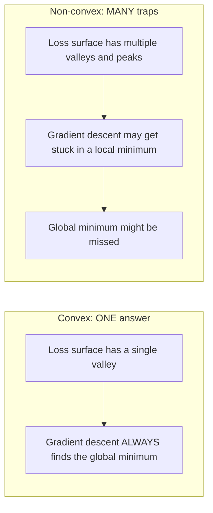
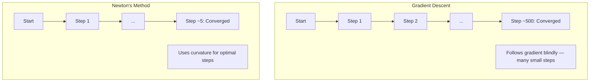
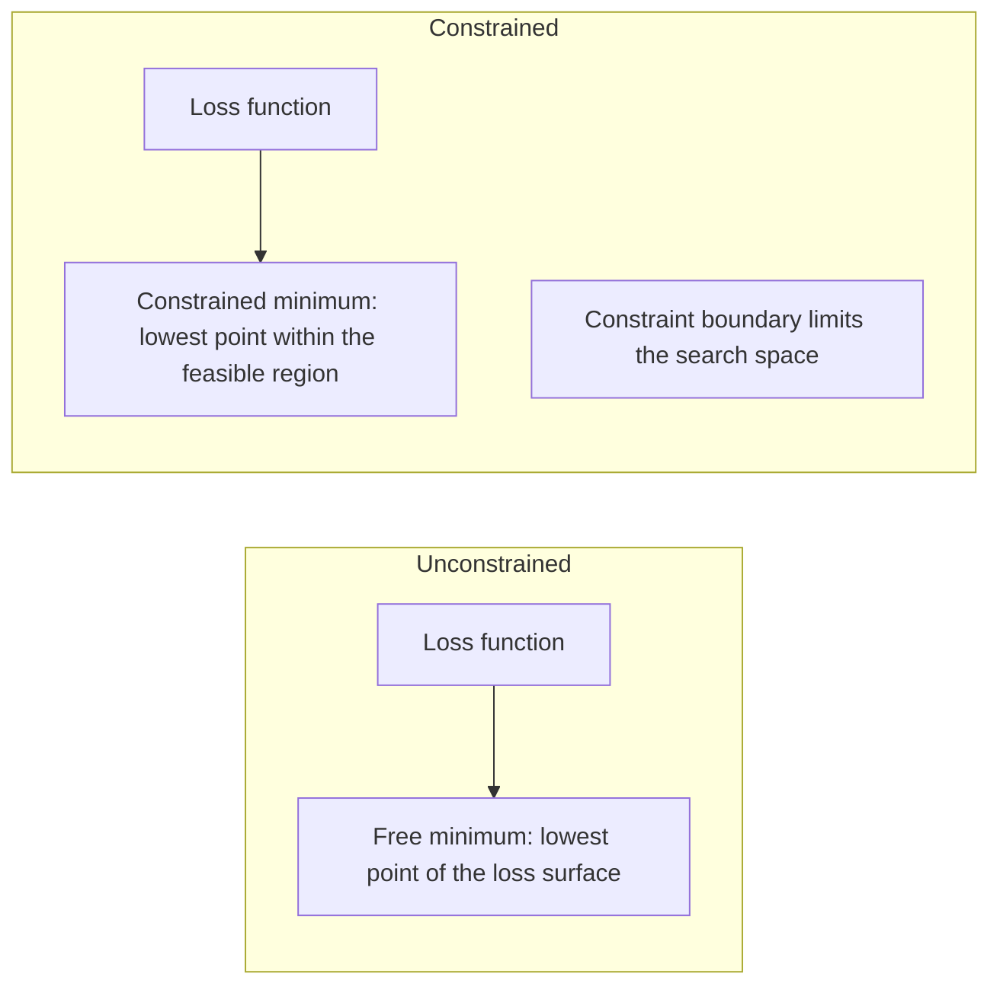
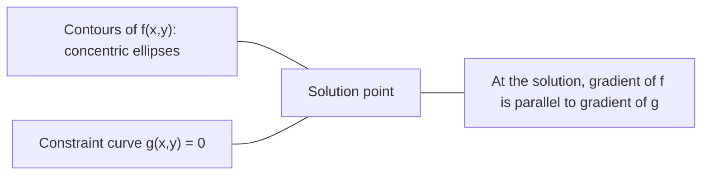

# 曲的优化

> 曲的问题有一个谷,神经网络有数百万.

**Type:** Build
**Language:**字符串
**Prerequisites:** Phase 1, Lessons 04 (Calculus for ML), 08 (Optimization)
**Time:** ~90 minutes

## 学习目标

- 测试一个函数是否曲,使用定义,第二衍生和赫西标准
- 运用牛顿的方法,并将其方形融合与梯度下降进行比较
- 使用拉格兰奇乘法解决限制优化问题,并解释KKT条件
- 解释为什么神经网络损失景观不凸,但SGD仍然找到好的解决方案

## 问题

课8教你梯度下降,动力和亚当.这些优化者在任何表面上都会下山. 但它们没有保证.在非形的景观上,梯度下降可能会降落在一个糟糕的地方最低值,卡在车点上,或者永远振荡.你无论如何都使用它,因为神经网络是非形的,没有替代方案.

但是机器学习中的许多问题都是曲的.线性回归,物流回归,SVM,LASSO,脊坡回归.对于这些问题来说,存在更强大的东西:优化与数学保障.曲的问题完全有一个谷.任何走下坡的算法都将达到全球最低水平.不需要重新启动.没有学习率的时间表.没有祈祷.

了解曲性有三个作用.首先,它告诉你当你的问题是容易 (曲) 时与硬 (非曲) 时.第二,它给你提供了比如牛顿曲问题的方法的更快工具.第三,它解释了整个 ML 中出现的概念:规律化作为一个限制,SVM 中的二元性,以及深度学习为什么尽管违反了曲性给你的每一个好特性,但它仍然有效.

## 概念

### 曲的集合

一套$S$形,如果在任何两个点中$S$它们之间的线段也完全在$S$现在,我们要去.

| Convex sets | Not convex |
|---|---|
| **Rectangle**: any two points inside can be connected by a line segment that stays inside | **Star/crescent shape**: a line between two interior points can pass outside the set |
| **Triangle**: same property holds for all interior points | **Donut/annulus**: the hole means some line segments leave the set |
| The line segment between any two points stays within the set | The line segment between some pairs of points exits the set |

官方测试:任何点$x, y$在$S$任何一个$t \in [0, 1]$关于这个问题$tx + (1-t)y$现在,$S$现在,我们要去.

曲集合的例子:
- 一条线,一架飞机,所有$\mathbb{R}^n$
- 球 (圆,球,超球)
- 一个半空间:$\lbrace x : a^T x \le b \rbrace$
- 任何数量的曲集合的交叉点

无的集合的例子:
- 甜甜圈 (菜)
- 两个分离的圆的结合
- 任何装有""或"洞"的套件

### 曲函数

函数$f$如果其域是一个曲的集合,并且为任何两个点$x, y$在其领域和任何$t \in [0, 1]$其他:

```math
f(tx + (1-t)y) \le t f(x) + (1-t) f(y)
```

几何:图表上的任何两个点之间的线段位于图表上或图表上.

| Property | Convex function | Non-convex function |
|---|---|---|
| **Line segment test** | The line between any two points on the graph lies **above or on** the curve | The line between some points on the graph dips **below** the curve |
| **Shape** | Single bowl/valley curving upward | Multiple peaks and valleys with mixed curvature |
| **Local minima** | Every local minimum is the global minimum | Multiple local minima may exist at different heights |

常见的曲函数:
- $f(x) = x^2$现在,我们要去做什么?
- $f(x) = \lvert x \rvert$(绝对值)
- $f(x) = e^x$它们的数量
- $f(x) = \max(0, x)$它们是的.
- $f(x) = -\log(x)$为了$x > 0$没有任何其他方法.
- 任何线性函数$f(x) = a^T x + b$形和形

### 曲度测试

实践测试,从最简单到最严格.

**Test 1: Second derivative test (1D).**如果$f''(x) \ge 0$对于所有人$x$现在$f$形的.

- $f(x) = x^2$其他$f''(x) = 2 \ge 0$曲的.
- $f(x) = x^3$其他$f''(x) = 6x$没有任何.$x < 0$没有曲的.
- $f(x) = e^x$其他$f''(x) = e^x > 0$曲的.

**Test 2: Hessian test (multivariate).**如果Hessian矩阵$H(x)$对于所有人来说,是正面的半确定的.$x$现在$f$赫西亚系是第二部分衍生物的矩阵.

**Test 3: Definition test.**检查不平等$f(tx + (1-t)y) \le t f(x) + (1-t) f(y)$直接. 对于衍生值难以计算的函数有用.

### 为什么曲性很重要

曲优化的核心定理:

**For a convex function, every local minimum is a global minimum.**

任何下坡路都会导致相同的答案.算法保证将趋于最佳解决方案.



后果:
- 没有必要随机重新启动
- 没有需要复杂的学习时间表
- 融合证明是可能的 (速度取决于函数属性)
- 解决方案是独一无二的 (高达平面区域)

### 在 ML 中,形与非形

| Problem | Convex? | Why |
|---------|---------|-----|
| Linear regression (MSE) | Yes | Loss is quadratic in weights |
| Logistic regression | Yes | Log-loss is convex in weights |
| SVM (hinge loss) | Yes | Maximum of linear functions |
| LASSO (L1 regression) | Yes | Sum of convex functions is convex |
| Ridge regression (L2) | Yes | Quadratic + quadratic = convex |
| Neural network (any loss) | No | Nonlinear activations create non-convex landscape |
| k-means clustering | No | Discrete assignment step |
| Matrix factorization | No | Product of unknowns |

随着线性输出的线性模型是曲的.当你添加隐藏的层,不线性激活,曲的断裂.

### 赫西亚矩阵

赫西亚人$H$函数的$f: \mathbb{R}^n \to \mathbb{R}$是什么?$n \times n$部分衍生品的二次矩阵.

```math
H_{ij} = \frac{\partial^2 f}{\partial x_i \, \partial x_j}
```

为了$f(x, y) = x^2 + 3xy + y^2$其他:

```math
\begin{gathered}
\begin{aligned}
\frac{\partial f}{\partial x} &= 2x + 3y & \frac{\partial^2 f}{\partial x^2} &= 2 & \frac{\partial^2 f}{\partial x \, \partial y} &= 3 \\
\frac{\partial f}{\partial y} &= 3x + 2y & \frac{\partial^2 f}{\partial y \, \partial x} &= 3 & \frac{\partial^2 f}{\partial y^2} &= 2
\end{aligned} \\[8pt]
H = \begin{bmatrix} 2 & 3 \\ 3 & 2 \end{bmatrix}
\end{gathered}
```

赫西亚人告诉你关于曲线:
- 所有正值的自值值:函数在每个方向上方曲线 (在那个点上曲线)
- 所有负值的自值:各方向向下曲线 (形,局部最大)
- 混合标志:座点 (在某些方向上,在其他方向下)
- 零自值:在该方向平 (退化)

为了曲性,赫西亚必须是正面半确式 (所有本值$\ge 0$) 在任何地方,而不是在一个地方.

### 牛顿的方法

渐进式下降使用第一级信息 (梯度).牛顿的方法使用第二级信息 (赫西式).它适应当前点的方形近似,直接跳到那个方形的最小.

```math
\begin{aligned}
\text{Update rule:} \quad & x_{\text{new}} = x - H^{-1} \cdot \text{gradient} \\
\text{Compare to gradient descent:} \quad & x_{\text{new}} = x - \text{lr} \cdot \text{gradient}
\end{aligned}
```

牛顿的方法将规模学习速度取代为反向赫西式. 这自动调整了基于本地曲线的步骤大小和方向.



优势:
- 接近最小的四方相近 (每一步的错误方形)
- 没有调节的学习速度
- 规模变异性 (不管你如何参数问题,都能工作)

缺点:
- 计算赫西安成本$O(n^2)$记忆力和$O(n^3)$转换
- 对于一个拥有100万重量的神经网络,$10^{12}$报名$10^{18}$运营
- 对于深度学习来说不实用

### 限制优化

无限制优化:尽量减少$f(x)$在所有地方$x$现在,我们要去.
限制优化:尽量减少$f(x)$受到限制.

实际问题有限制.你想尽量降低成本,但预算有限.你想尽量减少错误,但模型的复杂性有限.



### 缩乘法

拉格兰奇乘法将一个限制的问题转化为一个不受限制的问题.

问题: 减少$f(x)$根据$g(x) = 0$现在,我们要去.

解决方案:引入一个新的变量 (拉格兰奇乘法) $\lambda$) 并解决无限制的问题:

```math
L(x, \lambda) = f(x) + \lambda g(x)
```

在溶液中, $L$只有零

```math
\begin{aligned}
\frac{\partial L}{\partial x} &= \frac{\partial f}{\partial x} + \lambda \frac{\partial g}{\partial x} = 0 \\
\frac{\partial L}{\partial \lambda} &= g(x) = 0
\end{aligned}
```

几何直觉:在限制最小的时,$f$必须与压力梯度平行$g$如果它们不平行,你可以沿着制表面移动,$f$更多的.



举个例子: 减少$f(x,y) = x^2 + y^2$根据$x + y = 1$现在,我们要去.

```math
\begin{aligned}
L &= x^2 + y^2 + \lambda(x + y - 1) \\[4pt]
\frac{\partial L}{\partial x} &= 2x + \lambda = 0 \implies x = -\lambda/2 \\
\frac{\partial L}{\partial y} &= 2y + \lambda = 0 \implies y = -\lambda/2 \\
\frac{\partial L}{\partial \lambda} &= x + y - 1 = 0 \\[4pt]
&\text{From first two: } x = y \\
&\text{Substituting: } 2x = 1, \text{ so } x = y = 0.5, \ \lambda = -1
\end{aligned}
```

线上最接近的地方$x + y = 1$来源是$(0.5, 0.5)$现在,我们要去.

### 卡卡特条件

卡鲁什-库恩-图克条件将拉格兰奇乘法扩展到不平等的限制.

问题: 减少$f(x)$根据$g_i(x) \le 0$为了$i = 1, \ldots, m$现在,我们要去.

 KKT条件 (为了最佳效果而必要):

```math
\begin{aligned}
&\text{1. Stationarity:} && \frac{\partial f}{\partial x} + \sum_i \lambda_i \frac{\partial g_i}{\partial x} = 0 \\
&\text{2. Primal feasibility:} && g_i(x) \le 0 \quad \text{for all } i \\
&\text{3. Dual feasibility:} && \lambda_i \ge 0 \quad \text{for all } i \\
&\text{4. Complementary slackness:} && \lambda_i \, g_i(x) = 0 \quad \text{for all } i
\end{aligned}
```

补充的惰是关键的见解:$g_i = 0$没有任何限制,但没有影响解决方案的限制是$\lambda = 0$现在,我们要去.

支持向量是限制活动的数据点 ($\lambda > 0$) 所有其他数据点都具有$\lambda = 0$没有影响决策的边界.

### 规范化作为限制优化

它们不是任意的俩,而是隐藏的限制优化问题.

**L2 regularization (Ridge):**

```math
\begin{aligned}
&\text{minimize } \text{Loss}(w) \text{ subject to } \lVert w \rVert^2 \le t \\[4pt]
&\text{Equivalent unconstrained form:} \\
&\text{minimize } \text{Loss}(w) + \lambda \lVert w \rVert^2
\end{aligned}
```

限制$\lVert w \rVert^2 \le t$解决方案是输入轮首先触及这个球的地方.

**L1 regularization (LASSO):**

```math
\begin{aligned}
&\text{minimize } \text{Loss}(w) \text{ subject to } \lVert w \rVert_1 \le t \\[4pt]
&\text{Equivalent unconstrained form:} \\
&\text{minimize } \text{Loss}(w) + \lambda \lVert w \rVert_1
\end{aligned}
```

限制$\lVert w \rVert_1 \le t$定义钻石 (二维旋转方形).

| Property | L2 constraint (circle) | L1 constraint (diamond) |
|---|---|---|
| **Constraint shape** | Circle (sphere in higher dims) | Diamond (rotated square in 2D) |
| **Where loss contour touches** | Smooth boundary — any point on the circle | Corner — aligned with an axis |
| **Solution behavior** | Weights are small but nonzero | Some weights are exactly zero (sparse) |
| **Result** | Weight shrinkage | Feature selection |

这解释了L1为什么生产稀疏的模型 (特征选择),而L2只缩小重量.钻石的角落与轴相一致.损失轮更有可能触及角落,设置一个或多个重量完全为零.

### 两性

每个限制优化问题 (原始) 都有一个伴侣问题 (二元).对于曲的问题,原始和二元具有相同的最佳值.这是强大的二元性.

拉格兰基双重函数:

```math
\begin{aligned}
&\text{Primal:} && \text{minimize } f(x) \text{ subject to } g(x) \le 0 \\
&\text{Lagrangian:} && L(x, \lambda) = f(x) + \lambda g(x) \\
&\text{Dual function:} && d(\lambda) = \min_x L(x, \lambda) \\
&\text{Dual problem:} && \text{maximize } d(\lambda) \text{ subject to } \lambda \ge 0
\end{aligned}
```

为什么二元性很重要:
- 双重问题有时比原始问题更容易解决
- 解决SVM的形式是双重的,问题取决于数据点之间的点产品 (实现内核技巧)
- 双为原始最佳的下限提供,用于检查溶液质量

对于SVM,具体:

```
Primal: find w, b that maximize the margin 2/||w|| subject to
        y_i(w^T x_i + b) >= 1 for all i

Dual:   maximize sum(alpha_i) - 0.5 * sum_ij(alpha_i * alpha_j * y_i * y_j * x_i^T x_j)
        subject to alpha_i >= 0 and sum(alpha_i * y_i) = 0

The dual only involves dot products x_i^T x_j.
Replace x_i^T x_j with K(x_i, x_j) to get the kernel trick.
```

### 尽管没有曲性,但深度学习为什么有效

由于神经网络损失功能非常不曲.根据每种经典措施,优化它们都应该失败.然而,静态梯度下降可靠地找到好解决方案.

**Most local minima are good enough.**在高维度空间中,随机关键点 (梯度为零) 绝大多数是车点,而不是本地最小值.存在的少数本地最小值往往接近全球最小值.当参数空间有数百万维度时,陷入一个可怕的本地最小值极不可能.

**Saddle points, not local minima, are the real obstacle.**在一个函数中$n$对于高维度的随机关键点,所有的概率是$n$实际值是正值的 (本地最小值)$2^{-n}$几乎所有的关键点都是车点.

**Overparameterization smooths the landscape.**网络比训练示例更多的参数,更平滑,更连接的损失表面.更广泛的网络具有较少的恶性本地最小值.这与直觉相反,但经验一致.

**Loss landscape structure:**

| Property | Low-dimensional space | High-dimensional space |
|---|---|---|
| **Landscape** | Many isolated peaks and valleys | Smoothly connected valleys |
| **Minima** | Many isolated local minima | Few bad local minima; most are near-optimal |
| **Navigation** | Hard to find global minimum | Many paths lead to good solutions |
| **Critical points** | Mix of local minima and saddle points | Overwhelmingly saddle points, not local minima |

**Stochastic noise acts as implicit regularization.**微批次 SGD 增加噪音,防止落入的最小.的最小超适应;平面最小一般化.噪音偏差优化损失景观的平面区域.

### 实际上使用的二级方法

对于大型模型来说,纯牛顿的方法是不实用的.

**L-BFGS (Limited-memory BFGS):**通过使用最后的 $m$需要的$O(mn)$记忆而不是$O(n^2)$适用于高达10,000参数的问题.用于经典ML (物流回归,CRF),但不是深度学习.

**Natural gradient:**根据Fisher的数据测量,Fisher的数据测量对数据测量进行了测量,并将数据测量进行测量.

**Hessian-free optimization:**使用结合梯度来解决$Hx = g$没有形成.$H$只有需要Hessian向量产量,可以在$O(n)$通过自动分化进行时间.

**Diagonal approximations:**亚当的第二个时刻是赫西亚人的斜角近似.AdaHessian通过哈辛森估计器使用实际的赫西亚斜角元素扩展这一点.

| Method | Memory | Per-step cost | When to use |
|--------|--------|--------------|-------------|
| Gradient descent | $O(n)$ | $O(n)$ | Baseline, large models |
| Newton's method | $O(n^2)$ | $O(n^3)$ | Small convex problems |
| L-BFGS | $O(mn)$ | $O(mn)$ | Medium convex problems |
| Adam | $O(n)$ | $O(n)$ | Deep learning default |
| K-FAC | $O(n)$ | $O(n)$ per layer | Research, large-batch training |

```figure
convex-vs-nonconvex
```

## 建立它

### 步骤1:曲度检查器

通过采样点和检查定义来实验测试曲率的函数.

```python
import random
import math

def check_convexity(f, dim, bounds=(-5, 5), samples=1000):
    violations = 0
    for _ in range(samples):
        x = [random.uniform(*bounds) for _ in range(dim)]
        y = [random.uniform(*bounds) for _ in range(dim)]
        t = random.uniform(0, 1)
        mid = [t * xi + (1 - t) * yi for xi, yi in zip(x, y)]
        lhs = f(mid)
        rhs = t * f(x) + (1 - t) * f(y)
        if lhs > rhs + 1e-10:
            violations += 1
    return violations == 0, violations
```

### 步骤2:牛顿的2D方法

通过明确的赫西式运用牛顿的方法进行比较.

```python
def newtons_method(f, grad_f, hessian_f, x0, steps=50, tol=1e-12):
    x = list(x0)
    history = [x[:]]
    for _ in range(steps):
        g = grad_f(x)
        H = hessian_f(x)
        det = H[0][0] * H[1][1] - H[0][1] * H[1][0]
        if abs(det) < 1e-15:
            break
        H_inv = [
            [H[1][1] / det, -H[0][1] / det],
            [-H[1][0] / det, H[0][0] / det],
        ]
        dx = [
            H_inv[0][0] * g[0] + H_inv[0][1] * g[1],
            H_inv[1][0] * g[0] + H_inv[1][1] * g[1],
        ]
        x = [x[0] - dx[0], x[1] - dx[1]]
        history.append(x[:])
        if sum(gi ** 2 for gi in g) < tol:
            break
    return history
```

### 步骤3:拉格兰奇乘法解决器

通过拉格兰基基梯度下降来解决限制优化.

```python
def lagrange_solve(f_grad, g_val, g_grad, x0, lr=0.01,
                   lr_lambda=0.01, steps=5000):
    x = list(x0)
    lam = 0.0
    history = []
    for _ in range(steps):
        fg = f_grad(x)
        gv = g_val(x)
        gg = g_grad(x)
        x = [
            xi - lr * (fgi + lam * ggi)
            for xi, fgi, ggi in zip(x, fg, gg)
        ]
        lam = lam + lr_lambda * gv
        history.append((x[:], lam, gv))
    return history
```

### 步骤4:比较第一级与第二级

运行梯度下降和牛顿的方法,用相同的平方函数计算到接近的步骤.

```python
def quadratic(x):
    return 5 * x[0] ** 2 + x[1] ** 2

def quadratic_grad(x):
    return [10 * x[0], 2 * x[1]]

def quadratic_hessian(x):
    return [[10, 0], [0, 2]]
```

牛顿的方法将在1步 (这对方位数来说是确切的)  konverge.渐进下降将需要数百步,因为赫西亚的本值差异于5倍,从而产生长长的谷.

## 用它

在选择ML模型和解决器时,曲性分析直接适用于.

对于曲的问题 (物流回归,SVM,LASSO):
- 使用专用解决器 (liblinear, CVXPY, scipy.optimize.minimize with method='L-BFGS-B')
- 期待一个独特的全球解决方案
- 第二阶段的方法是实用的和快速的

对于非形问题 (神经网络):
- 使用第一级方法 (SGD,Adam)
- 接受解决方案取决于初始化和随机性
- 使用过度参数化,噪音和学习率时间表作为隐含的规范化
- 没有必要浪费时间寻找全球最低限度.

```python
from scipy.optimize import minimize

result = minimize(
    fun=lambda w: sum((y - X @ w) ** 2) + 0.1 * sum(w ** 2),
    x0=np.zeros(d),
    method='L-BFGS-B',
    jac=lambda w: -2 * X.T @ (y - X @ w) + 0.2 * w,
)
```

对于SVM,双重配方允许使用内核技巧:

```python
from sklearn.svm import SVC

svm = SVC(kernel='rbf', C=1.0)
svm.fit(X_train, y_train)
print(f"Support vectors: {svm.n_support_}")
```

## 运动

1. **Convexity gallery.**使用检查器测试这些函数以查看曲度: $f(x) = x^4$现在$f(x) = \sin(x)$现在$f(x,y) = x^2 + y^2$现在$f(x,y) = xy$现在$f(x) = \max(x, 0)$解释为什么每个结果都是有意义的.

2. **Newton vs gradient descent race.**运行两个方法$f(x,y) = 50x^2 + y^2$从起点开始$(10, 10)$变 gradient 降低发生什么,当条件数量 (最大至最小的赫西安自值比例) 增加时?

3. **Lagrange multiplier geometry.**减少$f(x,y) = (x-3)^2 + (y-3)^2$根据$x + 2y = 4$检查溶液的向率$f$与梯相对$g$在解决方案.

4. **Regularization constraint.**实现L1限制优化:尽量减少$(x-3)^2 + (y-2)^2$根据$\lvert x \rvert + \lvert y \rvert \le 1$显示溶液有一个坐标等于零 (钻石约束的差).

5. **Hessian eigenvalue analysis.**计算Rosenbrock函数的Hessian在 (1,1) 和 (-1,1).计算两个点的自值.自值告诉你关于最小与远离的曲线?

### 暗示

**Exercise 1.**在跑步之前,预测每一个结果.`check_convexity`,在一个维度,看看标志$f''(x)$两个维度,看看赫西亚的本值.$f(x,y) = xy$检查器必须报告它不是曲的.

**Exercise 2.**电话`optimize_gd`其他`newtons_method`向和向的向$f$对于梯度下降,学习率必须低于$2/100$由于$50x^2$它们的含量$y$方向移动缓慢. 重复$100x^2$然后再数几步.

**Exercise 3.**使用`lagrange_solve`随着$g(x,y) = x + 2y - 4$在答案上,查看.$x + 2y = 4$现在,$\nabla f = (2(x-3), 2(y-3))$是一个乘法$\nabla g = (1, 2)$现在,我们要去.

**Exercise 4.**没有限制的最小值 (3, 2) 在钻石之外,所以答案在钻石的边界上. 使用预测梯度下降:采取梯度步骤,然后投射回$\lvert x \rvert + \lvert y \rvert \le 1$检查结果是否满足平等的限制,并将其与`demo_regularization_geometry`现在,我们要去.

**Exercise 5.**电话`rosenbrock_hessian`在每一个点,然后将结果传递给`hessian_eigenvalues_2d`在 (1, 1) 时,两个自值值都是正值的,它们的比率非常大,所以谷口在一方向窄而另一方向平坦.

## 关键词

| Term | What it means |
|------|---------------|
| Convex set | A set where the line segment between any two points in the set stays inside the set |
| Convex function | A function where the line between any two points on its graph lies above or on the graph. Equivalently, Hessian is positive semidefinite everywhere |
| Local minimum | A point lower than all nearby points. For convex functions, every local minimum is the global minimum |
| Global minimum | The lowest point of a function over its entire domain |
| Hessian matrix | The matrix of all second partial derivatives. Encodes curvature information |
| Positive semidefinite | A matrix whose eigenvalues are all non-negative. The multidimensional analogue of "second derivative >= 0" |
| Condition number | Ratio of largest to smallest eigenvalue of the Hessian. High condition number means elongated valleys and slow gradient descent |
| Newton's method | Second-order optimizer that uses the inverse Hessian to determine step direction and size. Quadratic convergence near the minimum |
| Lagrange multiplier | A variable introduced to convert a constrained optimization problem into an unconstrained one |
| KKT conditions | Necessary conditions for optimality with inequality constraints. Generalize Lagrange multipliers |
| Complementary slackness | At the solution, either a constraint is active or its multiplier is zero. Never both nonzero |
| Duality | Every constrained problem has a companion dual problem. For convex problems, both have the same optimal value |
| Strong duality | Primal and dual optimal values are equal. Holds for convex problems satisfying Slater's condition |
| L-BFGS | Approximate second-order method that stores the last $m$ gradient differences instead of the full Hessian |
| Saddle point | A point where the gradient is zero but it is a minimum in some directions and a maximum in others |
| Overparameterization | Using more parameters than training examples. Smooths the loss landscape and reduces bad local minima |

## 进一步阅读

- [Boyd & Vandenberghe: Convex Optimization](https://web.stanford.edu/~boyd/cvxbook/)-标准教科书,可在线免费使用
- [Bottou, Curtis, Nocedal: Optimization Methods for Large-Scale Machine Learning (2018)](https://arxiv.org/abs/1606.04838)- 桥梁曲优化理论和深度学习实践
- [Choromanska et al.: The Loss Surfaces of Multilayer Networks (2015)](https://arxiv.org/abs/1412.0233)- 为什么不凸的神经网络的景观并不像看起来那么糟糕
- [Nocedal & Wright: Numerical Optimization](https://link.springer.com/book/10.1007/978-0-387-40065-5)- 牛顿方法,L-BFGS的综合参考,以及限制优化
