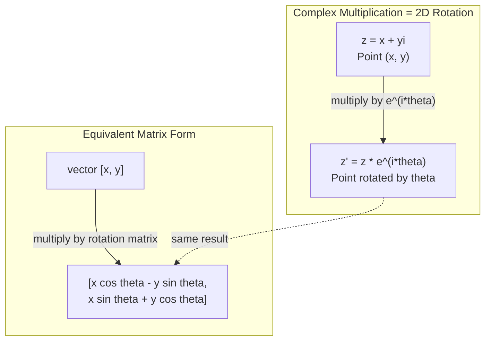
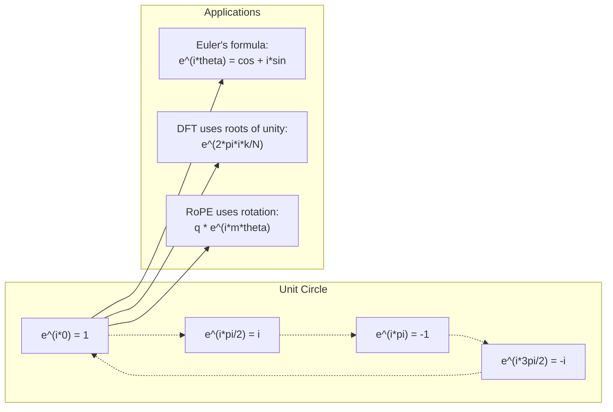

# 复杂的AI数字

> 平方根不是虚构的,它是旋转,频率和信号处理的重点.

**Type:** Learn
**Language:**字符串
**Prerequisites:** Phase 1, Lessons 01-04 (linear algebra, calculus)
**Time:** ~60 minutes

## 学习目标

- 进行复杂算术 (加,乘,分,结合) 在矩形和极形两种形式
- 应用尤勒公式来转换复杂指数和三角函数
- 通过复杂的团结根实现分离福利尔变形
- 解释转换器中的复杂旋转是如何构成ROPE和鼻状位置编码的基础

## 问题

你打开一篇关于福利尔转换的论文,`i`它们是的,它们是的.`sin`其他`cos`它们在不同的频率上,它们是复杂指数的真实和虚构部分.

复杂数字似乎是抽象的.一个基于 -1 的平方根构建的数量系统感觉像是一个数学技巧.但它不是一个技巧.它是旋转和振荡的自然语言.每当某种东西旋转,振动或振荡时,复杂数字都是正确的工具.

没有理解复杂数字,你无法理解分离福利尔转换.你无法理解FFT.你无法理解现代语言模型中ROPE (旋转位置嵌入) 如何工作.你无法理解原始转换器纸中的鼻状位置编码为什么使用它们的频率.

这一课从零开始构建复杂的算法,将其连接到几何,

## 概念

### 复杂数是什么?

复杂数有两个部分:一个真实部分和一个虚构部分.

```
z = a + bi

where:
  a is the real part
  b is the imaginary part
  i is the imaginary unit, defined by i^2 = -1
```

实际数字坐在一个轴上,虚构数字坐在另一轴上.每个复杂数字都是这个平面中的一个点.

### 复杂的算法

**Addition.**加入真实部分,加入虚构部分.

```math
\begin{aligned}
(a + bi) + (c + di) &= (a + c) + (b + d)i \\[4pt]
\text{Example: } (3 + 2i) + (1 + 4i) &= 4 + 6i
\end{aligned}
```

**Multiplication.**运用分布法,记住这一点.$i^2 = -1$现在,我们要去.

```math
\begin{aligned}
(a + bi)(c + di) &= ac + adi + bci + bdi^2 \\
&= ac + adi + bci - bd \\
&= (ac - bd) + (ad + bc)i \\[8pt]
\text{Example: } (3 + 2i)(1 + 4i) &= 3 + 12i + 2i + 8i^2 \\
&= 3 + 14i - 8 \\
&= -5 + 14i
\end{aligned}
```

**Conjugate.**转换了想象部分的标志.

```math
\text{conjugate of } (a + bi) = a - bi
```

复杂数和其结合数的结果总是真实的:

```math
(a + bi)(a - bi) = a^2 + b^2
```

**Division.**乘以指标的结合值的数量和命名符.

```math
\frac{a + bi}{c + di} = \frac{(a + bi)(c - di)}{c^2 + d^2}
```

这将消除了虚构的部分,给出一个清洁的复杂数字.

### 复杂的平面

复杂平面将每个复杂数字映射到2维点.水平轴是真实的轴,垂直轴是想象的轴.

```
z = 3 + 2i  corresponds to the point (3, 2)
z = -1 + 0i corresponds to the point (-1, 0) on the real axis
z = 0 + 4i  corresponds to the point (0, 4) on the imaginary axis
```

复杂数同时是源头的点和向量. 这种双重解释使复杂数为几何有用.

### 极形

任何平面的点都可以通过距离原点和距离正实际轴的角度来描述.

```math
\begin{aligned}
z &= r (\cos\theta + i \sin\theta) \\[4pt]
\text{where: } r &= |z| = \sqrt{a^2 + b^2} \quad \text{(magnitude, or modulus)} \\
\theta &= \mathop{\mathrm{atan2}}(b, a) \quad \text{(phase, or argument)}
\end{aligned}
```

长方形$(a + bi)$极形形状$(r, \theta)$它们是对乘法有益的.

**Multiplication in polar form.**乘以大小,加上角.

```math
\begin{aligned}
z_1 &= r_1 e^{i\theta_1} \\
z_2 &= r_2 e^{i\theta_2} \\[4pt]
z_1 z_2 &= (r_1 r_2) \, e^{i(\theta_1 + \theta_2)}
\end{aligned}
```

复杂数为旋转而完美,因此乘以一个复杂数的大小是纯旋转.

### 勒的公式

复杂指数和三角形数学的桥梁:

```math
e^{i\theta} = \cos\theta + i \sin\theta
```

这就是这门课程最重要的公式.$\theta = \pi$其他:

```math
\begin{aligned}
e^{i\pi} &= \cos\pi + i \sin\pi = -1 + 0i = -1 \\[4pt]
\text{Therefore: } e^{i\pi} + 1 &= 0
\end{aligned}
```

五个基本常数 ($e$现在$i$现在$\pi$它们在一个方程中连接在一起.

### 为什么艾勒公式对ML重要

勒的公式说$e^{i\theta}$追踪单位圈子为$\theta$的$\theta = 0$你在$(1, 0)$在$\theta = \pi/2$你在$(0, 1)$在$\theta = \pi$你在$(-1, 0)$在$\theta = 3\pi/2$你在$(0, -1)$完全旋转是$\theta = 2\pi$现在,我们要去.

这意味着复杂的指数是旋转.

### 连接到2D旋转

乘以复杂数$(x + yi)$通过$e^{i\theta}$旋转点$(x, y)$根据角度$\theta$关于原始的.

```math
\begin{aligned}
&\text{Rotation via complex multiplication:} \\
&\quad (x + yi)(\cos\theta + i \sin\theta) = (x \cos\theta - y \sin\theta) + (x \sin\theta + y \cos\theta)i \\[8pt]
&\text{Rotation via matrix multiplication:} \\
&\quad \begin{bmatrix} \cos\theta & -\sin\theta \\ \sin\theta & \cos\theta \end{bmatrix} \begin{bmatrix} x \\ y \end{bmatrix} = \begin{bmatrix} x \cos\theta - y \sin\theta \\ x \sin\theta + y \cos\theta \end{bmatrix}
\end{aligned}
```

复杂乘法是二维旋转.旋转矩阵只是复杂乘法,写在矩阵符号中.



### 光器和旋转信号

复杂的指数$e^{i\omega t}$是一个环绕单位圆的旋转点,以角频率$\omega$作为一个$t$随着这个点的增加,它会追踪圆.

实际上这个旋转点的部分是$\cos(\omega t)$想象中的部分是$\sin(\omega t)$突信号是旋转复杂数量的影子.

```math
\begin{aligned}
e^{i\omega t} &= \cos(\omega t) + i \sin(\omega t) \\[4pt]
\text{Real part: } & \cos(\omega t) \quad \text{-- a cosine wave} \\
\text{Imaginary part: } & \sin(\omega t) \quad \text{-- a sine wave}
\end{aligned}
```

这就是相光的表示.而不是跟踪一个动动的鼻波,你跟踪一个顺利旋转的箭头.相转变成为角度抵消.幅度变化成为大小变化.信号的增加成为向量增加.

### 团结的根源

其他$N$团结的根源是$N$在单元圈上均等间隔的点:

```math
w_k = e^{2\pi i k/N} \quad \text{for } k = 0, 1, 2, \ldots, N-1
```

为了$N = 4$根源为:$1, i, -1, -i$它们是四个圆点.
为了$N = 8$现在我们可以看到四个图形,

单一的根源是Furier变形的基础.$N$它们的频率均为等.

### 连接到DFT

微观的福利尔信号转换$x[0], x[1], \ldots, x[N-1]$是:

```math
X[k] = \sum_{n=0}^{N-1} x[n] \, e^{-2\pi i k n/N}
```

每个$X[k]$测量信号与信号的相关性$k$子的根,一个复杂的突触,$k$ DFT 打断信号到$N$它们可以将相轮相变为相轮相,

### 我为什么不想象

卡特斯用这个词,却是个历史上的意外.$i$负数是什么? 负数是什么? 负数是什么? 负数是什么? 负数是什么? 负数是什么?

更有用的是:$i$乘以 乘以 乘以 乘以 乘以 乘以 乘以 乘以 乘以 乘以 乘以 乘以 乘以 乘以 乘以 乘以 乘以 乘以 乘以 乘以 乘以 乘以 乘以 乘以 乘以 乘以 乘以 乘以 乘以 乘以 乘以 乘以 乘以 乘以 乘以 乘以 乘以 乘以 乘以 乘以 乘以 乘以 乘以 乘以 乘以 乘以 乘以 乘以 乘以 乘以 乘以 乘以 乘以 乘以 乘以 乘以 乘以 乘以 乘以 乘以 乘以 乘以 乘以 乘以 乘以 乘以 乘以 乘以 乘以 乘以 乘以 乘以 乘以 乘以 乘以 乘以 乘以 乘以 乘以 乘以 乘以 乘以 乘以 乘以 乘以 乘以 乘以 乘以 乘以 乘以 乘以 乘以 乘以 乘以 乘以 乘以 乘以 乘以 乘以 乘以 乘以 乘以 乘以 乘以 乘以 乘以 乘以 乘以 乘以 乘以 乘$i$乘以 ,然后再回 90 度到 想象轴.$i$再一次 ($i^2$现在你指向负面的真实方向.$i^2 = -1$它们是半轮,由两个四分之一轮构成.

因此,复杂数字在工程中到处存在.任何旋转的东西--电磁波,量子状态,信号振荡,定位编码--自然被复杂数字描述.

### 复杂指数与三角形函数

在艾勒的公式之前,工程师写出信号,$A \cos(\omega t + \phi)$-- 宽度$A$频率$\omega$阶段$\phi$算法是痛苦的,但是加两个不同相的共数需要三角形识别.

复杂的指数,同样的信号是$A e^{i(\omega t + \phi)}$增加两个信号就是增加两个复杂的数字.乘法 (调制) 是增加大小和增加角. 阶段转变成为角度加增. 频率转变成为相数乘法.

整个信号处理领域都转向复杂的指数符号,因为数学更清洁. "真信号"总是复杂表示的真实部分.想象中的部分作为会计,使所有的代数自然运行.

### 连接到变压器

**Sinusoidal positional encodings**(原始的变压器纸):

```math
\begin{aligned}
PE(pos, 2i) &= \sin\left(pos / 10000^{2i/d}\right) \\
PE(pos, 2i+1) &= \cos\left(pos / 10000^{2i/d}\right)
\end{aligned}
```

两对是不同频率复杂指数的现实和想象中的部分.每个频率为编码位置提供不同的"分辨率".低频率缓慢变化 (粗位置).高频率快速变化 (细位置).它们一起给每个位置一个独特的频率指纹.

**RoPE (Rotary Position Embedding)**通过复杂的轮换矩阵,它明确乘以查询和关键向量.两个代币之间的相对位置变成了旋转角.注意力是使用这些旋转向量计算的,使模型通过复杂的乘法对相对位置敏感.

| Operation | Algebraic Form | Geometric Meaning |
|-----------|---------------|-------------------|
| Addition | $(a+c) + (b+d)i$ | Vector addition in the plane |
| Multiplication | $(ac-bd) + (ad+bc)i$ | Rotate and scale |
| Conjugate | $a - bi$ | Reflect over real axis |
| Magnitude | $\sqrt{a^2 + b^2}$ | Distance from origin |
| Phase | $\mathop{\mathrm{atan2}}(b, a)$ | Angle from positive real axis |
| Division | multiply by conjugate | Reverse rotation and rescale |
| Power | $r^n e^{in\theta}$ | Rotate $n$ times, scale by $r^n$ |



```figure
roots-of-unity
```

## 建立它

### 步骤1:复杂课程

构建一个复杂数值类,支持矩形和极形形式之间的算数,大小,相和转换.

```python
import math

class Complex:
    def __init__(self, real, imag=0.0):
        self.real = real
        self.imag = imag

    def __add__(self, other):
        return Complex(self.real + other.real, self.imag + other.imag)

    def __mul__(self, other):
        r = self.real * other.real - self.imag * other.imag
        i = self.real * other.imag + self.imag * other.real
        return Complex(r, i)

    def __truediv__(self, other):
        denom = other.real ** 2 + other.imag ** 2
        r = (self.real * other.real + self.imag * other.imag) / denom
        i = (self.imag * other.real - self.real * other.imag) / denom
        return Complex(r, i)

    def magnitude(self):
        return math.sqrt(self.real ** 2 + self.imag ** 2)

    def phase(self):
        return math.atan2(self.imag, self.real)

    def conjugate(self):
        return Complex(self.real, -self.imag)
```

### 两步:极转换和尤勒公式

```python
def to_polar(z):
    return z.magnitude(), z.phase()

def from_polar(r, theta):
    return Complex(r * math.cos(theta), r * math.sin(theta))

def euler(theta):
    return Complex(math.cos(theta), math.sin(theta))
```

检查:`euler(theta).magnitude()`总是应该是1.0.`euler(0)`应该给 (1, 0). `euler(pi)`应该给出 (-1, 0).

### 步骤3:旋转

旋转一个点$(x, y)$根据角度$\theta$是一个复杂的乘法:

```python
point = Complex(3, 4)
rotated = point * euler(math.pi / 4)
```

只有角度变化.

### 复杂算术中的DFT

```python
def dft(signal):
    N = len(signal)
    result = []
    for k in range(N):
        total = Complex(0, 0)
        for n in range(N):
            angle = -2 * math.pi * k * n / N
            total = total + Complex(signal[n], 0) * euler(angle)
        result.append(total)
    return result
```

这是$O(N^2)$任何输出$X[k]$是信号样本的总数乘以统一根.

### 步骤5:反向DFT

逆 DFT 从其频谱中重建原始信号. 仅仅从前面 DFT 改变:将标志翻转在指数中并乘以 $N$现在,我们要去.

```python
def idft(spectrum):
    N = len(spectrum)
    result = []
    for n in range(N):
        total = Complex(0, 0)
        for k in range(N):
            angle = 2 * math.pi * k * n / N
            total = total + spectrum[k] * euler(angle)
        result.append(Complex(total.real / N, total.imag / N))
    return result
```

通过DFT,然后IDFT,你将原始信号返回机器精度.没有信息丢失.

### 第六步:团结的根源

```python
def roots_of_unity(N):
    return [euler(2 * math.pi * k / N) for k in range(N)]
```

检查两个特性:
- 每个根都具有一个大小.
- 总计$N$根是零 (它们通过对称取消).

它们是DFT可逆的特性. 统一的根构成频率域的直角基础.

## 用它

字面上,Python有内置的复杂数值支持.`j`代表了想象中的单位.

```python
z = 3 + 2j
w = 1 + 4j

print(z + w)
print(z * w)
print(abs(z))

import cmath
print(cmath.phase(z))
print(cmath.exp(1j * cmath.pi))
```

对于数组,numpy以本地处理复杂数量:

```python
import numpy as np

z = np.array([1+2j, 3+4j, 5+6j])
print(np.abs(z))
print(np.angle(z))
print(np.conj(z))
print(np.real(z))
print(np.imag(z))

signal = np.sin(2 * np.pi * 5 * np.linspace(0, 1, 128))
spectrum = np.fft.fft(signal)
freqs = np.fft.fftfreq(128, d=1/128)
```

## 运送它

跑步`code/complex_numbers.py`产生`outputs/skill-complex-arithmetic.md`现在,我们要去.

## 运动

1. **Complex arithmetic by hand.**计算$(2 + 3i)(4 - i)$然后计算.$(5 + 2i) / (1 - 3i)$绘制两个结果在复杂平面上,检查乘法是不是旋转和扩展了第一个数字.

2. **Rotation sequence.**首先要从这个点开始.$(1, 0)$乘以$e^{i\pi/6}$检查你是否回来$(1, 0)$在12次乘以后,在每一步打印坐标,确认它们追踪一个正规的12gon.

3. **DFT of a known signal.**创建一个信号,是总数的$\sin(2\pi \cdot 3t)$其他$0.5 \sin(2\pi \cdot 7t)$检查大小频谱的峰值在频率3和7,7的峰值是3的峰值的高度的一半.

4. **Roots of unity visualization.**计算一个性的第8根,验证它们的总和为零.验证任何根乘以原始根$e^{2\pi i/8}$给出了下一个根.

5. **Rotation matrix equivalence.**对于10个随机角度和10个随机点,验证复杂乘法与2x2旋转矩阵的矩阵向量乘法相同的结果.打印最大数值差异.

### 暗示

**Exercise 1.**扩大产品$i^2 = -1$通过乘以合并的$1 + 3i$检查产品`Complex(2, 3) * Complex(4, -1)`其他:`magnitude()`必须等于两个大小的乘法,`phase()`必须等于两个阶段的总和.

**Exercise 2.**让你走进`euler(math.pi / 6)`并且乘以12次.在每一步,检查大小保持在1和角增加30度.最后点必须在1e-12的 (1,0) 范围内.

**Exercise 3.**按时间点$t = n/32$打电话`dft`只有看0到15的桶,因为上半是镜像.$k$对于一个宽度的阴影$A$是$AN/2$预计在bin3上约16个,在bin7上约8个.

**Exercise 4.**电话`roots_of_unity(8)`然后加根:总数的大小必须接近0. 分开每个根与前一个根,检查每个结果都等于`euler(2 * math.pi / 8)`现在,我们要去.

**Exercise 5.**转矩阵是 [[cos t, -sin t], [sin t, cos t]].对于每个角度和点,计算`euler(t) * Complex(x, y)`预计一个值接近 $10^{-15}$现在,我们要去.

## 关键词

| Term | What it means |
|------|---------------|
| Complex number | A number $a + bi$ where $a$ is the real part, $b$ is the imaginary part, and $i^2 = -1$ |
| Imaginary unit | The number $i$, defined by $i^2 = -1$. Not imaginary in the philosophical sense -- it is a rotation operator |
| Complex plane | The 2D plane where the x-axis is real and the y-axis is imaginary. Also called the Argand plane |
| Magnitude (modulus) | The distance from the origin: $\sqrt{a^2 + b^2}$. Written as $\lvert z \rvert$ |
| Phase (argument) | The angle from the positive real axis: $\mathop{\mathrm{atan2}}(b, a)$. Written as $\arg(z)$ |
| Conjugate | The mirror image across the real axis: conjugate of $a + bi$ is $a - bi$ |
| Polar form | Expressing $z$ as $r e^{i\theta}$ instead of $a + bi$. Makes multiplication easy |
| Euler's formula | $e^{i\theta} = \cos\theta + i \sin\theta$. Connects exponentials to trigonometry |
| Phasor | A rotating complex number $e^{i\omega t}$ representing a sinusoidal signal |
| Roots of unity | The $N$ complex numbers $e^{2\pi i k/N}$ for $k = 0$ to $N-1$. $N$ equally spaced points on the unit circle |
| DFT | Discrete Fourier Transform. Decomposes a signal into complex sinusoidal components using roots of unity |
| RoPE | Rotary Position Embedding. Uses complex multiplication to encode relative position in transformer attention |

## 进一步阅读

- [Visual Introduction to Euler's Formula](https://betterexplained.com/articles/intuitive-understanding-of-eulers-formula/)- 建立了没有重的符号的几何直觉
- [Su et al.: RoFormer (2021)](https://arxiv.org/abs/2104.09864)- 引入复杂旋转的旋转位置嵌入
- [Vaswani et al.: Attention Is All You Need (2017)](https://arxiv.org/abs/1706.03762)- 原始变压器纸,具有鼻状位置编码
- [3Blue1Brown: Euler's formula with introductory group theory](https://www.youtube.com/watch?v=mvmuCPvRoWQ)- 视觉解释为什么$e^{i\pi} = -1$
- [Needham: Visual Complex Analysis](https://global.oup.com/academic/product/visual-complex-analysis-9780198534464)- 复杂数字的最佳视觉处理,充满了几何洞察力
- [Strang: Introduction to Linear Algebra, Ch. 10](https://math.mit.edu/~gs/linearalgebra/)- 在线性代数和本值的背景下复杂数
