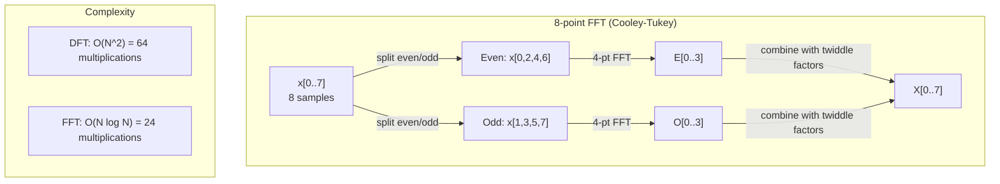
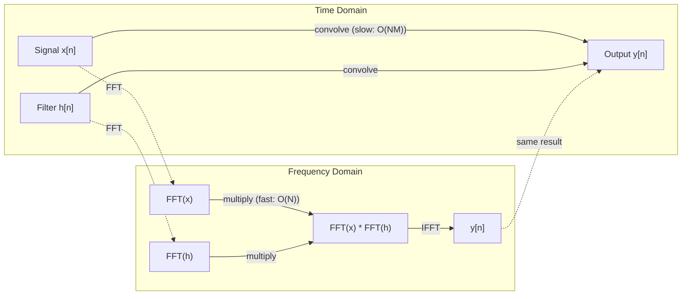

# 富里尔变形

> 每个信号都是阴影波的总和. 福利尔转换告诉你哪些.

**Type:** Build
**Language:**字符串
**Prerequisites:** Phase 1, Lessons 01-04, 19 (complex numbers)
**Time:** ~90 minutes

## 学习目标

- 实施DFT从零开始,并对其进行验证$O(N \log N)$库利-图基FFT
- 解释频率系数:从信号中提取振幅,相和功率频谱
- 应用卷积定理来通过FFT乘法执行卷积
- 连接Fourier频率分解到变体位置编码和CNN卷积层

## 问题

音频录音是时间间的压力测量序列.股价是数天的价值序列.图像是空间上的像素强度格.所有这些都是时间域 (或空间域) 的数据.你看到价值在某些索引中变化.

但在时间域中,许多模式是看不见的.这个音频信号是纯音调还是合声?这个股价是否有每周周期?这个图像是否有重复的纹理?这些问题是关于频率内容,时间域隐藏它.

福利尔变化将时间域的数据转换为频率域.它采用信号并分解成不同频率的阴影波.每个阴影波都有一个放大度 (它是多强) 和一个阶段 (它开始的地方).福利尔变化告诉你两者.

这对 ML 很重要,因为频率领域思维在任何地方都出现. 曲神经网络执行曲,这是频率域中的乘法. 转former位置编码器使用频率分解来表示位置. 音频模型 (语音识别,音乐生成) 运行于光谱仪 - - 频率表示声音. 时间序列模型寻找周期性模式. 了解Fourier变化,就能使你能够使用这些词汇.

## 概念

### 关于DFT的定义

给出$N$样本$x[0], x[1], \ldots, x[N-1]$光变形产生的$N$频率系数$X[0], X[1], \ldots, X[N-1]$其他:

```math
X[k] = \sum_{n=0}^{N-1} x[n] \, e^{-2\pi i k n/N} \qquad \text{for } k = 0, 1, \ldots, N-1
```

每个$X[k]$它们的大小是$\lvert X[k] \rvert$告诉你频率的幅度$k$现在的阶段$\angle X[k]$它们可以告诉你该频率的相对缓解.

关键的见解:$e^{-2\pi i k n/N}$是一个频率旋转的相子$k$ DFT计算信号与每个信号之间的相关性$N$如果信号含有频率的能量$k$如果没有,它接近零.

### 每个系数意味着什么

**$X[0]$: the DC component.**这就是所有样本的总和,与平均比例.它代表信号的恒定 (零频率) 偏移.

```math
X[0] = \sum_{n=0}^{N-1} x[n] \, e^0 = \text{sum of all samples}
```

**$X[k]$ for $1 \le k \le N/2$: positive frequencies.** $X[k]$表示频率$k$周期$N$较高的样本$k$意思是更高的频率 (更快的振荡).

**$X[N/2]$: the Nyquist frequency.**您可以使用的最高频率$N$在上面,你得到了号--高频率伪装为低频率.

**$X[k]$ for $N/2 < k < N$: negative frequencies.**对于真正值的信号,$X[N-k] = \overline{X[k]}$由于这些频率是正面频率的镜像,因此,$N/2 + 1$它们的数量

### 逆转DFT

逆DFT从其频率系数中重建原始信号:

```math
x[n] = \frac{1}{N} \sum_{k=0}^{N-1} X[k] \, e^{2\pi i k n/N} \qquad \text{for } n = 0, 1, \ldots, N-1
```

与前期DFT唯一的区别:指数中的标志是正面 (不是负面),并且有$1/N$正常化因素.

反向DFT是完美的重建.没有信息丢失.你可以从时间域到频率域,然后再回来,没有任何错误.DFT是基因的改变 - 它在不同的坐标系统中重新表达相同的信息.

### 快速的转移

按照上述定义的DFT是$O(N^2)$对于每一个$N$输出系数,你总结了$N$输入样本$N$总体而言,$10^{12}$运营.

快速富里尔转换 (FFT) 在$O(N \log N)$为了$N$频率分析是实际的.

库利-图基算法 (最常见的FFT) 通过分割和征服工作:

1. 信号分为偶索引和偶索引样本.
2. 按每一半的DFT进行递归计算.
3. 通过"双重因素"结合两个半尺寸的DFT$e^{-2\pi i k/N}$现在,我们要去.

```math
\begin{aligned}
X[k] &= E[k] + e^{-2\pi i k/N} \, O[k] && \text{for } k = 0, \ldots, N/2 - 1 \\
X[k + N/2] &= E[k] - e^{-2\pi i k/N} \, O[k] && \text{for } k = 0, \ldots, N/2 - 1 \\[6pt]
\text{where } E &= \text{DFT of even-indexed samples} \\
O &= \text{DFT of odd-indexed samples}
\end{aligned}
```

交对称意味着每个复 recursion 级别都会$O(N)$工作,而且有$\log_2(N)$总数: $O(N \log N)$现在,我们要去.



根据FFT的要求,信号长度为2.实践中,信号将为下一个2.

### 频谱分析

其他**power spectrum**是$\lvert X[k] \rvert^2$它们显示每个频率的能量量.

其他**phase spectrum**是$\angle X[k]$对于大多数分析任务,你关心的是功率谱,而忽略的是相.

```math
\begin{aligned}
\text{Power at frequency } k: \quad P[k] &= |X[k]|^2 = \mathop{\mathrm{Re}}(X[k])^2 + \mathop{\mathrm{Im}}(X[k])^2 \\
\text{Phase at frequency } k: \quad \phi[k] &= \mathop{\mathrm{atan2}}(\mathop{\mathrm{Im}}(X[k]), \mathop{\mathrm{Re}}(X[k]))
\end{aligned}
```

### 频率分辨率

频率分辨率取决于样本数量$N$及采样率$f_s$现在,我们要去.

```math
\begin{aligned}
\text{Frequency of bin } k: \quad & f_k = k \cdot f_s / N \\
\text{Frequency resolution:} \quad & \Delta f = f_s / N \\
\text{Maximum frequency:} \quad & f_{\max} = f_s / 2 \quad \text{(Nyquist)}
\end{aligned}
```

为了解决两个相近的频率,你需要更多的样本.

### 卷积定理

这也是信号处理最重要的结果之一,

**Convolution in the time domain equals pointwise multiplication in the frequency domain.**

```math
\begin{aligned}
& x * h = \text{IFFT}(\text{FFT}(x) \cdot \text{FFT}(h)) \\[4pt]
& \text{where } * \text{ is convolution and } \cdot \text{ is element-wise multiplication}
\end{aligned}
```

为什么这很重要:

- 长度两个信号的直接卷积$N$其他$M$需要$O(NM)$运营.
- 基于FFT的卷积需要$O(N \log N)$转换两者,乘以,转换回来.
- 对于大型核子来说,FFT卷积速度更快.
- 这正是发生在具有大接收场的卷积层中.

注:DFT计算圆形卷积 (信号卷积).对于线性卷积 (没有卷积),零板两个信号长度.$N + M - 1$在计算之前.



### 窗户

据DFT假设信号是周期性的 - - 它处理$N$如果信号不起始和结束在相同的值,这会在边界产生不连续性,这会显示为虚假的高频内容. 这称为光谱泄漏.

窗户在计算DFT之前将信号缩小到两个端的零,减少泄漏.

常见窗户:

| Window | Shape | Main lobe width | Side lobe level | Use case |
|--------|-------|----------------|-----------------|----------|
| Rectangular | Flat (no window) | Narrowest | Highest (-13 dB) | When signal is exactly periodic in N samples |
| Hann | Raised cosine | Moderate | Low (-31 dB) | General purpose spectral analysis |
| Hamming | Modified cosine | Moderate | Lower (-42 dB) | Audio processing, speech analysis |
| Blackman | Triple cosine | Wide | Very low (-58 dB) | When side lobe suppression is critical |

```math
\begin{aligned}
\text{Hann window:} \quad & w[n] = 0.5 \left(1 - \cos\frac{2\pi n}{N-1}\right) \\
\text{Hamming window:} \quad & w[n] = 0.54 - 0.46 \cos\frac{2\pi n}{N-1}
\end{aligned}
```

通过将窗口乘以元素方式与DFT前的信号来应用: `X = DFT(x * w)`现在,我们要去.

### 光电源

| Property | Time Domain | Frequency Domain |
|----------|-------------|-----------------|
| Linearity | $ax + by$ | $aX + bY$ |
| Time shift | $x[n - k]$ | $X[f] e^{-2\pi i f k/N}$ |
| Frequency shift | $x[n] e^{2\pi i f_0 n/N}$ | $X[f - f_0]$ |
| Convolution | $x * h$ | $X \cdot H$ (pointwise) |
| Multiplication | $x \cdot h$ (pointwise) | $X * H$ (circular convolution, scaled by $1/N$) |
| Parseval's theorem | $\sum \lvert x[n] \rvert^2$ | $\frac{1}{N} \sum \lvert X[k] \rvert^2$ |
| Conjugate symmetry (real input) | $x[n]$ real | $X[k] = \overline{X[N-k]}$ |

帕尔塞瓦尔定理说,在两个领域的总能量都是相同的.

### 连接到位置编码

转变器使用了突状位置编码:

```math
\begin{aligned}
PE(pos, 2i) &= \sin\left(pos / 10000^{2i/d_{\text{model}}}\right) \\
PE(pos, 2i+1) &= \cos\left(pos / 10000^{2i/d_{\text{model}}}\right)
\end{aligned}
```

每个维度对$(2i, 2i+1)$频率在不同频率上振荡.频率在几何上间隔 (尺寸0.1) 到低 (最后的尺寸). 这给每个位置一个独特的模式在所有频率带 - 类似于福利尔系数如何独特识别信号.

这项技术提供了以下主要特性:

- **Uniqueness:**没有两个位置具有相同的编码.
- **Bounded values:**罪和罪总是存在.$[-1, 1]$现在,我们要去.
- **Relative position:**位置编码$p+k$可以以定位编码的线性函数表达$p$模型可以学习如何保持相对位置.

### 与CNN的连接

卷积层将学习过器 (内核) 应用到输入中,通过通过信号或图像滑动.数学上,这是卷积操作.

根据卷积定理,这相当于:
1. 输入的 FFT
2. 核的FFT
3. 在频率域中乘以
4. 结果是

标准CNN实现使用直接卷积 (较快用于小型3x3核).但对于大型核或全球卷积,基于FFT的方法是显著更快的.一些架构 (如FNET) 完全取代了FFT的关注,实现了竞争精度.$O(N \log N)$没有$O(N^2)$复杂性.

### 频谱和短时间福利尔转换

一个FFT给你提供整个信号的频率内容,但没有告诉你这些频率发生什么时候.一个声 (一个频率随着时间的推移增加的信号) 和一个弦 (所有频率同时存在) 都可以具有相同的 magnitudo 频谱.

短时间福利尔转换 (STFT) 通过计算信号重叠窗户上的FFT来解决这一问题.结果是谱图:一个轴上时间和另一边频率的2D表示.每个点的强度显示了当时频率的能量.

```
STFT procedure:
1. Choose a window size (e.g., 1024 samples)
2. Choose a hop size (e.g., 256 samples -- 75% overlap)
3. For each window position:
   a. Extract the windowed segment
   b. Apply a Hann/Hamming window
   c. Compute FFT
   d. Store the magnitude spectrum as one column of the spectrogram
```

频谱是音频 ML 模型的标准输入表示.语音识别模型 (Whisper,DeepSpeech) 运行在mel 频谱上 - 频谱与MEL 尺度映射,更好地匹配人类音响感知.

### 标签名

如果信号含有以上频率$f_s/2$(尼奎斯特频率),以速度采样$f_s$通过100Hz采样的90Hz信号看起来与10Hz信号相同. 仅仅是样本无法区分它们.

```
Example:
  True signal: 90 Hz sine wave
  Sampling rate: 100 Hz
  Apparent frequency: 100 - 90 = 10 Hz

  The samples from the 90 Hz signal at 100 Hz sampling rate
  are identical to the samples from a 10 Hz signal.
  No amount of math can recover the original 90 Hz.
```

这就是为什么模拟到数字转换器包括反化过器,在采样之前将Nyquist以上频率删除.在ML中,化出现在没有适当的低通路过的情况下下样特征地图时.一些架构通过反化聚合层来解决这一问题.

### 零不增加分辨率

常见的误解:在FFT之前零接信号提高频率分辨率.它不.零接在现有频率桶之间插入,给你一个更光滑的光谱.但它不能揭示频率细节,原始样本中没有.

实际频率分辨率仅取决于观察时间$T = N / f_s$解决两个频率分开的$\Delta f$你至少需要$T = 1 / \Delta f$没有任何零填充量改变了这个基本限制.

```figure
fourier-synthesis
```

## 建立它

### 步骤1:从零开始的DFT

其他$O(N^2)$根据该定义,DFT直接遵循.

```python
import math

class Complex:
    ...

def dft(x):
    N = len(x)
    result = []
    for k in range(N):
        total = Complex(0, 0)
        for n in range(N):
            angle = -2 * math.pi * k * n / N
            w = Complex(math.cos(angle), math.sin(angle))
            xn = x[n] if isinstance(x[n], Complex) else Complex(x[n])
            total = total + xn * w
        result.append(total)
    return result
```

### 步骤 2:反向DFT

按正指数分为$N$现在,我们要去.

```python
def idft(X):
    N = len(X)
    result = []
    for n in range(N):
        total = Complex(0, 0)
        for k in range(N):
            angle = 2 * math.pi * k * n / N
            w = Complex(math.cos(angle), math.sin(angle))
            total = total + X[k] * w
        result.append(Complex(total.real / N, total.imag / N))
    return result
```

### 步骤3:FFT (Cooley-Tukey)

复制式FFT需要功率为2长度. 分成偶和奇,复制式,结合与扭曲因子.

```python
def fft(x):
    N = len(x)
    if N <= 1:
        return [x[0] if isinstance(x[0], Complex) else Complex(x[0])]
    if N % 2 != 0:
        return dft(x)

    even = fft([x[i] for i in range(0, N, 2)])
    odd = fft([x[i] for i in range(1, N, 2)])

    result = [Complex(0)] * N
    for k in range(N // 2):
        angle = -2 * math.pi * k / N
        twiddle = Complex(math.cos(angle), math.sin(angle))
        t = twiddle * odd[k]
        result[k] = even[k] + t
        result[k + N // 2] = even[k] - t
    return result
```

### 步骤4:光谱分析辅助员

```python
def power_spectrum(X):
    return [xk.real ** 2 + xk.imag ** 2 for xk in X]

def convolve_fft(x, h):
    N = len(x) + len(h) - 1
    padded_N = 1
    while padded_N < N:
        padded_N *= 2

    x_padded = x + [0.0] * (padded_N - len(x))
    h_padded = h + [0.0] * (padded_N - len(h))

    X = fft(x_padded)
    H = fft(h_padded)

    Y = [xk * hk for xk, hk in zip(X, H)]

    y = idft(Y)
    return [y[n].real for n in range(N)]
```

## 用它

对于真正的工作,使用numpy的FFT,它由高度优化的C库支持.

```python
import numpy as np

signal = np.sin(2 * np.pi * 5 * np.arange(256) / 256)
spectrum = np.fft.fft(signal)
freqs = np.fft.fftfreq(256, d=1/256)

power = np.abs(spectrum) ** 2

positive_freqs = freqs[:len(freqs)//2]
positive_power = power[:len(power)//2]
```

用于窗户和更先进的光谱分析:

```python
from scipy.signal import windows, stft

window = windows.hann(256)
windowed = signal * window
spectrum = np.fft.fft(windowed)
```

对于卷积:

```python
from scipy.signal import fftconvolve

result = fftconvolve(signal, kernel, mode='full')
```

对于光谱:

```python
from scipy.signal import stft

frequencies, times, Zxx = stft(signal, fs=sample_rate, nperseg=256)
spectrogram = np.abs(Zxx) ** 2
```

频谱矩阵有形状 (n_frequencies,n_time_frames).每个列是一个时间窗口的功率谱.这是音频ML模型作为输入所消耗的.

## 运送它

跑步`code/fourier.py`产生`outputs/prompt-spectral-analyzer.md`现在,我们要去.

## 运动

1. **Pure tone identification.**创建一个单个弦波的信号,在未知频率 (1至50Hz之间),在128Hz中进行样本测试1秒.使用DFT来确定频率.验证答案匹配.现在加加斯人的噪音,标准偏差为0.5,然后重复.噪音如何影响频谱?

2. **FFT vs DFT verification.**计算两个DFT ($O(N^2){}$时间在256,512,1024和2048的信号上都运行. 绘制DFT时间与FFT时间的比例.

3. **Convolution theorem proof by example.**创建信号 x = [1, 2, 3, 4, 0, 0, 0, 0] 和过 h = [1, 1, 1, 0, 0, 0, 0, 0].直接计算它们的圆形卷积 (嵌套循环).然后通过FFT (转换,乘,逆转换) 来计算它.验证结果匹配.现在通过零合适当地进行线性卷积.

4. **Windowing effects.**创建一个信号,是两个海脉波的总和10 Hz和12 Hz (非常接近).在128 Hz上进行样本1秒.计算没有窗户的功率频谱,汉窗和汉明窗.哪个窗户使得区分两个峰值最容易?为什么?

5. **Positional encoding analysis.**生成d_model = 128 和max_pos = 512 的阴影形位置编码.$(p_1, p_2)$显示点数的产量仅取决于$\lvert p_1 - p_2 \rvert$随着距离的增加,点的乘法会发生什么?

### 暗示

**Exercise 1.**通过1秒的 128 个样本,$k$是$k$对于整数频率,在1到63的桶中最大值的指数是频率. 选择一项整数的赫兹.两个桶之间的频率扩散到邻居,而峰值只给出了最近的桶. 使用 `generate_signal`其他`magnitude_spectrum`增加噪音后,检查其他垃圾桶升高时,峰值仍然在同一桶里.

**Exercise 2.**使用两长的功率,因为`fft`检查 电源的数据`max(abs(a - b))`时间比率将大约增长为$N / \log_2 N$现在,我们要去.

**Exercise 3.**对于圆形卷积,计算$y[n] = \sum_k h[k] x[(n-k) \bmod 8]$通过手动$n$分析结果:`convolve_direct`其他`convolve_fft`线性卷积长度为4 +3 - 1 = 6,所以首先检查长度8是否已经足够长.

**Exercise 4.**使用`hann_window`现在`hamming_window`现在`apply_window`其他`power_spectrum`它们可以在10 Hz 和 12 Hz 之间完成整个周期,因此没有窗户可以看起来最好.重复在 10.5 Hz 和 12.5 Hz 之间,以看到窗户减少的泄漏.

**Exercise 5.**计算每个编码的方法`positional_encoding(pos, 128)`比较位置 (0, 10) 的点子乘法和 (100, 110) 的点子乘法:两个值必须与1e-10左右相匹配.$\lvert p_1 - p_2 \rvert$对于一个固定$p_1$现在,我们要去.

## 关键词

| Term | What it means |
|------|---------------|
| DFT (Discrete Fourier Transform) | Converts $N$ time-domain samples into $N$ frequency-domain coefficients. Each coefficient is the correlation with a complex sinusoid at that frequency |
| FFT (Fast Fourier Transform) | An $O(N \log N)$ algorithm to compute the DFT. The Cooley-Tukey algorithm splits even/odd indices recursively |
| Inverse DFT | Reconstructs the time-domain signal from frequency coefficients. Same formula as DFT with flipped exponent sign and $1/N$ scaling |
| Frequency bin | Each index $k$ in the DFT output represents frequency $k f_s/N$ Hz. The "bin" is the discrete frequency slot |
| DC component | $X[0]$, the zero-frequency coefficient. Proportional to the signal mean |
| Nyquist frequency | $f_s/2$, the maximum frequency representable at sampling rate $f_s$. Frequencies above this alias |
| Power spectrum | $\lvert X[k] \rvert^2$, the squared magnitude of each frequency coefficient. Shows energy distribution across frequencies |
| Phase spectrum | $\angle X[k]$, the phase offset of each frequency component. Often ignored in analysis |
| Spectral leakage | Spurious frequency content caused by treating a non-periodic signal as periodic. Reduced by windowing |
| Window function | A tapering function (Hann, Hamming, Blackman) applied before DFT to reduce spectral leakage |
| Twiddle factor | The complex exponential $e^{-2\pi i k/N}$ used to combine sub-DFTs in the FFT butterfly computation |
| Convolution theorem | Convolution in time domain equals pointwise multiplication in frequency domain. Fundamental to signal processing and CNNs |
| Circular convolution | Convolution where the signal wraps around. This is what the DFT naturally computes |
| Linear convolution | Standard convolution without wraparound. Achieved by zero-padding before DFT |
| Parseval's theorem | Total energy is preserved through the Fourier transform. $\sum \lvert x[n] \rvert^2 = \frac{1}{N} \sum \lvert X[k] \rvert^2$ |
| Aliasing | When frequencies above Nyquist appear as lower frequencies due to insufficient sampling rate |

## 进一步阅读

- [Cooley & Tukey: An Algorithm for the Machine Calculation of Complex Fourier Series (1965)](https://www.ams.org/journals/mcom/1965-19-090/S0025-5718-1965-0178586-1/)- 改变计算机的原始FFT论文
- [3Blue1Brown: But what is the Fourier Transform?](https://www.youtube.com/watch?v=spUNpyF58BY)- 最好的视觉介绍Fourier变化
- [Lee-Thorp et al.: FNet: Mixing Tokens with Fourier Transforms (2021)](https://arxiv.org/abs/2105.03824)- 在变压器中,自觉取代了FFT
- [Smith: The Scientist and Engineer's Guide to Digital Signal Processing](http://www.dspguide.com/)- 免费的在线教科书,详细介绍了FT,窗口和光谱分析
- [Vaswani et al.: Attention Is All You Need (2017)](https://arxiv.org/abs/1706.03762)-从福利尔频率分解中获得的阴影形定位编码
- [Radford et al.: Whisper (2022)](https://arxiv.org/abs/2212.04356)- 用mel谱图作为输入表示的语音识别
