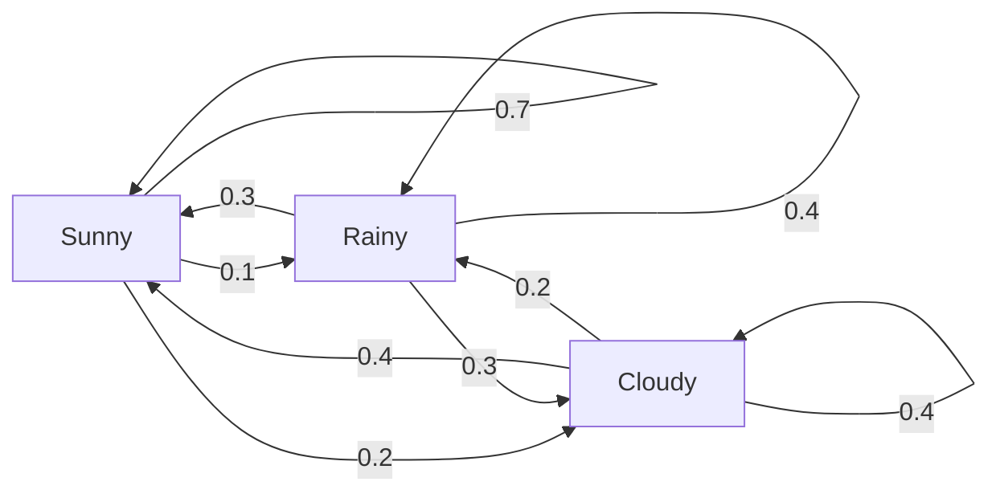
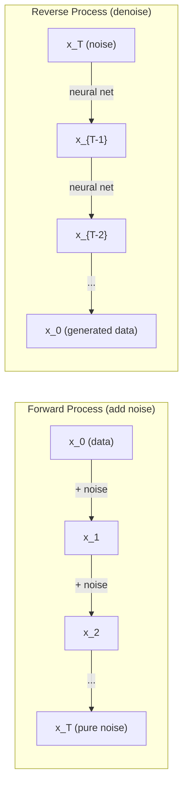

# 断过程

> 随机性与结构,随机散步,马科夫链和扩散模型背后的数学.

**Type:** Learn
**Language:**字符串
**Prerequisites:** Phase 1, Lessons 06-07 (probability, Bayes)
**Time:** ~75 minutes

## 学习目标

- 模拟1D和2D随机走路,验证$\sqrt{n}$移动规模
- 通过自己的组合计算它静止分布
- 实施Metropoolis-Hastings MCMC和Langevin动态,用于从目标分布中采样
- 将前方扩散过程连接到布朗运动,并解释反向过程如何生成数据

## 问题

许多人工智能系统都涉及随机性,随着时间的推移而进化.而不是静态性,结构化,序列性随机性,

语言模型一次生成代币.每个代币取决于前一个背景.模型输出了概率分布,从中取出样本,然后继续进行.这是一个 Stochastic 过程.

扩散模型逐步添加噪音到图像中,直到它变得纯静态.然后它们逆转过程,逐步否定过程,直到出现新的图像.前进过程是马科夫链.逆过程是学习的马科夫链,运行向后.

强化学习代理在环境中采取行动.每一个行动都带来了新的状态,有某种可能性. 代理在一个随机世界中遵循随机政策. 这整个过程是马科夫的决策过程.

采样是贝耶斯推理的背骨,构建一个马科夫链,

所有这些都建立在四个基本思想上:
1. 随机步行 - - 最简单的静止过程
2. 马科夫链 - - 结构化的随机性与过渡矩阵
3. 维因动态 - - 噪音的梯度下降
4. 城市-哈斯廷斯 - - 从任何分布中采样

## 概念

### 随机散步

开始从位置0.每一步,抛一个公平的硬币.头部:右 (+1).尾部:左 (-1).

在之后$n$步骤,你的位置是总数$n$随机$\pm 1$预期位置为0 (步行是无偏见的).$\sqrt{n}$现在,我们要去.

走路是公平的,没有任何方向的漂移.但随着时间的推移,它从开始的地方越来越远.$n$步骤是$\sqrt{n}$现在,我们要去.

```
Step 0:  Position = 0
Step 1:  Position = +1 or -1
Step 2:  Position = +2, 0, or -2
...
Step 100: Expected distance from origin ~ 10 (sqrt(100))
Step 10000: Expected distance from origin ~ 100 (sqrt(10000))
```

**In 2D**走上,下,左,右,等等的概率.$\sqrt{n}$距离从原点的距离. 路径追踪一个类似碎片的模式.

**Why $\sqrt{n}$?**每一步都是+1或-1的等等概率.$n$步骤,位置$S_n = X_1 + X_2 + \cdots + X_n$在哪里$X_i$是$\pm 1$每一步的差异是1,并且步骤是独立的,所以$\mathop{\mathrm{Var}}(S_n) = n$标准偏差 = $\sqrt{n}$根据中央极限定理,$S_n / \sqrt{n}$转移到标准正常分布.

这里$\sqrt{n}$标量显示在 ML 中各处. SGD噪音尺度为1/sqrt(批量_尺寸). 嵌入尺寸尺度为$\sqrt{d}$平方根是独立随机加量的签名.

**Connection to Brownian motion.**随机散步,用步骤尺寸.$1/\sqrt{n}$其他$n$按时间单位的步骤.$n$走向无限,走向布朗运动.$B(t)$-- 一个持续时间的过程,$B(t)$通常分布为 0 的平均值和变量$t$现在,我们要去.

布朗运动是扩散的数学基础. 它模拟了液体中的粒子的随机摇摆,股价的波动,

**Gambler's ruin.**随机步行者开始在位置$k$吸收阻隔在0和$N$达到的概率是多少?$N$在0之前?$P(\text{reach } N) = k/N$这种方法非常简单,优雅. 它与马丁加尔理论相连. 公平的随机走路是马丁加尔 (预期未来值=当前值).

### 马科夫链

马科夫链是一个系统,根据固定概率,状态之间过渡.关键属性:下一个状态只取决于当前状态,而不是历史.

```math
P(X_{t+1} = j \mid X_t = i, X_{t-1} = \ldots) = P(X_{t+1} = j \mid X_t = i)
```

这就是马科夫的属性. 这意味着你可以用过渡矩阵来描述整个动态.$P$其他:

```math
P[i][j] = \text{probability of going from state } i \text{ to state } j
```

每一行$P$总数为1 (你必须去某个地方).

**Example -- Weather:**

```
States: Sunny (0), Rainy (1), Cloudy (2)

P = [[0.7, 0.1, 0.2],    (if sunny: 70% sunny, 10% rainy, 20% cloudy)
     [0.3, 0.4, 0.3],    (if rainy: 30% sunny, 40% rainy, 30% cloudy)
     [0.4, 0.2, 0.4]]    (if cloudy: 40% sunny, 20% rainy, 40% cloudy)
```

经过许多过渡,状态分布趋于静止分布.$\pi$在哪里$\pi P = \pi$这就是左边的自向量$P$具有自值1.

对于天气链,静止分布是 [0.55,0.18,0.27] -- 长期来看,它在55%,不管是什么状态开始,



**Computing the stationary distribution.**两种方法:

1. **Power method**:乘以任何最初的分布$P$经过足够的代,它会相近.
2. **Eigenvalue method**求左自向量$P$具有自值1的自值向量.$P^T$具有自值1.

两种方法都要求链接满足缩条件.

**Convergence conditions.**如果一个马科夫链是:
- **Irreducible**任何国家都可以从其他国家到达
- **Aperiodic**:链不循环,有固定时间

机器人机器人机器人机器人机器人机器人机器人机器人机器人机器人机器人机器人机器人机器人机器人机器人机器人机器人机器人机器人机器人机器人机器人机器人机器人机器人机器人机器人机器人机器人机器人机器人机器人机器人机器人机器人机器人机器人机器人机器人机器人机器人机器人机器人机器人机器人机器人机器人机器人机器人机器人机器人机器人机器人机器人机器人机器人机器人机器人机器人机器人机器人机器人机器人机器人机器人机器人机器人机器人机器人机器人机器人机器人机器人机器人机器人机器人机器人机器人机器人机器人机器人机器人机器人机器人机器人机器人机器人机器人机器人机器人机器人机器人机器

**Absorbing states.**一个状态是吸收的,如果你进入它,你永远不会离开 ($P[i][i] = 1$吸收马科夫链的模型过程, 终端状态 - - 一场游戏结束,一个客户,一个符号序列,

**Mixing time.**位数: 位数: 位数: 位数: 位数: 位数: 位数: 位数: 位数: 位数: 位数: 位数: 位数: 位数: 位数: 位数: 位数: 位数: 位数: 位数: 位数: 位数: 位数: 位数: 位数: 位数: 位数: 位数: 位数: 位数: 位数: 位数: 位数: 位数: 位数: 位数: 位数: 位数: 位数: 位数: 位数: 位数: 位数: 位数: 位数: 位数: 位数: 位数: 位数: 位数: 位数: 位数: 位数: 位数: 位数:$P$混合时间控制 (减小第二大自值). 较大的差距 =更快的混合.

### 与语言模型的连接

语言模型中的代币生成大约是马科夫过程.鉴于当前的背景,模型输出了下一个代币的分布.温度控制了敏度:

```math
P(\text{token}_i) = \frac{\exp(\text{logit}_i / \text{temperature})}{\sum_j \exp(\text{logit}_j / \text{temperature})}
```

- 温度=1.0:标准分布
- 温度 < 1.0:更 (更确定性)
- 温度 > 1.0:平坦 (更随机)
- 温度$\to 0$鱼类:

顶部的样本抽取到$k$顶点p (核) 样本采集将缩小到最小的代币组,其累计概率超过$p$两者都修改了马科夫过渡概率.

### 布朗运动

随机走路的持续时间限制.$B(t)$有三个特性:
1. $B(0) = 0$
2. $B(t) - B(s)$通常分布为 0 的平均值和变量$t - s$(为$t > s$)
3. 不重叠间隔的增长是独立的

布朗运动是连续的,但在任何地方都无法区分,它在每个尺度上都会摇摆.

在单独的模拟中,你将布朗运动 приблизи为:

```math
B(t + dt) = B(t) + \sqrt{dt} \, z, \quad \text{where } z \sim \mathcal{N}(0, 1)
```

其他$\sqrt{dt}$根据"中央极限定理"来说,

### 兰杰文动力学

代下降发现函数的最小值. 兰杰文动态发现概率分布是与$\exp(-U(x)/T)$在哪里$U$是一个能量函数,$T$温度是

```math
x_{t+1} = x_t - dt \, \nabla U(x_t) + \sqrt{2 T \, dt} \, z_t
```

两种力量对粒子作用:
1. **Gradient force**($-dt \cdot \nabla U$):向低能量推进 (如梯度下降)
2. **Random force**($\sqrt{2T dt} \cdot z$):随机方向推 (探测)

在温度下$T = 0$在高温下,它几乎是随机的步行.在正确的温度下,粒子探索能量景观,并在低能量的地区花更多时间.

**Connection to diffusion models.**扩散模型的前进过程是:

```math
x_t = \sqrt{\alpha_t} \, x_{t-1} + \sqrt{1 - \alpha_t} \cdot \text{noise}
```

通过一个马科夫链,它逐渐将数据与噪音混合在一起.$x_T$只是纯粹的高斯噪音.

反向过程--从噪音回到数据-- 也是一种马科夫链,但它的过渡概率是由神经网络学习的.



### 马科夫链蒙特卡罗

有时你需要从一个分布中取样$p(x)$贝耶斯后层是经典的例子 - - 你知道概率乘以前面,但正常化常数是难以解决的.

**Metropolis-Hastings**构建一个马科夫链,其静止分布是$p(x)$其他:

1. 开始从某个位置.$x$
2. 提出一个新职位$x'$根据提案分发的结果$Q(x' \mid x)$
3. 计算接受率: $a = p(x') Q(x \mid x') / (p(x) Q(x' \mid x))$
4. 接受$x'$没有任何可能的$\min(1, a)$否则,你就在$x$现在,我们要去.
5. 复制.

如果$Q$是对称 (例如,$Q(x' \mid x) = Q(x \mid x') = \mathcal{N}(x, \sigma^2){}$),比率简化为$a = p(x') / p(x)$只有概率的比率,正常化常数取消.

链接的转移将保证到$p(x)$对于这些问题,我们必须要注意,在温和的条件下,但如果提案太小 (随机步行) 或太大 (高拒绝),则趋向可能会缓慢.

**Why it works.**接受率确保了详细的平衡:$x$现在,我们要去$x'$占到的概率是$x'$现在,我们要去$x$详细的平衡意味着$p(x)$并且在我们看到的样本中,$p(x)$现在,我们要去.

**Practical considerations:**
- **Burn-in**丢掉第一条$N$链接需要时间从起点到达静止分布.
- **Thinning**保持每一个$k$减少自动相关性.
- **Multiple chains**它们在不同的起点上运行多个链.
- **Acceptance rate**对于Gaussian的提案$d$由于其尺寸,最佳接受率约为23% (Roberts & Rosenthal,2001).

### 人工智能中的断过程

| Process | AI Application |
|---------|---------------|
| Random walk | Exploration in RL, Node2Vec embeddings |
| Markov chain | Text generation, MCMC sampling |
| Brownian motion | Diffusion models (forward process) |
| Langevin dynamics | Score-based generative models, SGLD |
| Markov decision process | Reinforcement learning |
| Metropolis-Hastings | Bayesian inference, posterior sampling |

```figure
random-walk-diffusion
```

## 建立它

### 步骤1:随机走路模拟器

```python
import numpy as np

def random_walk_1d(n_steps, seed=None):
    rng = np.random.RandomState(seed)
    steps = rng.choice([-1, 1], size=n_steps)
    positions = np.concatenate([[0], np.cumsum(steps)])
    return positions


def random_walk_2d(n_steps, seed=None):
    rng = np.random.RandomState(seed)
    directions = rng.choice(4, size=n_steps)
    dx = np.zeros(n_steps)
    dy = np.zeros(n_steps)
    dx[directions == 0] = 1   # right
    dx[directions == 1] = -1  # left
    dy[directions == 2] = 1   # up
    dy[directions == 3] = -1  # down
    x = np.concatenate([[0], np.cumsum(dx)])
    y = np.concatenate([[0], np.cumsum(dy)])
    return x, y
```

后面的步骤是+1或-1$n$变量增长线性与 变量增长线性与 变量增长$n$标准偏差的增长率是$\sqrt{n}$现在,我们要去.

### 步骤2:马科夫链

```python
class MarkovChain:
    def __init__(self, transition_matrix, state_names=None):
        self.P = np.array(transition_matrix, dtype=float)
        self.n_states = len(self.P)
        self.state_names = state_names or [str(i) for i in range(self.n_states)]

    def step(self, current_state, rng=None):
        if rng is None:
            rng = np.random.RandomState()
        probs = self.P[current_state]
        return rng.choice(self.n_states, p=probs)

    def simulate(self, start_state, n_steps, seed=None):
        rng = np.random.RandomState(seed)
        states = [start_state]
        current = start_state
        for _ in range(n_steps):
            current = self.step(current, rng)
            states.append(current)
        return states

    def stationary_distribution(self):
        eigenvalues, eigenvectors = np.linalg.eig(self.P.T)
        idx = np.argmin(np.abs(eigenvalues - 1.0))
        stationary = np.real(eigenvectors[:, idx])
        stationary = stationary / stationary.sum()
        return np.abs(stationary)
```

静止分布是左自向量$P$我们通过计算 的自向量来找到它.$P^T$(转换左自向向向向向向向向向向向向向向向向向向向向向向向).

### 步骤3: 兰杰文动态

```python
def langevin_dynamics(grad_U, x0, dt, temperature, n_steps, seed=None):
    rng = np.random.RandomState(seed)
    x = np.array(x0, dtype=float)
    trajectory = [x.copy()]
    for _ in range(n_steps):
        noise = rng.randn(*x.shape)
        x = x - dt * grad_U(x) + np.sqrt(2 * temperature * dt) * noise
        trajectory.append(x.copy())
    return np.array(trajectory)
```

梯度推$x$声防止着. 在平衡时,样本分布是相对的$\exp(-U(x)/\text{temperature})$现在,我们要去.

### 第四步:大都会 - 忙

```python
def metropolis_hastings(target_log_prob, proposal_std, x0, n_samples, seed=None):
    rng = np.random.RandomState(seed)
    x = np.array(x0, dtype=float)
    samples = [x.copy()]
    accepted = 0
    for _ in range(n_samples - 1):
        x_proposed = x + rng.randn(*x.shape) * proposal_std
        log_ratio = target_log_prob(x_proposed) - target_log_prob(x)
        if np.log(rng.rand()) < log_ratio:
            x = x_proposed
            accepted += 1
        samples.append(x.copy())
    acceptance_rate = accepted / (n_samples - 1)
    return np.array(samples), acceptance_rate
```

算法提出一个新的点,检查它是否具有更高的概率 (或与比率相对的概率接受),并重复.

## 用它

实际上,你会使用既定的库来进行这些算法.

```python
import numpy as np

rng = np.random.RandomState(42)
walk = np.cumsum(rng.choice([-1, 1], size=10000))
print(f"Final position: {walk[-1]}")
print(f"Expected distance: {np.sqrt(10000):.1f}")
print(f"Actual distance: {abs(walk[-1])}")
```

### 转变矩阵的 numpy

```python
import numpy as np

P = np.array([[0.7, 0.1, 0.2],
              [0.3, 0.4, 0.3],
              [0.4, 0.2, 0.4]])

distribution = np.array([1.0, 0.0, 0.0])
for _ in range(100):
    distribution = distribution @ P

print(f"Stationary distribution: {np.round(distribution, 4)}")
```

乘以最初的分布$P$它们在一个直径中,可以在一个直径中进行一个直径,然后在一个直径中,它可以在一个直径中进行一个直径.

### 与实际框架的联系

- **PyTorch diffusion:**其他`DDPMScheduler`在拥抱的脸上`diffusers`执行前进和倒退的马科夫链
- **NumPyro / PyMC:**对于贝叶斯推理使用MCMC (NUTS样本,在Metropolis-Hastings上改善)
- **Gymnasium (RL):**环境步骤函数定义了马科夫决策过程

### 验证马科夫链的融合

```python
import numpy as np

P = np.array([[0.9, 0.1], [0.3, 0.7]])

eigenvalues = np.linalg.eigvals(P)
spectral_gap = 1 - sorted(np.abs(eigenvalues))[-2]
print(f"Eigenvalues: {eigenvalues}")
print(f"Spectral gap: {spectral_gap:.4f}")
print(f"Approximate mixing time: {1/spectral_gap:.1f} steps")
```

频谱差距告诉你链接的原始状态是多快的. 0.2 的差距意味着大约 5 个步骤的混合. 0.01 的差距意味着大约 100 个步骤. 运行长时间模拟之前,总是检查这个 - - 一个缓慢混合链废物计算.

## 运送它

这一课产生了:
- `outputs/prompt-stochastic-process-advisor.md`--一个提示,帮助确定哪个对特定问题的过程框架适用于

## 联系

| Concept | Where it shows up |
|---------|------------------|
| Random walk | Node2Vec graph embeddings, exploration in RL |
| Markov chain | Token generation in LLMs, MCMC sampling |
| Brownian motion | Forward diffusion process in DDPM, SDE-based models |
| Langevin dynamics | Score-based generative models, stochastic gradient Langevin dynamics (SGLD) |
| Stationary distribution | MCMC convergence target, PageRank |
| Metropolis-Hastings | Bayesian posterior sampling, simulated annealing |
| Temperature | LLM sampling, Boltzmann exploration in RL, simulated annealing |
| Mixing time | Convergence speed of MCMC, spectral gap analysis |
| Absorbing state | End-of-sequence token, terminal states in RL |
| Detailed balance | Correctness guarantee for MCMC samplers |

扩散模型值得特别关注.DDPM (Ho et al., 2020) 定义了前进马科夫链:

```math
q(x_t \mid x_{t-1}) = \mathcal{N}\left(x_t; \sqrt{1-\beta_t} \, x_{t-1}, \beta_t I\right)
```

在哪里$\beta_t$之后,我们会看到一个杂的时间表.$T$步骤$x_T$平均值$\mathcal{N}(0, I)$逆转过程由一个预测噪音的神经网络进行参数:

```math
p_\theta(x_{t-1} \mid x_t) = \mathcal{N}\left(x_{t-1}; \mu_\theta(x_t, t), \sigma_t^2 I\right)
```

了解马科夫链意味着理解如何和为什么扩散模型生成数据.

基梯度化 (Stochastic Gradient Langevin Dynamics) 结合了迷你批次化降低和基梯度噪音. 根据标准的测量, 随着学习速度的衰退,SGLD从优化转向采样 -- 你得到了大约的贝耶斯后面样品免费. 这就是从神经网络中获取不确定性估计的最简单方法之一.

关键的见解在所有这些连接上:  Stochastic 过程不仅仅是理论工具. 他们是现代人工智能系统中的计算机制. 当你调整法学士的温度时,你调整了马科夫链. 当你训练一个扩散模型时,你正在学习扭转一个类似布朗运动的过程. 当你运行贝叶斯推理时,你构建一个连锁链,

## 运动

1. **Simulate 1000 random walks of 10000 steps.**图表最终位置分布. 验证它是大约Gaussian的平均0和标准偏差.$\sqrt{10000} = 100$现在,我们要去.

2. **Build a text generator using a Markov chain.**训练一个小的体积:每一个词,数过关到下一个词. 构建过关矩阵. 通过从链中采样生成新的句子.

3. **Implement simulated annealing**使用Metropoles-Hastings. 开始在高温 (几乎接受一切) 并且逐渐冷却 (只接受改进). 使用它来找到一个具有多个本地最小的函数的最小值.

4. **Compare Langevin dynamics at different temperatures.**采样来自双井潜力$U(x) = (x^2 - 1)^2$在低温下,样品集成在一个井.在高温下,它们在两处都传播.找到连锁在井之间混合的关键温度.

5. **Implement the forward diffusion process.**开始使用1维信号 (例如,鼻波).通过线性噪音时间表逐步增加噪音100步以上. 显示信号如何降低到纯噪音. 然后实施一个简单的指标,扭转这个过程 (即使是简单的,只会减去估计的噪音).

### 暗示

**Exercise 1.**电话`random_walk_1d(10000, seed=i)`检查平均值接近0;标准偏差接近100;最后位置约有68%在 -100到100之间.

**Exercise 2.**计算每个单词对,然后把每个行分为其总数,使每个行加起来为1. 传输矩阵到`MarkovChain(transition_matrix, state_names)`打电话`simulate`检查你输出中的每一对单词都在体内出现.

**Exercise 3.**接受一个更糟糕的点,有可能性.$\exp(-\Delta / T)$并且乘以$T$测试一个你知道的最小值的函数,然后检查你的答案与一个细节的网格搜索.

**Exercise 4.**梯度是$4x(x^2 - 1)$所以把它传给`langevin_dynamics(grad_U, x0, dt, temperature, n_steps)`门在$x = 0$号的高度为1,所以计算出标志的频率.$x$温度从0.05到1的变化,并寻找温度,

**Exercise 5.**电话`diffusion_forward(signal, 100)`计算$\bar{\alpha}$作为产品的最后一步$(1 - \beta_t)$如果$\bar{\alpha}$信号还不是纯噪音,所以提高`beta_end`首先用真实的噪音测试你的标机.$(x_t - \sqrt{1 - \bar{\alpha}_t} \epsilon)/\sqrt{\bar{\alpha}_t}$必须回复原始信号.

## 关键词

| Term | What people say | What it actually means |
|------|----------------|----------------------|
| Random walk | "Coin-flip movement" | A process where position changes by random increments at each step |
| Markov property | "Memoryless" | The future depends only on the present state, not on the history |
| Transition matrix | "The probability table" | $P[i][j]$ = probability of moving from state $i$ to state $j$ |
| Stationary distribution | "The long-run average" | The distribution $\pi$ where $\pi P = \pi$ -- the chain's equilibrium |
| Brownian motion | "Random jiggling" | The continuous-time limit of a random walk, $B(t) \sim \mathcal{N}(0, t)$ |
| Langevin dynamics | "Gradient descent with noise" | Update rule that combines deterministic gradient and random perturbation |
| MCMC | "Walking toward the target" | Constructing a Markov chain whose stationary distribution is the one you want |
| Metropolis-Hastings | "Propose and accept/reject" | MCMC algorithm that uses acceptance ratios to ensure convergence |
| Temperature | "The randomness knob" | Parameter controlling the tradeoff between exploration and exploitation |
| Diffusion process | "Noise in, noise out" | Forward: gradually add noise. Reverse: gradually remove it. Generates data. |

## 进一步阅读

- **Ho, Jain, Abbeel (2020)**关于"散概率模型"的论文, 引发了散模型革命.
- **Song & Ermon (2019)**基于分数的方法,使用兰杰文动态进行样本采集.
- **Roberts & Rosenthal (2004)**什么时候和为什么MCMC工作的理论.
- **Norris (1997)**标准教科书,涵盖缩,静止分布和击球时间.
- **Welling & Teh (2011)**通过斯托卡斯式渐进式兰杰文动力学进行贝耶斯学习.
