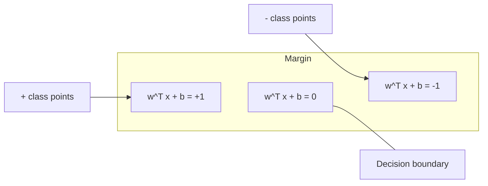
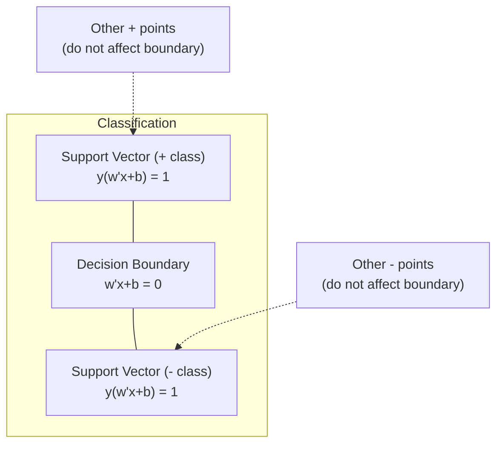
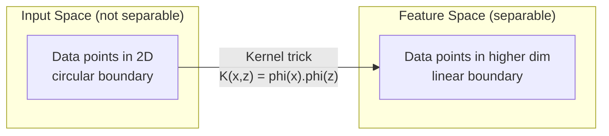

# 支持向量机

> 找出两个阶级之间的最宽的街道.

**Type:** Build
**Language:**字符串
**Prerequisites:** Phase 1 (Lessons 08 Optimization, 14 Norms and Distances, 18 Convex Optimization)
**Time:** ~90 minutes

## 学习目标

- 实现从零开始使用原始配方的链损失和梯度下降的线性SVM
- 解释最大边缘原则,并从训练有素的模型中确定支持向量
- 比较线性,多项和RBF内核,并解释内核技巧如何避免明确的高维映射
- 评估边缘宽度和分类错误之间的C参数控制的权衡

## 问题

您有两个类的数据点,需要画一个线 (或超平面) 分离它们.无限的许多线可以工作.你应该选择哪一个?

差距是决定边界和每一边最接近的数据点之间的距离. 较宽的差距意味着分类器更有信心,更好地将未见的数据概括.

这种直觉导致了支持向量机,这是 ML 中最具数学优雅的算法之一.SVM在深度学习之前是主导分类方法,并且仍然是小数据集,高维度数据和需要原则,理解良好模型的理论保障的问题最好的选择.

 SVM 直接连接到第1阶段:优化是曲的 (课时18),边缘是用规范 (课时14) 测量的,并且内核技巧利用点产品来处理非线性界限,而无需在高维空间中计算.

## 概念

### 最大利分类器

给出了线性分离的数据,$y_i \in \lbrace -1, +1 \rbrace$并且具有特征的向量$x_i$我们需要一个超级飞机$w^T x + b = 0$这将分开各类.

距离一个点的距离$x_i$对于超平面是:

```math
\text{distance} = \frac{\lvert w^T x_i + b \rvert}{\lVert w \rVert}
```

对于正确分类的点:$y_i (w^T x_i + b) > 0$边缘是从超平面到两侧最接近的点的距离的两倍.



优化问题:

```math
\begin{aligned}
\text{maximize} \quad & \frac{2}{\lVert w \rVert} \quad \text{(the margin width)} \\
\text{subject to} \quad & y_i (w^T x_i + b) \ge 1 \quad \text{for all } i
\end{aligned}
```

同等 (最小化)$\lVert w \rVert^2$优化更容易):

```math
\begin{aligned}
\text{minimize} \quad & \frac{1}{2} \lVert w \rVert^2 \\
\text{subject to} \quad & y_i (w^T x_i + b) \ge 1 \quad \text{for all } i
\end{aligned}
```

这是一个曲的平方程序. 它有一个独特的全球解决方案. 坐落在边界边界的数据点 (在哪里$y_i (w^T x_i + b) = 1$只有这些点才能确定决定的边界. 移动或移除任何非支持向量点,边界不会改变.

### 支持向量:少数关键



大多数训练点是无关紧要的.只有支持向量才有所重要.这就是为什么SVM在预测时间上具有记忆效率:你只需要存储支持向量,而不是整个训练集.

支持向量数量也给出了通用错误的限制.与数据集尺寸相比,支持向量较少意味着更好的通用.

### 软边缘:使用C参数处理噪音

实际数据很少完全可以分开.一些点可能位于边界的错误侧面或边界内部.软边界公式允许通过引入宽松变量来违反.

```math
\begin{aligned}
\text{minimize} \quad & \frac{1}{2} \lVert w \rVert^2 + C \sum_i \xi_i \\
\text{subject to} \quad & y_i (w^T x_i + b) \ge 1 - \xi_i \\
& \xi_i \ge 0 \quad \text{for all } i
\end{aligned}
```

宽松变量$\xi_i$测量了多少点$i$违反了边缘.$C$控制交易:

| $C$ value | Behavior |
|---------|----------|
| Large $C$ | Penalizes violations heavily. Narrow margin, fewer misclassifications. Overfits |
| Small $C$ | Allows more violations. Wide margin, more misclassifications. Underfits |

$C$换的规律化强度.$C$它们的度较小.$C$更多的规律化.

### 损失:SVM损失函数

软边缘SVM可以被重写为无限制优化:

```math
\text{minimize} \quad \frac{1}{2} \lVert w \rVert^2 + C \sum_i \max(0, 1 - y_i (w^T x_i + b))
```

术语$\max(0, 1 - y_i f(x_i))$时刻的位置是的损失.当点正确分类,并且超过边缘时,它是零.当点在边缘内或错误分类时,它是线性.

```
Hinge loss for a single point:

loss
  |
  | \
  |  \
  |   \
  |    \
  |     \_______________
  |
  +-----|-----|-------->  y * f(x)
       0     1

Zero loss when y*f(x) >= 1 (correctly classified, outside margin).
Linear penalty when y*f(x) < 1.
```

进行物流损失 (物流回归) 的比较:

```math
\begin{aligned}
\text{Hinge:} \quad & \max(0, 1 - y f(x)) && \text{Hard cutoff at margin} \\
\text{Logistic:} \quad & \log(1 + \exp(-y f(x))) && \text{Smooth, never exactly zero}
\end{aligned}
```

损产生稀缺的解决方案 (只有支持向量有非零的贡献).物流损失使用所有数据点.这使得SVM在预测时间更有效的存储.

### 训练直线SVM,梯度下降

您可以使用链损失的梯度下降加上L2规律化来训练线性SVM,而不需要解决限制的QP:

```math
\begin{aligned}
& L(w, b) = \frac{\lambda}{2} \lVert w \rVert^2 + \frac{1}{n} \sum_i \max(0, 1 - y_i (w^T x_i + b)) \\[6pt]
& \text{Gradient with respect to } w\text{:} \\
& \quad \text{If } y_i (w^T x_i + b) \ge 1\text{:} \quad \frac{\partial L}{\partial w} = \lambda w \\
& \quad \text{If } y_i (w^T x_i + b) < 1\text{:} \quad \frac{\partial L}{\partial w} = \lambda w - y_i x_i \\[6pt]
& \text{Gradient with respect to } b\text{:} \\
& \quad \text{If } y_i (w^T x_i + b) \ge 1\text{:} \quad \frac{\partial L}{\partial b} = 0 \\
& \quad \text{If } y_i (w^T x_i + b) < 1\text{:} \quad \frac{\partial L}{\partial b} = -y_i
\end{aligned}
```

这被称为原始式.$O(n \cdot d)$根据时间,$n$是样本数量和$d$对于大小,稀少,高维度数据 (文本分类),这是快速的.

### 双重配方和核心技巧

根据第一阶段18课,KKT条件,SVM问题的拉格兰基双数是:

```math
\begin{aligned}
\text{maximize} \quad & \sum_i \alpha_i - \frac{1}{2} \sum_{i,j} \alpha_i \alpha_j y_i y_j (x_i \cdot x_j) \\
\text{subject to} \quad & 0 \le \alpha_i \le C \\
& \sum_i \alpha_i y_i = 0
\end{aligned}
```

双重只涉及点点产品$x_i \cdot x_j$它们是数据点之间的数据点.这是关键的见解.$K(x_i, x_j)$而SVM可以学习非线性界限,

```math
\begin{aligned}
\text{Linear kernel:} \quad & K(x, z) = x \cdot z \\
\text{Polynomial kernel:} \quad & K(x, z) = (x \cdot z + c)^d \\
\text{RBF (Gaussian):} \quad & K(x, z) = \exp(-\gamma \lVert x - z \rVert^2)
\end{aligned}
```

 RBF 核将数据映射到无限维度空间中.输入空间中接近的点具有接近 1 的核值.距离较远的点具有接近 0 的核值.它可以学习任何平滑的决策界限.



核算法计算了高维空间中的点数值,而没有去那里.$d$在$D$空间的特征是$O(D^d)$它们的尺寸.$K(x, z)$计算在$O(D)$时间.

### 逆转的SVM (SVR)

支持向量回归适合宽度的管道$\epsilon$管内点没有损失. 管外点是线性地处罚.

```math
\begin{aligned}
\text{minimize} \quad & \frac{1}{2} \lVert w \rVert^2 + C \sum_i (\xi_i + \xi_i^*) \\
\text{subject to} \quad & y_i - (w^T x_i + b) \le \epsilon + \xi_i \\
& (w^T x_i + b) - y_i \le \epsilon + \xi_i^* \\
& \xi_i, \xi_i^* \ge 0
\end{aligned}
```

其他$\epsilon$宽管 = 支持向量较少 = 适合性更高.窄管 = 支持向量较多 = 适合性更紧.

### 为什么SVM输给深度学习 (以及当他们仍然赢得时)

从1990年代末到2010年代初,SVM主导了 ML.深度学习因多种原因超过了它们:

| Factor | SVMs | Deep learning |
|--------|------|---------------|
| Feature engineering | Requires it | Learns features |
| Scalability | $O(n^2)$ to $O(n^3)$ for kernel | $O(n)$ per epoch with SGD |
| Image/text/audio | Needs handcrafted features | Learns from raw data |
| Large datasets (>100k) | Slow | Scales well |
| GPU acceleration | Limited benefit | Massive speedup |

在这些情况下,SVM仍然赢得胜利:
- 小数据集 (数百到数千个样本)
- 高维度稀疏数据 (含TF-IDF功能的文本)
- 需要数学保证时 (边际额度)
- 训练时间必须最小 (线性SVM非常快)
- 具有明确的利结构的二元分类
- 异常检测 (单类SVM)

```figure
svm-margin
```

## 建立它

### 步骤1:痕损失和梯度

根据,计算一批的杆损失及其梯度.

```python
def hinge_loss(X, y, w, b):
    n = len(X)
    total_loss = 0.0
    for i in range(n):
        margin = y[i] * (dot(w, X[i]) + b)
        total_loss += max(0.0, 1.0 - margin)
    return total_loss / n
```

### 步骤2:通过梯度下降的线性SVM

通过减少规律化关损失来训练.

```python
class LinearSVM:
    def __init__(self, lr=0.001, lambda_param=0.01, n_epochs=1000):
        self.lr = lr
        self.lambda_param = lambda_param
        self.n_epochs = n_epochs
        self.w = None
        self.b = 0.0

    def fit(self, X, y):
        n_features = len(X[0])
        self.w = [0.0] * n_features
        self.b = 0.0

        for epoch in range(self.n_epochs):
            for i in range(len(X)):
                margin = y[i] * (dot(self.w, X[i]) + self.b)
                if margin >= 1:
                    self.w = [wj - self.lr * self.lambda_param * wj
                              for wj in self.w]
                else:
                    self.w = [wj - self.lr * (self.lambda_param * wj - y[i] * X[i][j])
                              for j, wj in enumerate(self.w)]
                    self.b -= self.lr * (-y[i])

    def predict(self, X):
        return [1 if dot(self.w, x) + self.b >= 0 else -1 for x in X]
```

### 步骤3:内核函数

实现线性,多项和RBF核.

```python
def linear_kernel(x, z):
    return dot(x, z)

def polynomial_kernel(x, z, degree=3, c=1.0):
    return (dot(x, z) + c) ** degree

def rbf_kernel(x, z, gamma=0.5):
    diff = [xi - zi for xi, zi in zip(x, z)]
    return math.exp(-gamma * dot(diff, diff))
```

### 步骤4:边缘和支持向量识别

训练后,确定哪些点是支向量,并计算边缘宽度.

```python
def find_support_vectors(X, y, w, b, tol=1e-3):
    support_vectors = []
    for i in range(len(X)):
        margin = y[i] * (dot(w, X[i]) + b)
        if abs(margin - 1.0) < tol:
            support_vectors.append(i)
    return support_vectors
```

看到`code/svm.py`对于所有演示的全面实施.

## 用它

通过"学习"

```python
from sklearn.svm import SVC, LinearSVC, SVR
from sklearn.preprocessing import StandardScaler
from sklearn.pipeline import Pipeline

clf = Pipeline([
    ("scaler", StandardScaler()),
    ("svm", SVC(kernel="rbf", C=1.0, gamma="scale")),
])
clf.fit(X_train, y_train)
print(f"Accuracy: {clf.score(X_test, y_test):.4f}")
print(f"Support vectors: {clf['svm'].n_support_}")
```

重要:在训练SVM之前,总是扩展您的特性.SVM对特征大小敏感,因为边缘取决于$\lVert w \rVert$没有扩展的特征扭曲了几何学.

对于大型数据集,使用`LinearSVC`(原始表达式,$O(n)$时间的时间`SVC`(双重表达,$O(n^2)$为了$O(n^3){}$):

```python
from sklearn.svm import LinearSVC

clf = Pipeline([
    ("scaler", StandardScaler()),
    ("svm", LinearSVC(C=1.0, max_iter=10000)),
])
```

## 运动

1. 生成一个2D线性可分离的数据集.训练你的线性SVM并识别支持向量. 检查支持向量是决策边界最接近的点.

2. 变化$C$在噪音集中的0.001到1000.$C$观察从宽 (不适合) 过渡到狭 (过适合).

3. 创建一个类界限圆形 (非线性) 的数据集. 显示线性SVM失败.计算RBF内核矩阵,并显示内核诱导的功能空间中类变得可分离.

4. 根据数据集进行链损失与物流损失的比较.训练线性SVM和物流回归.计算每个模型的决策边界 (支持向量与所有点) 贡献多少训练点.

5. 适应 子子子子子子子子子子子子子子子子子子子子子子子子子子子子子子子子子子子子子子子子子子子子子子子子子子子子子子子子子子子子子子子子子子子子子子子子子子子子子子子子子子子子子子子子子子子子子子子子子子子子子子子子子子子子子子子子子子子子子子子子子子子子子子子子$y = \sin(x) + \text{noise}$图形图形图形图形图形图形图形图形图形图形图形图形图形图形图形图形图形图形图形图形图形图形图形图形图形图形图形图形图形图形图形图形图形图形图形图形图形图形图形图形图形图形图形图形图形图形图形图形图形图形图形图形图形图形图形图形图形图形图形图形图形图形图形图形图形图形图形图形图形图形图形图形图形图形图形图形图形图形图形图形图形图形图形图形图形图形图形图形图形图形图形图形图形图形图形图形图形图形图形图形图形图形图形图形图形图形图形图形图形图形图形图形图形图形图形图形图形图形图形图形图形图形图形图形图形图形图形图形图形图形图形图形图形图形图形图形图形图形图形图形图形图形图形图形图形图形图形图形图形图形图形图形图形图形图形图形图形图形图形图形图形图形图形图形图形图形图形图形图形图形图形图形图形图形图形图形图形图形图形

## 关键词

| Term | What it actually means |
|------|----------------------|
| Support vectors | The training points closest to the decision boundary. The only points that determine the hyperplane |
| Margin | The distance between the decision boundary and the nearest support vectors. SVMs maximize this |
| Hinge loss | $\max(0, 1 - y f(x))$. Zero when correctly classified and outside the margin. Linear penalty otherwise |
| C parameter | Trade-off between margin width and classification errors. Large $C$ = narrow margin, small $C$ = wide margin |
| Soft margin | SVM formulation that allows margin violations via slack variables. Handles non-separable data |
| Kernel trick | Computing dot products in a high-dimensional feature space without explicitly mapping to that space |
| Linear kernel | $K(x, z) = x \cdot z$. Equivalent to standard dot product. For linearly separable data |
| RBF kernel | $K(x, z) = \exp(-\gamma \Vert x-z \Vert^2)$. Maps to infinite dimensions. Learns any smooth boundary |
| Polynomial kernel | $K(x, z) = (x \cdot z + c)^d$. Maps to a feature space of polynomial combinations |
| Dual formulation | Reformulation of the SVM problem that depends only on dot products between data points. Enables kernels |
| SVR | Support Vector Regression. Fits an epsilon-tube around the data. Points inside the tube have zero loss |
| Slack variables | $\xi_i$: measures how much a point violates the margin. Zero for correctly classified points outside margin |
| Maximum margin | The principle of choosing the hyperplane that maximizes the distance to the nearest points of each class |

## 进一步阅读

- [Vapnik: The Nature of Statistical Learning Theory (1995)](https://link.springer.com/book/10.1007/978-1-4757-3264-1)- 关于SVM和统计学学习的基础文本
- [Cortes & Vapnik: Support-vector networks (1995)](https://link.springer.com/article/10.1007/BF00994018)- 原始的SVM纸
- [Platt: Sequential Minimal Optimization (1998)](https://www.microsoft.com/en-us/research/publication/sequential-minimal-optimization-a-fast-algorithm-for-training-support-vector-machines/)-使SM培训成为实践的SMO算法
- [scikit-learn SVM documentation](https://scikit-learn.org/stable/modules/svm.html)- 具体实施的实践指南
- [LIBSVM: A Library for Support Vector Machines](https://www.csie.ntu.edu.tw/~cjlin/libsvm/)- 支持大多数SVM实现的C++库
